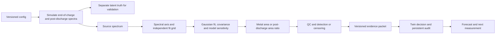

# Standalone demonstrator architecture

The simulator writes the source spectra and isolated known truth. The replay uses the spectrum artifacts through preprocessing, fit, area and QC. It hashes each artifact and links it to its predecessor and the run configuration. The packet retains source and provenance references, uncertainty, acquisition context and the QC decision. The twin retains the packet digest in an atomic snapshot with the observation history and forecasts. [`simulate`](../src/sim.py) · [`run_demo` and `verify_run`](../src/run.py) · [`build_packet` and `verify_provenance`](../src/packet.py) · [`update_twin`](../src/twin.py)

Use the [measurement card](measurement.md) for the observable and fit, the [uncertainty budget](uncertainty.md) for what the packet SD covers, the [QC rationale](qc.md) for evidence classes, and the [update logic](twin.md) for the transition from packet to state. The [scientific limitations](limitations.md) govern interpretation.
