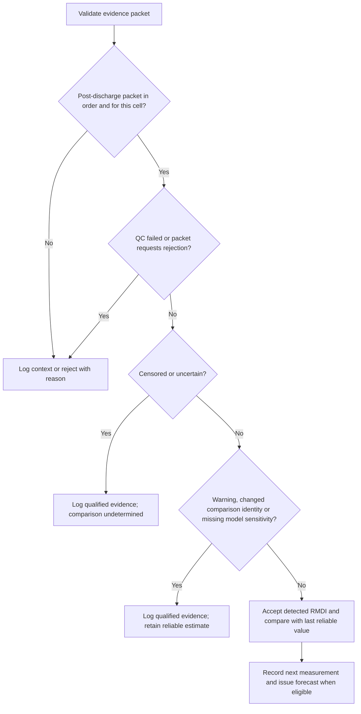

# Twin state and update logic

The state tracks one cell's latest reliable post-discharge RMDI, its SD, evidence IDs, comparison status, and next-cycle forecast. Each packet produces an auditable decision. The locked atomic snapshot stores the history with the state. Replaying the same packet digest is idempotent. A conflict in identity, policy or chronology is logged with a reason. [`TwinState` and `UpdateEvent`](../src/contracts.py) · [`update_twin` and `_apply_packet`](../src/twin.py) · [Atomic JSON write](../src/common.py)

The decision tree follows [`_apply_packet`](../src/twin.py). Qualified and rejected evidence remains inspectable. The reliable numerical estimate changes only on an eligible detected update.

## Change and forecast

For two comparable detected values, subtract the prior reliable reading from the new reading to get the change Δ. Under independent fit errors, combine the two SDs in quadrature to get the change SD. The audit records the ratio of Δ to its SD. An increase is flagged when Δ exceeds 1.96 times that SD plus the two model sensitivities. The positive direction addresses an accumulation question. Under a normal reference, 1.96 corresponds to a one-sided tail of about 2.5%. The resolution margin for `stable` requires that |Δ| plus the same guard fit within 0.05 RMDI. Unresolved cases are `undetermined`. Acceleration uses differences between two consecutive slopes over the last three reliable points with propagated random error and a separate model guard. [`_assess_change` and `_accelerating`](../src/twin.py) · [`twin.increase_z` and `twin.adequate_sensitivity_margin`](../config.yaml)

With at least three reliable points, the twin fits a line over up to four recent observations using inverse-variance weights. The nominal 95% Student-*t* interval uses *n* − 2 degrees of freedom, estimated line uncertainty, and the median measurement variance from the local window as the future measurement variance. Weighted residual variation can inflate the interval, with a floor at the measurement-noise scale. The event that issues the forecast stores it before the target cycle arrives. A later eligible observation at that cycle is compared with the saved forecast. [`_fit_forecast` and `_apply_packet`](../src/twin.py) · [`twin.forecast_*`](../config.yaml)

The next-evidence recommendation follows the event. It can request a matched post-discharge repeat, a check of reference stability and fit residuals, or expert review of an acceleration pattern. [`_next_evidence`](../src/twin.py)
