# 可靠数字孪生的数据科学

[返回中文总入口](index.html) · [英文 PDF](../../MRI_Data_Science_261120_173705.pdf) · [Markdown 源](data-science.md)

原件：`MRI_Data_Science_261120_173705.pdf`，共 16 页。

## 页码索引

[1](#第-1-页) · [2](#第-2-页) · [3](#第-3-页) · [4](#第-4-页) · [5](#第-5-页) · [6](#第-6-页) · [7](#第-7-页) · [8](#第-8-页) · [9](#第-9-页) · [10](#第-10-页)

[11](#第-11-页) · [12](#第-12-页) · [13](#第-13-页) · [14](#第-14-页) · [15](#第-15-页) · [16](#第-16-页)


## 第 1 页

[对照英文原件第 1 页](../../MRI_Data_Science_261120_173705.pdf#page=1)

### 可靠数字孪生的数据科学


Yuliia Prokop 博士，布拉格捷克理工大学。


## 第 2 页

[对照英文原件第 2 页](../../MRI_Data_Science_261120_173705.pdf#page=2)

### 从源文件到经过验证的证据包

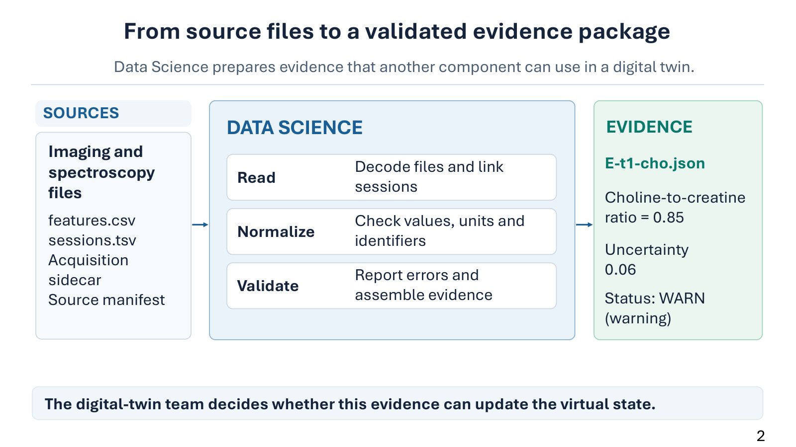

数据科学团队负责准备其他数字孪生组件可以使用的证据。

| 来源 | 数据科学处理 | 输出证据 |
| --- | --- | --- |
| 成像和波谱文件 | 读取。解码文件并关联采集会话。 | `E-t1-cho.json` |
| `features.csv`、`sessions.tsv` | 规范化。检查数值、单位和标识符。 | 胆碱与肌酸的比值为 0.85。 |
| 采集旁车文件、源文件清单 | 验证。报告错误并组装证据。 | 不确定度为 0.06。状态为 `WARN`（警告）。 |

数字孪生团队决定该证据能否更新虚拟状态。


## 第 3 页

[对照英文原件第 3 页](../../MRI_Data_Science_261120_173705.pdf#page=3)

### 目标证据 JSON

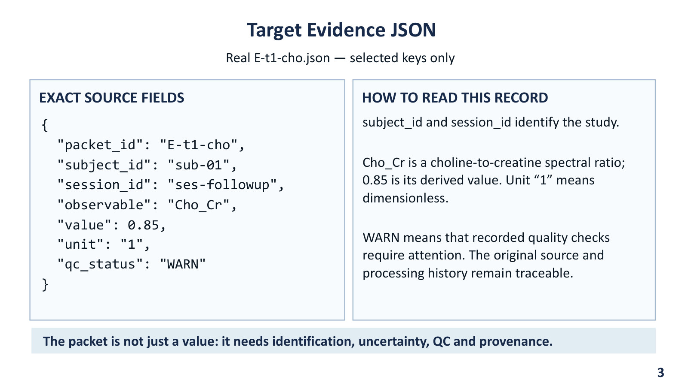

以下是实际的 `E-t1-cho.json`，仅展示部分键。

```json
{
  "packet_id": "E-t1-cho",
  "subject_id": "sub-01",
  "session_id": "ses-followup",
  "observable": "Cho_Cr",
  "value": 0.85,
  "unit": "1",
  "qc_status": "WARN"
}
```

- `subject_id` 和 `session_id` 用于识别该研究记录。
- `Cho_Cr` 表示胆碱与肌酸的波谱比值。0.85 是其派生值。单位 `1` 表示无量纲。
- `WARN` 表示记录中的质量控制结果需要关注。仍可追溯到原始来源和处理历史。

完整证据包应包含标识、不确定度、质控和溯源信息。


## 第 4 页

[对照英文原件第 4 页](../../MRI_Data_Science_261120_173705.pdf#page=4)

### 证据契约：标识、数值与来源

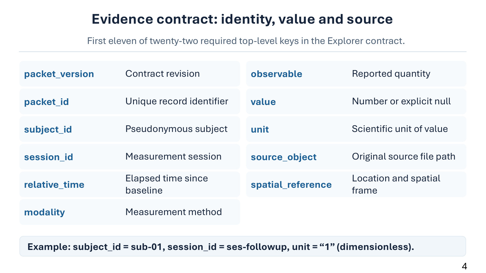

Explorer 的契约要求 22 个顶层键。这里给出前 11 个。

| 字段 | 含义 |
| --- | --- |
| `packet_version` | 契约版本 |
| `packet_id` | 唯一记录标识符 |
| `subject_id` | 受试对象的假名标识符 |
| `session_id` | 测量会话 |
| `relative_time` | 自基线以来的时间 |
| `modality` | 测量方式 |
| `observable` | 报告的可观测量 |
| `value` | 数值或显式 `null` |
| `unit` | 数值的科学单位 |
| `source_object` | 原始源文件路径 |
| `spatial_reference` | 位置及空间坐标系 |

示例：`subject_id = sub-01`、`session_id = ses-followup`、`unit = "1"`（无量纲）。


## 第 5 页

[对照英文原件第 5 页](../../MRI_Data_Science_261120_173705.pdf#page=5)

### 证据契约：质控、上下文和溯源

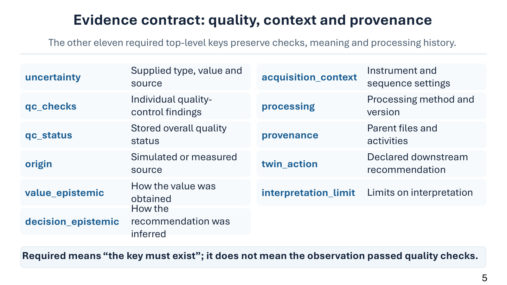

其余 11 个必需顶层键保留检查结果、含义和处理历史。

| 字段 | 含义 |
| --- | --- |
| `uncertainty` | 提供的不确定度类型、数值和来源 |
| `qc_checks` | 各项质量控制结果 |
| `qc_status` | 文件中记录的总体质量状态 |
| `origin` | 来源是模拟数据还是实测数据 |
| `value_epistemic` | 取得该数值的方式 |
| `decision_epistemic` | 推断出建议的方式 |
| `acquisition_context` | 仪器和序列设置 |
| `processing` | 处理方法及版本 |
| `provenance` | 父源文件和处理活动 |
| `twin_action` | 声明的下游操作建议 |
| `interpretation_limit` | 解读限制 |

必需字段必须存在。观察是否通过质控由单独检查决定。


## 第 6 页

[对照英文原件第 6 页](../../MRI_Data_Science_261120_173705.pdf#page=6)

### 证据契约的可选字段

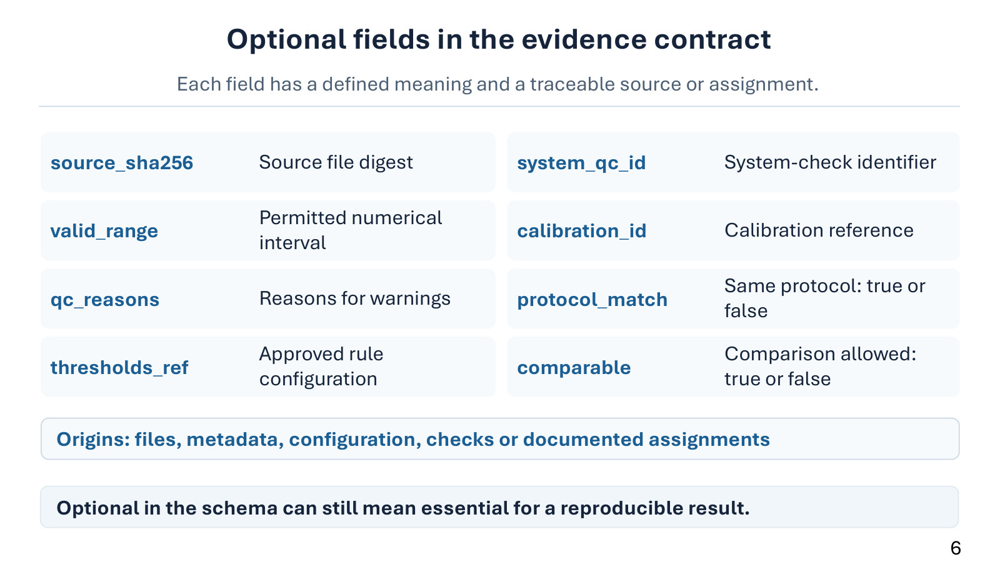

每个字段都有明确含义，能够追溯到来源或有记录的赋值操作。

| 字段 | 含义 |
| --- | --- |
| `source_sha256` | 源文件摘要 |
| `valid_range` | 允许的数值区间 |
| `qc_reasons` | 发出警告的原因 |
| `thresholds_ref` | 经批准的规则配置 |
| `system_qc_id` | 系统检查标识符 |
| `calibration_id` | 校准记录的引用 |
| `protocol_match` | 协议是否相同，`true` 或 `false` |
| `comparable` | 是否允许比较，`true` 或 `false` |

来源包括文件、元数据、配置、检查结果或有记录的赋值操作。部分字段即使在模式中为可选，仍可能是复现结果所必需的。


## 第 7 页

[对照英文原件第 7 页](../../MRI_Data_Science_261120_173705.pdf#page=7)

### 从两张源表映射到证据字段

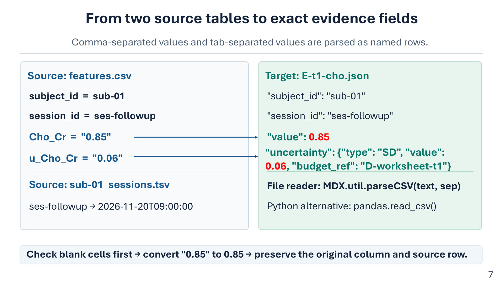

CSV 和 TSV 按列名解析出各行的字段。

| 来源 | 目标 `E-t1-cho.json` |
| --- | --- |
| `features.csv` 的 `subject_id = sub-01` | `"subject_id": "sub-01"` |
| `features.csv` 的 `session_id = ses-followup` | `"session_id": "ses-followup"` |
| `Cho_Cr = "0.85"` | `"value": 0.85` |
| `u_Cho_Cr = "0.06"` | `"uncertainty": {"type": "SD", "value": 0.06, "budget_ref": "D-worksheet-t1"}` |
| `sub-01_sessions.tsv` | `ses-followup` 对应 `2026-11-20T09:00:00` |

文件读取函数为 `MDX.util.parseCSV(text, sep)`。Python 可使用 `pandas.read_csv()`。先检查空单元格，再将文本 `"0.85"` 转为数值 0.85，并保留原始列和源数据行。


## 第 8 页

[对照英文原件第 8 页](../../MRI_Data_Science_261120_173705.pdf#page=8)

### 从采集元数据映射到证据上下文

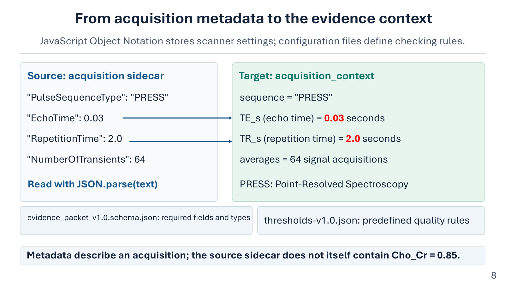

采集设置用 JavaScript 对象表示法（JSON）存储。配置文件定义检查规则。

| 来源：采集旁车文件 | 目标：`acquisition_context` |
| --- | --- |
| `"PulseSequenceType": "PRESS"` | `sequence = "PRESS"` |
| `"EchoTime": 0.03` | `TE_s`（回波时间）= 0.03 s |
| `"RepetitionTime": 2.0` | `TR_s`（重复时间）= 2.0 s |
| `"NumberOfTransients": 64` | `averages` = 64 次信号采集 |

用 `JSON.parse(text)` 读入。PRESS 指点分辨波谱。 `evidence_packet_v1.0.schema.json` 规定必需字段和类型。 `thresholds-v1.0.json` 记录预设质控规则。采集旁车文件描述采集设置。比值 `Cho_Cr = 0.85` 来自特征文件。


## 第 9 页

[对照英文原件第 9 页](../../MRI_Data_Science_261120_173705.pdf#page=9)

### 磁共振二进制文件需使用相应的读取器

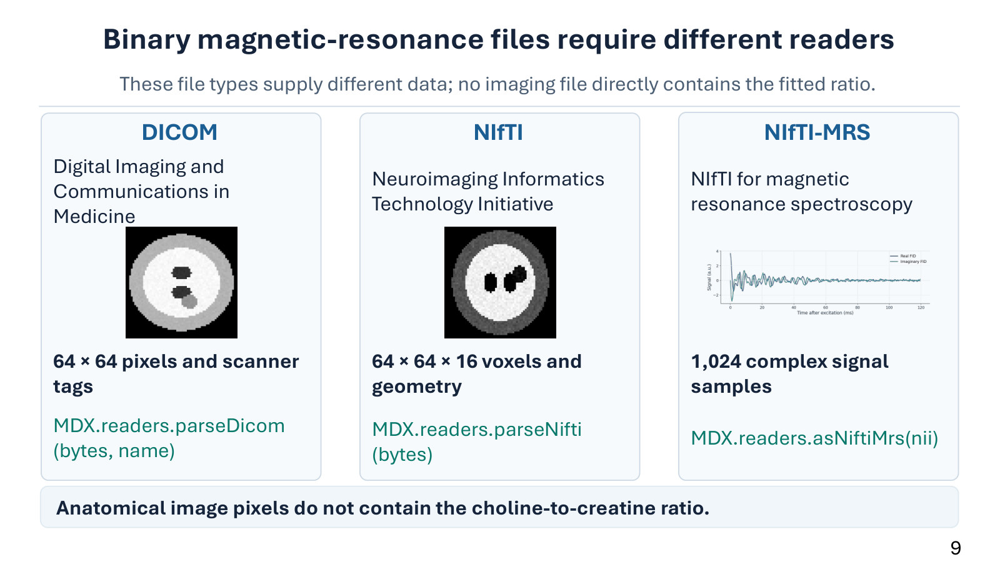

这些格式提供不同类型的数据。胆碱与肌酸的拟合比值无法直接从解剖图像的像素获得。

| 格式 | 本例的数据 | 读取接口 |
| --- | --- | --- |
| DICOM（医学数字成像和通信） | 64 × 64 个像素和扫描仪标签 | `MDX.readers.parseDicom(bytes, name)` |
| NIfTI（神经影像信息技术倡议） | 64 × 64 × 16 个体素及其几何信息 | `MDX.readers.parseNifti(bytes)` |
| NIfTI-MRS（用于磁共振波谱的 NIfTI） | 1,024 个复数信号采样点 | `MDX.readers.asNiftiMrs(nii)` |


## 第 10 页

[对照英文原件第 10 页](../../MRI_Data_Science_261120_173705.pdf#page=10)

### 规范化：类型、单位和标识

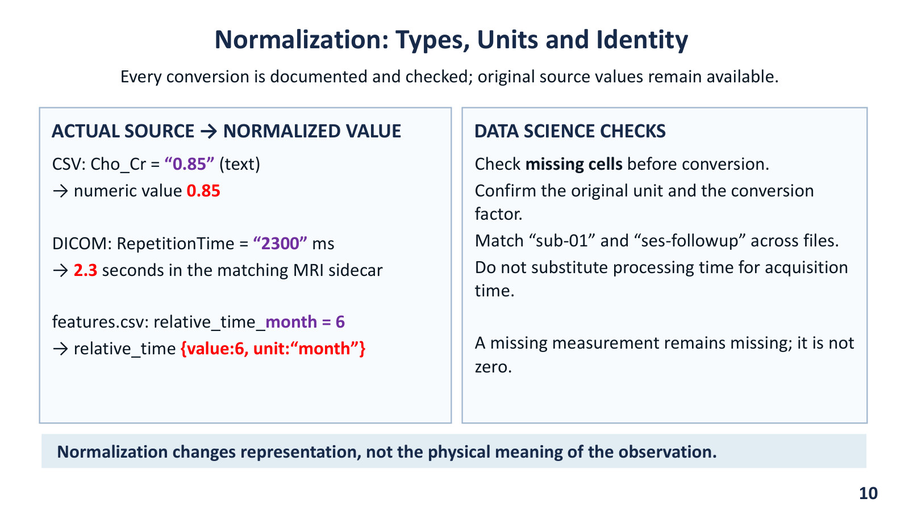

记录并检查每一次转换，保留原始源值。规范化调整表示形式，保持观测量的物理含义。

| 原始数据 → 规范化数据 | 数据科学检查 |
| --- | --- |
| CSV 中的 `Cho_Cr = "0.85"`（文本）→ 数值 0.85 | 转换前检查缺失单元格。 |
| DICOM 中的 `RepetitionTime = "2300"` ms → 相应 MRI 旁车文件中的 2.3 s | 确认原始单位和换算系数。 |
| `features.csv` 中的 `relative_time_month = 6` → `relative_time {value:6, unit:"month"}` | 跨文件匹配 `sub-01` 和 `ses-followup`。 |

采集时间必须取自采集记录。缺失值应保持缺失，不能置为零。


## 第 11 页

[对照英文原件第 11 页](../../MRI_Data_Science_261120_173705.pdf#page=11)

### 检查算法 1：记录的结构能否通过验证？

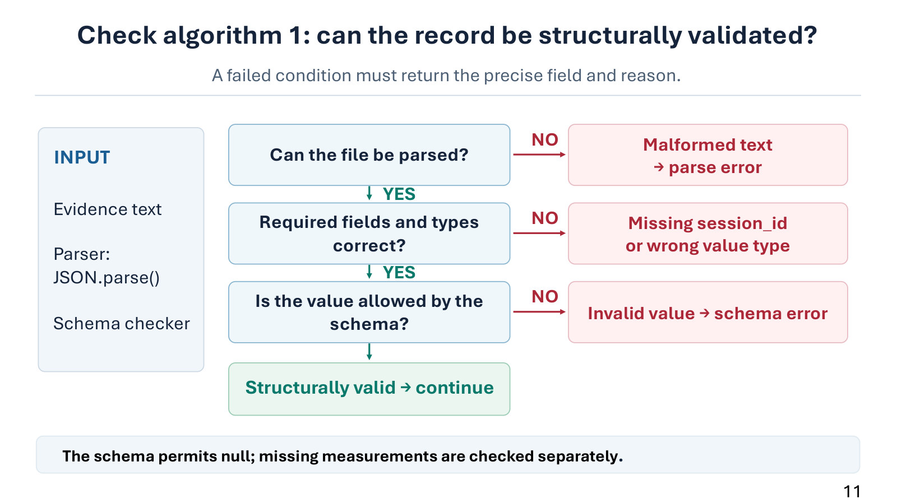

输入为证据文本。解析器为 `JSON.parse()`，随后使用模式验证器。检查失败时，返回具体字段和原因。

| 检查 | 否 |
| --- | --- |
| 能否解析文件？ | 文本格式错误 → 解析错误 |
| 必需字段和类型是否正确？ | 缺少 `session_id` 或值类型错误 |
| 模式是否允许该值？ | 无效值 → 模式错误 |

全部通过时继续处理。模式允许 `null`，缺失测量值另行检查。


## 第 12 页

[对照英文原件第 12 页](../../MRI_Data_Science_261120_173705.pdf#page=12)

### 语义验证：同一字段的三种结果

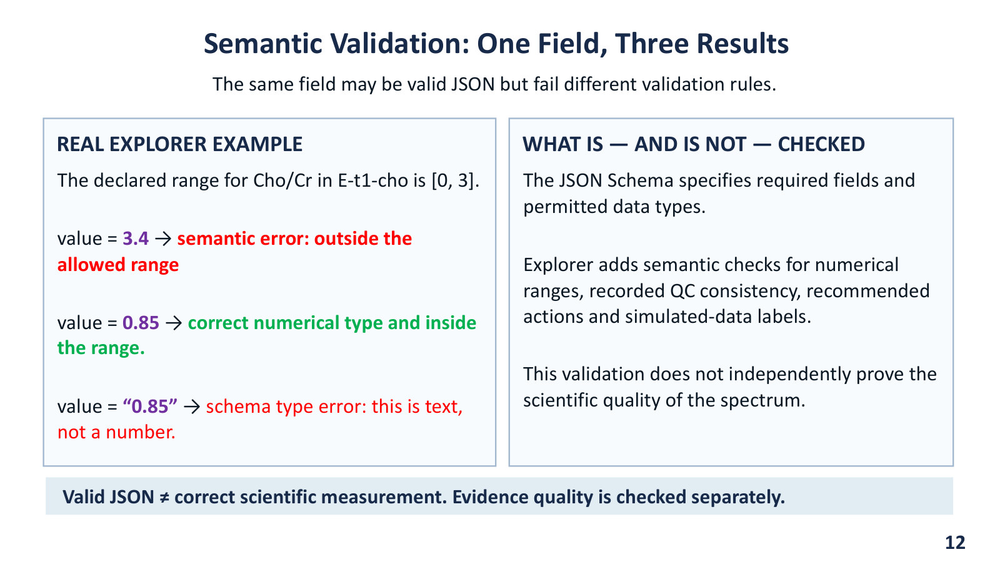

以 Explorer 的实际数据为例，`E-t1-cho` 中 Cho/Cr 的声明范围为 `[0, 3]`。

| 输入 | 结果 |
| --- | --- |
| `value = 3.4` | 语义错误。超出允许范围。 |
| `value = 0.85` | 类型正确，且数值处于范围内。 |
| `value = "0.85"` | 模式类型错误。该值为文本。 |

JSON Schema 规定必需字段及允许的类型。Explorer 进一步检查数值范围、记录的 QC 状态是否一致、建议的操作以及模拟数据标签。波谱的科学质量由独立的证据质控检查判定。


## 第 13 页

[对照英文原件第 13 页](../../MRI_Data_Science_261120_173705.pdf#page=13)

### 检查算法 2：来源是否关联且可追溯？

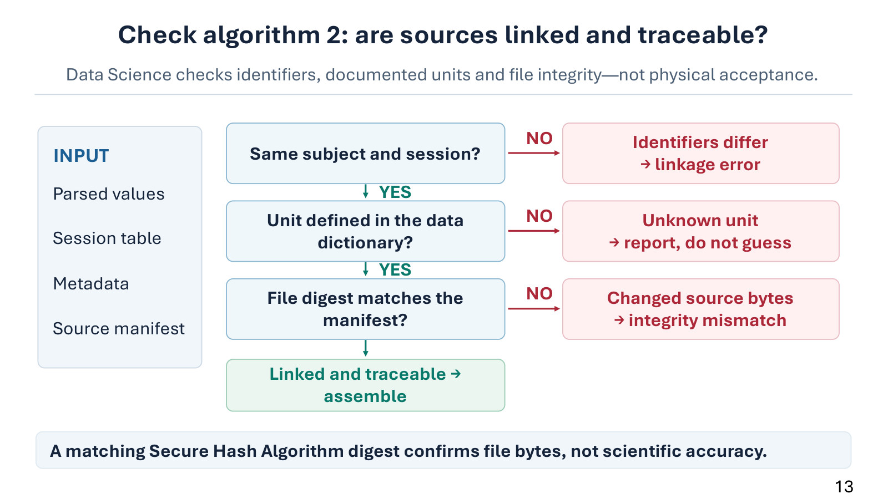

输入为解析出的数值、会话表、元数据和源文件清单。数据科学检查标识符、已记录的单位和文件完整性。测量能否在物理层面被接收，应由相应方向判定。

| 检查 | 否 |
| --- | --- |
| 受试对象和会话是否一致？ | 标识符不同 → 关联错误 |
| 数据字典是否定义了单位？ | 单位未知 → 报告问题，不作推测 |
| 文件摘要是否与清单一致？ | 源文件字节变化 → 完整性不匹配 |

全部通过时，即可组装有关联且可追溯的记录。安全散列算法生成的摘要用于判断文件字节是否一致。测量准确度需单独评估。


## 第 14 页

[对照英文原件第 14 页](../../MRI_Data_Science_261120_173705.pdf#page=14)

### 跨文件检查：BIDS 和数据隐私

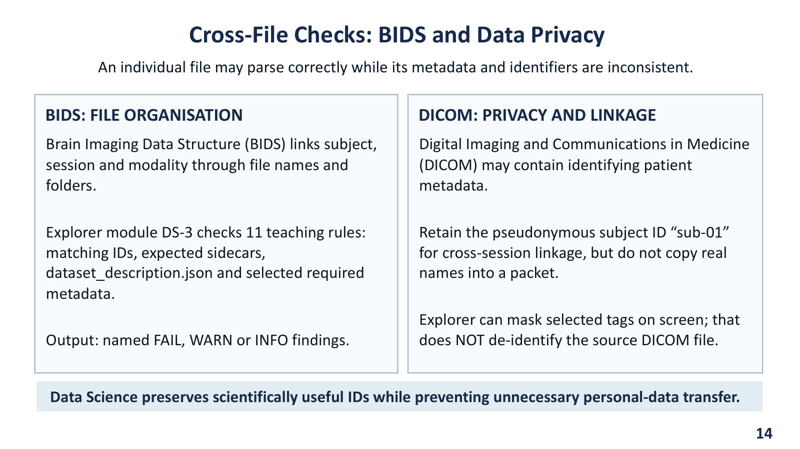

单个文件可能成功解析，但跨文件的元数据或标识符仍可能不一致。

- **BIDS（脑成像数据结构）** 通过文件名和目录关联受试对象、会话及模态。Explorer 的 DS-3 模块检查 11 条教学规则，涉及标识符匹配、预期的旁车文件、`dataset_description.json` 以及部分必需元数据。输出包含名称和 `FAIL`、`WARN` 或 `INFO`。
- **DICOM（医学数字成像和通信）** 可能含有可识别患者身份的元数据。保留假名标识符 `sub-01` 用于跨会话关联。证据包不得含真实姓名。Explorer 可以在屏幕上遮挡部分标签。源 DICOM 文件仍需单独去标识化。

数据科学团队保留科学上有用的标识符，同时防止不必要的个人数据传输。


## 第 15 页

[对照英文原件第 15 页](../../MRI_Data_Science_261120_173705.pdf#page=15)

### 从四类来源到一个经过验证的证据包

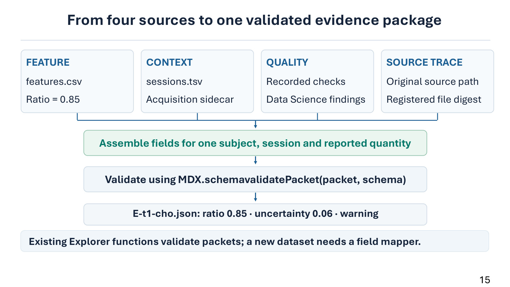

| 特征 | 上下文 | 质控 | 来源追踪 |
| --- | --- | --- | --- |
| `features.csv`，比值 0.85 | `sessions.tsv`、采集旁车文件 | 已记录的检查、数据科学检查结果 | 原始源路径、登记的文件摘要 |

为一个受试对象、一次测量会话和一个报告量组装字段。使用验证函数检查证据包。原图将接口印为 `MDX.schemavalidatePacket(packet, schema)`，Explorer v1.0-rc5 的实际接口是 `MDX.schema.validatePacket(packet, schema)`。

结果为 `E-t1-cho.json`。比值为 0.85，不确定度为 0.06，状态为警告。现有 Explorer 函数可以验证证据包。对于新数据集，需要提供字段映射。


## 第 16 页

[对照英文原件第 16 页](../../MRI_Data_Science_261120_173705.pdf#page=16)

### 溯源：将每个结果追溯到其来源

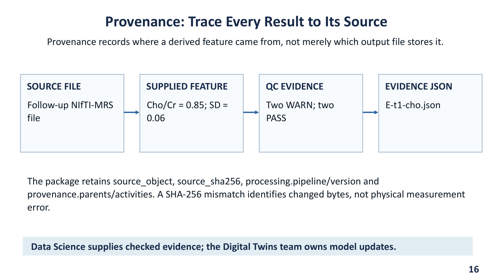

溯源记录派生特征的来源和形成过程。

| 源文件 | 提供的特征 | 质控证据 | 证据 JSON |
| --- | --- | --- | --- |
| 随访 NIfTI-MRS 文件 | Cho/Cr = 0.85，SD = 0.06 | 两项 `WARN`，两项 `PASS` | `E-t1-cho.json` |

资料包保留 `source_object`、`source_sha256`、`processing.pipeline`、`processing.version`、`provenance.parents` 和 `provenance.activities`。SHA-256 不匹配指向文件字节变化。物理测量误差需另行判断。

数据科学团队提供经过检查的证据。数字孪生团队负责模型更新。


[返回中文总入口](index.html)
