# 从自旋到健康数字孪生：人、设备和物体｜挑战手册 v1.6

[返回中文总入口](index.html) · [英文 PDF](../../MRI_Local_Spectroscopy_Health_Digital_Twin_Hackathon_Dossier_v1.6.pdf) · [Markdown 源](dossier-v1.6.md) · [挑战手册 v1.5](dossier-v1.5.html) · [项目方更新压缩包](../../update%20files.zip)

原件：`MRI_Local_Spectroscopy_Health_Digital_Twin_Hackathon_Dossier_v1.6.pdf`，共 60 页。

章节、表格、原图及公式按原件 PDF 页码编排。参考文献保留原始著录。

## 章节目录

- [1. 引言与挑战缘由（第 4 页）](#第-4-页)
- [2. MRI、局部波谱及数字孪生术语（第 9 页）](#第-9-页)
- [3. 实例：两次脑扫描（第 13 页）](#第-13-页)
- [4. 量子工程（第 17 页）](#第-17-页)
- [5. 精密机械、计量和不确定度（第 22 页）](#第-22-页)
- [6. 数据科学（第 27 页）](#第-27-页)
- [7. 数字孪生（第 32 页）](#第-32-页)
- [8. 跨团队集成与证据包（第 37 页）](#第-37-页)
- [9. 赛程、交付物与评估（第 40 页）](#第-40-页)
- [10. MRI 数据浏览器（第 44 页）](#第-44-页)
- [11. 结论和开发路线（第 46 页）](#第-46-页)
- [A. 术语表（第 50 页）](#第-50-页)
- [B. 最低数据包和数据字典（第 51 页）](#第-51-页)
- [C. 合成案例（第 52 页）](#第-52-页)
- [D. 不确定度工作表（第 53 页）](#第-53-页)
- [E. 孪生状态与证据模式（第 54 页）](#第-54-页)
- [F. 交接卡（第 56 页）](#第-56-页)
- [G. 评分标准（第 57 页）](#第-57-页)
- [H. 推荐阅读路线（第 58 页）](#第-58-页)
- [I. 伦理与隐私（第 59 页）](#第-59-页)
- [J. 科研扩展（第 60 页）](#第-60-页)
- [参考文献（第 48 页）](#第-48-页)

## 第 1 页

[对照英文原件第 1 页](../../MRI_Local_Spectroscopy_Health_Digital_Twin_Hackathon_Dossier_v1.6.pdf#page=1)

INNOVATEU 教学挑战 · Raiker Witter、Yuliia Prokop、Maja Rücker、Ion Barosan。《从自旋到健康数字孪生》

### 面向人、设备和物体

以磁共振为通用测量手段，以两次脑扫描为完整示例。量子工程、精密机械、数据科学和数字孪生方向的黑客松挑战手册。

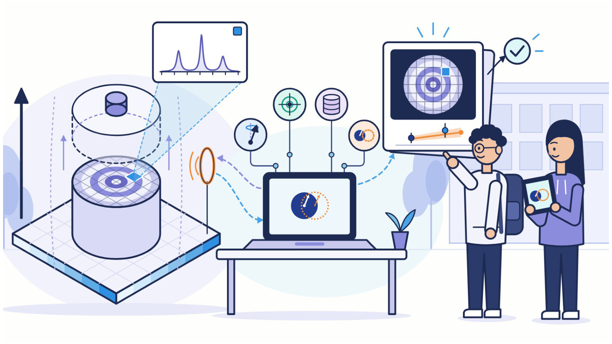

<!-- compact-table -->
| 项目 | 说明 |
| --- | --- |
| 课程背景 | NMR 量子工程 (PHYS5347, 乌尔姆大学) · QDTS 实验室 — 从量子工程到跨尺度数字孪生 |
| 活动 | 赛前讲座（乌尔姆大学、布拉格捷克理工大学、埃因霍温理工大学），含 U06「MRI 与空间分辨波谱」，2026 年 11 月 20 日（周五）10:00–13:00，KICU Ulm。随后为 InnovateU 黑客松，2026 年 11 月 20 日（周五）16:00 至 11 月 21 日（周六）17:00，地点同上。 |
| 目标受众 | 高级理学士/理学硕士学生，涉及量子工程与物理学、精密工程与计量学、数据科学、数字孪生与系统工程；欢迎以下领域的学生：生物医学工程、人工智能、可视化技术。 |

挑战赛的核心问题

从磁共振测量获得的哪些证据足以更新人、设备或物体的健康数字孪生？哪些方面仍不确定？

这里所说的“健康”

健康是指一个系统在其生命周期中的状态，这一判断是基于它之前的状况：一个人的组织、电池单元的健康状态、聚合物密封件的老化、仪器的校准。这份挑战手册中提到的脑部扫描只是一个例子，而不是主题：证据的逻辑并不依赖于具体对象（§11.3，附录 J.6）。

硬性规则

任何团队都不得声称某个人员、设备或物品发生了变更，除非它能够提供支持该变更的测量证据、校准背景、不确定性、溯源信息以及对比基线。


## 第 2 页

[对照英文原件第 2 页](../../MRI_Local_Spectroscopy_Health_Digital_Twin_Hackathon_Dossier_v1.6.pdf#page=2)

### 摘要

磁共振提供了一种从量子尺度相互作用到系统级模型之间的异常直接的桥梁。传统的 MRI 提供空间结构和对比度信息；定量 MRI 提供参数图信息；局部化的质子磁共振波谱（¹H MRS）和波谱成像（MRSI）增加了化学选择性信息；超极化¹³C 方法可以在特定的研究环境中提供时间分辨的代谢信息。然而，一系列图像或光谱并不能构成数字孪生体。一个可信的孪生体通过明确的元数据、不确定性、溯源、模型假设和更新逻辑将测量结果与虚拟表示联系起来。

这份挑战手册将这一机会转化为一个跨学科的黑客松挑战。学生们构建了一个透明的原型，该原型是一个纵向的、基于测量的系统健康数字孪生体。以一个例子为例，他们构建了一个被扫描了两次的合成大脑。这个原型不得用于诊断疾病、认证设备或模拟临床或安全决策。它必须展示如何验证来自一个或多个 MRI/MRS 会话的证据，将其与之前的观察结果进行比较，并用于更新虚拟状态，同时保留不确定性和其他可能的解释。教育上的问题不是能否构建出一个能够识别模式的 AI，而是我们能否解释孪生体为什么会发生变化，变化的程度以及变化的置信度是多少？

这个挑战赛分为四个领域。量子工程负责测量模型和可观测量的物理含义。精密机械/计量学负责校准、定位、重复性和不确定性问题。数据科学负责数据结构、元数据、质量控制和溯源问题。数字孪生体负责状态表示、同化、预测和透明的决策支持。只有当这些部分形成一个完整的系统时，黑客松才能取得成功。最小的原型能够在从基线到随访的环节中执行一次可追踪的更新，并显示出哪些观测因素驱动了更新过程，哪些不确定性限制了更新，哪些竞争性的解释仍然存在，以及下一步最需要哪种测量。更深层次的教训是：数字孪生体并不是数据的可视化，而是物理对应物、测量、模型、不确定性和决策之间一种有纪律的关系——这种关系可以应用于电池、精密机械和其他复杂系统。这也是挑战赛所激励的更大理念的一部分：一个用于整体福祉的联合数字孪生架构，只有当每个在孪生体之间交换的数字都得到定义、保持其精确性，并在数据契约下运行时，这个架构才能发挥作用（§1.4）。

关键词：磁共振成像；磁共振波谱成像（MRSI）；超极化¹³C；数字孪生；纵向成像；定量磁共振成像；计量学；不确定性；溯源；健康状况；无损检测；BIDS；MRS-BIDS；NIfTI-MRS；DICOM 格式；卡尔曼滤波器；基于挑战赛的学习。


## 第 3 页

[对照英文原件第 3 页](../../MRI_Local_Spectroscopy_Health_Digital_Twin_Hackathon_Dossier_v1.6.pdf#page=3)

### 挑战赛概览

<!-- compact-table -->
| 项目 | 挑战赛定义 |
| --- | --- |
| 项目标题 | 从模拟到健康数字孪生——为了人类、设备和物体 |
| 核心问题 | 有哪些证据足以更新孪生体信息？还有哪些内容仍然不确定？ |
| 系统 | 任何在其使用寿命期间状态都会发生变化的系统，磁共振技术都可以对其进行测量：包括人、电池单元、聚合物密封件，以及磁共振扫描仪本身（参见第 11.3 节，附录 J.6）。 |
| 示例（包含数据） | 两次扫描的合成大脑：纵向 MRI 结合局部¹H 光谱分析（基线 t0，随访 t1）；可选的低场随访和超极化¹³C 通道。团队可以基于此进行进一步研究，或选择其他系统。 |
| 最小原型 | 一次从基线到随访的更新，包含证据、质量控制、不确定性、溯源信息、可见的状态变化以及下一次测量的建议（成熟度等级 3） |
| 轨道 | 量子工程 · 精密机械/计量学 · 数据科学 · 数字孪生 |
| 起始材料 | StarterPack v0.3（DICOM、NIfTI、BIDS、MRS-BIDS、JSON/CSV 格式），MRI Data Explorer v1.0-rc5，包含 9 个步骤的引导式浏览功能，此挑战手册中的内容可编辑图表 |
| 允许使用的数据 | 仅包含合成数据、公开数据、去标识化数据或由讲师准备的数据；不用于临床实践。 |
| 预期输出结果 | 原型 + 架构 + 数据字典 + 测量与不确定性卡片 + 证据链 + 5 分钟的演示 |
| 成功标准 | 团队可以解释孪生体发生了哪些变化，哪些没有变化，以及接下来应该测量什么。 |
| 日期与地点 | 预赛讲座环节 11 月 20 日周五，时间：10:00–13:00，地点：KICU 乌尔姆 10:00 介绍（乌尔姆）· 10:30 数据科学（布拉格科技大学）· 11:30 数字孪生（埃因霍温大学）· 12:15 使用 U06 MRI/MRS 进行量子工程讲解及挑战赛简介（乌尔姆）· 12:45 问答环节· 配准和正式报名 15:00–16:00 · 团队组建仪式 周五 16:00 · 最终演讲 周六 21 日 11 月 15:00 · KICU 乌尔姆，Lise-Meitner-Straße 10/1 |

### 目录

<!-- compact-table -->
| 章节 | 附录 |
| --- | --- |
| 1. 介绍与挑战赛的合理性 | A. 术语表与符号说明 |
| 2. 最低要求语言：MRI、局部波谱以及数字孪生 | B. 最小数据包与数据字典 |
| 3. 实际案例：两次脑部扫描的结果 | C. 合成挑战案例 |
| 4. 量子工程：可观测量模型与设计 | D. 精确度和不确定性工作表 |
| 5. 精密机械、计量学与不确定性 | E. 数字孪生状态与证据模式 |
| 6. 数据科学：元数据、质量与溯源 | F. 团队交接卡片 |
| 7. 数字孪生：状态、更新逻辑与预测 | G. 评估标准 |
| 8. 跨团队整合与证据包 | H. 推荐阅读路径 |
| 9. 马拉松式开发活动的实施、交付成果以及评估方式 | I. 伦理、隐私与临床非等效性 |
| 10. MRI 数据浏览器及其扩展程序 | J. 未来的科学扩展 |
| 11. 结论与发展路线图 · 参考文献 |  |


## 第 4 页

[对照英文原件第 4 页](../../MRI_Local_Spectroscopy_Health_Digital_Twin_Hackathon_Dossier_v1.6.pdf#page=4)

### 1. 介绍与挑战赛的合理性

### 1.1 从图像到纵向证据模型

MRI 通常被视为一种生成图像的技术。对于这种挑战赛来说，这种描述过于狭隘了。MR 图像是链条的末端，该链条始于核自旋物理学，经过磁场、射频激励、梯度处理、信号接收和重建等环节，最终以空间表示形式呈现，其解释取决于对比度、序列参数、校准和处理方式。局部波谱技术又增加了第二个环节：体素或波谱成像网格被激发，时域信号被获取、校正并傅里叶变换，然后将光谱特征归因于化学环境或代谢物。纵向研究则增加了第三个层次：必须比较不同时间、扫描条件、协议、定位以及生物学背景下的重复测量数据。

数字孪生挑战赛从普通的数据可视化开始。孪生体维持一个虚拟表示，该表示通过与其物理对应物的观测数据进行更新，并用于预测或决策支持。美国国家科学院的定义强调动态更新、预测性能力和以价值为导向的决策[1]。在医疗保健领域，2025 年的一项范围审查发现，只有少数已发表的人类数字孪生研究符合个性化、动态更新和预测性决策支持的严格标准[2]；参见[36, 37]。这是一个重要的警示：仪表板、患者记录、3D 模型或 AI 分类器并不自动就构成了一个数字孪生体。

### 1.2 为什么 MRI 和局部波谱是互补的

MRI 通过询问信号起源以及组织或材料的性质如何塑造空间对比度来研究现象。MRS 则通过询问局部区域内存在的共振频率及其强度、频率或线型的变化来进行分析。定量 MRI 则增加了诸如松弛度或扩散度量等参数估计。超极化¹³C 则提供了一个前沿示例：它能够在短时间内追踪标记的底物到产物的转化过程，将代谢过程转化为动态轨迹，而非静态的浓度分布图[7–9, 35]。

教育价值远远超出了任何单一的生物医学应用案例。更多的数据并不能消除歧义。体素放置、B₀不均匀性、序列设置、拟合质量或信噪比等因素都可能导致光谱变化。图像的变化则可能由运动、几何失真、配准、对比度差异、重建或真正的结构变化引起。因此，一个有用的孪生体必须同时反映测量值以及该值应该被信任或不被信任的原因。

### 1.3 为什么这是一个量子工程与系统工程的问题

该课程从自旋和哈密顿量开始，而挑战赛则着眼于系统整合。这是有意为之。量子尺度的相互作用决定了共振和信号的形成：塞曼哈密顿量决定了拉莫尔频率，化学位移分隔了代谢物，而热极化——在 3 特斯拉的磁场和体温条件下，对质子的影响仅为约 10 ppm——限制了灵敏度。超极化是一种自旋态工程，它可以将这种极化强度提高四到五个数量级，持续时间为一到两分钟（¹³C T₁大约为 20-60 秒）。梯度场和射频硬件在空间上编码信号；机械和电磁方面的容差决定了可重复性；数据结构决定了测量数据在离开扫描仪后是否仍然具有可解释性；孪生体模型决定了证据如何随时间被整合。这一挑战将物理、测量、数据和模型层面联系起来，而不会试图用某一学科来替代其他学科（详见第 2 章中的测量链）。

### 1.4 四条线索及其相关证据问题

<!-- compact-table -->
| 方向 | 核心问题 | 挑战赛中的主要责任 |
| --- | --- | --- |
| 量子工程（核磁共振/磁共振物理） | 从物理角度观察到了什么？ | 可观测量、测量与观测模型、预期信号行为、基于已知真值的仿真。 |


## 第 5 页

[对照英文原件第 5 页](../../MRI_Local_Spectroscopy_Health_Digital_Twin_Hackathon_Dossier_v1.6.pdf#page=5)

<!-- compact-table -->
| 方向 | 核心问题 | 挑战赛中的主要责任 |
| --- | --- | --- |
|  |  | 具有物理意义的导出量，物理层面的质量控制 |
| 精密机械／计量学 | 我们能否信任并复制这些测量结果？ | 校准、几何学、定位、场和频率的可追溯性、重复性、不确定度预算、参考对象、接受阈值 |
| 数据科学 | 这些证据是如何被整理、检查和查询的？ | 数据模型、元数据、质量控制标志、溯源、协调化、特征提取、机器可读接口 |
| 数字孪生 | 证据是如何更新虚拟状态的？ | 状态变量、观测模型、同化以及质量门控、预测和情景设置、下一次测量推理、面向用户的解释 |

这些职责与 EuroTeQ 课程架构相呼应——测量、验证、代表、整合[40]。这个黑客松项目不应产生四个孤立的小项目；它只生成一个原型，所有更新都可以追溯到这四个职责中的每一个（图 1）。

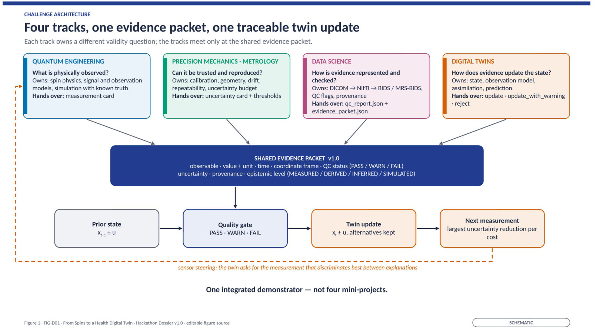

**图释**。四个方向分别回答四个有效性问题。量子工程定义可观测量，精密机械／计量学说明测量精度，数据科学组织并检查证据，数字孪生决定证据可更新哪些状态。证据包连接四个方向，经过门控进入更新，并据此提出下一次测量。

<!-- caption -->
图 1. 挑战赛架构。每个方向拥有不同的有效性问题；这些方向在共享的证据包处相遇，该证据包会触发一个门控的孪生体更新以及一个下一次测量提案，从而完成闭环。[图-D01]

为什么选择这个挑战赛作为测试案例。其长期目标是构建一个用于提升福祉的数字化孪生体架构：涉及人、设备、物体和公共服务的孪生体——甚至包括电子状态或电子民主——这些孪生体应对其自身数据具有权威性，并且只交换证据。这样的联邦架构只有在每个从一个孪生体传递到另一个孪生体的数值都得到明确定义（测量内容、单位、来源），具备精确性（不确定性、可重复性、质量标志），并遵循数据契约（模式、溯源、所有权）的情况下才能发挥作用。这个挑战赛正是针对这三个条件进行的测试：量子工程定义了可观测量（测量卡片），精密机械/计量学确定了其精确性（不确定性卡片），数据科学则将其纳入数据契约（证据包）中，而数字化孪生体则决定了可以对其进行哪些修改（孪生体更新）。能够为一个数值构建出完整架构的团队，已经为这一架构的构建做出了贡献。


## 第 6 页

[对照英文原件第 6 页](../../MRI_Local_Spectroscopy_Health_Digital_Twin_Hackathon_Dossier_v1.6.pdf#page=6)

### 1.5 挑战声明

挑战声明

构建一个透明的原型，将纵向 MRI 和局部波谱集成到数字孪生状态中。展示从基线到随访的一次更新过程。说明所测量的内容、校准和质量控制方法、数据的表示方式、数字孪生的变化、不确定性的传播方式、仍然存在的替代解释，以及哪些额外的测量能够最有效地降低不确定性。

### 1.6 本挑战手册的内容与不包括的内容

这份挑战手册既是一本科学入门指南，也是一份系统设计文档，同时还具有马拉松式开发活动的规范。来自四个领域的学生可以在不同的层次参与进来，但他们仍然可以通过一组共享的对象进行沟通：测量卡片、不确定性卡片、证据包、状态变量以及更新事件。

这不是一个临床方案、医疗设备规格、诊断系统或推荐引擎。健康指的是一个系统在其整个生命周期中的状态——无论是人、设备还是物体。这个医学案例只是一个实际工作的例子，而“患者”一词仅用于指代该案例。所有原型程序都使用合成数据、公开数据、去标识化数据或教师准备的数据，并且明确声明它们的输出只是教育性的演示，而非临床结论（附录一）。

### 1.7 阅读路径

<!-- compact-table -->
| 读取器 | 从这里开始 | 然后专注于 |
| --- | --- | --- |
| 量子工程专业学生 | 第 2 章至第 4 章 | 附录 A–C；附录 F 中的测量任务 |
| 精密机械/计量学专业学生 | 第 3 章和第 5 章 | 附录 D；接受阈值（§5.8） |
| 数据科学专业学生 | 第 2 章、第 6 章和第 8 章 | 附录 B 和 E；StarterPack v0.3 |
| 数字孪生学生 | 第 2 章、第 7 章和第 8 章 | 附录 E；已完成更新事件（§3.10，§7.5） |
| 黑客松导师 | 挑战赛概览；第 8-9 章 | 附录 F–G |
| 团队负责人/集成人员 | 第 3 章、第 8 章、第 9 章和第 10 章 | 所有交接卡片（附录 F） |

### 1.8 合作伙伴教学合同：每场讲座的准备工作

讲师们不必猜测自己教授的是学科概览、软件教程还是数据库课程。每个合作讲师都会准备一个集成演示器所需的接口工件。因此，讲座从交接开始：下一层需要接收什么内容，以何种形式呈现，以及需要哪些质量信息？（图 2）。在 2026 年的乌尔姆试点项目中，乌尔姆教授量子工程，布拉格科技大学的データ科学以及埃因霍亨科技大学的数字孪生技术；精密机械/计量学没有自己的讲座，而是依赖于第 5 章（§9.1）。

<!-- compact-table -->
| 方向 | 讲座重点（约 60-75 分钟） | 需要交接的事项 | 不需要 |
| --- | --- | --- | --- |
| 量子工程 | MRI/MRS 测量语义；空间与频谱定位；对比度与定量观测值；单一观测方程；物理质量控制 | 测量卡 + 可解释的可观测量 + 物理质量控制字段 | 完整的 MRI 或光谱学专业课程 |
| 精密机械／计量学 | 几何学与共配准；B0/B1/梯度效应；定位；校准；漂移；重复性；可追溯性；不确定性；阈值 | 不确定度卡 + 下游层可以测试的阈值 | 一门独立于测量体系的机械设计课程 |
| 数据科学 | DICOM → NIfTI → BIDS/MRS-BIDS；JSON/CSV 接口；类型、缺失值、单位、标识符、去标识化处理 | 已验证的证据文件：`evidence_packet.json` + `qc_report.json` + 数据文件 | 数据库理论或晦涩难懂的机器学习流程 |


## 第 7 页

[对照英文原件第 7 页](../../MRI_Local_Spectroscopy_Health_Digital_Twin_Hackathon_Dossier_v1.6.pdf#page=7)

<!-- compact-table -->
| 方向 | 讲座重点（约 60-75 分钟） | 需要交接的事项 | 不需要 |
| --- | --- | --- | --- |
|  | 溯源; 明确的质量控制声明 | 词典 |  |
| 数字孪生 | 状态与观测；输入契约；时间与框架的一致性；更新/带警告的更新/拒绝；具有不确定性意识的更新；情景分析；下一次测量 | 状态/更新合同 + 一个先前的事件 → 证据 → 更新/拒绝事件 | 一个仅展示历史数据的仪表盘 |

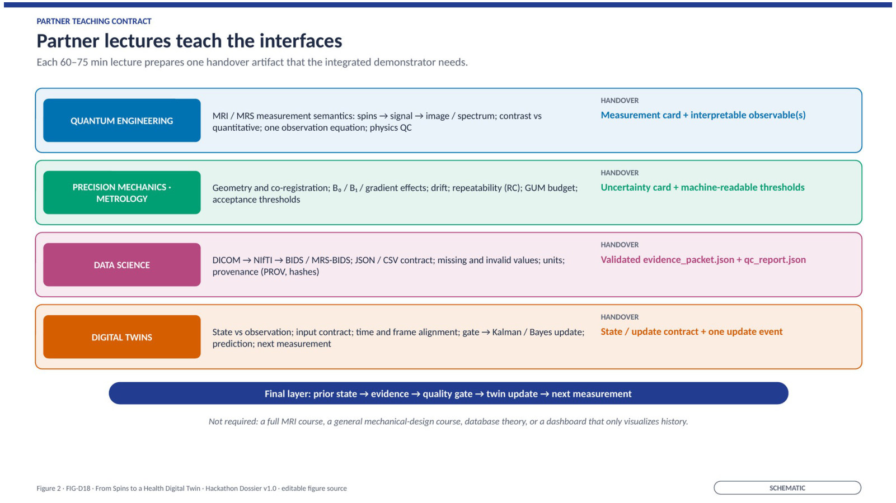

**图释**。课程聚焦接口交接。量子工程交付测量卡、可解释的观测量和物理质控。精密机械／计量学交付不确定度卡和阈值。数据科学交付验证过的证据包、质控报告和数据字典。数字孪生交付状态与更新契约及一次可审计的更新或拒绝。

<!-- caption -->
图 2. 合作伙伴负责教授相关接口；每个合作伙伴为集成演示器准备一份交接文档。[图 D18]

### 1.9 数据质量归属：共享质量门控，明确责任

缺失或无效的值不会被分配给某个模糊的质量层。能够解释故障的层拥有科学决策权；数据科学负责技术检测以及标志的保存。缺失的必需 JSON 字段是一个数据有效性问题。物理上不可能的采集组合是量子工程问题。几何校准失败是计量学问题。WARN 观测是否仍可以更新孪生体，这是数字孪生接受政策决策的问题。没有任何层会默默地修复科学证据以使其通过。

<!-- compact-table -->
| 故障或检查失败 | 主要所有者 | 数据科学行动 | 数字孪生效应 |
| --- | --- | --- | --- |
| 物理意义，采集合理性 | 量子工程 | 保留域名质量控制代码及其原因 | 仅在符合域名规则的情况下使用 |
| 校准、定位、漂移、重复性、不确定性 | 精密机械／计量学 | 存储校准参考值、单位以及不确定性信息 | 通过阈值进行加权处理、发出警告或拒绝 |
| 模式、类型、必填字段、标识符、单位、缺失值 | 数据科学 | 检测、验证、标记；保留明确的空值及原因说明 | 必需的失败情况 → 拒绝；可选的错误信息仍然可见 |
| 状态/输入兼容性，时间与帧数对齐 | 数字孪生 | 揭露合同违规行为及来源链接 | 更新 / 带警告的更新 / 拒绝 |
| 模糊的跨层问题 | 共享导师质量门控 | 保留原始证据 + 所有标志；需要升级处理 | 索赔不会自动得到加强 |


## 第 8 页

[对照英文原件第 8 页](../../MRI_Local_Spectroscopy_Health_Digital_Twin_Hackathon_Dossier_v1.6.pdf#page=8)

### 1.10 共享的学生作业和集成层

在任何一个合作伙伴发布特定方向的任务之前，共同确定分配任务。最低的共同分配要求是一次从基线到随访的纵向更新。整合层并非第五个项目；它是使所有四个贡献都变得必要的测试。

<!-- compact-table -->
| 舞台 | 学生任务 | 最小人工制品 |
| --- | --- | --- |
| 1. 测量和解释 | 选择一种 MRI/MRS 可观测量；说明其含义及其非含义 | 测量卡 |
| 2 · 验证 | 确定主导的校准、重复性还是不确定性问题 | 不确定度卡 + 阈值 |
| 3 · 表示 | 创建数据字典、质量控制报告和带有溯源信息的证据包 | 交接文件 |
| 4 · 更新 | 应用输入协议：更新 / 带警告的更新 / 拒绝 | 状态转换 + 不确定性 |
| 5 · 防御 | 追踪一个孪生体变量到其源头，并为下一个测量值命名 | 5 分钟介绍 + 溯源 |

### 1.11 导师学分认可以及合作伙伴讲师可以做的事情

在 2026 年的试点项目中，1 ECTS 路线是一条紧凑的挑战路径。在塔林理工大学，应用物理课程在 2026 年 9 月同意将其认定为 1 ECTS 学分，不过这一认定是否适用于 2026 年的试点项目尚不确定。其他合作伙伴的认可情况则取决于当地的规则以及正式的安排。主办机构在学习成果、评估、监督和文件记录方面保持一致，并共同负责学分或相应的认可工作。然而，仅仅参与并不自动意味着在所有地方都能获得学分。

试点项目的运作规则如下：合作讲师需完成约定的教学任务、指导工作，并提供评估所需的证据；除非其所在机构承担了这一职责，否则他们不得为其他大学授予学分。在招聘截止前，每位当地协调员需确认认可流程以及所有必要的签名、出席确认、评分输入或文件资料。


## 第 9 页

[对照英文原件第 9 页](../../MRI_Local_Spectroscopy_Health_Digital_Twin_Hackathon_Dossier_v1.6.pdf#page=9)

### 2. 最低要求语言：MRI、局部波谱以及数字孪生

### 2.1 可观测量、特征和状态并非同一概念

跨学科项目通常会在文字数据中融合多个层面。这份挑战手册区分了四个层面，它们之间的关联必须明确界定。

<!-- compact-table -->
| 层 | 示例 | 问题 |
| --- | --- | --- |
| 测量 | 复杂 MR 信号（FID，k 空间），图像体积，频谱 | 究竟获得了什么？ |
| 可观测量 | T1 地图，ADC，拟合峰面积，线宽 | 采集支持哪种物理量？ |
| 特征 | 区域体积、代谢物比例、潜像嵌入 | 用于分析的表示方式是什么？ |
| 孪生体状态 | 几何估计，带有不确定性的代谢状态变量 | 哪个持久虚拟量会随时间进行更新？ |

每个证据包都包含一个证据性质标签（根据课程的惯例规范 C-023），以及其数据的来源（测量或模拟）。因此，从合成谱中得出的数值属于模拟所得，而非测量所得。显示数据的图表带有“模拟”标记；而没有数据的图表则带有“非数据”标记。

<!-- compact-table -->
| 标签 | 含义 | 示例（来自真实研究；StarterPack 中的数值均为模拟得出的结果） |
| --- | --- | --- |
| MEASURED | 由仪器记录 | DICOM 序列，NIfTI-MRS FID |
| 来源于测量数据 | 通过已声明且可重复的方法，根据实测数据进行计算得出 | 重建图像，拟合后的 Cho/Cr 比例，T1 图谱 |
| INFERRED | 关于未观测量的基于模型的陈述 | 证据包决策，孪生体状态 xt，后验区间 |
| SIMULATED | 由一个已知输入的前向模型生成 | 合成光谱、体模图像、HP¹³C 曲线、预测范围 |

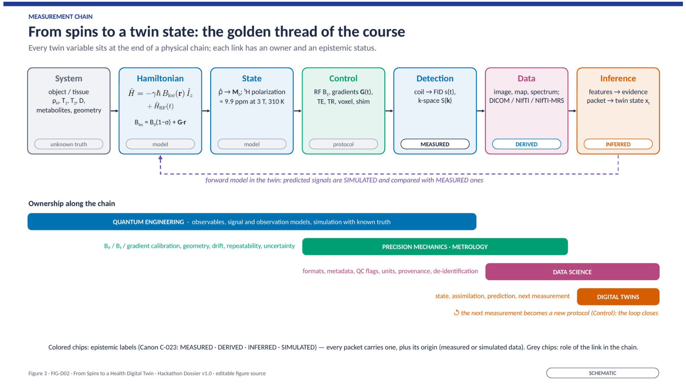

**图释**。课程测量链：系统 → 哈密顿量 → 状态 → 控制 → 检测 → 数据 → 推断。按责任方向及证据性质标记各环节。正向模型产生模拟信号，与实测信号作比较。

<!-- caption -->
图 3. 该过程的测量链（系统→哈密顿量→状态→控制→检测→数据→推理），其各个环节的所有者以及每个环节的认识状态。孪生体的前向模型会产生模拟信号，这些信号会与实际测量的信号进行比较。[图-D02]

图 3 将这些标签标注在方向的测量链上，并显示了每个环节所属于的方向。


## 第 10 页

[对照英文原件第 10 页](../../MRI_Local_Spectroscopy_Health_Digital_Twin_Hackathon_Dossier_v1.6.pdf#page=10)

### 2.2 磁共振成像作为一种空间编码的磁共振技术

磁共振成像通过刻意施加的梯度 G 来使相位和频率依赖于位置。在常规做法中（k 以每米周期数表示，γ以弧度每秒和特斯拉^-1 表示；遵循标准规范 C-017/C-019），k 空间轨迹就是如此。

#### 公式 (2.1)

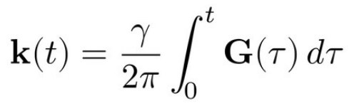{width=55%}

经过解调后的信号，实际上是对由接收灵敏度 c(r)加权的横向磁化强度进行空间傅里叶变换的结果：

#### 公式 (2.2)

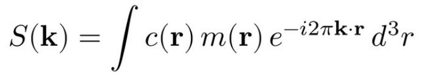{width=55%}

视野由采样间隔决定，FOV = 1/Δk；像素大小则由范围决定，Δx = 1/(2kmax)。这次黑客松的关键不是推导出每一个序列，而是认识到图像几何形状和对比度取决于一个可控的测量链。孪生体必须存储足够的序列、视野和校准元数据，以便之后能够解释得到的图像或地图。

### 2.3 图像对比度与定量 MRI

MR 图像强度并非恒定不变。它取决于质子密度、弛豫时间、序列时序、翻转角、线圈灵敏度以及重建技术等因素。例如，在 TR 远大于 TE 的自旋回波成像中，情况就有所不同。

#### 公式 (2.3)

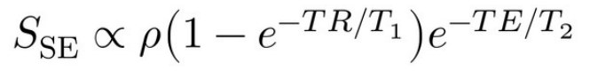{width=55%}

因此，同一种组织在不同实验条件下会表现出不同的强度。这使得原始强度成为一种具有潜在风险的纵向生物标志物。定量 MRI 能够更精确地估计物理参数——比如 T₁、T₂值，或者表观扩散系数（ADC）等参数。

#### 公式 (2.4)

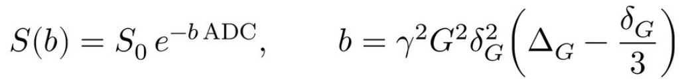{width=55%}

(δG: 梯度脉冲持续时间, ΔG: 它们之间的间隔) — 但是重复性仍然取决于校准、采集和分析。计量学认为，定量 MRI 需要像其他测量一样具有可追溯性和不确定性框架[3]；QIBA 扩散模型将重复性、偏差以及基于体模的系统测试视为解释纵向 ADC 变化的先决条件[4, 23, 24]。

### 2.4 局部波谱：具有空间背景的化学现象

局部¹H MRS 选择了一个体素（例如通过 PRESS [39]），并记录自由感应衰减，而不是成像。在简单的模型中，FID 是阻尼振荡的总和，每个共振点对应一个振荡。

#### 公式 (2.5)

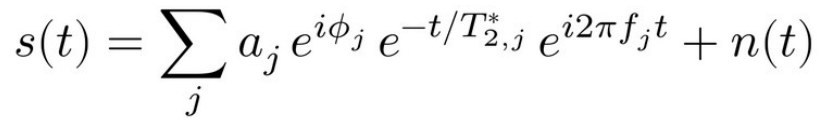{width=55%}

其傅里叶变换呈现出一个由洛伦兹线组成的频谱，其中半高全宽 FWHM 为 1/(πT²)。

这些位置是按照化学位移尺度来报告的。

#### 公式 (2.6)

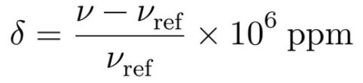{width=55%}

这样一来，NAA 在 2.01 ppm 附近出现，肌酸在 3.03 和 3.92 ppm 附近出现，而胆碱则在 3.20 ppm 附近出现。MRSI 将这一规律扩展到整个光谱网格上。其解释取决于磁场强度、回波时间、定位序列、水抑制效果、匀场质量、线宽、拟合模型以及组织成分。因此，局部波谱是一个具有位置、采集参数和质量指标的测量对象——而不是一系列独立的峰值列表[19, 20, 32, 34]。

标准化正在得到改进。MRSinMRS 报告标准列出了必须报告的硬件、采集、分析和质量细节[5]。NIfTI-MRS [18]和 MRS-BIDS [6]存储了光谱学数据，这些数据由机器处理。


## 第 11 页

[对照英文原件第 11 页](../../MRI_Local_Spectroscopy_Health_Digital_Twin_Hackathon_Dossier_v1.6.pdf#page=11)

可读的元数据以及链接到解剖图像的谱数据。这使得 MRS 非常适合用于关于证据溯源的马拉松比赛。

### 2.5 作为可选动态代谢通道的超极化¹³C

超极化可以制备非平衡的核自旋极化，并增强可检测信号[28]。在溶解-DNP 研究中，会注入超极化的[1-¹³C]丙酮酸，并随时间跟踪其转化为乳酸和碳酸氢盐的过程。这种测量是瞬时的：极化会随着 T₁时间（对于体内[1-¹³C]丙酮酸而言约为 20-60 秒）而放松，每次射频激发都会消耗磁化，因此采集时间必须控制在 1 到 2 分钟内；动力学建模则需要在离线环境下进行。对于丙酮酸和乳酸信号 Pyr(t)和 Lac(t)，采用最小二点模型，输入函数为 u(t)。

#### 公式 (2.7)

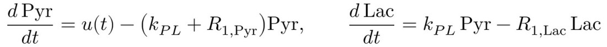{width=55%}

其中，以翻转角α进行射频采样，每次 TR 都会给每个池增加一个明显的衰减率−ln(cos α)/TR。该模型是故意简化的；实际分析需要考虑输送、灌注、交换以及更多的组成部分[7]。只需说明为什么观察模型很重要：乳酸曲线并非代谢状态本身，而是关于其状态的证据，只有与时机、翻转角和极化性一起考虑时，这些证据才具有意义。

### 2.6 纵向测量

寿命——一个人的生命历程，或设备的生命周期——并不保证能够完全模拟一个人的一生。这里指的是在一段时间内进行的重复测量，具有明确的会话上下文，并且模型能够传递信息。最基础的例子包含两个会话，t₀和 t₁；更完善的原型则包含三个或更多的会话，这样孪生体就能区分一次性异常与持续性的轨迹变化。

### 2.7 不确定性与溯源

每一次观测都伴随着两个要素：一个不确定性声明（重复性、拟合度、校准、配准、模型差异）和溯源信息（源数据、处理版本、转换过程）。没有这些要素，孪生体看起来可能很精确，但实际上它是在默默地结合不兼容的证据[25–27]。

### 2.8 在此背景下，什么可以被称为数字孪生？

一个原型如果具备以下条件，就可以被视为数字孪生演示器：(i) 有明确的物理对应物或参考对象；(ii) 有一个持续的虚拟状态；(iii) 有随时间更新的观察数据；(iv) 具有预测、预期或情景功能；以及(v) 从预测或不确定性到人类关于下一步要检查或测量的决策之间存在明显的联系。不需要自主控制；就像任何与安全相关的设备一样，医疗示例更倾向于采用人类在循环中进行的解释，并明确考虑不确定性因素。

### 2.9 简洁的数学模型

让 xₜ表示在时间 t 时的虚拟状态。来自模态 m 的观测被建模为

#### 公式 (2.8)

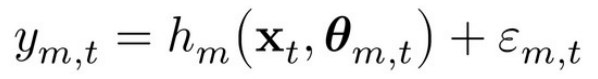{width=55%}

其中，hm 表示观测模型，θm,t 表示扫描仪、协议和校准条件，而εm,t 则表示带有协方差 Rm,t 的噪声和残差误差。孪生体更新则遵循贝叶斯规则进行计算。

#### 公式 (2.9)

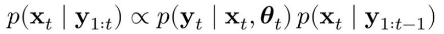{width=55%}

当 h 为线性函数且误差服从高斯分布时，即为示例（§7.5）所用的卡尔曼滤波器 [31]。团队可实现规则、加权融合、类卡尔曼滤波器、贝叶斯方法或集合方法。应优先确保观测模型、不确定度和溯源始终可见。


## 第 12 页

[对照英文原件第 12 页](../../MRI_Local_Spectroscopy_Health_Digital_Twin_Hackathon_Dossier_v1.6.pdf#page=12)

### 2.10 单个表中最小的语言元素数量

<!-- compact-table -->
| 术语 | 马拉松式竞赛的含义 |
| --- | --- |
| MRI | 空间编码磁共振测量；定性或定量 |
| MRS / MRSI | 具有化学信息及代谢物敏感性的局部化或空间分辨光谱 |
| HP ¹³C | 使用超极化标记底物的可选瞬态代谢通道 |
| 校准 | 将仪器响应与可信的度量标准或几何模型相连接的参考程序。 |
| QC | 用于判断数据集是否适合进行比对的检查（通过/警告/失败） |
| 溯源 | 可追溯的源数据、处理过程、版本以及衍生结果的历史记录 |
| 不确定性 | 量化或分类化的测量或模型不确定性 |
| 证据性质标签 | 测量值、推导值、推断值或模拟值的状态 |
| 孪生体状态 | 随时间更新的持久虚拟表示 |
| 观察模型 | 状态与模态所测量的内容之间的关系 |
| 更新事件 | 由公认证据导致的孪生体状态的可追踪变化 |
| 预测/情景 | 孪生体的预期或假设性比较 |


## 第 13 页

[对照英文原件第 13 页](../../MRI_Local_Spectroscopy_Health_Digital_Twin_Hackathon_Dossier_v1.6.pdf#page=13)

### 3. 实际案例：两次脑部扫描的结果

### 3.1 通过一个例子说明挑战手册的工作原理

一个关于人或设备的广泛健康数字孪生模型，在 25 小时的时间内是无法被完全模拟的。因此，这份挑战手册通过一个足够小的例子来进行分析，这个例子既具有原型意义，又包含了所有四个方面的内容：一个经过两次扫描的合成大脑。这只是作为一个例子，而不是挑战赛的主题。各团队可以对其进行修改，或者将相同的证据逻辑应用到设备或物体上（参见第 11.3 节，附录 J.6）。

示例讲解

一位化名受试者进行了基线 3 T 扫描，包括解剖结构、一张定量图谱以及局部¹H 光谱分析。在部分不同的条件下，又进行了随访扫描。研究团队需要决定是否需要更新孪生体的数据，更新后的数据可信度如何，哪些测量因素可以解释这种变化，以及哪些额外的证据最为有价值。可选的扩展服务包括便携式低场随访或超极化¹³C 时间序列分析。

### 3.2 基线会话时间 t₀

基线用于确定初始状态和参考几何结构。提供的 StarterPack v0.3 包含了 T 加权体积、脑掩模、合成 T₁图、前额¹H PRESS 频谱（TE 30 ms，TR 2 s，64 次平均处理，ν0 = 123.25 MHz）以及关于字段、序列、时间、质量控制和处理版本的元数据。基线并不真实：它自身存在不确定性，因此任何后续的变化都是两个不确定估计值的差异。

### 3.3 随访会话 t₁

随访至少包含一个故意的模糊性——例如，一个小的模拟真实变化加上一个体素位移，一个没有生物学变化的方案变更，或者一个低信噪比的光谱。在 StarterPack v0.3 版本中，随访光谱更宽（全宽半峰为 11.4 赫兹，而基线为 8.7 赫兹），噪声更大（信噪比为 24.8，而基线为 31.2），并且注册的区域体积更大。任务是要诊断证据结构，而不是猜测一个隐藏的标签。图 4 展示了两个会话的证据是如何组织的。

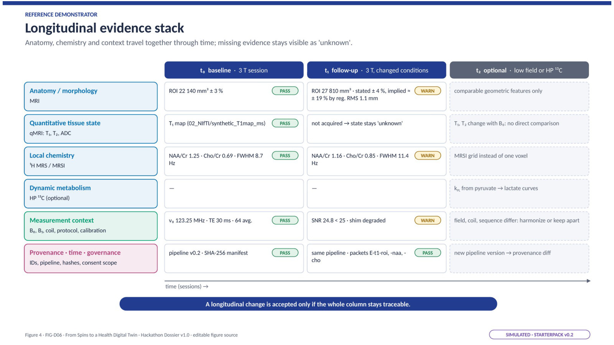

**图释**。t₀ 为 3 T 基线，t₁ 为条件有变的 3 T 随访。两次均保留解剖、局部波谱和测量上下文。定量图缺失时标为未知。t₂ 示意可选的便携低场 MRI 或超极化 ¹³C 路线。图中合成数据引用 StarterPack v0.2。

<!-- caption -->
图 4. 加工示例的纵向证据堆栈（StarterPack v0.2，合成样本）。缺失的证据仍显示为“未知”状态，而非被填充；可选的 t₂列显示了低场强度和 HP ¹³C 数据线。[图-D06]


## 第 14 页

[对照英文原件第 14 页](../../MRI_Local_Spectroscopy_Health_Digital_Twin_Hackathon_Dossier_v1.6.pdf#page=14)

### 3.4 可选的床边低场通道

低场和便携式 MRI 可以使纵向监测更加方便，但场强的变化会影响信噪比、松弛度、对比度和伪影[10]。一项 2025 年的研究利用之前的高场扫描作为个性化先验条件，以改进低场的随访重建[11]。将此视为一项研究扩展：比较高场的基线与模拟或公共低场的随访结果，并将重建的增强效果与生物变化的证据严格区分开来。

### 3.5 可选超极化¹³C 通道

先进的通道使用短时间的动态系列 pyruvate 和乳酸信号来替代静态光谱学值，同时还会提供关于极化、时间和翻转角度的元数据。该任务是一种透明的动力学总结（例如 kPL），它与传统 MRI 在同一区域和会话中进行。而孪生体则持有不同时间尺度的变量：解剖结构的变化需要数月时间，一些定量 MR 参数的变化速度更快，而超极化代谢则在大约一分钟内被测量出来。

### 3.6 什么才算得上是有意义的变更？

核心推理任务在于区分四种可能性——真实变化、测量误差、处理误差以及模型差异。这四种情况并不互相排斥；一个强有力的原型解释可以综合多种原因，而不是强制采用二元答案。

<!-- compact-table -->
| 观察到的差异 | 可能的解释 | 所需的证据 |
| --- | --- | --- |
| 区域体积变化 | 真实形态学、配准误差、分割版本、失真 | 配准质量控制，相同分割版本，几何校准，不确定性 |
| ADC 转换已更改 | 真实扩散变化、温度或方案差异、梯度偏差、信噪比 | 协议匹配，体模/QIBA 风格的质量控制，重复性 |
| MRS 比率发生变化 | 真实化学效应，体素位移，化学位移位移，线宽/信噪比，拟合不稳定性，组织比例 | 体素重叠、线宽、拟合残差以及置信水平、组织构成 |
| HP ¹³C 乳酸曲线变化 | 真实通量、传输、时序、极化、射频校准、动力学模型 | 剂量和时机因素、极化质量控制、模型敏感性 |
| 低场图像看起来有所不同 | 真实解剖结构、依赖于场的对比度、信噪比、重建先验、伪影 | 字段和协议元数据、测试对象、可比较特征定义 |

### 3.7 最小可行孪生体状态

第一个状态向量可以特意设置得较小：

#### 公式 (3.1)

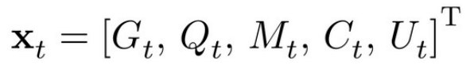{width=55%}

Gₜ — 几何或形态学摘要，例如某个区域的体积；

Qₜ — 一种定量磁共振参数，例如 T₁或 ADC；

Mₜ — 一个或多个具有定位信息的光谱学或代谢特征（此处为 Cho/Cr 和 NAA/Cr）；

Cₜ — 与解释相关的测量上下文和校准状态；

Uₜ — 与状态相关的不确定性（协方差或区间）。

状态向量并非一种诊断工具。它只是一种承载证据的表示形式，旨在检验跨领域的整合性。

### 3.8 成功的更新事件

成功的团队能够点击或追踪一个更新事件，并回答以下问题：使用了哪些源文件？哪些质量控制检查通过了？哪些校准值很重要？哪些功能发生了变化？哪些孪生变量发生了变化？哪些不确定性增加了或减少？还有哪些替代解释？哪种测量方法最能减少歧义？（图 5）


## 第 15 页

[对照英文原件第 15 页](../../MRI_Local_Spectroscopy_Health_Digital_Twin_Hackathon_Dossier_v1.6.pdf#page=15)

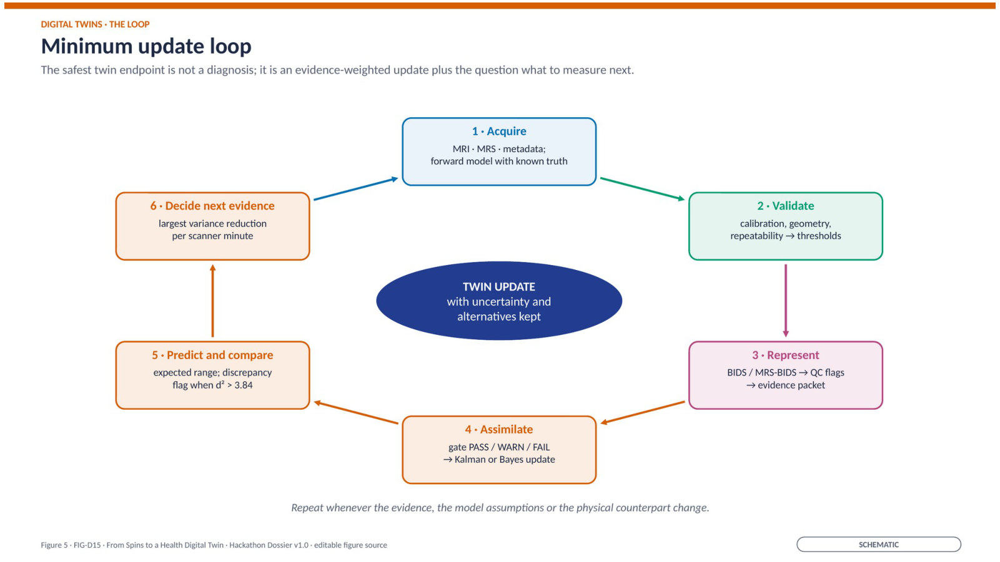

**图释**。六步更新闭环：① 采集 MRI、MRS 和元数据。② 核对校准、几何和阈值。③ 通过 BIDS／MRS-BIDS 表示数据，保留质控标记并组装证据包。④ 按 PASS、WARN、FAIL 门控后执行卡尔曼或贝叶斯更新。⑤ 预测期望范围并检查差异，图中以 d² > 3.84 作为标记条件。⑥ 选择单位扫描时间内最有价值的下一项证据。证据、模型假设或物理系统变化时重复。

<!-- caption -->
图 5. 最小更新循环。一个可靠的孪生体更新过程以选择下一步应获取哪些证据为终点。[图 D15]

### 3.9 建议的原型视图

纵向时间线，包含会话、模式以及质量控制状态信息；

带有光谱学体素叠加的解剖图像或区域图；

具有不确定性的局部波谱或代谢物面板；

具有重复性区间的定量参数趋势；

测量上下文卡片（扫描仪、字段和频率、协议、校准）；

包含先前证据、新证据以及后验信息的孪生体面板；

为什么孪生体会发生变化？溯源路径；

接下来我们应该测量什么？基于不确定性减少的提案，而非诊断方法。

### 3.10 用 StarterPack 数值演算一次更新

StarterPack v0.3 的证据包构成一个完整的教学示例，数值沿用 v0.2。对各特征，将变化量 Δ = y₁ − y₀ 与合成不确定度 u(Δ) = √(u₀² + u₁²) 比较。这里将两次采集视为独立。共同的系统项（如相同的化学位移偏移、相同的校准）在 Δ 中可部分抵消。已知这些项时，应从 u(Δ) 中扣除。

#### 公式 (3.2)

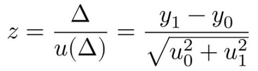{width=55%}

先做一致性检查。随访证据包的 ROI 体积声明 u = 4%，同时记录配准 RMS 为 1.1 mm。对此等体积半径 r = 17.4 mm 的紧凑区域，边界不确定度 σ_b 对应的相对体积不确定度约为 3σ_b/r，本例为 19%。若要满足声明的 4%，则需 σ_b ≈ 0.23 mm。因此一致性检查发出 WARN，由精密机械／计量学负责，并把隐含的不确定度传递到下游。刚体平移保持体积，误差来自用不完美的配准传播掩膜。该区域在六个月内变化 +25.6% 也缺乏可信度，需要审计配准和分割。

<!-- caption -->
表 1. 用 StarterPack v0.3 的数值演算变化检验（SIMULATED 来源）。星号表示按 1.1 mm 的配准 RMS 推得的值。原证据包声明 4%（z = 4.38）。


## 第 16 页

[对照英文原件第 16 页](../../MRI_Local_Spectroscopy_Health_Digital_Twin_Hackathon_Dossier_v1.6.pdf#page=16)

<!-- compact-table -->
| 特征 | t0 | t1 | Δ | u(Δ) | z | QC | 孪生体作用 |
| --- | --- | --- | --- | --- | --- | --- | --- |
| ROI 体积 / 立方毫米 | 22 140 ± 3 % | 27 810 ± 19 %* | +5 670 | 5 310 | 1.07 | WARN | 更新时附带警告（K = 0.009：保持原状）；审计 |
| NAA/Cr | 1.25 ± 0.06 | 1.16 ± 0.08 | -0.09 | 0.100 | - 0.90 | WARN | 更新带警告信息 (K = 0.26) |
| Cho/Cr | 0.69 ± 0.05 | 0.85 ± 0.06 | +0.16 | 0.078 | 2.05 | WARN | `update_with_warning` (K = 0.32); 重新匀场 + 重复操作 |

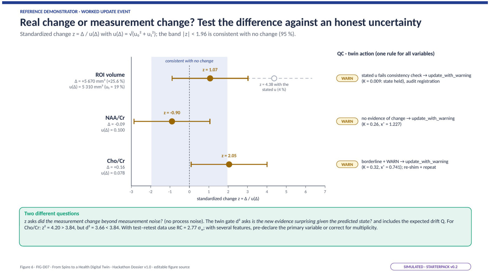

**图释**。横轴为标准化变化 z = Δ/u(Δ)，|z| < 1.96 的区间与无变化相容（95%）。ROI 按声明的 4% 得 z = 4.38，采用配准误差隐含的不确定度后 z = 1.07，需审计配准。NAA/Cr 无明确变化。Cho/Cr 处于临界，质量状态 WARN，K ≈ 0.32，后验约 0.741。图下比较 z² = 4.20 与创新统计量 d² = 3.66，两者分别衡量变化和相对于预测的偏离。

<!-- caption -->
图 6. 三个特征的标准化变化。在真实不确定性条件下，ROI 的变化不再显著（灰色部分：与所述的 4%变化相同）；NAA/Cr 没有变化；Cho/Cr 的变化处于临界状态，其光谱数据未能通过两个质量阈值检测（警告状态）。[图-D07]

所有变量采用同一规则。对每份接收的证据包，用同一带门控卡尔曼步骤更新对应状态变量（§7.5）。门控用证据包的方差，WARN 证据计算增益时将方差加倍。图 6 展示变化检验。ROI 的 K = 0.009，状态在审计前基本保持。NAA/Cr 的 K = 0.26，Cho/Cr 的 K = 0.32。Cho/Cr 更新为 x⁺ = 0.741 ± 0.048。先验 x⁻ = 0.69、P⁻ = 0.05² + 0.03²（基线方差加六个月过程噪声 Q），Cho/Cr 的创新统计量 d² = 3.66 < 3.84。

Cho/Cr 的 z² = 4.20，高于 3.84，d² = 3.66，低于 3.84。z 检验两次测量的差异是否超出测量噪声。d² 衡量新证据与预测状态的偏离程度，其中计入孪生体预期的六个月漂移 Q。当 z 处于临界范围而 d² 没有触发门控时，孪生体带警告更新，并提出改进测量。若同时检验三个特征，团队应在查看数据前指定一个主要变量，或进行多重性校正，例如每个特征使用 0.05/3。

下一次测量优先重新匀场后重复 PRESS（§7.7）。该例涵盖整项挑战：物理决定比值的含义，计量说明哪项不确定度有依据，数据层记录证据包、标记和溯源，孪生体负责门控、更新与选择下一次测量。


## 第 17 页

[对照英文原件第 17 页](../../MRI_Local_Spectroscopy_Health_Digital_Twin_Hackathon_Dossier_v1.6.pdf#page=17)

### 4. 量子工程：可观测量模型与设计

### 4.1 量子工程定义了“测量”的含义

量子工程的贡献并不提供 MRI 图像。它定义了采集实际测量的内容，以及对于黑客松来说足够安全的简化关系。每种模式都成为一个测量卡，包含输入参数、预期信号、输出可观测量、假设条件、限制条件，以及具有已知真值的验证案例。

### 4.2 从自旋极化到信号

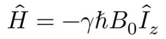{width=55%}

在 B₀场中，自旋为½的原子核的塞曼哈密顿量

通过ħω₀将能级分割，其中 Larmor 频率ω₀ = γB₀。在热平衡状态下，极化状态为

#### 公式 (4.1)

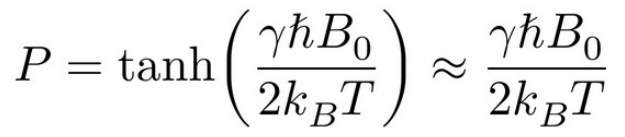{width=55%}

在 3 T 和 310 K 的条件下，¹H 的采集率约为 9.9 ppm，而¹³C 的采集率约为 2.5 ppm。平衡磁化强度 M₀ = ½ ρ γħ P 与 B₀呈线性关系；诱导信号则随ω₀M₀增长。当体素噪声占主导地位时，信噪比大致与 B₀、体素体积以及采集时间的平方根呈线性关系。由于代谢物的浓度较低——1-10 mmol/L，约为组织水中质子浓度的 80-90 mol/L 的 10⁴倍——这就是为什么 MRS 体素宽度为厘米，而 MRI 像素为毫米的原因。此外，超极化效应——在溶解 DNP 后约为 0.3，约为热¹³C 值的 10⁵倍——使得实时代谢成像成为可能[28]。标称场和实际场之间存在差异：StarterPack 旁车文件设备显示 3.0 T，但ν₀ = 123.25 MHz 意味着 B₀ = 2.895 T（γ/2π = 42.577 MHz T⁻¹）。这两个数值都属于该设备的一部分；它们表示不同的含义。

### 4.3 MRI 测量卡

<!-- compact-table -->
| 字段 | 内容 |
| --- | --- |
| 物理机制 | 核自旋激发，通过梯度进行空间编码，公式(2.1)–(2.2) |
| 原始/接近原始格式的对象 | k 空间 S(k)或重建的复图像；幅度图像的噪声遵循 Rician 分布[33] |
| 控制变量 | B0, B1, TR, TE, TI, 翻转角, 梯度, 带宽, 线圈, 重建 |
| 派生可观测量 | 几何形状，T1 / T2 / T2* 地图，以 ADC 或其他定义的地图形式呈现，包含单位信息 |
| 主要混杂因素 | 运动、B0 不均匀性、梯度非线性、线圈灵敏度 c(r)、重建、协议变更 |
| 验证 | 具有已知值的体模[29]，重复扫描，数字参照物，基于已知真实情况的模拟 |
| 证据性质标签 | 图像：由测量数据得出；地图：由其他数据得出；模拟图像：通过模拟生成 |

图 7 将卡片与成像方程以及用于光谱分析的局部体素相连。


## 第 18 页

[对照英文原件第 18 页](../../MRI_Local_Spectroscopy_Health_Digital_Twin_Hackathon_Dossier_v1.6.pdf#page=18)

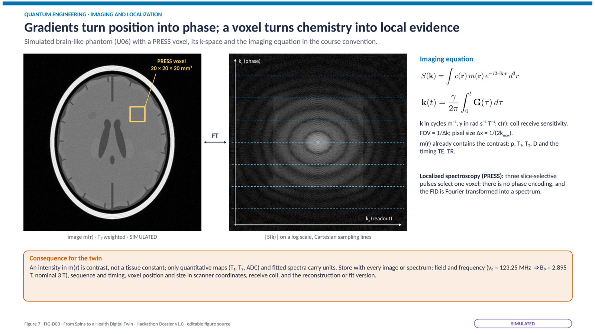

**图释**。左图为含 20 × 20 × 20 mm³ PRESS 体素的合成脑体模。中图显示 k 空间幅度，kₓ 为读出方向，kᵧ 为相位编码。右面板是采用课程符号约定的成像方程。

<!-- caption -->
图 7. 空间编码与定位（模拟）。左图：基于大脑体模的 U06 体模，具有 20 毫米的 PRESS 体素；中图：其 k 空间强度分布；右图：按照常规惯例绘制的成像方程。[图-D03]

### 4.4 局部¹H 光谱卡

<!-- compact-table -->
| 字段 | 内容 |
| --- | --- |
| 物理机制 | 来自局部体素（PRESS、STEAM、sLASER）或 MRSI 网格的化学位移分辨信号，公式(2.5)–(2.6) |
| 原始/接近原始格式的对象 | 复杂时域 FID 模型加上水参考数据和元数据（NIfTI-MRS 格式） |
| 控制变量 | B0, TE, TR, 平均值, 定位, 匀场, 水抑制, 射频校准, 体素放置 |
| 派生可观测量 | 峰值面积、浓度估计或比率（Cho/Cr，NAA/Cr）、线宽、信噪比、拟合残差、CRLB |
| 主要混杂因素 | 匀场不良、重叠、基线问题、信噪比低、体素不匹配、化学位移位移、组织成分、模型拟合 |
| 验证 | 合成光谱具有已知的振幅，体模采用已知浓度，进行残留检查，并重复放置 |
| 证据性质标签 | FID：测量值；拟合比例：推导出的数值；模拟光谱：模拟得到的光谱数据。 |

图 8 展示了这张卡片对两次初始测试会话的影响：所使用的化学试剂相同，但测量得到的曲线更为宽阔，信噪比也有所降低。


## 第 19 页

[对照英文原件第 19 页](../../MRI_Local_Spectroscopy_Health_Digital_Twin_Hackathon_Dossier_v1.6.pdf#page=19)

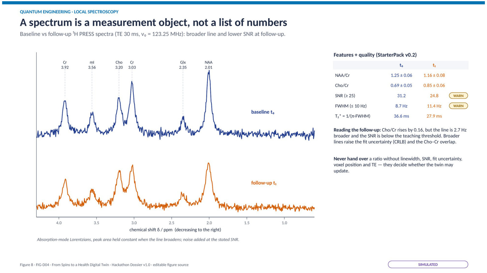

**图释**。比较基线与随访的模拟 ¹H PRESS 波谱，TE 30 ms，谱仪频率 123.25 MHz。横轴为化学位移，纵轴为信号。随访线宽较大、SNR 较低。右侧汇总 NAA/Cr、Cho/Cr 及质控，这些数值来源于 StarterPack v0.2。

<!-- caption -->
图 8. 基线和随访¹H 光谱（使用 StarterPack v0.2 的线宽、信噪比和比率进行模拟）。随访线的频率比基线宽 2.7 赫兹（T₂）

* 27.9 毫秒，而非 36.6 毫秒）其信噪比低于教学标准。[图 D04]

StarterPack v0.2/Explorer v0.1 中的已知问题——这是一个不错的初步任务。

在探索轴上，合成 FIDs 将 NAA、Cr 和 Cho 分别定位在约 5.7、4.7 和 4.0 ppm 处，而标签则位于 2.02、3.03 和 3.20 ppm。生成器的偏移量并不遵循 fⱼ = (δⱼ − δref)·ν₀这一规律，频率轴的符号约定也未进行说明。已在 v0.3 版本中修复这一问题：让每个共振峰都以其化学位移相对于参考值进行定位（水为 4.7 ppm，或根据 NIfTI-MRS 默认值），记录 FFT 和共轭关系的约定，并添加单元测试以验证已知峰位在单个光谱点内的准确性。

### 4.5 定量 MRI：对比剂并非测量指标

至少有一个量被视作测量值，而非直观读取的强度。ADC 是一个合适的选择：它具有单位（毫米²·秒⁻¹）、一个前向模型（2.4）以及成熟的可重复性框架[4]。T₁或 T₂同样适用。对于双点 ADC 估计，其计算公式为 ADC = ln(S₀/Sb)/b，误差传播则会产生……

#### 公式 (4.2)

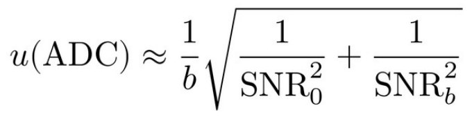{width=55%}

例如，b = 1000 s mm⁻²、SNR₀ = 50 和 `SNR_b` = 20 时，平均之前的单体素标准不确定度为 u ≈ 0.054 × 10⁻³ mm² s⁻¹。学生需要把正向模型说明到足以理解灵敏度和偏差的程度。无需复现厂商序列。

### 4.6 光谱拟合与不确定性分析

任何谱都不可能仅通过一个数字来表示，而不包含质量信息。Cramér-Rao 下界（CRLB）给出了从拟合模型的 F Fisher 信息矩阵得到的无偏估计所能达到的最小方差。

#### 公式 (4.3)

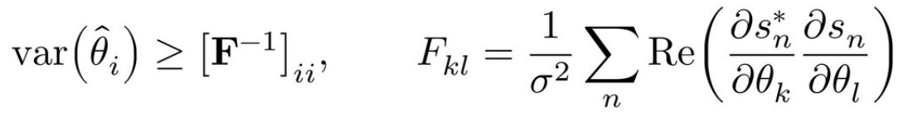{width=55%}

这里的σ²是每个实部和虚部信道的噪声方差，sₙ则是样本 n 时的模型参数。对于单一的洛伦兹分布，振幅不确定性随着线宽的增加而增加，而随着信噪比的增加而减少。这就是为什么线宽较宽的随访会增加 Cho/Cr 的不确定性。CRLBs 是下限值，并且取决于模型[21]；通过滤波光谱来…


## 第 20 页

[对照英文原件第 20 页](../../MRI_Local_Spectroscopy_Health_Digital_Twin_Hackathon_Dossier_v1.6.pdf#page=20)

仅相对 CRLB 就可能导致组间结果出现偏差[22]。特征表中至少包含以下一项：绝对 CRLB、线宽、信噪比、残差度量或分类质量控制标志。合成光谱必须通过改变线宽和噪声来使这些依赖性显现出来。

另外两点需要注意：肌酐的比例具有相同的分母，因此 NAA/Cr 和 Cho/Cr 的误差呈正相关，而 Cr 本身被假设为稳定的——这是一种假设，并非为了掩盖问题。体素中的灰质、白质和脑脊液浓度（而非比例）需要水的参考值以及组织分数校正[19, 20]。

### 4.7 超极化动态测量

对于可选的 HP 通道，量子工程定义了双位点模型（2.7），以及具有已知参数的时间序列，以便孪生团队能够测试其更新逻辑在真实的噪声和时序不确定性下是否能够恢复变化的方向（图 9）。其目的是建立一个透明的动态观测模型，而不是一个临床代谢模型。

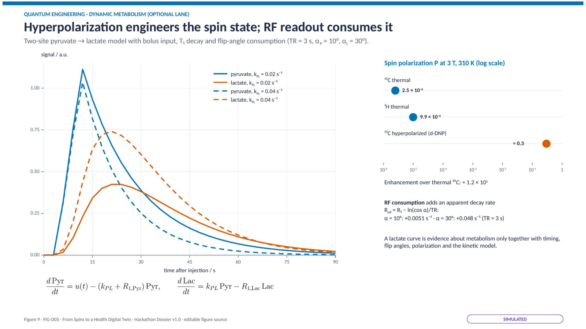

**图释**。左图比较两种转化速率下的丙酮酸和乳酸模拟轨迹，包括丸剂输入、T₁ 衰减与翻转角造成的极化消耗。TR = 3 s，丙酮酸和乳酸翻转角分别为 10° 和 30°。右图用对数刻度比较 3 T、310 K 下的自旋极化。

<!-- caption -->
图 9. 双位点丙酮酸-乳酸代谢动力学，涉及单次剂量输入以及射频消耗的情况，展示了两种不同的转化速率（已通过模拟得到），以及使得测量能够进行的极化水平。[图-D05]

### 4.8 建议的模拟任务

生成一个具有已知几何形状的区域，并对其进行轻微的变形或配准移动；测量明显的体积变化。

生成一个单指数扩散信号，如方程(2.4)所示，并在不同的噪声水平下测量 ADC 的读数；与方程(4.2)进行比较。

生成一个¹H 谱图，将其表示为在正确的化学位移处出现的洛伦兹线或沃伊特线的总和；改变线宽、体素混合和信噪比；报告化学位移限制边界。

生成一个双磁体的 HP ¹³C 系列装置，并在改变时序、翻转角度和振幅扰动的情况下估算 kPL 值。

将真实参数与学生相关数据分开导出，这样导师就可以评估推理结果的准确性。


## 第 21 页

[对照英文原件第 21 页](../../MRI_Local_Spectroscopy_Health_Digital_Twin_Hackathon_Dossier_v1.6.pdf#page=21)

### 4.9 推荐的量子工程合作伙伴讲座

这场持续 60-75 分钟的桥梁讲座涵盖了下游合作伙伴需要正确理解的内容：MRI/MRS 测量链、空间编码与定位、对比度加权与定量观测值、FID 和光谱的含义、一个简单的观测方程、物理层面的质量控制以及跨会话比较的局限性。其交接内容是一张带有可变名称、物理含义、单位、空间支持、采集依赖关系、质量指标以及无法推断出的信息的测量卡。在乌尔姆试点项目中，乌尔姆在 11 月 20 日上午分两部分讲解这些内容：介绍部分（10:00-10:30）和量子工程部分（12:15-12:45），其中还回顾了第 5 章的重要内容，并给出了挑战赛的概要。

### 4.10 量子工程交接成果

针对所选模式的单页测量模型；

参数范围和单位；

至少有一个具有已知真值的模拟或数字参照物；

对每个派生特征的物理解释；

已知的无效使用方式和故障模式；

传递给数据科学和数字孪生的不确定性值接口定义。


## 第 22 页

[对照英文原件第 22 页](../../MRI_Local_Spectroscopy_Health_Digital_Twin_Hackathon_Dossier_v1.6.pdf#page=22)

### 5. 精密机械、计量学与不确定性

### 5.1 为什么精密机械是核心而非辅助工具

孪生体即使在受试者没有发生变化的情况下，也可能受到毫米级定位差异、B₀漂移、梯度尺度误差或线圈几何结构变化的影响而受到干扰。精密工程为测量物理与数据科学之间提供了信任的基础。挑战赛使得这一点变得可见，而不是将校准视为背景实验室工作[3, 24]。

### 5.2 不确定性度量链视图

<!-- compact-table -->
| 来源 | 机制 | 对孪生体的可能影响 |
| --- | --- | --- |
| 主题或样本定位 | 不同的姿势或体素放置 | 表观几何结构或光谱学变化 |
| 梯度比例与非线性特性 | 编码字段与理想状态有所不同 | 几何失真，有偏扩散度量 [13] |
| B0 漂移和不均匀性 | 频率发生偏移，线条变宽 | MRS 线宽、图像伪影、量化偏差[12, 14] |
| B1 / 射频发射频率变化 | 翻转角与标称值不同 | 对比和定量映射偏差 |
| 接收灵敏度，线圈位置 | 计算变化量 | 与组织无关的强度变化 |
| 化学位移偏移 | 切片位置取决于频率 | 代谢物的体素并不重合（§5.5） |
| 运动 | 采集过程中的状态变化 | 模糊、重影现象、频谱污染 |
| 温度，体模状态 | 参照物发生变化 | 校准错误或 ADC 参考电压问题 |
| 机械重复性 | 无法重复定位的夹具或体模 | 跨会话坐标不确定性 |

### 5.3 校准层次结构

精度团队负责区分仪器检查、协议校准、会话几何结构、分析校准以及纵向对比工作。每个层级都会向上提交机器可读取的结果（见图 10）。

1. 仪器状态：场均匀性、频率参考点、梯度特性、射频链路、基本系统质量控制[12]。

2. 协议校准：针对特定序列的设定，使用具有已知值的参考扫描、模型以及数字参考对象[29]。

3. 会话几何学：定位、坐标框架、基准点、体素放置、自动对齐和配准。

4. 分析校准：软件版本、拟合模型、分割版本、与已知真实值的偏差。

5. 纵向比较：重复性带以及判断差异大于测量误差的标准。


## 第 23 页

[对照英文原件第 23 页](../../MRI_Local_Spectroscopy_Health_Digital_Twin_Hackathon_Dossier_v1.6.pdf#page=23)

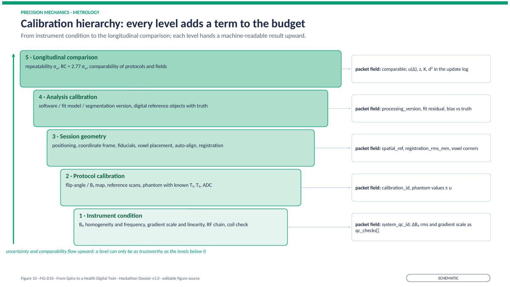

**图释**。校准从设备状态逐层延伸到重复测量的可比性。各层记录可由下游读取的参数和质控结果。分析校准包括软件、拟合模型、分割版本和带真值的数字参照物。纵向比较使用重复性、RC = 2.77σ_w 以及协议和场强可比性。

<!-- caption -->
图 10. 校准层次结构，各层级中的数据包字段都有其贡献作用。[图-D10]

### 5.4 领域和频率的可追溯性

标称字段是一个标签；光谱仪频率是一个测量值。当ν₀ = 123.25 MHz 时，实际场强为 2.895 T，而不是 3.0 T。静态频率偏移会使所有峰值重合，可以通过参考（例如 NAA 或肌酸峰值）来消除这种影响；在 2 分钟的采集过程中（64 × 2 秒），漂移为 0.1 ppm（在 123 MHz 下为 12 Hz）会导致线条变宽并破坏平均值计算，除非通过瞬态校正来消除这种漂移。数据包中存储了ν₀、用于 ppm 轴的参考值以及漂移估计值。

### 5.5 几何结构：体素放置与化学位移位移

在 PRESS 中，每个带宽 BWRF 的切片选择性脉冲会选择一个体素，该体素的位置取决于共振频率。相对于δc 处的载波，位于δ处的代谢物的体素会发生位移。

#### 公式 (5.1)

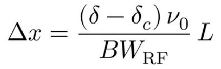{width=55%}

每个轴上，以 L 表示体素大小。当ν₀ = 123.25 MHz，BWRF = 1.2 kHz 且 L = 20 mm 时，NAA 和 Cho 体素在每个轴上的差异为 2.4 毫米——相当于体素的 12%（见图 11）。放置和配准错误以相同的方式交换组织：沿一个轴发生 2 毫米的移动相当于 20 毫米体素的 10%，而三个轴上的相同位移则约为 16%。必须将两个错误源分开：扫描仪处体素的处方误差以及不同会话之间的配准误差；StarterPack 的阈值 2.0 毫米配准 RMS 对应的组织交换预算为 10-16%，而 FAIL 示例（3.8 毫米）则为 19-29%。梯度非线性会引入位置依赖性的失真，除非进行校正，否则这种失真可能远离等中心位置达到数百分比[13]。


## 第 24 页

[对照英文原件第 24 页](../../MRI_Local_Spectroscopy_Health_Digital_Twin_Hackathon_Dossier_v1.6.pdf#page=24)

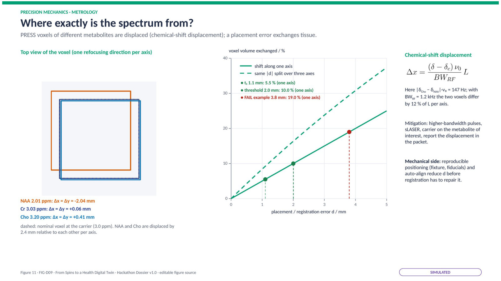

**图释**。左图从上方显示各代谢物的 PRESS 体素。因化学位移，各体素发生位置偏移。右图横轴为定位误差，纵轴为置换掉的体素体积百分比。位置偏差会换入不同组织。

<!-- caption -->
图 11. 频谱的来源在哪里？NAA、Cr 和 Cho 的 PRESS 体素的化学位移变化，以及随着放置误差变化的体素体积交换比例（模拟结果）。[FIG-D09]

### 5.6 重复性和有意义的改变

当存在测试-重测数据时，个体内标准偏差σw 决定了重复性系数

#### 公式 (5.2)

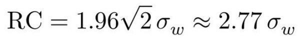{width=55%}

— 对于未改变的实验对象，两次重复测量之间的差异有 95%的情况都小于 RC[23, 24, 30]。如果差异|Δ|小于 RC，则孪生体本身不会发生变化。当只有每次实验的不确定性数据时，会使用方程(3.2)中的 z 检验。StarterPack v0.4 将添加测试-重测对，以便可以计算σw 和 RC，而不仅仅是定义它们。

### 5.7 不确定度预算

本次黑客松并不需要进行完整的 GUM 研究[25]，但每一个定量结果都需要有合理的预算。对于输入变量之间不相关的结果 y = f(x₁, …, xN)，预算应当合理。

#### 公式 (5.3)

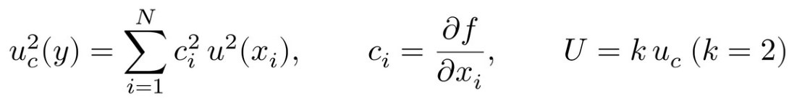{width=55%}

相关的输入会增加协方差项。随访中 Cho/Cr 比率的教学预算（图 12）结合了光谱拟合、线形模型误差、位置调整、化学位移偏移以及校准等因素，最终得到 uc = 0.058 的结果，这与数据包不确定性 0.06 相匹配；拟合项占方差的 60%。这些项不会被重复计算：CRLB 涵盖了测量到的线宽噪声，而线形项则涵盖了模型误差（非洛伦兹形状、频率漂移），这是 CRLB 无法处理的。教育的步骤是确定哪种因素在更新过程中起主导作用，而不是计算复杂的公式。


## 第 25 页

[对照英文原件第 25 页](../../MRI_Local_Spectroscopy_Health_Digital_Twin_Hackathon_Dossier_v1.6.pdf#page=25)

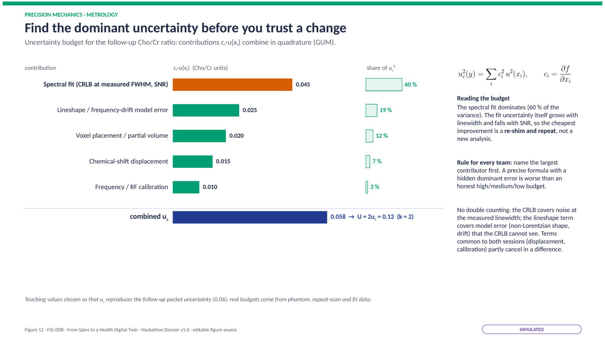

**图释**。随访 Cho/Cr 的不确定度预算。各贡献 cᵢu(xᵢ) 按平方和合成，图中列出各项绝对量和占合成方差的比例。谱拟合贡献最大，优先重新匀场并重复采集。

<!-- caption -->
图 12. 随访中 Cho/Cr 比率的不确定度预算。主要影响因素（谱拟合，由线宽和信噪比驱动）表明，最经济的改进方法是重新匀场并重复实验。[图-D08]

### 5.8 验收标准

在孪生体接受观测之前，测量层会响应一系列质量门控，每个质量门控都有一个机器可读取的阈值。每个质量门控在数据包中对应一个 qcchecks[]元素（名称、值、单位、阈值、状态、所有者；§8.2）：

<!-- compact-table -->
| 质量门控 | 数据包字段 | 教学阈值 | 若违反，则产生何种后果 |
| --- | --- | --- | --- |
| 系统质量控制通过 | `system_qc_id` | 目前和将来 | FAIL |
| 与基线相当的采集 | `protocol_match` | 相同的序列家族，TE，TR，字段 | WARN（如果字段不同且未进行协调处理，则触发失败） |
| 在容忍范围内进行配准 | 注册标准差_米 | ≤ 2.0 毫米 | > 2.0 警告，> 3.0 失败（提案） |
| 所述的不确定性是一致的 | `roi_u_consistency` | 声明 u 大于等于隐含 u (3σb/r) | WARN；携带隐含的警告信息 |
| 频谱足够窄 | `mrs_linewidth_Hz` | ≤ 10 赫兹（3 特斯拉，单轴） | > 10 警告，> 20 失败（提案） |
| 信噪比足够 | `mrs_snr` | ≥ 25 | < 25 WARN, < 10 FAIL |
| 已验证的有效范围内，导出量符合要求。 | 值，有效范围 | 在范围内 | FAIL |
| 不确定性足够小，可以投入使用 | 不确定度 | z 检验或 RC 标准 | 更新时发出警告 (小单位：千) |

如果质量门控失败，正确的孪生体操作可能是拒绝或降低对观测数据的权重，而不是更新状态。

### 5.9 精密力学设计子挑战

可选的物理设计子挑战

设计一个可复现的局部波谱或纵向 MRI 定位与校准方案：采用受试者支撑或体模固定装置、体素放置辅助工具、参考标记几何结构、低场线圈或磁体定位方案，或者校准插件。提供公差、自由度、感知与反馈选项，以及不确定度预算——而不仅仅是具有真实感的 CAD 模型。将这一方案与其数量联系起来。


## 第 26 页

[对照英文原件第 26 页](../../MRI_Local_Spectroscopy_Health_Digital_Twin_Hackathon_Dossier_v1.6.pdf#page=26)

改进（例如图 11 中的配准 RMS 或组织交换）。

### 5.10 推荐的精密机械/计量学合作伙伴讲座

一场持续 60-75 分钟的桥梁讲座围绕测量链展开：定位与坐标框架；与梯度和场相关的几何学；B₀、B₁以及热或机械漂移；校准与可追溯性；重复性及其相关概念；紧凑型不确定度预算；接受阈值。学生作业要求指出一个纵向比较中的主要不确定性来源，并将其表示为机器可识别的阈值或标志，数据科学需要保留这些指标，而孪生体则对其进行处理。在乌尔姆试点项目中，11 月 20 日并没有单独的精密机械/计量学讲座。该讲座的内容基于这一章节，乌尔姆的量子工程部分则回顾了其中的要点：信噪比、作为模型假设失效产生的伪影，以及变化与其不确定性之间的比较（§3.10）。

### 5.11 精确的方向交付成果

所选测量链的校准和重复性图表；

一个不确定度预算，其中主要贡献因素被突出显示；

一种机械或计量方面的改进理念；

证据包的接受和拒绝阈值；

一种结构化的质量控制状态，数据科学将其传递给孪生体，而不会隐藏底层值。


## 第 27 页

[对照英文原件第 27 页](../../MRI_Local_Spectroscopy_Health_Digital_Twin_Hackathon_Dossier_v1.6.pdf#page=27)

### 6. 数据科学：元数据、质量与溯源

### 6.1 数据科学拥有证据展示权

数据科学使得测量可以在不同的人、会话、软件和机构之间自由传递，而不会失去其意义。首要的任务不是训练模型，而是定义一个数据契约，以保留身份、模态、空间参考、采集环境、校准、衍生值、单位、不确定性、质量控制状态、证据性质标签和溯源。

### 6.2 DICOM、NIfTI、BIDS 和 MRS-BIDS

临床 MRI 使用 DICOM 表示图像对象，并支持工作流程互操作 [16]。科研分析常用 NIfTI 紧凑地存储三维体数据与仿射几何。BIDS 进一步规定数据集的组织、命名及机器可读的 JSON／TSV 旁车文件 [17]。BIDS 通过 MRS-BIDS 表示波谱 [6]，数据存为 NIfTI-MRS，即复数时域数据与波谱元数据 [18]。学生应了解各种表示保留了什么、转换时哪些信息可能丢失，以及孪生体必须获得哪些元数据。无需具备数据库专家知识。

<!-- compact-table -->
| 层 | 挑战赛中的角色 | 保留最低限度的元数据 |
| --- | --- | --- |
| DICOM / 源图像 | 原始采集对象与背景 | 研究/系列/实例 ID、扫描仪、序列、时间设置、几何参数 |
| NIfTI 格式/处理过的图像 | 便于分析的体积 | 仿射（体素→扫描仪毫米），地图类型和单位，处理溯源 |
| BIDS | 研究机构和会议议题 | 主题、会话、模式、采集标签、侧边栏元数据 |
| NIfTI-MRS / MRS-BIDS | 具有机器可读元数据的光谱分析 | 核心、场和光谱仪频率、TE/TR、VOI、参考值、序列、平均值 |
| 孪生体证据包 | 横向界面 | 可观测量、数值、单位、位置、不确定性、质量控制、证据性质标签、来源、处理版本 |

合成版 StarterPack v0.3 (`MRI_Hackathon_DataScience_StarterPack_v0.3.zip`) 包含了 DICOM、NIfTI、BIDS MRI 以及 MRS-BIDS/NIfTI-MRS 格式的溯源/随访示例，并附带一个紧凑的 JSON/CSV 交接层。这些文件是小型教学对象，展示了身份、几何结构、采集数据以及光谱学元数据、质量控制、单位和溯源如何在整个流程中传递。

<!-- compact-table -->
| 表示法 | 在起始资料包中 | 学生们应该注意的事项 | 交接问题 |
| --- | --- | --- | --- |
| DICOM | 01_DICOM/基线, 随访 | 丰富的采集元数据；系列/实例结构；几何信息 | 哪些元数据需要保留到下游阶段？ |
| NIfTI | 02_NIfTI/*.nii.gz | 阵列 + 几何结构；采集环境位于标题之外 | 丢失或移到了副驾驶座上的物品是什么？ |
| BIDS MRI | 03_BIDS_MRI/sub-01/ses-*/anat | NIfTI + 命名 + JSON/TSV 边栏 | 有没有其他人可以在不了解具体情境的情况下进行解释呢？ |
| MRS-BIDS | 04_MRS_BIDS/sub-01/ses-*/mrs | NIfTI-MRS FID + 光谱学元数据 + BIDS 语义 | 能否将频谱与受试者、会话、虚拟对象身份和采集结果相关联？ |
| JSON / CSV | 05_TwinReady_JSON_CSV | 显式合同：特性、质量控制、不确定性、溯源 | 孪生体能够决定更新、使用警告进行更新，还是在不进行手动重新解释的情况下拒绝更新吗？ |

图 13 总结了每种表示形式在传输过程中会保留哪些信息、会被转移到副件中，或者会在传输过程中丢失哪些内容。


## 第 28 页

[对照英文原件第 28 页](../../MRI_Local_Spectroscopy_Health_Digital_Twin_Hackathon_Dossier_v1.6.pdf#page=28)

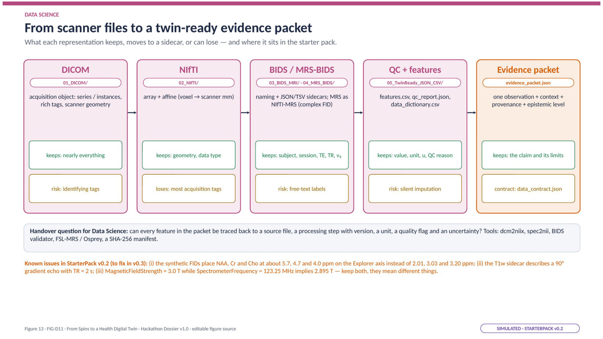

**图释**。读图顺序为 DICOM → NIfTI → BIDS／MRS-BIDS → 质控与特征 → 证据包。各步骤标明数据保留在哪里，哪些内容移入 JSON／TSV 旁车，以及转换中可能丢失的元数据。

<!-- caption -->
图 13. 从扫描文件到适用于孪生体的证据包：每种表示形式保留的内容以及信息可能丢失的位置。教学目标是界面素养，而非数据库课程。[图-D11]

### 6.3 最小数据字典

团队在编写仪表板之前会就数据字典达成一致。最低限度的字段应足够通用，以包含 MRI、MRS 和计量学证据：受试者和会话标识符、相对时间、模式、空间参考、采集参数、可观测量、值和单位、不确定性、质量控制状态和原因、证据性质标签、溯源链接、处理版本以及解释限制（附录 B）。

### 6.4 机器学习前的质量控制

机器学习模型能够非常高效地处理不良数据。因此，在采用任何高级人工智能之前，需要进行质量控制和缺失逻辑处理。有用的检查包括：不可能的元数据组合、单位一致性问题、缺失的校准数据、低信噪比、宽泛的界限、配准失败、超出范围的拟合值以及版本不匹配等问题。团队能够区分生物学上不寻常的数据和技术上无效的数据。图 14 展示了随访过程中的质量检查报告，其中包含了每项检查的值、阈值、负责人以及相应的后果。


## 第 29 页

[对照英文原件第 29 页](../../MRI_Local_Spectroscopy_Health_Digital_Twin_Hackathon_Dossier_v1.6.pdf#page=29)

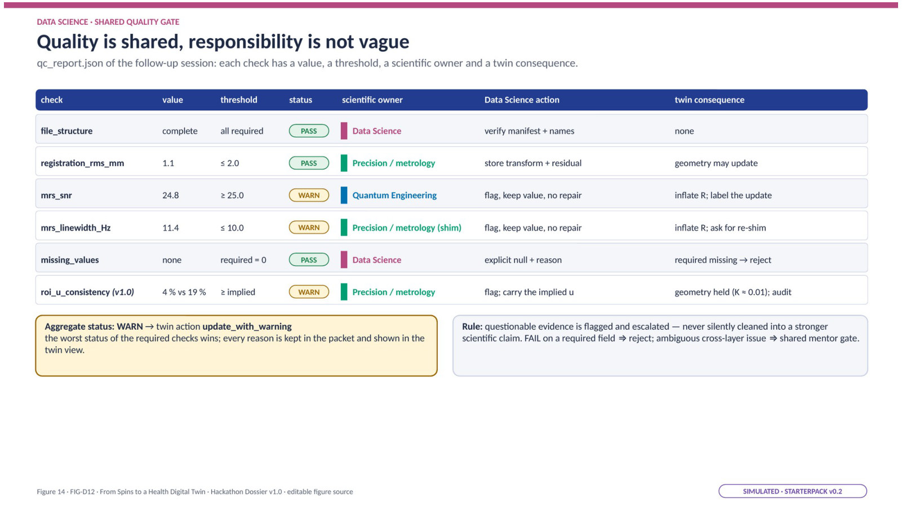

**图释**。随访质控表列出检查、数值、阈值、判定、科学责任方、数据科学操作和孪生后果。检查涉及文件结构、配准 RMS、MRS SNR、MRS 线宽、缺失值及 ROI 不确定度一致性。质控保留所有原因，并以最严重的一项汇总为 WARN。ROI 的 4% 与隐含的约 19% 不一致，需携带修正不确定度并审计配准。

<!-- caption -->
图 14. 随访会话的共享质量门控（StarterPack v0.2 `qc_report.json`）。数据科学进行检测并保留相关信息；科学负责人做出决策；孪生体执行已声明的接受策略。[图-D12]

### 6.5 协调性与可比性

纵向数据可能来自不同的扫描仪、领域或协议。进行数据标准化确实有帮助，但这样做既不能消除真实的变化，也不能实现真正的可比性。团队应保留原始数据值，记录所使用的转换方法，并说明转换后的数值是否适合进行趋势分析。低场/高场选项的设计初衷就是为了实现这种对比和信噪比差异，这些都是物理上的差异，而非表面上的差异。

### 6.6 基于溯源的特征工程

每个特征都可以追溯到一个空间区域和一个源对象。代谢物比率包含了谱 ID、体素坐标、化学位移位移、拟合软件及版本、CRLB 和组织比例；区域体积则包含了图像序列、分割版本和配准变换。孪生体无法获得一个没有必要信息的数字，这些信息对于解释它是至关重要的。

### 6.7 溯源图

一个有向无环图就足够了：采集 → 预处理 → 重建或拟合 → 特征提取 → 数据包生成 → 孪生体更新。在 W3C PROV 术语中[27]，节点包括实体（文件、特征、数据包、状态）、活动（转换、拟合、质量控制、更新）以及代理（管道、团队）；每个实体都携带了起始包清单中的版本信息和 SHA-256 哈希值。强大的团队允许用户点击孪生变量，并直接返回到原始文件（图 15）。


## 第 30 页

[对照英文原件第 30 页](../../MRI_Local_Spectroscopy_Health_Digital_Twin_Hackathon_Dossier_v1.6.pdf#page=30)

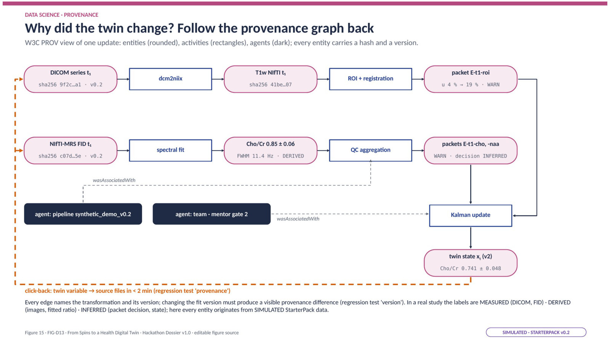

**图释**。W3C PROV 图例：圆角框为实体，矩形为活动，深色框为代理。源 DICOM、NIfTI、NIfTI-MRS 等经转换、配准、分割或拟合，生成特征与证据包，最后用于孪生更新。每个实体携带文件摘要和版本。

<!-- caption -->
图 15. 一次更新的溯源图。孪生体变量返回源文件的点击行为是一种回归测试。[图-D13]

### 6.8 公平的数据和标识符

该数据包设计遵循 FAIR 原则[26]：对受试者、会话和数据包进行持久性标识；使用标准词汇表提供丰富的元数据（BIDS 实体、DICOM 标签、NIfTI-MRS 键）；明确设定许可和访问条件；以及具有机器可读的溯源信息。使用化名 ID 和相对时间（“第 6 个月”）可以避免不必要的个人数据泄露。

### 6.9 负责任的 AI 领域

AI 可以用于去噪、重建、分割、特征提取或预测，但透明性比复杂性更为重要。每个由 AI 生成的值都需要一个模型版本、一个训练领域声明以及一个不确定性或置信度指标。如果模型使用之前的扫描结果作为先验信息，那么原型会警告旧的错误可能会传播，而真正的新变化可能会被抑制——这对个性化低场重建来说是一个真实的风险[11]。

### 6.10 建议的数据科学合作伙伴讲座和作业

60-75 分钟的讲座：5 分钟讨论为什么格式是科学证据的一部分；15 分钟讲解 DICOM 到 NIfTI 再到 BIDS/MRS-BIDS 的转换过程；15 分钟讨论 JSON/CSV 作为明确的接口；10 分钟讲解所需字段、缺失和无效值、单位以及去标识化；10 分钟讨论溯源和谱系；15-20 分钟进行实践操作。

`data_contract.json`、`qc_report.json` 和 `evidence_packet.json`。这种形式比一般的数据库讲座更为具体和有用。在乌尔姆的试点项目中，CTU 布拉格在 11 月 20 日上午提供了一次 45 分钟的方向性讲座（时间从 10:30 到 11:15）。

任务：检查成对示例；创建或修订 features.csv 文件；生成包含明确的通过/警告/失败原因的 QC 报告；创建一个满足合同要求的证据包（格式 v1.0，第 8 章）；为每个质量决策指定负责人；证明一个孪生变量能够追溯到其源文件，并展示出一个溯源路径。

2026 年 11 月 20 日，布拉格捷克理工大学 Yuliia Prokop 博士讲授《可靠数字孪生的数据科学：从源文件到经过验证的证据包》[44]。讲义跟踪 Explorer 中的一份实际示例包，文件名为 E-t1-（续下页）。


## 第 31 页

[对照英文原件第 31 页](../../MRI_Local_Spectroscopy_Health_Digital_Twin_Hackathon_Dossier_v1.6.pdf#page=31)

cho.json (Cho/Cr = 0.85, SD 0.06, 状态为 WARN)，来自 features.csv、sessions.tsv 以及采集侧边栏的数据：合同中所需的 22 个顶级键及其可选字段；适用于 DICOM、NIfTI 和 NIfTI-MRS 的读取器；对类型、单位和标识符进行标准化处理（缺失的测量数据保持缺失状态，永不为零）；使用算法 1 进行结构和语义验证；使用算法 2 进行链接性和可追溯性验证（同一受试者和会话，单位由数据字典定义，文件摘要与清单匹配）；Explorer 模块的 DS-3 和 DICOM 隐私检查功能；以及溯源信息。两条消息被带入黑客松：有效的 JSON 尚不是正确的科学测量数据，而匹配的 SHA-256 摘要则确认了文件字节，而非物理特性。新的数据集需要一个字段映射器；然后 Explorer 函数 MDX.schema.validatePacket 会检查数据包。

### 6.11 数据科学交付成果

机器可读数据字典及示例证据包（规范 v1.0）；

具有至少五项检查步骤并保留相关原因的 QC 流程；

从源数据到孪生体的溯源表示，包含版本和哈希值；

一项关于协调或标准化的决定，需附上理由和限制条件；

可选的 analytics 或 AI 组件，严格地放置在 QC 和溯源的下游；

数字孪生团队在无需人工重新解释的情况下直接导入数据。


## 第 32 页

[对照英文原件第 32 页](../../MRI_Local_Spectroscopy_Health_Digital_Twin_Hackathon_Dossier_v1.6.pdf#page=32)

### 7. 数字孪生：状态、更新逻辑与预测

### 7.1 孪生体是一个不断演变的模型，而非静态的档案。

数字孪生方向仅能构建之前扫描的仪表板。虚拟状态会随时间持续存在，并利用新的观测数据来更新估计值、预测或情景。如果模型是透明的并且能够考虑不确定性，那么一个简单的状态空间模型就足够了[1, 37]。

### 7.2 设计状态

该状态中仅包含具有明确含义的变量，以及相应的观测路径：几何信息、一个定量成像变量、一个光谱学变量、校准与质量状态，还有不确定性（公式 3.1）。那些无法得到证据支持的变量将被保持为未知状态；它们永远不会被默默地估算出来。

### 7.3 观测模型

每种计量学方式都通过自身的观测模型来观察状态（公式 2.8）。MRI 观测几何结构和对比度依赖参数；MRS 观测化学共振的局部混合；HP ¹³C 观测瞬态标记代谢物的动态变化；而计量学则观测测量系统本身。更新过程中保留了这些区别，而不是将所有特征合并为一个同等状态的向量。

### 7.4 数据同化选项

<!-- compact-table -->
| 方法 | 强度 | 风险/教学提示 |
| --- | --- | --- |
| 基于规则的置信度更新 | 简单、易于理解、在 25 小时内即可实施 | 阈值可能是主观的——需要记录下来。 |
| 加权最小二乘法/评分融合 | 数值上透明 | 权重必须来源于不确定性。 |
| 卡尔曼滤波器 | 纵向高斯态的自然性 | 可能会过度简化非线性或异质性的观测数据 |
| 贝叶斯更新 | 先验和似然性明确 | 需要仔细设定概率假设 |
| 粒子/集合方法 | 非线性与多重假设 | 通常过于复杂，不适合核心创意马拉松比赛使用 |
| ML 潜在状态模型 | 灵活 | 难以验证；必须保留溯源和不确定性 |

### 7.5 更新处理：一种有门控的卡尔曼滤波步骤

对于具有观测模型 h = 1 的标量孪生变量，卡尔曼步骤[31]如下：

#### 公式 (7.1)

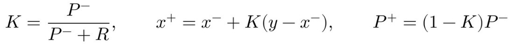{width=55%}

给定先验分布 x⁻和方差 P⁻，以及后验分布 y（具有方差 R），再结合增益 K 和后验分布 x⁺、P⁺，最终得到归一化创新值。

#### 公式 (7.2)

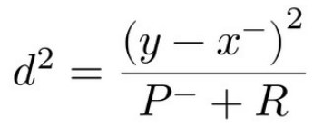{width=55%}

如果先验信息和证据一致，则质量门控服从χ²分布，具有一个自由度；当 d² > 3.84 (95%)时，表明模型存在不一致性。质量门控始终使用数据包方差 R = u²进行评估，因此质量策略绝不会让劣化的证据看起来更加一致。此时，质量状态决定了用于增益的方差。

<!-- compact-table -->
| 质量控制状态 | 孪生体作用 | 证据方差 R |
| --- | --- | --- |
| PASS | 更新 | R = u²，来自数据包 |
| WARN | `update_with_warning` | R = 2·u²，用于增益（按照团队政策规定）；质量门控为 u²；原因 |


## 第 33 页

[对照英文原件第 33 页](../../MRI_Local_Spectroscopy_Health_Digital_Twin_Hackathon_Dossier_v1.6.pdf#page=33)

<!-- compact-table -->
| 质量控制状态 | 孪生体作用 | 证据方差 R |
| --- | --- | --- |
|  |  | 显示 |
| FAIL | 拒绝 | 无更新；记录下来的证据存在问题，并附有相关原因。 |

为什么要在预算中已经包含线宽和信噪比的情况下，还要增加 WARN 证据呢？因为 CRLB 只是一个下限：当线形较宽且信噪比较低时，实际的拟合误差（基线、线形、重叠）通常会超过这个下限，而这个差距并不在预算范围内。因子 2 是一个被宣布的、可验证的团队政策，而不是一个物理常数。

对于 Cho/Cr 模型（§3.10）：x⁻ = 0.69，P⁻ = 0.05² + 0.03² = 0.0034，y = 0.85，数据包方差 0.06² = 0.0036，策略方差 R = 2 × 0.06² = 0.0072。此时 d² = 3.66（符合标准，但处于边缘水平），K = 0.321，x⁺ = 0.741，P⁺ = 0.00231（σ⁺ = 0.048）。图 16 展示了先验分布、证据和后验分布；虚线曲线表示未采用 WARN 策略的情况（K = 0.486，x⁺ = 0.768）。同样的步骤也适用于 NAA/Cr 模型以及 ROI 体积的计算（见表 1）。在六个月内，Cho/Cr 模型和 NAA/Cr 模型的流程噪声分别为 0.03（分别约为值的 4%和 2%），而 ROI 的流量则仅为 1%（221 毫米³）；这些均为假设性数值，实际上需要通过测试-重测法或文献数据进行验证。合成的基准测试（StarterPack v0.4）应确保在约 95%的情况下，95%的置信区间能够覆盖已知的真实值。

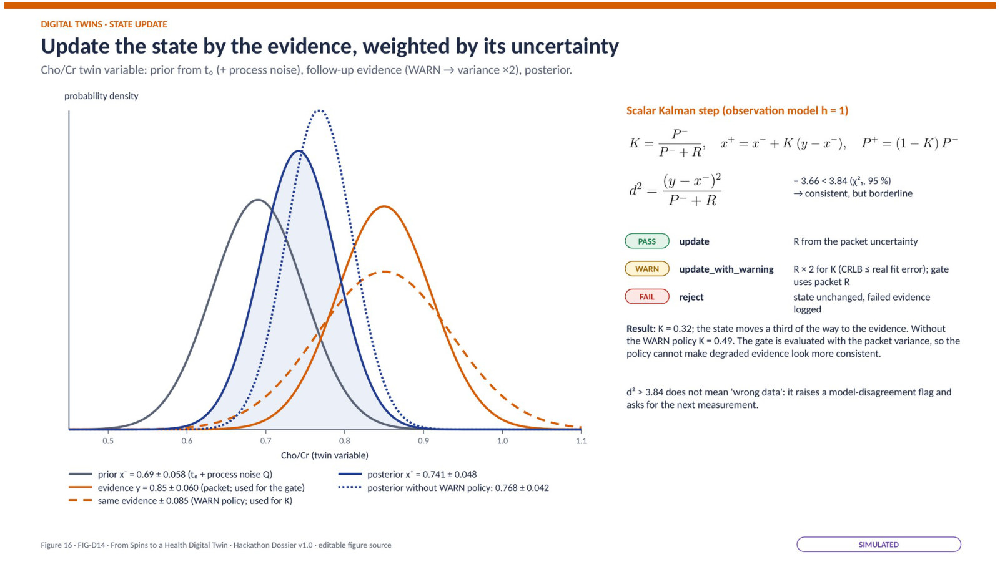

**图释**。Cho/Cr 卡尔曼更新。横轴为比值，纵轴为概率密度。左、右分布分别展示先验和随访证据，更新产生后验。WARN 时在增益计算中将观测方差加倍。图例同时给出按 PASS 处理时的比较曲线。

<!-- caption -->
图 16. Cho/Cr 孪生变量的门控卡尔曼更新（根据 StarterPack 数值进行模拟）。[图-D14]

### 7.6 预测与情景功能

一个最小孪生体预测的是一种范围，而非确定的未来结果：如果一切保持不变，预期的重复测量范围将是(x⁺ ± 1.96 (P⁺ + R)1/2，其中 R = 0.050²，这是经过重新调整后的 PASS 质量重复测量，参见§7.7）；在简单趋势模型下，预期的下一个值；或者，如果已知校准偏差得到校正，则预期的测量结果。这将不确定性转化为模型的活跃组成部分，并使差异具有可测试性。

### 7.7 接下来应该测量什么？——最安全的决策支持输出

对于教育性的健康示范项目而言，最可靠的决策支持来源是证据的选择，而非治疗方案的选择。对于一个没有偏差的重复测量模型，其方差可以表示为σm²。在下次更新之后，模型的后验方差将会是……

#### 公式 (7.3)

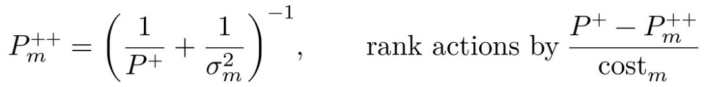{width=55%}


## 第 34 页

[对照英文原件第 34 页](../../MRI_Local_Spectroscopy_Health_Digital_Twin_Hackathon_Dossier_v1.6.pdf#page=34)

成本根据协议估计。一次 PRESS 采集耗时 64 × 2 s = 2.1 min。重新匀场后再采集（2 min 调整＋2.1 min 采集，σ_m = 0.050，质量为 PASS），可将 σ⁺ 从 0.048 降至 0.035，方差每分钟降低 2.7 × 10⁻⁴。不改变匀场，仅将平均次数加倍（4.3 min，σ_m = 0.042），线宽仍为 11.4 Hz，因而仍执行 WARN 策略。此时 σ⁺ 可降至 0.038，方差每分钟降低 2.1 × 10⁻⁴。图 17 建议重新匀场后重复 PRESS。两种方案的方差收益接近，重新匀场可以消除触发 WARN 的原因，并可消除潜在的 Cho 与 Cr 重叠偏差。若另一种解释是频率漂移或体素偏移等偏差，能区分这些解释的操作更有价值，即使不降低方差。可用体模和频率校准，也可重新定位后再测。这与美国国家科学院报告 [1] 的感测、同化、预测、调度闭环相呼应。

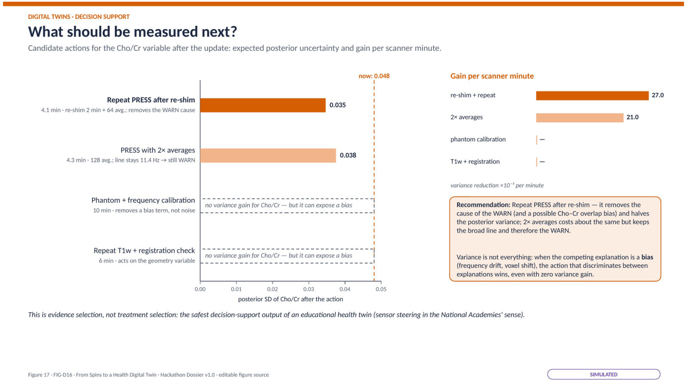

**图释**。比较下一次测量的候选方案。纵向比较用预计后验不确定度和每分钟的方差收益。当前不确定度为 0.048。优先重新匀场后重复 PRESS，因为此方案能处理触发 WARN 的线宽和潜在峰重叠偏差。

<!-- caption -->
图 17. 根据预期后验不确定性以及每台扫描仪每分钟的增益来排序候选测量方案（模拟结果）。[图-D16]

### 7.8 不确定性可视化

不确定性在附录中清晰可见，并非隐藏起来：置信带、后验区间、交通灯式质量控制、竞争假设条形图、未知状态和溯源徽章。不建议使用未经分解的单一风险评分——这会给人一种确定性的错觉。

### 7.9 推荐的数字化孪生伙伴讲座

一场持续 60-75 分钟的桥梁讲座从以下输入契约开始：状态与观测；一个透明的观测模型；时间和坐标对齐；先验→证据→使用方程(7.1)更新状态；不确定性传播以及创新质量门控；何时必须拒绝观测而不是同化它。该练习以三种结果结束——更新、带警告的更新或拒绝——以及关于下一步如何测量的建议。11 月 20 日，Ion Barosan 博士在 TU/e 进行了“数字孪生系统概念”的讲座（11:30-12:15）[45]。本章介绍了挑战赛的基本孪生体概念——一个状态、观测模型、一个带有质量门控的更新规则；TU/e 的讲座将其置于数字孪生系统中，如下所述。经过处理的更新（§3.10, §7.5）和探索之旅（停留在 6-9 处）仍然是常见的参考示例；团队在第一个质量门控阶段对它们进行深入探讨。

TU/e 视角下的数字孪生系统。本次讲座将孪生体视为一个完整的数字孪生系统（DTS），而不仅仅是模型本身：包括五个相互关联的组成部分——物理孪生体（PT）、数字孪生体（DT）、数字孪生数据（DD）、服务（SS）和连接（CN）——此外还包含一个用于推理和决策支持的认知组件（CC）。


## 第 35 页

[对照英文原件第 35 页](../../MRI_Local_Spectroscopy_Health_Digital_Twin_Hackathon_Dossier_v1.6.pdf#page=35)

推动系统的使命，四个视图（领域、开发者、应用程序、用户）以及通过服务级别互操作性层实现异构双胞胎的联合。在这个挑战中，各个组件之间的映射如下：

PT — 被测量的系统（一个人、一个电池单元、一个密封件）以及感知它的扫描仪；测量卡会标明其感知精度（第 4 章）。

DT — 具有观测模型的孪生体 x 以及门控更新规则（§3.7, §7.2–§7.5）；ₜ

DD — 证据包、数据字典、质量控制报告以及溯源信息（第 6 章和第 8 章）；

CN — 每个接口处的数据契约：单位、不确定性和溯源信息会随每个数字一同传输（ schema v1.0，第 8 章）；

SS — 监控功能，包括更新决策（更新、带警告的更新或拒绝），以及不确定性显示功能（参见§7.5 和§7.8 章节）；

CC — 即“下一步该做什么”的推荐方案，包含明确的限制条件：孪生体提供建议，但不进行诊断（§7.7, §9.11）；

使命与联盟——挑战性问题“它是否发生了变化，我们又能有多大的把握？”通过共享合同将这样的双胞胎联合起来，是实现§1.4 中整体福祉的架构。一个团队的架构幻灯片可以列出四个视图。

### 7.10 数字孪生成果交付物

定义了状态向量、观测模型以及更新规则；

至少有一次先前的证据与声明中的质量控制政策相符的后验演示；

至少一种预测或情景对比；

可见的不确定性以及其他的解释方案；

一项基于模型不确定性的后续证据提案；

对原型功能的明确说明，不包括其隐含功能。

### 7.11 本次挑战赛的孪生体成熟模型

<!-- compact-table -->
| 级别 | 名称 | 最低能力 |
| --- | --- | --- |
| 0 | 数据查看器 | 显示图像和光谱；无持久状态 |
| 1 | 纵向登记 | 随时间链接会话和衍生测量数据 |
| 2 | 证据感知模型 | 存储不确定性、溯源和测量上下文 |
| 3 | 动态孪生体演示器 | 根据新的观测数据更新持久状态。 |
| 4 | 孪生体预测性 | 生成预期范围或情景预测 |
| 5 | 证据引导孪生体 | 推荐能够最大程度降低不确定性的测量方法 |

最低级别的马拉松比赛目标是达到 3 级；实力较强的团队可以挑战 4 级目标；而 5 级目标则是具有挑战性的目标。目前，MRI Data Explorer v0.1 版本仍处于 1-2 级水平（见图 18；第 10 章）。


## 第 36 页

[对照英文原件第 36 页](../../MRI_Local_Spectroscopy_Health_Digital_Twin_Hackathon_Dossier_v1.6.pdf#page=36)

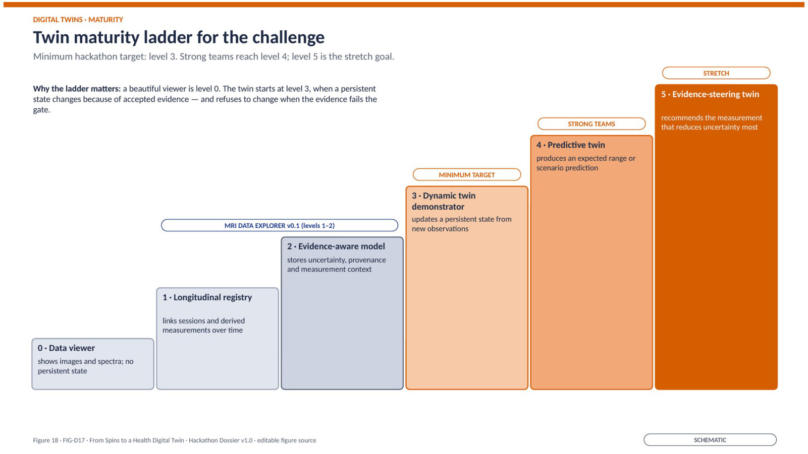

**图释**。成熟度从显示数据逐步发展到持久状态、证据门控更新、预测与情景分析，直至主动选择证据。挑战赛最低目标为第 3 级，第 4 级面向较成熟的团队，第 5 级为进阶目标。

<!-- caption -->
图 18. 孪生体成熟阶梯图，显示了马拉松竞赛的目标以及 MRI 数据探索器的当前位置。[图-D17]


## 第 37 页

[对照英文原件第 37 页](../../MRI_Local_Spectroscopy_Health_Digital_Twin_Hackathon_Dossier_v1.6.pdf#page=37)

### 8. 跨团队整合与证据包

### 8.1 接口对象：一个证据包

最实用的集成设备是一种与模态无关的证据包。量子工程和精密机械负责测量和不确定性方面的处理；数据科学则负责验证、标准化和存储该证据包；数字孪生技术则利用该证据包来更新状态。一个证据包可以包含一份由 MRI 得出的区域体积数据、一份 ADC 估计值、一份 MRS 特征数据或一份校准结果。

### 8.2 证据包模式 v1.0

<!-- compact-table -->
| 字段 | 示例 | 责任方 |
| --- | --- | --- |
| 数据包版本号，数据包 ID | 1.0 · E-t1-cho（也称为 E-t1-roi、E-t1-naa） | 数据科学 |
| `subject_id`, `session_id`, `relative_time` | sub-01 · ses-followup · 第 6 个月 | 数据科学 |
| 方式 | MRI / qMRI / MRS / MRSI / HP13C / 校准 | 数据科学 |
| `source_object`, `source_sha256` | NIfTI-MRS 文件 + 哈希值 | 数据科学 |
| `spatial_reference` | 扫描框+可见区域角点，配准变换 | 精密机械／计量学 |
| 可观测量、数值、单位、有效范围 | `Cho_Cr` · 0.85 · 1（无量纲） · [0, 3] | 量子工程 |
| 不确定性 (类型, 值) | SD 0.06（拟合+线形+布局） | 精密机械／计量学 |
| `qc_checks`[] | 每个质量门控的{名称, 值, 单位, 阈值, 状态, 所有者}（§5.8） | 共同门控 |
| `qc_status`, `qc_reasons` | WARN · SNR 24.8 < 25; FWHM 11.4 Hz > 10 Hz | 共同门控 |
| 起源 | 模拟（入门包）或测量 | 数据科学 |
| 价值认识论，决策认识论 | 推导出的比率 · 推断出的孪生体行为 | 全部 |
| `system_qc_id`, `protocol_match`, comparable | sysqc-2026-11-20 · 真实 · 为真 | 精密机械／计量学 |
| `acquisition_context` | ν0 123.25 MHz，B0 标称值 3 特斯拉，压力模式，TE 时间长度为 30 毫秒，TR 为 2 秒，进行 64 次平均处理。 | 量子工程 |
| 校准 ID，阈值参考 | `phantom-2026-11` · 阈值 v1.0 | 精密机械／计量学 |
| 处理 | 管道 + 版本 + 参数 | 数据科学 |
| 溯源 | 父实体 + 活动（PROV） | 数据科学 |
| `twin_action` | `update_with_warning` + 原因 | 数字孪生 |
| `interpretation_limit` | 并非临床声明；仅限正面视野范围 | 全部 |

该挑战手册附带了机器可读的 schema `evidence_packet_v1.0.schema.json`（JSON Schema 2020-12）以及三个示例数据包（PASS、WARN、FAIL）。§5.8 中的每个质量门控都是一个 qcchecks[]的条目。有两个规则无法在 schema 中表示，它们通过配套脚本 `validate_packet.py` 进行验证：aggregate `qc_status` 等于最严格的检查要求，而 value 位于 `valid_range` 内。那些属于更新而非某个数据包中的量——u(Δ)、z、K、d²——存储在孪生体的更新日志中（附录 E.2）。

### 8.3 不同轨道之间的接口协议

<!-- compact-table -->
| 生产者 | 必须提供 | 消费者不得假设 |
| --- | --- | --- |
| 量子工程 | 含义、单位、模型假设、有效参数范围、证据性质标签 | 一个数字在不同的协议之间是可比的 |
| 精密机械／计量学 | 校准状态、不确定因素、接受限度 | 那次经过的 QC 确实进行了生物学上的解释。 |
| 数据科学 | 结构化数据包、溯源、质量控制标志、转换历史 | 一个清晰的模式能够消除测量偏差 |
| 数字孪生 | 状态映射、更新规则、后验不确定性、情景输出 | 模型预测与临床事实的一致性 |


## 第 38 页

[对照英文原件第 38 页](../../MRI_Local_Spectroscopy_Health_Digital_Twin_Hackathon_Dossier_v1.6.pdf#page=38)

### 8.4 共享坐标系统与时间

空间和时间对齐是可能导致整合失效的两个关键因素。每一个空间特征都依赖于扫描仪坐标、已配准的解剖学框架或具有文献记载的命名区域；光谱学特征还携带着化学位移信息。每一次观测都有一个会话标识符和相对时间。没有体素位置的光谱学值是不完整的；同样，没有配准框架的图像特征也是不完整的。

### 8.5 作为集成测试的一次更新事件

团队在构建更多功能之前，先就一条黄金路径达成一致：选择基线状态，接收一个随访数据包，运行质量门控，更新一两个变量，展示不确定性并解释结果——这正是§3.10 中所述的工作流程。如果这条路径可以逐段追踪，那么架构是可靠的；可以在不改变逻辑的情况下添加更多的功能模块。

### 8.6 差异主题

一个有价值的特征可以说明为什么两份证据会存在差异。建议至少考虑三个因素：

测量不一致：两种协议估计的是同一个量，但超出重复性系数的差异较大。

多模态不一致：局部波谱发生变化时，解剖结构保持稳定，反之亦然。

模型不一致性：孪生体预测的稳定性与新的证据不符，因为新证据的方差大于预期范围（d² > 3.84）。

该团队不会自动解决这些差异问题。他们会将这些差异揭示出来，并命名相应的测量或校准过程，以便区分不同的解释方案。

### 8.7 跨团队回归测试

<!-- compact-table -->
| 测试 | 通过条件 |
| --- | --- |
| 单位 | 每个定量值都有一个明确且符合尺寸单位的单位。 |
| 溯源 | 每个显示的孪生体变量都可以追溯到源数据，并且处理时间不到两分钟。 |
| QC | 失败数据包无法更新孪生体；警告数据包仅根据声明策略进行更新。 |
| 不确定性 | 增加数据包的不确定性会降低其影响（K 值越小越好）。 |
| 空间 | 女士和区域特征始终与正确的注册位置相关联。 |
| 版本 | 更改分析版本会导致溯源信息的可见差异 |
| 证据性质标签 | 模拟得到的数值从不以实测值的形式显示；示意图上也会注明这一点。 |
| 预测 | 观测值和预测值在视觉上是有明显区别的。 |
| 限制 | 用户界面明确说明该原型是非临床的。 |

### 8.8 常见的集成故障模式

<!-- compact-table -->
| 失败 | 为什么它会失败 | 修正 |
| --- | --- | --- |
| 漂亮的仪表盘，但没有更新逻辑。 | 这是一个观察者，而不是孪生体。 | 添加一个持久性状态，以及一个基于证据的更新机制。 |
| 没有溯源的 AI 结果 | 无法被审计或复制 | 存储模型、版本、来源及不确定性信息 |
| 所有特征均被归一化为 0–1 区间。 | 物理含义和单位已丢失 | 保留原始的数值、单位、公式符号、缩写、文件名和程序标识。 |
| 与几何学分离的光谱学 | 局部化学环境已失去定位 | 存储 VOI 坐标、位移和配准 |
| 将 QC 视为一个神奇的得分 | 主要的误差来源是隐藏起来的 | 显示组件检查以及不确定性的影响因素 |


## 第 39 页

[对照英文原件第 39 页](../../MRI_Local_Spectroscopy_Health_Digital_Twin_Hackathon_Dossier_v1.6.pdf#page=39)

<!-- compact-table -->
| 失败 | 为什么它会失败 | 修正 |
| --- | --- | --- |
| 具有临床意义的风险输出结果 | 声明了一个教育原型 | 展示出对下一步措施的信心和支持吧。 |


## 第 40 页

[对照英文原件第 40 页](../../MRI_Local_Spectroscopy_Health_Digital_Twin_Hackathon_Dossier_v1.6.pdf#page=40)

### 9. 马拉松式开发活动的实施、交付成果以及评估方式

### 9.1 事件时间线

该挑战赛被纳入教学日程中。2026 年 11 月 20 日星期五的预赛讲座时间段为 10:00 至 13:00，地点在 KICU 乌尔姆（Lise-Meitner-Straße 10/1），同时也有线上讲座：10:00 介绍：针对整体福祉的联合数字孪生架构（乌尔姆）；10:30 数据科学：数据定义与合同（布拉格科技大学）；11:15 休息；11:30 数字孪生体（埃因霍温理工大学）；12:15 量子工程讲座，内容包括 MRI 和空间分辨光谱学以及挑战赛简介（乌尔姆）；12:45 问答环节。2026 年试点项目中，精密机械/计量学没有自己的讲座：第 5 章将承担该方向的教学任务，而量子工程部分的讲座则回顾了其要点。InnovateU 黑客松将在同一地点举行：签到和正式配准时间为星期五 15:00 至 16:00（16:00 之后不再接受报名），团队组建仪式为 16:00，晚餐时间为 19:00；周六午餐时间为 12:00，演讲评审为 13:30，最终演讲为 15:00，颁奖典礼为 16:00，活动结束时间为 17:00。团队必须在正式配准后才能组建，因此团队在活动开始时就已组建完成，而不是在讲座期间。11 月 20 日的合作伙伴讲座内容总结在§6.10（布拉格科技大学）和§7.9（埃因霍温理工大学）中。所有文件都会提前分发给参与者；探索者的 9 站引导之旅将代替单独的参观流程。图 19 展示了拟议的导师引导流程。

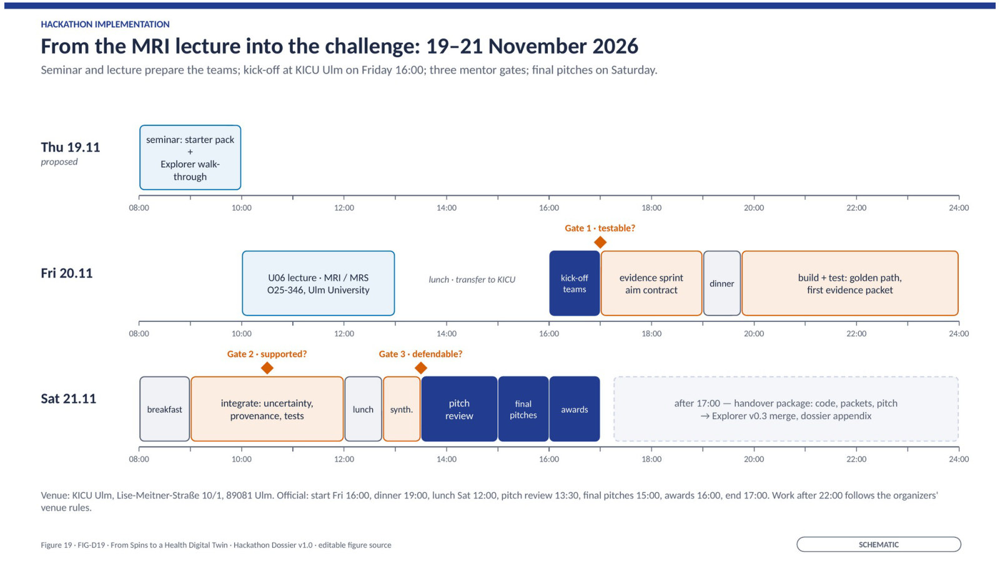

**图释**。图示为 2026 年 11 月 19–21 日的旧安排。从 StarterPack 研讨、Explorer 演示及 MRI 讲座进入挑战。周五 16:00 在 KICU Ulm 启动，设三次导师检查，周六最终陈述。本版本的最新时间以 §9.1 正文为准。

<!-- caption -->
图 19。从 MRI 讲座过渡到挑战赛，展示了所提出的导师机制。图中显示的房间（O25-346）以及 11 月 19 日星期四的演练属于 10 月计划；当前计划位于§9.1 部分。[FIG-D19]

### 9.2 目标合同

在开始时，每个团队都需要撰写一份一段落的目标合同：物理对应物、选定的模式或模式、需要更新的一个状态变量、需要解决的其中一个歧义问题、一个原型输出以及一个限制条件。这份合同应放在一张幻灯片上。导师质量门控 1 会检查该问题是否在事件范围内是可测试的。

### 9.3 推荐节奏

<!-- compact-table -->
| 时间 | 舞台 | 所需的结果 |
| --- | --- | --- |
| 周五 16:00–17:00 | 开球和框架 | 组建队伍并安排对战；分配赛道；选定案例；起草目标协议 |
| 周五 17:00（质量门控 1） | 可测试吗？ | 目标合同 + 选定的状态变量 + 数据来源 |


## 第 41 页

[对照英文原件第 41 页](../../MRI_Local_Spectroscopy_Health_Digital_Twin_Hackathon_Dossier_v1.6.pdf#page=41)

<!-- compact-table -->
| 时间 | 舞台 | 所需的结果 |
| --- | --- | --- |
| 周五 17:00–19:00 | 证据冲刺 | 数据审计、物理假设、校准/质量控制图、未知变量 |
| 周五 19:45–很晚 | 构建和测试 | 第一个证据包，黄金路径，最小更新逻辑 |
| 时间：Sat 09:00–12:00（质量门控 2 在 10:30） | 积分 · 支持吗？ | 接口、不确定性、溯源、回归测试；质量控制 + 不确定性 + 溯源 + 替代解释 |
| 星期六 12:45–13:30 | 合成 | 工作演示版、架构图、局限性说明、产品介绍文案 |
| 时间：13:30（质量门控 3 = 音高评审） | 可防御的？ | 回归测试、限制卡、音高排练 |
| 星期六 15:00–16:00 | 防御 | 五分钟介绍，导师提问，交接文件包 |

### 9.4 团队构成

理想的团队应该是跨学科的。一个五人团队中，每个方向都有一个负责人，此外还有一名协调员和视觉沟通者；规模较小的团队则会合并这些角色。没有任何一个方向可以被视为另一个方向的黑箱。

### 9.5 建议的挑战赛道

<!-- compact-table -->
| 车道 | 核心问题 | 轨道 |
| --- | --- | --- |
| A · 真正的变化还是测量上的变化？ | 该团队能否区分物理变化和重复性以及校准效应？ | 全部四项；最严格的计量学标准 |
| B · MRI + 局部 MRS 孪生体 | 局部化学能有什么独特之处，使得形态学无法展现呢？ | 量子工程 + 数据科学 + 数字孪生 |
| C · 低场随访 | 如何在不因主题变化而导致对比度变化的情况下比较多场测量数据呢？ | 量子工程 + 精准性 + 数据科学 |
| D · HP ¹³C 代谢轨迹 | 如何更新一个空间孪生体的瞬态代谢序列？ | 量子工程 + 数据科学 + 数字孪生 |
| E · 接下来要测量什么？ | 哪种采集方式每分钟能最大程度降低不确定性？ | 数字孪生+精密+量子工程 |
| F · 精密固定装置 / 体模 | 如何使几何形状和校准过程更加可重复性？ | 精度 + 量子工程 + 数据科学 |
| G · 探索模块 | MRI 数据浏览器（第 10 章）中，哪个缺失的模块对金路径来说最为重要？ | 任何；以软件为导向的团队 |

### 9.6 导师门限

<!-- compact-table -->
| 质量门控 | 问题 | 预期的证据 |
| --- | --- | --- |
| 第 1 次检查 · 周五 17:00 | 该团队正在解决一个具体的纵向证据问题吗？ | 目标合同 + 状态变量 + 数据来源 |
| 第 2 次检查 · 周六 10:30 | 这些证据是否支持进行此次更新？ | QC + 不确定性 + 溯源 + 替代解释 |
| 第 3 次检查 · 周六 13:30 | 该团队能够解释不同领域之间的权衡与限制吗？ | 回归测试 + 限制卡 + 音高 |

### 9.7 必需的成果

一页式挑战赛画布与系统架构；

单一可读取数据字典和证据包示例（规范版本 1.0）；

一张测量卡和一张不确定度卡；

一个能够执行至少一次从基线到随访更新的可操作或可点击的原型；

一种溯源视图，将孪生体追溯到原始证据；

一种不确定性及竞争性解释的观点；

下一个证据提案；

五分钟的陈述内容，以及简短的限制性声明；


## 第 42 页

[对照英文原件第 42 页](../../MRI_Local_Spectroscopy_Health_Digital_Twin_Hackathon_Dossier_v1.6.pdf#page=42)

为获得课程学分：个人对自身的方向贡献以及从其他方向中学到的知识的反思。

### 9.8 技术选择

<!-- compact-table -->
| 级别 | 可能的加工路径 | 良好的输出效果 |
| --- | --- | --- |
| 初学者 | PowerPoint / Figma / Miro + 电子表格 | 可点击的故事板、证据表、更新逻辑 |
| 中级 | 电子表格 + Python 笔记本 | QC 仪表板 + 透明的状态更新 |
| 中级 | HTML / CSS / JavaScript，以 MRI 数据浏览器 v1.0-rc5 为基础 | 具有质量门控的互动纵向视图 |
| 高级 | Streamlit / Dash | 数据驱动的孪生体演示器 |
| 高级 | Python + pydicom, nibabel, spec2nii, FSL-MRS 或 Osprey + API | 集成处理与更新流程 |
| 精密设计 | CAD + 公差表 + 简单仿真 | 与不确定性降低相关的固定装置或体模概念 |

不需要复杂的堆栈。一个具有正确证据逻辑的透明原型比一个无法解释其输入、假设或不确定性的复杂模型更为优越。

### 9.9 五分钟演讲模板

<!-- compact-table -->
| 时间 | 内容 |
| --- | --- |
| 0:00–0:30 | 问题：我们正在解决哪种纵向不确定性？ |
| 0:30–1:15 | 证据：MRI/MRS 数据及其所具有的信息价值 |
| 1:15–2:00 | 信任：校准、质量控制、不确定性——以及最主要的贡献因素 |
| 2:00–3:00 | 原型：展示孪生体更新、质量门控和溯源 |
| 3:00–3:45 | 解释：发生了什么变化？哪些情况仍然不确定？存在的不同解释 |
| 3:45–4:30 | 下一个需要验证的方面：接下来应该测量或校准什么，以及为什么如此做。 |
| 4:30–5:00 | 限制与转移：同一链条如何跟随设备或物体 |

### 9.10 评估：学术成就与竞技能力

两种评估逻辑并存。学术性评估用于检查学习成果，个体可追溯性评估则侧重于反思；而竞争性卓越评估则奖励团队原型及展示成果。一个团队即便在另一个团队获胜的情况下，也能在教育方面取得成功。

<!-- compact-table -->
| 标准 | 问题 | 重量 |
| --- | --- | --- |
| 科学准确性 | MRI/MRS 的概念和物理解释是否具有说服力？ | 20 % |
| 测量信任 | 校准、重复性和不确定性是否得到了重视？ | 15 % |
| 数据完整性 | 这些元数据、溯源、质量控制、单位和认知标签是否明确？ | 15 % |
| 数字孪生逻辑 | 持久状态、门控更新、预测或情景，还是不确定性？ | 20 % |
| 横向整合 | 这四条轨道真的会相互作用吗？ | 15 % |
| 原型与沟通 | 该演示是否可行？能否清晰地解释结果？ | 10 % |
| 伦理与界限 | 隐私问题、偏见以及临床上的非等价性是否值得关注？ | 5 % |

### 9.11 伦理、隐私与临床非等价性

仅使用合成数据、公开数据、去标识化数据或教师准备的数据。团队从不以个人预测的形式提供医疗建议。任何个人或临床衍生数据集在使用前都需要获得相关机构的批准。即使经过去标识化处理，影像数据仍可能包含敏感信息；元数据的最小化、匿名 ID 和访问控制是数据设计的一部分。偏见也是一个衡量问题：模型


## 第 43 页

[对照英文原件第 43 页](../../MRI_Local_Spectroscopy_Health_Digital_Twin_Hackathon_Dossier_v1.6.pdf#page=43)

在某一扫描仪、领域、人群或协议上训练出的孪生体可能无法进行转移，因此孪生体会显示其数据和模型域。如果无法进行转移，则无法验证该条件下的正确输出结果（附录一）。

### 9.12 信用确认与局部协调

对于 2026 年的试点项目，1 ECTS 挑战赛是一个明确的紧凑路径，但认可仍然局限于本地范围（§1.11）。在活动开始前，每个参与机构都会发布一份简短的认可说明：符合条件的学生、所需的准备工作、出席和完成规则、评估证据、负责的协调员以及任何需要的讲师确认信息。这些安排是集中制定的，不会在活动期间由讲师或学生自行决定。

### 9.13 后马拉松项目的路线图

1. 冻结最优的跨方向证据模式和数据字典（证据包 v1.x）。

2. 构建一个包含已知基准数据、测量误差以及测试-重测对的合成基准集（StarterPack v0.4，附录 C）；StarterPack v0.3 仅包含附录 B.3 中的修复方案。

3. 在经过隐私和许可审核后，再添加一个真实的 MRI/MRS 数据集。

4. 使用体模或数字参考对象来验证精度和不确定性层。

5. 将原型扩展为适用于 MRS-BIDS/NIfTI-MRS 输入格式，并实现一个可复现的处理容器。

6. 在基线路径稳定后，增加第二种模式或仅进行低场随访。

7. 将 HP ¹³C 介绍为一种研究扩展工具，它具有共识校准功能和动力学分析指导功能[7]。

8. 将最佳的团队模块整合到 MRI 数据浏览器中（第 10 章），并在教学中使用该平台。


## 第 44 页

[对照英文原件第 44 页](../../MRI_Local_Spectroscopy_Health_Digital_Twin_Hackathon_Dossier_v1.6.pdf#page=44)

### 10. MRI 数据浏览器及其扩展程序

### 10.1 在挑战赛中的角色

MRI 数据浏览器 v0.1 是一个无需依赖的 JavaScript 教学演示工具，可以在浏览器中离线使用。它通过五个层次展示了 StarterPack 的功能：DICOM→NIfTI→BIDS/MRS-BIDS→质量控制+功能→孪生体证据门控，同时提供了 3D 和正交切片视图、磁共振波谱成像（MRSI）视图、数据窗口（内容、质量、交接）以及 PASS/WARN 证据门控。该工具可以加载 NIfTI-1、显式 VR DICOM、JSON 和 CSV/TSV 格式的数据。它是软件团队共享的起始点，也是导师们常用的查看工具。它明确不是临床查看器、医疗设备、经过验证的 DICOM 工作站或 BIDS 验证工具。参与者可以获取当前版本 v1.0-rc5（2026 年 11 月 9 日），该版本以单个离线 HTML 文件的形式提供，包含 9 个步骤的引导式浏览、词汇表按钮、可见的 VOI 立方体以及用于解释 MRSI 的“多个立方体（模拟）”视图。

在成熟度阶梯上（图 18），探索者位于第 1-2 层：它负责链接会话，显示质量控制与交接规则，但不保留持久状态，也不执行任何更新操作。这个空白期正是黑客松的最低目标。

### 10.2 四条轨道上的延伸部分

配套文件 `MRI_Data_Explorer_Extension_Strategy_v1.0` 说明 Explorer 如何扩展成四个方向共同使用的教学平台。图 20 概述了这一计划。

<!-- compact-table -->
| 方向 | 模块（v0.3 → v1.0） |
| --- | --- |
| 量子工程 | 前向模型实验室（SE／IR／GRE 信号方程）；k 空间与采样（视场、混叠、点扩散函数）；带有 CRLB 的 MRS 模拟器与拟合工具；HP ¹³C 动力学分析，包含射频消耗数据；偏振与信噪比计算工具 |
| 精密机械／计量学 | 采用化学位移进行体素叠加；B0/匀场→线宽模型；梯度非线性与体模质量控制；重复性（Bland–Altman，RC）；具有相关性的 GUM 预算编辑器 |
| 数据科学 | 支持使用已测试过的 ppm 协议的 NIfTI-MRS 读取器；BIDS/MRS-BIDS 验证工具（简化版）；每个数据包的 JSON 格式校验；PROV 图表和 SHA-256 清单文件；DICOM 标签的 t0 与 t1 之间的对比分析 |
| 数字孪生 | 持久状态存储和时间线；基于质量门控的卡尔曼/贝叶斯更新；预测带和差异标志；信息价值规划器；审计跟踪导出 |

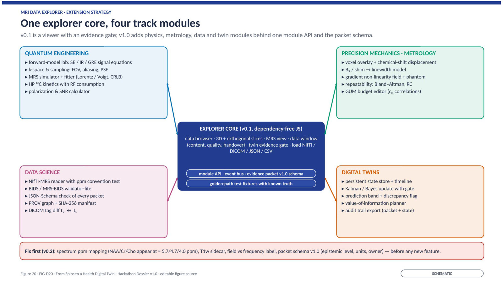

**图释**。一个 Explorer 核心通过公共模块 API 与证据包 v1.0 接入四个方向。模块包括正向 MRI 信号、波谱模拟和拟合、定位和不确定度、数据规范与溯源以及数字孪生状态更新。原图将 v0.1 标为含证据门控的查看器。

<!-- caption -->
图 20. 一个 Explorer 核心，四个方向模块位于一个模块 API 之后，以及证据包模式 v1.0。[图-D20]


## 第 45 页

[对照英文原件第 45 页](../../MRI_Local_Spectroscopy_Health_Digital_Twin_Hackathon_Dossier_v1.6.pdf#page=45)

### 10.3 首先进行修复

在新功能之前，v0.2 修复了 v0.1 评审中发现的问题：ppm 映射（§4.4）、T₁w 侧边栏、场与频率之间的证据性质标签以及数据包模式（证据性质级别、单位、所有者、阈值）。每个模块都遵循相同的定义：一个具有已知真理的计量学参考案例，针对数据包模式进行单元测试，每个输出结果都有一个证据性质标签，挑战手册附录中有一段描述，并且不得提出任何临床声明（图 21）。

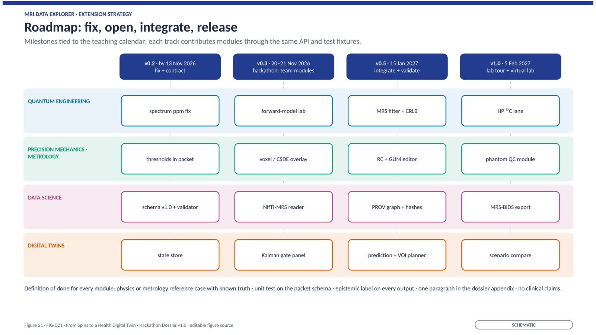

**图释**。路线图四个时间点：v0.2 在 2026 年 11 月 13 日前修复问题，v0.3 在 11 月 20–21 日开放团队模块，v0.5 在 2027 年 1 月 15 日集成验证，v1.0 在 2 月 5 日随导览和虚拟实验台发布。各方向共用模块 API 与测试样例。

<!-- caption -->
图 21. Explorer 的路线图：修复版本（v0.2，发布于 11 月 13 日之前）；开放给团队模块使用版本（v0.3，开发阶段）；集成与验证版本（v0.5，发布于 2027 年 1 月）；最终版本发布，附带实验室参观和虚拟实验室功能（v1.0，发布于 2027 年 2 月 5 日）。[图-D21]

发布名称说明：计划作为 v0.2 版本发布的修复内容分别被命名为 v1.0-rc4（2026 年 10 月 20 日）和 v1.0-rc5（2026 年 11 月 9 日）。而团队模块阶段（图 21 中的 v0.3 版本）则指的是整个黑客松活动本身。


## 第 46 页

[对照英文原件第 46 页](../../MRI_Local_Spectroscopy_Health_Digital_Twin_Hackathon_Dossier_v1.6.pdf#page=46)

### 11. 结论与开发路线图

### 11.1 主要结论

这场挑战并非要在一个周末内构建出患者的数字孪生体——这样的表述容易引发过度承诺。更可行的挑战在于进行透明的纵向更新，其中 MRI 和局部波谱提供证据，精密工程则决定这些证据是否可信，数据科学则确保数据的意义和溯源性得到保留。同时，孪生体模型在显示不确定性的同时，会更新虚拟状态——并等待下一次测量。

### 11.2 为什么这符合课程要求

这个主题源自 NMR 量子工程课程——自旋物理学、信号形成、梯度、松弛、光谱学、MRI 和超极化技术——它创造了与精密系统、数据基础设施和数字孪生之间的真实接口。这是一个综合性的挑战，而不是将应用直接粘贴到课程之后的科学内容。

### 11.3 为什么纵向框架结构很有用，但必须保持适度

“寿命”是一个纵向系统的概念——一个人的生命历程，一个设备的生命周期：不同种类的测量数据会随着时间的推移而累积，而虚拟表示必须保持一致性，同时仪器、协议和模型也在不断演变。原型仅展示了几个时间点。这个更广泛的标题为研究提供了一定的范围，而不会迫使学生去假设他们能够全面模拟健康状况。

“健康”一词在这里具有广义含义：指一个系统相对于其自身历史以及预期功能的状态。大脑就是一个典型的例子，选择这个对象是因为在大脑区域，磁共振成像和局部波谱技术已经非常成熟，而且可以获取具有已知真实性的合成数据。选择这个对象并非因为该方法仅限于医学领域。磁共振技术同样适用于对技术系统的内部进行监测：例如，Li MRI 能够检测工作电池中的锂金属微结构[41]；对锂离子电池外部磁场的磁共振成像可以揭示其充电状态以及制造缺陷[42]；单面核磁共振技术可以测量弹性体的交联密度和老化情况、溶剂对聚合物的影响，以及多孔材料和文化遗产物体的结构[43]。磁共振扫描仪本身也是一种设备：它的仪器会进行检查，而体模校准（§5.3）则构成了该仪器的长期健康记录。

因此，各团队可以提出一个转移方案（附录 J.6）：保留证据包、质量门控、不确定度预算和更新规则，并交换观测模型 hm 和状态变量。只有当团队为新系统指定了测量模型、校准和比较基线时，转移才是可信的；不可协商的规则保持不变。

### 11.4 分发给学生之前的准备状态

<!-- compact-table -->
| 项目 | 状态 (2026 年 11 月 20 日) |
| --- | --- |
| 示例实验（合成类脑主题，前额区域视觉输入） | 已定义（第 3 章）；StarterPack v0.3 版本已发布（修复了 v0.2 版本中的问题，功能与 v0.2 版本相同） |
| 三层数据包（功能·图像/光谱·高级原始数据/动态数据） | StarterPack v0.3 中的 Tiers 0–1；tier 2 开放（HP ¹³C，体模） |
| 每个方向接口的所有者 + 一个集成所有者 | 2026 年 11 月 20 日举行的预赛讲座：乌尔姆（介绍；量子工程及挑战赛简介），布拉格科技大学（数据科学，Y. Prokop [44]；第 6.10 节中的总结），埃因霍温理工大学（数字孪生系统概念，I. Barosan [45]；第 7.9 节中将第 7 章的内容映射到埃因霍温理工大学的组件上）。2026 年试点项目中没有举行精密机械/计量学方面的讲座：该方向仍保持在第 5 章的水平。每个接口的名称所有者仍然未确定。 |


## 第 47 页

[对照英文原件第 47 页](../../MRI_Local_Spectroscopy_Health_Digital_Twin_Hackathon_Dossier_v1.6.pdf#page=47)

<!-- compact-table -->
| 项目 | 状态 (2026 年 11 月 20 日) |
| --- | --- |
| 冷冻证据包模式与质量控制字段列表 | 本挑战手册中的版本为 v1.0（参见第 8.2 节，附录 E） + 包含 PASS/WARN/FAIL 示例的 `evidence_packet_v1.0.schema.json` 文件 |
| 讲师真实文件（真实变更与受干扰的变更） | 适用于 StarterPack v0.3 版本（仅限讲师使用，不适用于学生套餐）；模板详见附录 C |
| 过程噪声 Q 值及 WARN 政策系数 | 教学值（§7.5）；应使用测试-重测法或文献中的数值来替代 |
| 在 Mentor 简报会上，会介绍截止时间和评分标准。 | Gates §9.6，rubric §9.10 以及附录 G |
| 从这份挑战手册中得出的两页学生简介 | 这次黑客松参赛作品以及由探险者提供的 9 站导览服务，都只是这个项目的简短版本而已。 |
| StarterPack / 探索者修复功能（像素比映射、T1w 侧架、字段标签） | 完成——StarterPack v0.3 和 MRI Data Explorer v1.0-rc5 版本（2026 年 11 月 9 日） |

### 11.5 最终声明

最终声明

数字孪生不应因了解超出测量支持范围的信息而获得奖励。相反，它应该因准确理解证据所支持的内容、对证据的信任程度以及下一步应测量的内容而获得奖励。


## 第 48 页

[对照英文原件第 48 页](../../MRI_Local_Spectroscopy_Health_Digital_Twin_Hackathon_Dossier_v1.6.pdf#page=48)

### 参考文献

参考文献已在 2026 年 10 月 20 日通过出版社、存储库、arXiv、W3C 以及 BIPM 的记录进行了核对。

[1] National Academies of Sciences, Engineering, and Medicine. Foundational Research Gaps and Future Directions for

数字孪生技术。华盛顿特区：国家科学院出版社；2024 年。doi:10.17226/26894。

[2] Tudor BH, Shargo R, Gray GM, et al. A scoping review of human digital twins in healthcare applications and usage

patterns. npj Digit Med. 2025;8(1):587. doi:10.1038/s41746-025-01910-w.

[3] Hall MG, Cashmore M, Cho H, et al. Metrology for MRI: the field you've never heard of. MAGMA. 2025;38(3):387–412.

doi:10.1007/s10334-025-01238-2.

[4] Boss MA, Malyarenko D, Partridge S, et al. The QIBA Profile for Diffusion-Weighted MRI: Apparent Diffusion Coefficient

作为一种定量成像生物标志物。《放射学》2024 年；313(1):e233055。doi:10.1148/radiol.233055。

[5] Lin A, Andronesi O, Bogner W, et al. Minimum Reporting Standards for in vivo Magnetic Resonance Spectroscopy

(MRSinMRS)：专家们的共识建议。NMR Biomed. 2021;34(5):e4484. doi:10.1002/nbm.4484。

[6] Bouchard AE, Wong D, Bogner W, et al. MRS-BIDS, an extension to the Brain Imaging Data Structure for magnetic

共振光谱学。科学数据。2025;12:1384. doi:10.1038/s41597-025-05543-2。

[7] Larson PEZ, Bernard JML, Bankson JA, et al. Current methods for hyperpolarized [1-13C]pyruvate MRI human studies.

Magn Reson Med. 2024;91(6):2204–2228. doi:10.1002/mrm.29875.

[8] Hsieh CY, Lai YC, Lu KY, Lin G. Advancements, challenges, and future prospects in clinical hyperpolarized magnetic

共振成像：一项全面综述。Biomed J. 2025;48(3):100802. doi:10.1016/j.bj.2024.100802。

[9] Wang ZJ, Ohliger MA, Larson PEZ, et al. Hyperpolarized 13C MRI: State of the Art and Future Directions. Radiology.

2019;291(2):273–284. doi:10.1148/radiol.2019182391.

[10] Kravchenko D, Hagar MT, Vecsey-Nagy M, et al. Low-field and portable MRI technology: advancements and

Innovations. Eur Radiol Exp. 2025;9:103. doi:10.1186/s41747-025-00638-2.

[11] Oved T, Lena B, Najac CF, Shen S, Rosen MS, Webb A, Shimron E. Deep learning of personalized priors from past MRI

这些扫描技术使得低成本系统也能实现快速且高质量的床边磁共振成像。相关论文可参考：arXiv:2505.02470; 2025 年。

[12] Brunnquell CL, Andrews TJ, Fielden SW, et al. AAPM Task Group Report 325: MRI static magnetic field homogeneity

测量与评估程序——指南与资源。《医学物理》2024 年；51(10):7038–7046。doi:10.1002/mp.17351。

[13] Jovicich J, Czanner S, Greve D, et al. Reliability in multi-site structural MRI studies: effects of gradient non-linearity

基于体模和人体数据的校正研究。NeuroImage. 2006;30(2):436–443. doi:10.1016/j.neuroimage.2005.09.046.

[14] Juchem C, de Graaf RA. B0 magnetic field homogeneity and shimming for in vivo magnetic resonance spectroscopy.

Anal Biochem. 2017;529:17–29. doi:10.1016/j.ab.2016.06.003.

[15] Ligneul C, Najac C, Döring A, et al. Diffusion-weighted MR spectroscopy: Consensus, recommendations, and resources

从采集到建模。《磁共振医学》2024 年；91(3)：860-885。doi:10.1002/mrm.29877。

[16] DICOM Standards Committee. Digital Imaging and Communications in Medicine (DICOM).

https://www.dicomstandard.org/

[17] Gorgolewski KJ, Auer T, Calhoun VD, et al. The brain imaging data structure, a format for organizing and describing

神经成像实验的输出结果。科学数据。2016;3:160044. doi:10.1038/sdata.2016.44。

[18] Clarke WT, Bell TK, Emir UE, et al. NIfTI-MRS: A standard data format for magnetic resonance spectroscopy. Magn

Reson Med. 2022;88(6):2358–2370. doi:10.1002/mrm.29418。规范引用链接：https://github.com/wtclarke/`mrs_nifti_standard` (doi:10.5281/zenodo.5084788)。

[19] Near J, Harris AD, Juchem C, et al. Preprocessing, analysis and quantification in single-voxel magnetic resonance

光谱学：专家共识建议。NMR Biomed. 2021;34(5):e4257. doi:10.1002/nbm.4257。

[20] Wilson M, Andronesi O, Barker PB, et al. Methodological consensus on clinical proton MRS of the brain: Review and

建议意见。Magn Reson Med. 2019;82(2):527–550. doi:10.1002/mrm.27742。

[21] Cavassila S, Deval S, Huegen C, van Ormondt D, Graveron-Demilly D. Cramér–Rao bounds: an evaluation tool for

定量研究。NMR 生物医学杂志，2001 年；14:278-283。doi:10.1002/nbm.701。

[22] Kreis R. The trouble with quality filtering based on relative Cramér-Rao lower bounds. Magn Reson Med.

2016;75(1):15–18. doi:10.1002/mrm.25568.

[23] Raunig DL, McShane LM, Pennello G, et al. Quantitative imaging biomarkers: a review of statistical methods for

技术性能评估. 统计方法医学研究. 2015;24(1):27–67. doi:10.1177/0962280214537344.


## 第 49 页

[对照英文原件第 49 页](../../MRI_Local_Spectroscopy_Health_Digital_Twin_Hackathon_Dossier_v1.6.pdf#page=49)

[24] Sullivan DC, Obuchowski NA, Kessler LG, et al. Metrology standards for quantitative imaging biomarkers. Radiology.

2015;277(3):813–825. doi:10.1148/radiol.2015142202.

[25] Joint Committee for Guides in Metrology. JCGM 100:2008. Evaluation of measurement data — Guide to the expression

测量中的不确定性。国际温标委员会；2008 年。doi:10.59161/JCGM100-2008E。

[26] Wilkinson MD, Dumontier M, Aalbersberg IJ, et al. The FAIR Guiding Principles for scientific data management and

管理。科学数据。2016;3:160018. doi:10.1038/sdata.2016.18.

[27] Moreau L, Missier P, eds. PROV-DM: The PROV Data Model. W3C Recommendation, 30 April 2013.

https://www.w3.org/TR/2013/REC-prov-dm-20130430/

[28] Ardenkjær-Larsen JH, Fridlund B, Gram A, et al. Increase in signal-to-noise ratio of > 10,000 times in liquid-state NMR.

《美国国家科学院院刊》2003 年，第 100 卷，第 18 期，页码：10158-10163。doi:10.1073/pnas.1733835100。

[29] Keenan KE, Ainslie M, Barker AJ, et al. Quantitative magnetic resonance imaging phantoms: A review and the need for

系统体模。Magn Reson Med. 2018;79(1):48–61. doi:10.1002/mrm.26982。

[30] Bland JM, Altman DG. Statistical methods for assessing agreement between two methods of clinical measurement.

Lancet. 1986;1(8476):307–310.

[31] Kalman RE. A new approach to linear filtering and prediction problems. Trans ASME J Basic Eng. 1960;82:35–45.

doi:10.1115/1.3662552.

[32] de Graaf RA. In Vivo NMR Spectroscopy: Principles and Techniques. 3rd ed. Hoboken, NJ: Wiley; 2019.

[33] Gudbjartsson H, Patz S. The Rician distribution of noisy MRI data. Magn Reson Med. 1995;34(6):910–914.

doi:10.1002/mrm.1910340618.

[34] Öz G, Alger JR, Barker PB, et al. Clinical proton MR spectroscopy in central nervous system disorders. Radiology.

2014;270(3):658–679. doi:10.1148/radiol.13130531.

[35] Kurhanewicz J, Vigneron DB, Ardenkjaer-Larsen JH, et al. Hyperpolarized 13C MRI: Path to Clinical Translation in

肿瘤学。新生物。2019;21(1):1–16。doi:10.1016/j.neo.2018.09.006。

[36] Laubenbacher R, Mehrad B, Shmulevich I, Trayanova N. Digital twins in medicine. Nat Comput Sci. 2024;4(3):184–191.

doi:10.1038/s43588-024-00607-6.

[37] Kapteyn MG, Pretorius JVR, Willcox KE. A probabilistic graphical model foundation for enabling predictive digital twins

At Scale. Nat Comput Sci. 2021;1:337–347. doi:10.1038/s43588-021-00069-0.

[38] Ma D, Gulani V, Seiberlich N, et al. Magnetic resonance fingerprinting. Nature. 2013;495(7440):187–192.

doi:10.1038/nature11971.

[39] Bottomley PA. Spatial localization in NMR spectroscopy in vivo. Ann N Y Acad Sci. 1987;508:333–348.

doi:10.1111/j.1749-6632.1987.tb32915.x.

[40] Course and challenge framework: NMR Quantum Engineering (PHYS5347, Ulm University) and EuroTeQ / InnovateU

协作飞行员材料（乌尔姆、塔尔泰克大学、埃因霍温大学、科特迪瓦大学），2026 年。

[41] Chandrashekar S, Trease NM, Chang HJ, Du LS, Grey CP, Jerschow A. 7Li MRI of Li batteries reveals location of

微观结构锂元素。《自然材料》2012 年；11:311–315。doi:10.1038/nmat3246。

[42] Ilott AJ, Mohammadi M, Schauerman CM, Ganter MJ, Jerschow A. Rechargeable lithium-ion cell state of charge and

通过原位内外磁共振成像进行缺陷检测。Nat Commun. 2018;9:1776. doi:10.1038/s41467-018-04192-x.

[43] Casanova F, Perlo J, Blümich B, eds. Single-Sided NMR. Berlin, Heidelberg: Springer; 2011. ISBN 978-3-642-16306-7.

[44] Prokop Y. Data Science for Reliable Digital Twins: from source files to a validated evidence package. Lecture slides, CTU

布拉格；InnovateU 预活动讲座系列，KICU 乌尔姆，2026 年 11 月 20 日。

[45] Barosan I. Digital Twins System Concepts — TU/e foundations of digital twins. Lecture slides, Eindhoven University of

技术；InnovateU 活动前的讲座环节，KICU 乌尔姆，2026 年 11 月 20 日。


## 第 50 页

[对照英文原件第 50 页](../../MRI_Local_Spectroscopy_Health_Digital_Twin_Hackathon_Dossier_v1.6.pdf#page=50)

### 附录 A. 术语表与符号说明

<!-- compact-table -->
| 符号/术语 | 含义 |
| --- | --- |
| B0, ν0 | 静态场；Larmor 频率，ν0 = (γ/2π)B0 |
| B1 | 射频发射场 |
| G(t), k(t) | 梯度波形；k 空间位置以周期单位 m⁻¹表示，公式(2.1) |
| γ | 旋磁比，单位为 rad s⁻¹ T⁻¹（对于¹H，γ/2π = 42.577 MHz T⁻¹） |
| TR, TE, TI, α | 重复频率、回波时间以及翻转角；翻转角 |
| δ, 百万分之一 | 相对于参考值的化学位移，公式(2.6) |
| δG, ΔG, b | 扩散梯度持续时间和分离距离；b 值，公式(2.4) |
| Pyr, Lac | HP ¹³C 模型中的丙酮酸和乳酸信号，公式(2.7) |
| FWHM, T2 * | 线宽；对于洛伦兹曲线，FWHM = 1/(πT² *) |
| SNR, CRLB | 信噪比；Cramér–Rao 下界，公式(4.3) |
| CSDE | 局部波谱的化学位移误差，方程(5.1) |
| ADC | 表观扩散系数，公式(2.4) |
| P | 自旋极化，公式(4.1)；第 7 章中讨论了状态方差(P⁻, P⁺) |
| Δ, Δx | 会话之间的变化，方程(3.2)；体素位移，方程(5.1) |
| kPL | 丙酮酸转化为乳酸的转化率，公式(2.7) |
| u, uc, U | 标准、组合和扩展不确定性（k = 2），公式（5.3） |
| σw, 电阻-电容 | 组内标准差；重复性系数，公式（5.2） |
| xt, ym,t, hm, θm,t, εm,t | 孪生体状态；模态观测 m；观测模型；上下文；误差，方程(2.8) |
| x⁻, P⁻, x⁺, P⁺, K, R | 先验和后验的均值与方差、卡尔曼增益、证据方差，方程(7.1) |
| d² | 标准化创新，公式(7.2)；质量门控为 3.84（95%） |
| PASS / WARN / FAIL | QC 状态：孪生体更新 / 带警告的更新 / 拒绝 |
| MEASURED / DERIVED / INFERRED / SIMULATED | 认识论标签（惯例标准 C-023）；原始数据均为经过测量或模拟得出的结果 |
| SCHEMATIC | 没有数据的图表徽章 |

惯例说明：在公式中，γ的单位为 rad s⁻¹ T⁻¹，而 k 的单位为 cycles m⁻¹。因此，傅里叶核的表达式为

. 所有数据字典条目以及图表轴中都会显示单位名称。全文采用美国拼写规范。

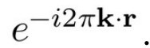{width=55%}


## 第 51 页

[对照英文原件第 51 页](../../MRI_Local_Spectroscopy_Health_Digital_Twin_Hackathon_Dossier_v1.6.pdf#page=51)

### 附录 B. 最低数据包与数据字典

### B.1 三层数据包

<!-- compact-table -->
| 层级 | 目录 | 目的 |
| --- | --- | --- |
| 第 0 层——具有功能 | 包含会话级证据性质标签、元数据信息的 CSV/JSON 文件 | 每个团队都可以立即开始工作。 |
| 第 1 级：重建数据 | 小型 NIfTI 文件、区域掩膜、NIfTI-MRS 光谱 | 可视化、配准、特征提取 |
| 第 2 级：高级 | k 空间片段，原始 MRS 数据，含水参考值，HP ¹³C 系列，体模及校准数据 | 进行高级物理和数据处理任务，而不会干扰核心功能。 |

### B.2 核心数据-字典字段

<!-- compact-table -->
| 字段 | 类型 | 含义 |
| --- | --- | --- |
| `subject_id` | 字符串 | 伪名稳定的主题标识符 |
| `session_id` | 字符串 | 稳定的会话标识符 |
| `relative_time` | 数字 + 单位 | 相对于基线的时间；避免使用实际日期 |
| 方式 | 枚举 | MRI, qMRI, MRS, MRSI, HP13C, 校准 |
| `field_strength_T`, `spectrometer_frequency_MHz` | 数字 | 标称字段和测量频率——两者均被保留 |
| 序列，TR，TE，TI，翻转角度 | 字符串 / 秒 / 度 | 采集设置 |
| `spatial_ref` | 字符串/数组 | 坐标框架、区域或视觉对象角点，配准变换 |
| `source_id`, `source_sha256` | 字符串 | 源文件及其哈希值 |
| 可观测量，数值，单位 | 字符串 / 数字 / 字符串 | 定义的量、数值、国际单位制或声明的单位 |
| 不确定度 | 数字/间隔 | SD、CI 或拟合不确定度，类型 |
| `qc_checks`[] | 对象列表 | 质量门控、名称、值、单位、阈值、状态、每个质量门控的拥有者 |
| `qc_status`, `qc_reason` | 枚举/字符串 | 通过、警告、失败及原因 |
| 起源 | 枚举 | 在链条根源处测量或模拟得到的数据 |
| 价值认识论，决策认识论 | 枚举 | 测量、推导、推断、模拟，用于该值和孪生体作用 |
| `system_qc_id`, `protocol_match`, comparable, `valid_range` | 字符串 / 布尔值 / 布尔值 / 时间间隔 | §5.8 的质量门控输入 |
| 校准 ID，阈值参考 | 字符串 | 校准记录与阈值设定 |
| 处理版本，模型版本 | 字符串 | 管道和模型版本 |
| `provenance_parent` | 字符串/列表 | 直接父实体 |
| `interpretation_limit` | 字符串 | 不得根据该值来做出任何结论。 |

### B.3 StarterPack v0.2 及已知问题

该压缩文件包含五种格式的合成示例：DICOM、NIfTI、BIDS MRI、MRS-BIDS/NIfTI-MRS 以及孪生体兼容的 JSON/CSV 格式。此外，还包含 PASS、WARN 和 FAIL 数据包以及合作伙伴接口说明。这些只是教学用对象，并非合规性认证；实际研究中会使用当前的验证工具、机构级去标识化以及特定模式的质量控制措施。本次评审中发现的问题将在 v0.3 版本中修复。

合成 MRS 中，NAA、Cr 和 Cho 的含量分别约为 5.7、4.7 和 4.0 ppm，而非 Explorer 中的 2.01、3.03 和 3.20 ppm；频率偏移和符号约定必须符合 NIfTI-MRS 规范（§4.4）。

T1w 侧车：“合成梯度回波”，TR = 2 秒，翻转角 90°，TE = 12 毫秒，这不是 T1 加权协议；可以使用例如 TR 较短且翻转角较小的 3D spoiled 梯度回波，或者采用反转预备序列。

磁场强度为 3.0 特斯拉，而光谱仪频率为 123.25 兆赫（B₀ = 2.895 特斯拉）：保留这两个数值，并记录它们之间的差异。

数据包 v0.2 中某些字段缺少证据性质标签和阈值参考信息；需迁移至方案 v1.0（附录 E）。


## 第 52 页

[对照英文原件第 52 页](../../MRI_Local_Spectroscopy_Health_Digital_Twin_Hackathon_Dossier_v1.6.pdf#page=52)

### 附录 C. 合成挑战案例

### C.1 情况 A——明显的结构变化，光谱特性保持稳定

基线和随访在区域体积上有所不同；光谱学保持在重复性范围内。隐藏的扰动因素包括配准误差、梯度非线性或真正的微小变化。任务在于判断几何结构是否有所更新，以及光谱学是否能提供独立的支持。

### C.2 情况 B——由测量质量引起的明显代谢变化

随访频谱显示比例发生了变化，但线条变宽，信噪比降低，体素覆盖的组织成分也发生了改变。任务：防止不合理的更新，识别主要的不确定性，提出下一次采集或校准的建议。StarterPack 随访案例是这种情况的轻微版本（§3.10）。

### C.3 案例 C——具有冲突信任的多模式变更

在相同的区域中，定量 MRI 参数和光谱特征都会发生变化；其中，MRI 参数的重复性很高，而光谱特征的重复性则相对较低。任务要求：以特定模态的置信度来更新数据，而不是使用二值标志来表示结果。

### C.4 病例 D——高场基线，低场随访

结构外观会因场和协议的不同而有很大差异，不过一些基本的几何特征却保持稳定。任务在于确定哪些特征是可以比较的，哪些需要协调处理，而哪些则不应该被合并在一起。可选功能还包括借助先验信息进行重建，从而避免幻觉现象或忽略新的发现结果。

### C.5 案例 E——动态 HP ¹³C 轨迹

从两个 kPL 值出发，结合不同的计时、翻转角度和信噪比扰动，得到合成丙酮酸和乳酸曲线（图 9）。任务：估计变化的方向，传递不确定性，并将结果与没有临床意义的空间孪生体联系起来。

### C.6 教官真实情况文件模板

```json
{
"case": "B",
"starterpack_version": "0.4",
"features": {
"Cho_Cr":     {"true_change": 0.00, "perturbations": ["linewidth +2.7 Hz", "SNR -20 %"],
"expected_action": "update_with_warning (K about 0.3) + re-shim and repeat"},
"roi_volume": {"true_change_mm3": 0, "perturbations": ["mask propagation with 1.1 mm boundary error (dilation)"],
"expected_action": "consistency WARN, implied u ~ 19 %, update_with_warning (K ~ 0) + registration audit"}
},
"scoring": {"correct_action": 2, "dominant_uncertainty_named": 1,
"inconsistent_uncertainty_detected": 1, "next_measurement_reasonable": 1}
}
```


## 第 53 页

[对照英文原件第 53 页](../../MRI_Local_Spectroscopy_Health_Digital_Twin_Hackathon_Dossier_v1.6.pdf#page=53)

### 附录 D. 精度和不确定性工作表

每次贡献填写一行；第一个模块是一个针对随访中的 Cho/Cr 比率的示例（教学值，图 12）。

<!-- compact-table -->
| 贡献 | ci·u(xi) | 获取方式 | 对可观测量的影响 | 缓解措施 |
| --- | --- | --- | --- | --- |
| 光谱拟合（在测量得到的全宽半峰值、信噪比条件下的 CRLB） | 0.045 | 拟合协方差 / 置信水平下限 | 60%的 uc² | 更好的匀场设置，更多平均值 |
| 线形/频率漂移模型误差 | 0.025 | 残差形状，漂移估计值 | 19 % | 重新匀场，频率漂移校正 |
| 体素放置/部分体积 | 0.020 | 配准残差，分割 | 12 % | 固定装置，自动对齐 |
| 化学位移偏移 | 0.015 | 方程(5.1) | 7 % | 更高带宽脉冲，sLASER |
| 频率/射频校准 | 0.010 | 体模，参考扫描 | 3 % | 会话前的校准 |
| 联合 UC | 0.058 | 方程(5.3) | U = 2uc | — |
| 重复性 |  | 重复扫描 / 文献资料 / 模拟 |  |  |
| 梯度比例/非线性度 |  | 体模 / 模型 |  |  |
| B1 / 翻转角度变化 |  | B1 地图 / 射频校准 |  |  |
| 模型差异 |  | 对比测试/压力测试 |  |  |

团队规则：首先识别出贡献最大的因素。一个明显的错误足以使比较结果变得不可靠，这一点比复杂的公式更为重要。


## 第 54 页

[对照英文原件第 54 页](../../MRI_Local_Spectroscopy_Health_Digital_Twin_Hackathon_Dossier_v1.6.pdf#page=54)

### 附录 E. 孪生体状态与证据框架

### E.1 示例证据包（规范 v1.0）

该文件适用于 `evidence_packet_v1.0.schema.json`；当对数据包进行哈希处理时，`source_sha256` 会从 `manifest_sha256.csv` 中获取。

```json
{
"packet_version": "1.0",
"packet_id": "E-t1-cho",
"subject_id": "sub-01", "session_id": "ses-followup", "relative_time": {"value": 6,
"unit": "month"},
"modality": "MRS",
"source_object": "04_MRS_BIDS/sub-01/ses-followup/mrs/sub-01_ses-followup_acq-press_nuc-1H_voi-frontal_svs.nii.gz",
"source_sha256": null,
"spatial_reference": {"frame": "scanner", "voi_size_mm": [20, 20, 20],
"csde_mm_NAA_Cho": 2.4},
"observable": "Cho_Cr", "value": 0.85, "unit": "1",
"uncertainty": {"type": "SD", "value": 0.06, "budget_ref": "D-worksheet-t1"},
"valid_range": [0, 3],
"qc_checks": [
{"name": "mrs_snr", "value": 24.8, "unit": "1", "threshold": "WARN < 25; FAIL < 10",
"status": "WARN", "owner": "QE"},
{"name": "mrs_linewidth_Hz", "value": 11.4, "unit": "Hz", "threshold": "WARN > 10; FAIL > 20", "status": "WARN", "owner": "PM"},
{"name": "missing_values", "value": 0, "unit": "1", "threshold": "== 0", "status":
"PASS", "owner": "DS"}],
"qc_status": "WARN", "qc_reasons": ["mrs_snr 24.8 < 25.0", "mrs_linewidth_Hz 11.4 > 10.0"],
"origin": "SIMULATED", "value_epistemic": "DERIVED", "decision_epistemic": "INFERRED",
"system_qc_id": "sysqc-synthetic", "protocol_match": true, "comparable": true,
"acquisition_context": {"field_strength_T": 3.0, "spectrometer_frequency_MHz": 123.25,
"sequence": "PRESS",
"TE_s": 0.030, "TR_s": 2.0, "averages": 64},
"calibration_id": "phantom-2026-11", "thresholds_ref": "thresholds-v1.0",
"processing": {"pipeline": "synthetic_demo", "version": "0.2", "fit": "Lorentzian, constant baseline"},
"provenance": {"parents": ["NIfTI-MRS t1"], "activities": ["spec2nii", "spectral fit",
"QC aggregation"]},
"twin_action": {"recommended": "update_with_warning", "reason": "usable evidence; spectroscopy uncertainty must stay visible"},
"interpretation_limit": "educational synthetic data; frontal VOI only; no clinical meaning"
}
```

### E.2 更新后的示例状态

```json
{
"subject_id": "sub-01", "time": {"value": 6, "unit": "month"}, "state_version": 2,
"origin": "SIMULATED",
"geometry": {"roi_volume_mm3": 22190, "sd": 697, "K": 0.009,
"status": "updated_with_warning", "note": "stated u inconsistent; registration audit requested"},
"qmri":     {"T1_ms": null, "status": "unknown (not acquired at t1)"},
"mrs":      {"NAA_Cr": 1.227, "sd_NAA": 0.058,
"Cho_Cr": 0.741, "sd_Cho": 0.048, "status": "updated_with_warning"},
"gate":     {"d2_Cho": 3.66, "d2_NAA": 0.74, "d2_ROI": 1.14, "threshold": 3.84,
"discrepancy": false},
"prediction": {"Cho_Cr_repeat_range_95": [0.61, 0.88], "assumes": "PASS-quality repeat after re-shim, R = 0.050^2"},
"next_measurement": ["repeat PRESS after re-shim", "registration / segmentation audit"],
"provenance": ["E-t1-roi", "E-t1-naa", "E-t1-cho"], "decision_epistemic": "INFERRED"
}
```


## 第 55 页

[对照英文原件第 55 页](../../MRI_Local_Spectroscopy_Health_Digital_Twin_Hackathon_Dossier_v1.6.pdf#page=55)

### E.3 更新逻辑

1. 根据 v1.0 规范对数据包进行验证。如果质量控制结果为“失败”，则拒绝更新操作，并记录此次失败的观测结果及其原因。

2. 通过声明的观测模型，将接受的证据与状态变量建立联系。

3. 质量门控，其中数据包方差为 u² (d², 公式 7.2)；根据质量控制策略设置增益的方差（警告 → 2u²）。

4. 更新状态（公式 7.1），并存储先前信息、证据、后验信息、增益以及 d²值。

5. 将实际结果与预测结果进行比较；如果 d²大于 3.84，则表明模型存在不一致性。

6. 如果后验不确定性超过了团队设定的阈值，请按照方程(7.3)对后续测量进行排序。


## 第 56 页

[对照英文原件第 56 页](../../MRI_Local_Spectroscopy_Health_Digital_Twin_Hackathon_Dossier_v1.6.pdf#page=56)

### 附录 F. 团队交接卡片

<!-- compact-table -->
| 方向 | 您接收到的输入内容 | 您所提交的内容 | 接口测试 |
| --- | --- | --- | --- |
| 量子工程 | 选定模式 + 挑战案例 | 测量模型、单位、模拟真实值、有效范围、物理限制、认知标签 | 有没有其他团队能够解释一下“可观测量”在物理上的含义呢？ |
| 精密机械／计量学 | 测量模型 + 硬件和协议上下文 | 校准图、不确定度预算、阈值、质量控制状态、可选夹具或体模 | 孪生体能否区分因测量系统改变而导致的测量结果的变化？ |
| 数据科学 | 源对象 + 元数据 + 质量控制规则 | 证据包 v1.0，数据字典，溯源图，具有单位和不确定性的功能 | 每个功能都能追溯到其源头吗？ |
| 数字孪生 | 证据包 + 不确定性 | 持久状态，门控更新规则，预测或情景，下一证据视图 | 当不确定性或质量控制标准发生变化时，孪生体是否仍能正确反应？ |
| 积分器 | 以上所有内容 | 一条端到端的黄金路径 + 架构设计 + 回归测试清单 | 一位导师能否在不到两分钟的时间内审核完整个更新过程？ |


## 第 57 页

[对照英文原件第 57 页](../../MRI_Local_Spectroscopy_Health_Digital_Twin_Hackathon_Dossier_v1.6.pdf#page=57)

### 附录 G. 评估标准

<!-- compact-table -->
| 级别 | 科学/测量 | 数据 / 溯源 | 孪生体逻辑 | 整合/沟通 |
| --- | --- | --- | --- | --- |
| 卓越 | 物理学计算正确；不确定性已量化处理；主要干扰因素已得到验证 | Schema 版本 1.0，一致性良好；溯源完整；质量控制透明；标签正确 | 持久状态 + 有门控制的更新 + 预测 + 下一阶段证据逻辑 | 四条轨道已连接在一起；演示音轨和音调音轨均可进行监听。 |
| 好 | 基本正确；已考虑不确定性因素 | 元数据与溯源基本完整 | 状态更新与一种情景 | 这些接口在运行时会存在一些小的差异。 |
| 适当 | 看似合理的核心结果，却基于薄弱的假设 | 数据已整理完毕，可追溯性部分完成 | 具有有限更新逻辑的仪表盘 | 一些切换仍然是手动进行的。 |
| 不足 | 不支持的物理参数、错误的单位或质量控制问题 | 与源数据分离的特征 | 没有持久性的状态或更新 | 采用并行小型项目的方式，而非单一的解决方案。 |


## 第 58 页

[对照英文原件第 58 页](../../MRI_Local_Spectroscopy_Health_Digital_Twin_Hackathon_Dossier_v1.6.pdf#page=58)

### 附录 H. 推荐阅读资料

<!-- compact-table -->
| 方向 | 从...开始 | 为什么 |
| --- | --- | --- |
| 量子工程 | 关于 HP ¹³C 的讲座 U06 及相关脚本：de Graaf [32]；Wilson 等人[20]；Larson 等人[7] | 将信号形成与可观测量及其限制条件联系起来 |
| 精密机械／计量学 | Hall 等人[3]；QIBA ADC 剖面数据[4]；AAPM TG-325 标准[12]；Raunig 等人[23]；GUM 指南[25] | 作为具有可追溯性和重复性的测量系统的 MRI |
| 数据科学 | BIDS [17], MRS-BIDS [6], NIfTI-MRS [18]; MRSinMRS [5]; FAIR [26]; PROV-DM [27] | 元数据、互操作性、溯源 |
| 数字孪生 | 国家科学院[1]；Kapteyn 等人[37]；Laubenbacher 等人[36]；Tudor 等人[2] | 具有不确定性的严格孪生体定义 |
| 所有团队 | 这份挑战手册，第 3 章、第 8 章和第 9 章 | 示例、证据包、黑客松工作流程 |


## 第 59 页

[对照英文原件第 59 页](../../MRI_Local_Spectroscopy_Health_Digital_Twin_Hackathon_Dossier_v1.6.pdf#page=59)

### 附录一：伦理规范、隐私问题以及临床非等效性

仅使用合成数据、公开数据、去标识化数据或经机构批准的数据。

使用匿名主题和会话标识符；尽量减少元数据的使用；优先使用相对时间。

请勿输出诊断结果、治疗建议或个人风险预测信息。

请说明每个模型的验证领域；避免在不同扫描仪、字段或人群之间进行无意识的转移。

保持不确定性可见，并将证据不足视为一种合理的结果。

将“模拟的”内容标记为此类；切勿将其描述为“测量得到的”。

明确区分教育原型、研究工具和临床系统。

在获取任何真实的健康数据之前，必须先进行隐私保护、同意获取、管理以及网络安全方面的审查，其次才能进行技术整合工作。


## 第 60 页

[对照英文原件第 60 页](../../MRI_Local_Spectroscopy_Health_Digital_Twin_Hackathon_Dossier_v1.6.pdf#page=60)

### 附录 J. 未来的科学扩展功能

### J.1 定量 MRI 和多参数双胞胎研究

T₁/T₂映射、扩散模型以及扩散加权 MRS[15]、磁化率、灌注和 MR 指纹识别[38]——这些方法各自仅包含其自身的校准和重复性模型。

### J.2 磁共振波谱成像（MRSI）与代谢图谱

一个空间光谱场将光谱学与类似图像的孪生体状态联系起来，但这也带来了重建、光谱质量以及多维度比较方面的挑战。

### J.3 超极化代谢通量

从双位点模型到考虑递送过程的动力学分析、多代谢物成像技术以及不确定性感知的参数估计方法；共识校准仍然是最重要的指导原则[7]。

### J.4 便携式低场纵向成像设备

较低的成本和便携性需要与信噪比、对比度以及硬件限制进行权衡；孪生体决定哪些特性保持可比性，以及何时需要高场参考[10, 11]。

### J.5 最优实验设计与传感器控制

一个成熟的孪生体会选择能够最大程度降低模型不确定性的采集方式——即控制接口、精密工程以及信息理论[1, 37]。

### J.6 传输至设备和对象

将“人”替换为“设备”或“物体”，将 MRI/MRS 替换为内部可观测的局部测量值，将“组织状态”替换为“设备或材料状态”：锂金属体积或电池单元的充电状态，来自⁷Li 或内部体模的 MRI [41, 42]；弹性密封材料的交联密度，来自单面 NMR [43]；扫描仪本身的场漂移、信噪比和几何畸变，来自其体模记录（§5.3）。可重复使用的概念是证据包和链状测量→验证→表示→整合。


[返回中文总入口](index.html)
