# NMR 量子工程与数字孪生｜结语讲义 v2.3

[返回中文总入口](index.html) · [英文 PDF](../../NMR_QE_InnovateU_Conclusion_v2.3_2026-11-20.pdf) · [Markdown 源](qe-conclusion.md)

原件：`NMR_QE_InnovateU_Conclusion_v2.3_2026-11-20.pdf`，共 17 页。

按 PDF 文件页码对照。页脚的讲义总页数沿用课程原始编号。原图保留公式及课程符号约定。

## 页码索引

[1](#第-1-页) · [2](#第-2-页) · [3](#第-3-页) · [4](#第-4-页) · [5](#第-5-页) · [6](#第-6-页) · [7](#第-7-页) · [8](#第-8-页) · [9](#第-9-页) · [10](#第-10-页)

[11](#第-11-页) · [12](#第-12-页) · [13](#第-13-页) · [14](#第-14-页) · [15](#第-15-页) · [16](#第-16-页) · [17](#第-17-页)

## 第 1 页

[对照英文原件第 1 页](../../NMR_QE_InnovateU_Conclusion_v2.3_2026-11-20.pdf#page=1)

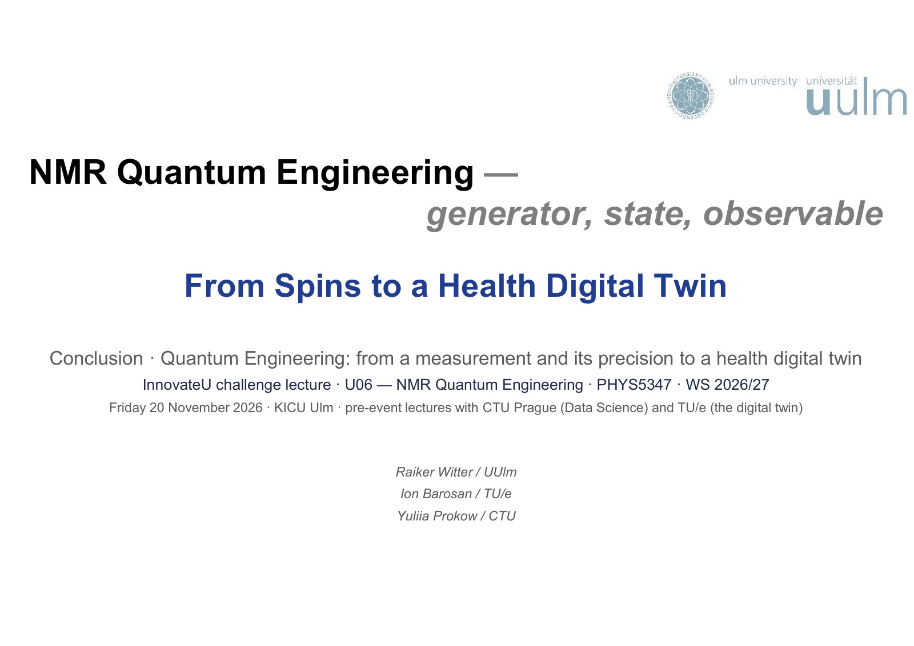

NMR 量子工程 —

生成器、状态、可观测量

从旋转技术到健康数字孪生

结论 · 量子工程：从测量及其精度到健康数字孪生

InnovateU 挑战赛讲座·U06 — 量子工程·PHYS5347·WS 2026/27

2026 年 11 月 20 日星期五 · KICU 乌尔姆 · 与 CTU 布拉格（数据科学）和 TU/e（数字孪生）共同举办的预会议程

Raiker Witter / 乌尔姆

Ion Barosan / 埃因霍温科技大学

Yuliia Prokop / 中央技术大学

### 图内文字与标签

- uim 大学 Universität
- uulm

## 第 2 页

[对照英文原件第 2 页](../../NMR_QE_InnovateU_Conclusion_v2.3_2026-11-20.pdf#page=2)

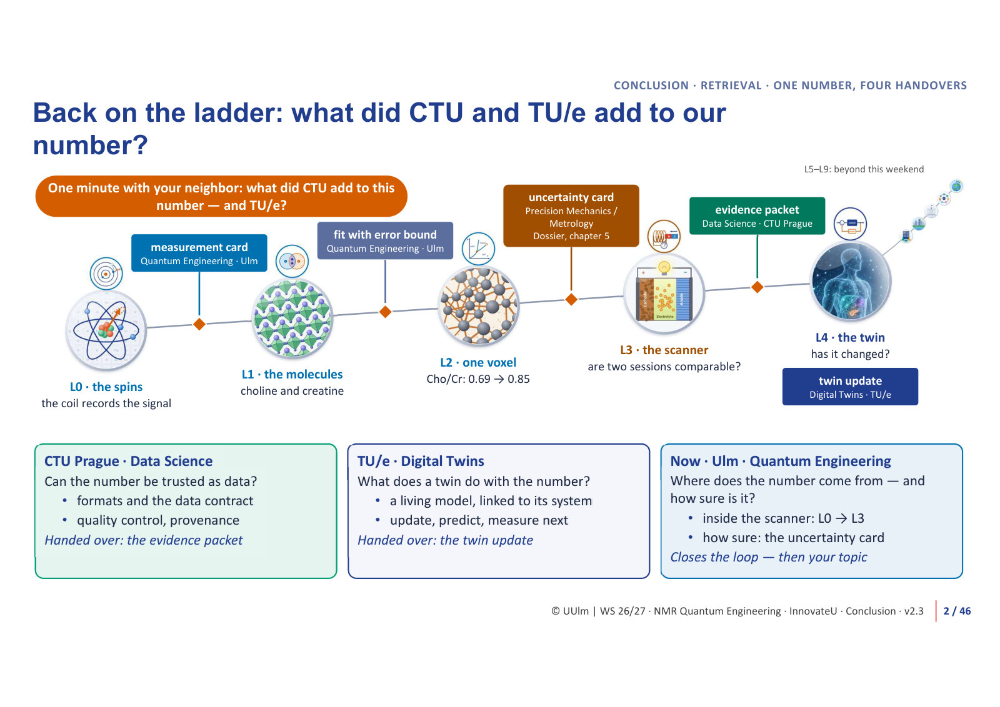

CONCLUSION · RETRIEVAL · ONE NUMBER, FOUR HANDOVERS

### 回到问题本身：CTU 和 TU/e 为我们增加了多少数据？

L5–L9：直到这个周末之后

与你的邻居进行一次交流：CTU 对此增加了什么内容？

不确定度卡 精密机械 /

数字与 TU/e？证据包 数据科学 · 布拉格中央理工大学

计量学挑战手册，第 5 章

带有误差界限的量子工程 · 乌尔姆

测量卡 量子工程 · 乌尔姆

L4 · 孪生体发生了改变？

L3·这些扫描仪是否可以进行两次比较？

L2 · 一个体素 Cho/Cr: 0.69 → 0.85

L1 · 分子胆碱和肌酸

孪生体更新 数字孪生 · 埃因霍夫大学

L0 · 线圈中的自旋记录信号

CTU 布拉格 · 数据科学 这个数字作为数据是否可信？

TU/e · 数字孪生体 孪生体如何处理这个数字？

现在·乌尔姆·量子工程 这个数字是从哪里来的——它有多准确？

- 格式和数据协议
- 一个与系统相连接的活生生的模型
- 质量控制，溯源 已移交：证据包
- 更新、预测、测量下一个孪生体：孪生体更新
- 扫描仪内部：L0 → L3
- 有多确定：不确定度卡 结束循环——那么你的主题

2 / 46 © UUlm | WS 26/27 · NMR Quantum Engineering · InnovateU · Conclusion · v2.3

## 第 3 页

[对照英文原件第 3 页](../../NMR_QE_InnovateU_Conclusion_v2.3_2026-11-20.pdf#page=3)

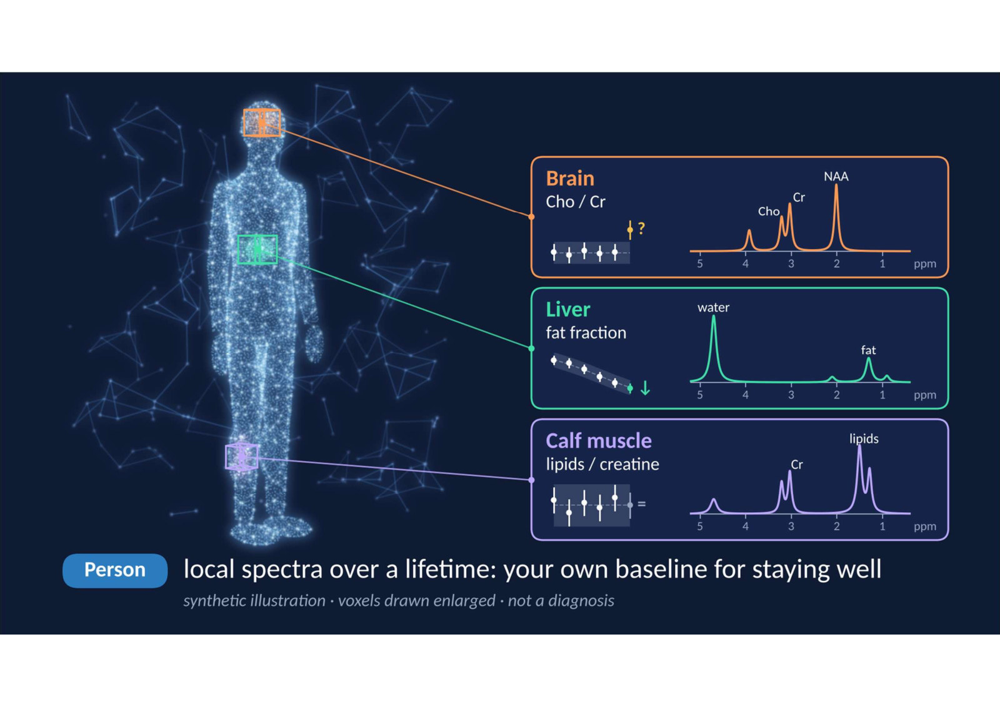

3 / 46 © UUlm | WS 26/27 · NMR Quantum Engineering · InnovateU · Conclusion · v2.3

### 图内文字与标签

- 大脑
- NAA
- Cho / Cr
- ppm
- 肝脏
- 水
- 脂肪比例
- 小腿肌肉
- 脂质
- 脂质 / 肌酸
- 人物
- 在一段时间内观察到的局部波谱：这就是你保持健康的基线
- 合成插图 • 放大显示的体素 • 并非诊断结果

## 第 4 页

[对照英文原件第 4 页](../../NMR_QE_InnovateU_Conclusion_v2.3_2026-11-20.pdf#page=4)

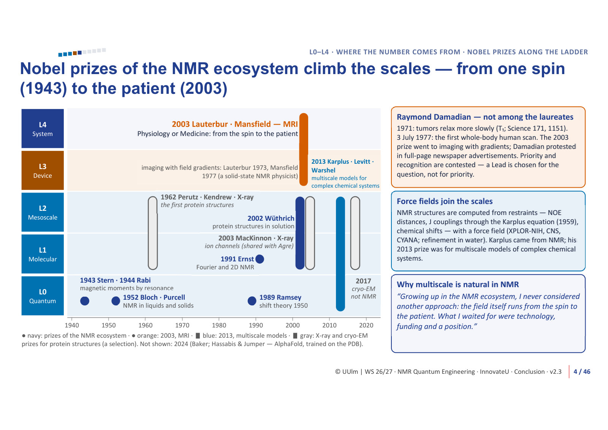

L0–L4 · WHERE THE NUMBER COMES FROM · NOBEL PRIZES ALONG THE LADDER

### NMR 生态系统的诺贝尔奖得主不断涌现——从 1943 年的“自旋”奖到 2003 年的“患者”奖。

雷蒙德·达马迪安——并未获得 1971 年的奖项：他的研究指出肿瘤的消退速度较慢（T₁；科学杂志，171 卷，1151 页）。1977 年 7 月 3 日，他完成了首次全身人体扫描。2003 年的奖项授予了利用梯度成像技术的研究团队；达马迪安通过整版报纸广告对此表示抗议。关于优先权和认可的问题仍然存在争议——评选委员会选择以“领先”作为评判标准，而非优先考虑优先权。

L4 系统

2003 劳特伯·曼斯菲尔德 — 磁共振成像生理学或医学：从原理到临床应用

2013 年，Karplus、Levitt 和 Warshel 提出了用于复杂化学系统的多尺度模型。

L3 设备

利用场梯度进行成像：Lauterbur 1973, Mansfield

1977 年（一位固态核磁共振物理学家）

1962 年，Perutz 和 Kendrew 利用 X 射线技术揭示了第一批蛋白质结构。

力场与 NMR 结构计算中的约束条件相结合——包括单键间距离、通过 Karplus 方程得出的 J 耦合常数（1959 年提出），以及化学位移数据——这些数据都通过力场进行整合（XPLOR-NIH、CNS、CYANA；在水环境中进行优化处理）。Karplus 的研究基于核磁共振技术；他于 2013 年获得的奖项，正是因为他提出了复杂化学系统的多尺度模型。

L2 中尺度

2002 年 Wüthrich 发表的溶液中的蛋白质结构研究

2003 麦金农 · X 射线离子通道（与阿格雷共同研究）

L1 分子

1991 年，恩斯特·傅里叶与二维核磁共振技术

1943 年斯特恩·1944 年拉比 通过共振产生磁矩

2017 年冷冻电镜与核磁共振研究

为什么多尺度方法在核磁共振领域如此自然？“我在核磁共振领域成长，从未考虑过其他的方法：这个领域本身就是从自旋层面一直延伸到患者治疗的过程。我所等待的，只是技术、资金支持以及一个合适的职位。”

L0 量子

1952 年，布洛赫和珀塞尔提出了关于液体和固体中核磁共振现象的研究。

1989 年拉姆齐移位理论 1950 年

1940

1950

1960

1970

1980

1990

2000

2010

2020

●navy：NMR 生态系统的奖项 · ●orange：2003 年，MRI 领域 · ▮blue：2013 年，多尺度模型领域 · ▮gray：蛋白质结构的 X 射线和冷冻电镜分析奖项（部分奖项）。未显示：2024 年（Baker；Hassabis & Jumper——AlphaFold 项目，基于 PDB 数据训练而成）。

4 / 46 © UUlm | WS 26/27 · NMR Quantum Engineering · InnovateU · Conclusion · v2.3

## 第 5 页

[对照英文原件第 5 页](../../NMR_QE_InnovateU_Conclusion_v2.3_2026-11-20.pdf#page=5)

### 用四个方程连接自旋与波谱

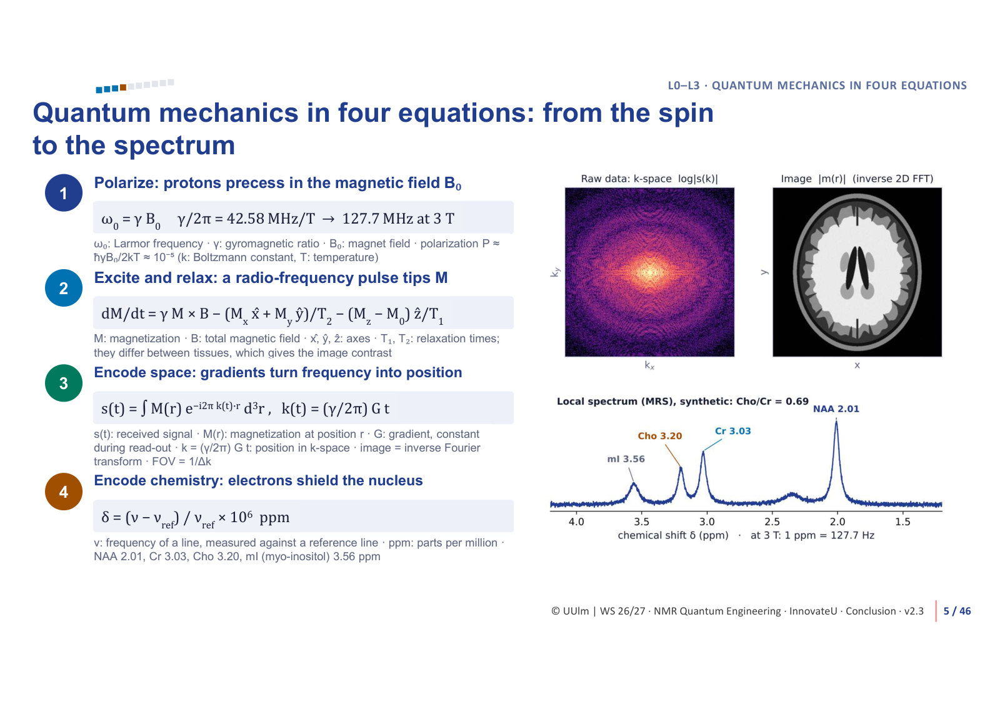

L0–L3 · 四个方程描述的量子力学。

1. **极化。** 质子在磁场 \(B_0\) 中进动。拉莫尔角频率 \(\omega_0=\gamma B_0\)，旋磁比 \(\gamma/(2\pi)=42.58\ \mathrm{MHz/T}\)，因此在 3 T 时频率为 127.7 MHz。极化 \(P\approx\hbar\gamma B_0/(2kT)\approx10^{-5}\)，其中 \(k\) 为玻尔兹曼常量，\(T\) 为温度。
2. **激发与弛豫。** 射频脉冲使磁化矢量 \(\mathbf M\) 偏转。总磁场为 \(\mathbf B\)，\(\hat x,\hat y,\hat z\) 是坐标方向。\(T_1\) 与 \(T_2\) 是弛豫时间。组织间的差异产生图像对比。
3. **空间编码。** 梯度把频率与位置关联。\(s(t)\) 是接收信号，\(M(\mathbf r)\) 是位置 \(\mathbf r\) 上的磁化。读出期间梯度 \(\mathbf G\) 恒定，\(\mathbf k(t)=(\gamma/2\pi)\mathbf Gt\) 为 k 空间坐标。图像由逆傅里叶变换得到。视野 \(\mathrm{FOV}=1/\Delta k\)。
4. **化学编码。** 电子对原子核产生屏蔽。化学位移 \(\delta=(\nu-\nu_\mathrm{ref})/\nu_\mathrm{ref}\times 10^6\)，以 ppm 表示。谱线相对参考线的常见位置为 NAA 2.01、Cr 3.03、Cho 3.20、mI（肌醇）3.56 ppm。

\[
\frac{d\mathbf M}{dt}=\gamma\mathbf M\times\mathbf B-\frac{M_x\hat x+M_y\hat y}{T_2}-\frac{(M_z-M_0)\hat z}{T_1}
\]

\[
s(t)=\int M(\mathbf r)e^{-i2\pi\,\mathbf k(t)\cdot\mathbf r}\,d^3r
\]

## 第 6 页

[对照英文原件第 6 页](../../NMR_QE_InnovateU_Conclusion_v2.3_2026-11-20.pdf#page=6)

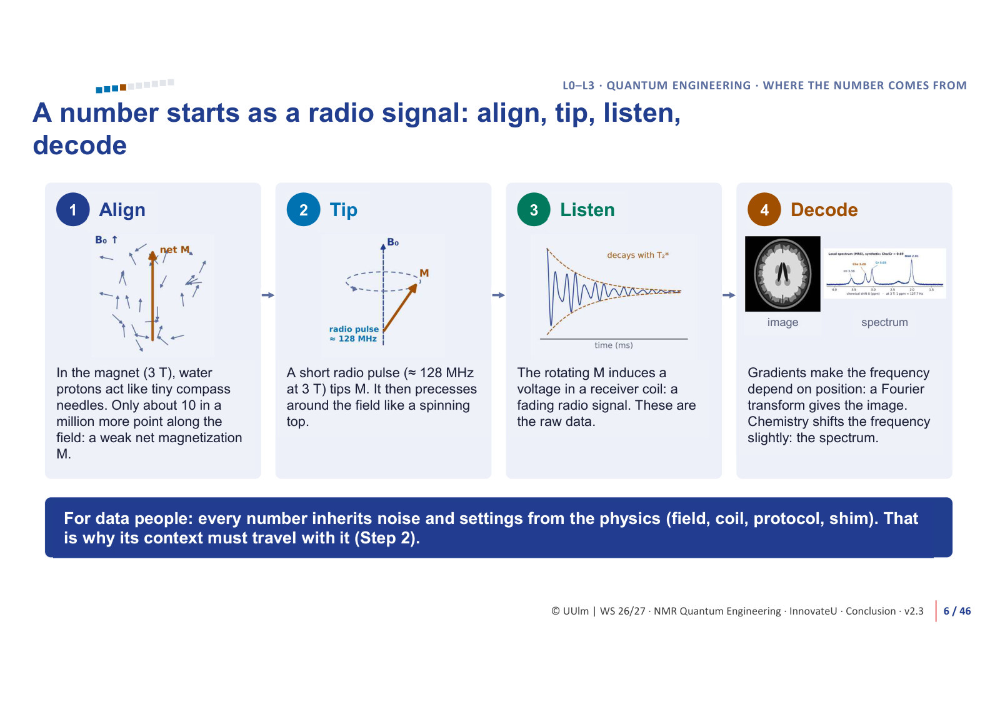

L0–L3 · QUANTUM ENGINEERING · WHERE THE NUMBER COMES FROM

### 一个数字最初就像一种无线电信号：排列、调整、监听、解码

1

对齐

2

提示：

3

倾听

4

解码

图像

频谱

在磁场所产生的 3 特斯拉环境中，水分子中的质子就像微小的指南针指针一样工作。只有大约每百万中有 10 个质子会沿着磁场方向指向同一方向，这就形成了一种微弱的净磁化强度 M。

一个短暂的无线电脉冲（在 3 特斯拉的磁场中约为 128 兆赫）使 M 物体发生偏转。随后，它像陀螺一样围绕磁场旋转。

旋转的 M 线圈在接收线圈中产生了电压：这就是衰减的无线电信号。这些就是原始数据。

梯度使得频率依赖于位置：傅里叶变换则产生图像。化学因素略微改变了频率：这就是光谱。

对于数据处理人员来说：每一个数字都带有来自物理因素（磁场、线圈、协议、匀场）的噪声和设定。因此，数据的上下文必须与其一同传递（步骤 2）。

6 / 46 © UUlm | WS 26/27 · NMR Quantum Engineering · InnovateU · Conclusion · v2.3

### 图内文字与标签

- 网络流量，M
- 随着 T2 的衰减
- 无线电脉冲
- = 128 MHz !
- 时间（毫秒）

## 第 7 页

[对照英文原件第 7 页](../../NMR_QE_InnovateU_Conclusion_v2.3_2026-11-20.pdf#page=7)

### 梯度让进动频率成为空间标尺

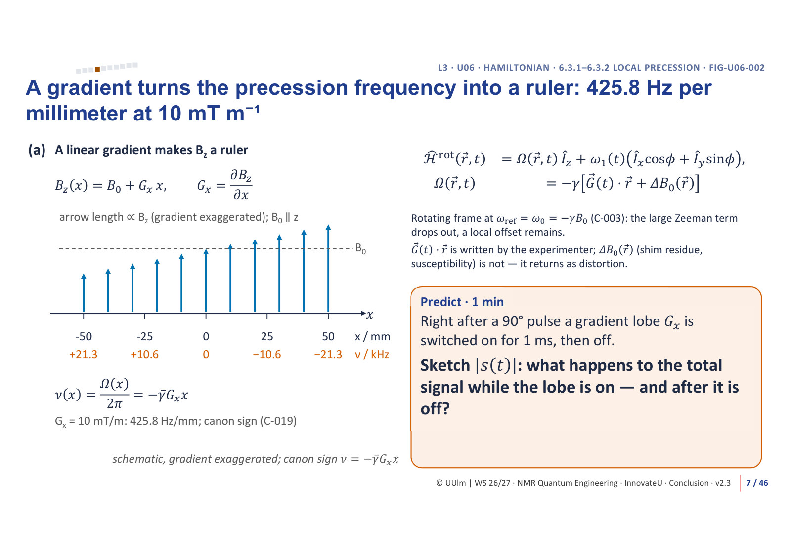

L3 · U06 · 哈密顿量 · 6.3.1–6.3.2 局部进动 · FIG-U06-002。

**线性梯度。** \(B_z(x)=B_0+G_xx\)，\(G_x=\partial B_z/\partial x\)。在原图中，箭头长度与 \(B_z\) 成正比，梯度经过夸张，\(B_0\) 沿 z 轴。按 C-019 的符号约定，\(\nu(x)=\Omega(x)/(2\pi)=-\bar\gamma G_xx\)。当 \(G_x=10\ \mathrm{mT/m}\) 时，频率变化的幅度为 425.8 Hz/mm。

| x / mm | −50 | −25 | 0 | 25 | 50 |
| --- | --- | --- | --- | --- | --- |
| ν / kHz | +21.3 | +10.6 | 0 | −10.6 | −21.3 |

**旋转坐标系。** 取 \(\omega_\mathrm{ref}=\omega_0=-\gamma B_0\)（C-003）。消去大的塞曼项后，留下局部偏移 \(\Omega(\mathbf r,t)=-\gamma[\mathbf G(t)\cdot\mathbf r+\Delta B_0(\mathbf r)]\)。实验者设定梯度项。\(\Delta B_0\) 来自匀场残差、磁化率等，会造成畸变。包含射频项的完整哈密顿量见原图。

**预测练习，1 分钟。** 施加 90° 脉冲后立即开启梯度叶瓣 \(G_x\)，持续 1 ms 后关闭。画出总信号 \(s(t)\)。分别考虑梯度开启时与关闭后的变化。

## 第 8 页

[对照英文原件第 8 页](../../NMR_QE_InnovateU_Conclusion_v2.3_2026-11-20.pdf#page=8)

### 接收线圈在 k 空间轨迹上测量磁化的空间傅里叶变换

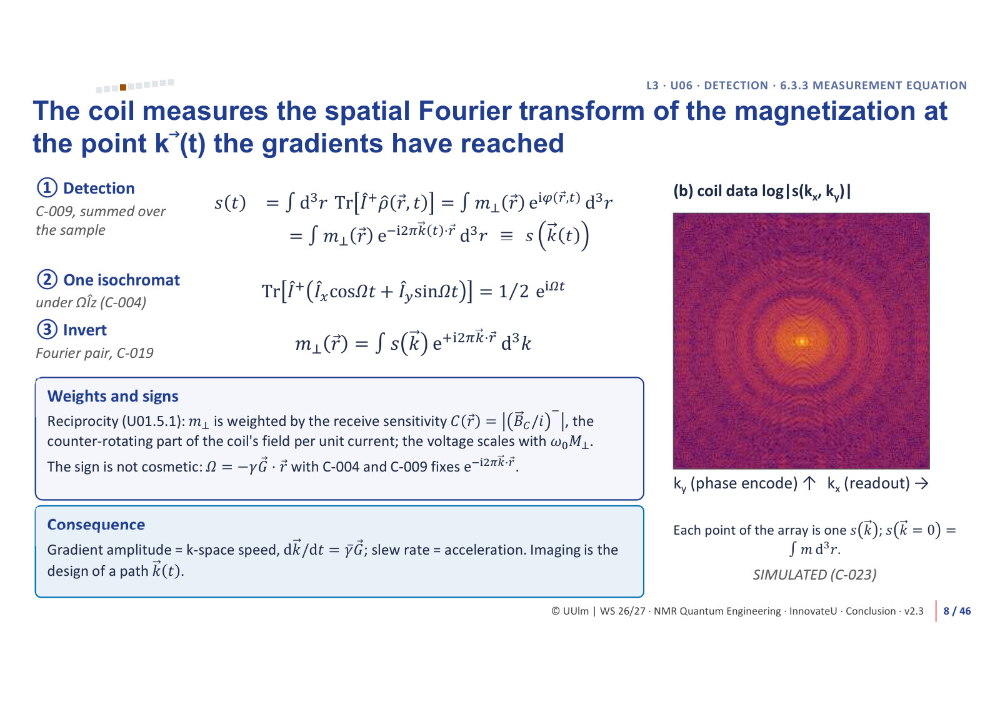

L3 · U06 · 检测 · 6.3.3 测量方程。

1. **检测（C-009）。** 对样品体积内的迹项求和。离共振相位积分给出 \(s(t)\)，等价于在梯度到达的 \(\mathbf k(t)\) 处采样。
2. **单个等频自旋群（C-004）。** 在 \(\Omega\hat I_z\) 的作用下，其迹项为 \(\tfrac12 e^{i\Omega t}\)。算符形式见原图。
3. **逆变换（C-019）。** 对 \(\mathbf k\) 作逆傅里叶变换恢复 \(m(\mathbf r)\)。

\[
s(\mathbf k(t))=\int m(\mathbf r)e^{-i2\pi\mathbf k(t)\cdot\mathbf r}\,d^3r,\qquad
m(\mathbf r)=\int s(\mathbf k)e^{+i2\pi\mathbf k\cdot\mathbf r}\,d^3k
\]

**权重和符号。** 按互易性（U01.5.1），\(m\) 由接收灵敏度 \(C(\mathbf r)\) 加权。该灵敏度取线圈单位电流产生的反向旋转场分量。电压与 \(\omega_0M_\perp\) 成正比。C-004 与 C-009 的 \(\Omega=-\gamma\mathbf G\cdot\mathbf r\) 固定了指数项的负号。

**线圈数据图。** 色阶为 \(\log |s(k_x,k_y)|\)，竖轴 \(k_y\) 为相位编码，横轴 \(k_x\) 为读出。数组每点为一个 \(s(\mathbf k)\)。\(s(\mathbf k=0)=\int m\,d^3r\)。数据为模拟（C-023）。

梯度幅度决定 k 空间速度 \(d\mathbf k/dt=\bar\gamma\mathbf G\)。梯度切换率决定加速度。成像涉及设计轨迹 \(\mathbf k(t)\)。

## 第 9 页

[对照英文原件第 9 页](../../NMR_QE_InnovateU_Conclusion_v2.3_2026-11-20.pdf#page=9)

### 快速序列、分辨率与信噪比

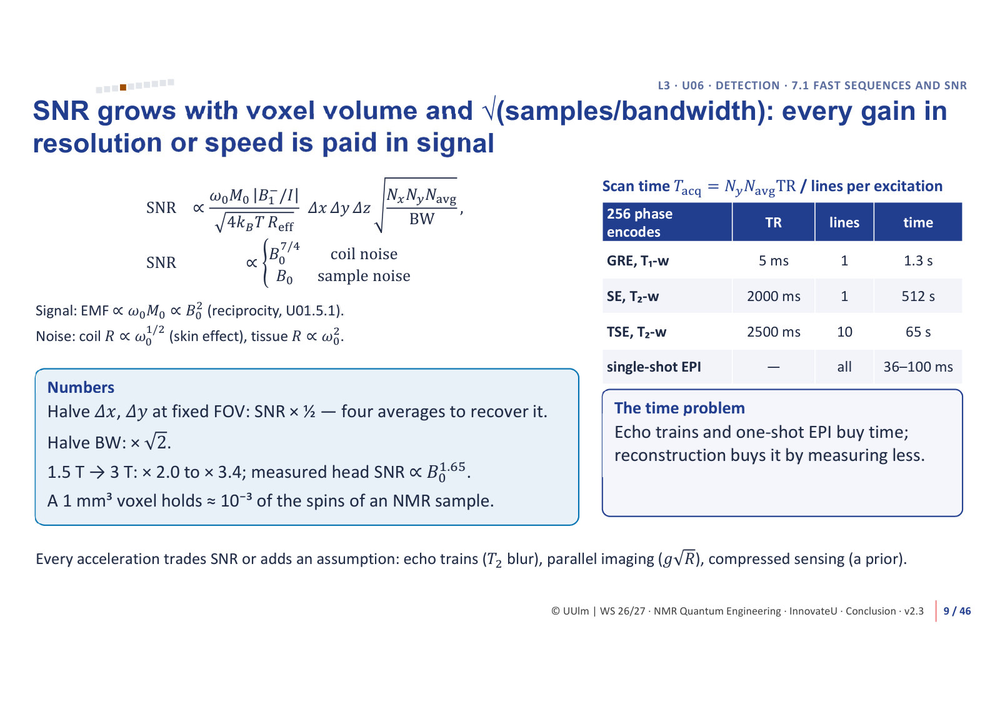

L3 · U06 · 检测 · 7.1 快速序列和信噪比。

SNR 随体素体积及 \(\sqrt{\text{采样数}/\text{带宽}}\) 增长。分辨率或速度的提升会消耗信号。

\[
\mathrm{SNR}\propto\frac{\omega_0 M_0|B_1^-/I|}{\sqrt{4 k_BTR_\mathrm{eff}}}\Delta x\Delta y\Delta z\sqrt{\frac{N_x N_y N_\mathrm{avg}}{\mathrm{BW}}}
\]

线圈噪声占主导时，SNR 与 \(B_0^{7/4}\) 成正比。样品噪声占主导时，SNR 与 \(B_0\) 成正比。由互易性（U01.5.1），信号感应电动势与 \(\omega_0M_0\) 成正比，也与 \(B_0^2\) 成正比。线圈电阻因趋肤效应与 \(\omega_0^{1/2}\) 成正比。组织电阻与 \(\omega_0^2\) 成正比。

- 视野固定时将 \(\Delta x,\Delta y\) 各减半，原讲义给出的 SNR 因子为 ½，需平均 4 次才能恢复。
- 带宽减半，SNR 乘以 \(\sqrt2\)。
- 从 1.5 T 到 3 T，SNR 乘以 2.0–3.4。实测头部 SNR 与 \(B_0^{1.65}\) 成正比。
- 1 mm³ 体素中的自旋数约为一个 NMR 样品的 \(10^{-3}\)。

扫描时间 \(T_\mathrm{acq}=N_yN_\mathrm{avg}\mathrm{TR}/(\text{每次激发的采样线数})\)。下表采用 256 条相位编码线。

| 序列 | TR | 每次激发的线数 | 时间 |
| --- | --- | --- | --- |
| GRE，T₁ 加权 | 5 ms | 1 | 1.3 s |
| SE，T₂ 加权 | 2000 ms | 1 | 512 s |
| TSE，T₂ 加权 | 2500 ms | 10 | 65 s |
| 单次激发 EPI | — | 全部 | 36–100 ms |

回波链和单次激发 EPI 节约采集时间。重建也可通过减少测量节时。加速会损失 SNR 或引入假设，例如回波链造成 \(T_2\) 模糊，并行成像涉及 \(g\sqrt R\)，压缩感知需使用先验。

## 第 10 页

[对照英文原件第 10 页](../../NMR_QE_InnovateU_Conclusion_v2.3_2026-11-20.pdf#page=10)

### 从成像伪影定位失效的模型假设

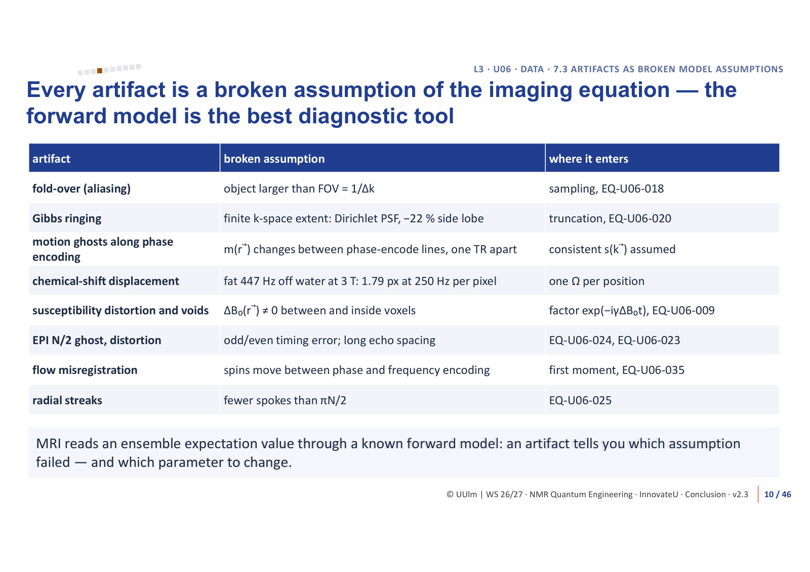

L3 · U06 · 数据 · 7.3 模型假设失效造成的伪影。

| 伪影 | 失效的假设或原因 | 发生位置或方程 |
| --- | --- | --- |
| 折叠（混叠） | 对象大于视野 \(\mathrm{FOV}=1/\Delta k\) | 采样，EQ-U06-018 |
| Gibbs 振铃 | k 空间范围有限。Dirichlet 点扩散函数的旁瓣为 −22% | 截断，EQ-U06-020 |
| 相位编码方向的运动鬼影 | 相隔一个 TR 的相位编码线之间，\(m(\mathbf r)\) 变化 | 采集假定 \(s(\mathbf k)\) 一致 |
| 化学位移偏移 | 3 T 时脂肪与水相差 447 Hz。带宽为 250 Hz/像素时，偏移 1.79 像素 | 假定每个位置只有一个 \(\Omega\) |
| 磁化率畸变与信号空洞 | 体素间和体素内存在 \(\Delta B_0(\mathbf r)\ne 0\) | 因子 \(\exp(-i\gamma\Delta B_0t)\)，EQ-U06-009 |
| EPI 的 N/2 鬼影和畸变 | 奇偶线的时序误差，回波间隔过长 | EQ-U06-024、EQ-U06-023 |
| 流动错位 | 自旋在相位编码与频率编码之间移动 | 一阶矩，EQ-U06-035 |
| 径向条纹 | 辐条少于 \(\pi N/2\) | EQ-U06-025 |

MRI 通过已知前向模型读取系综期望值。可用伪影反查哪条假设失效，以及应调整哪个参数。

## 第 11 页

[对照英文原件第 11 页](../../NMR_QE_InnovateU_Conclusion_v2.3_2026-11-20.pdf#page=11)

### PRESS 与 STEAM 的单体素定位

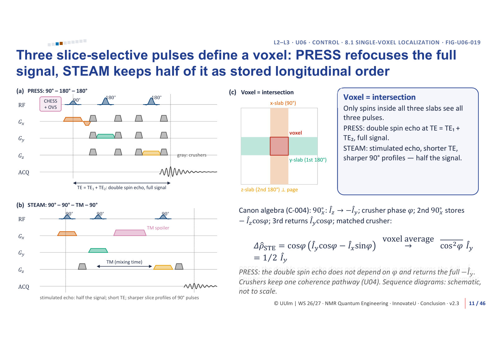

L2–L3 · U06 · 控制 · 8.1 单体素定位 · FIG-U06-019。

- **图 a，PRESS。** 90°–180°–180°。先进行 CHESS 水抑制与 OVS 外体积抑制。RF 为射频，\(G_x,G_y,G_z\) 是梯度，ACQ 为采集，灰色为碎相梯度。在 \(\mathrm{TE}=\mathrm{TE}_1+\mathrm{TE}_2\) 时得到双自旋回波，保留全部信号。
- **图 b，STEAM。** 90°–90°–TM–90°，TM 是混合时间，其中有扰相梯度。受激回波保留一半信号。TE 较短，90° 脉冲的切片选择轮廓更锐利。
- **图 c，定位。** 体素为三个选择层面的交集。只有交集内的自旋经历三个脉冲。图示 x 层选择 90° 脉冲，y 层选择第 1 个 180° 脉冲，z 层选择第 2 个 180° 脉冲并垂直于图面。
- **C-004 运算约定。** 绕 x 轴的 90° 脉冲使 \(\hat I_z\) 变为 \(-\hat I_y\)。碎相梯度累积相位 \(\varphi\)。第 2 个 90°ₓ 脉冲储存 \(-\hat I_z\cos\varphi\)，第 3 个恢复 \(\hat I_y\cos\varphi\)。施加配对碎相梯度并对体素取平均后保留 \(\tfrac12\hat I_y\)。PRESS 的双自旋回波与 \(\varphi\) 无关，恢复完整的 \(-\hat I_y\)。

碎相梯度选择一条相干路径（U04）。序列图为示意图，未按比例绘制。

## 第 12 页

[对照英文原件第 12 页](../../NMR_QE_InnovateU_Conclusion_v2.3_2026-11-20.pdf#page=12)

### 单体素波谱：水抑制、基波谱拟合与解释

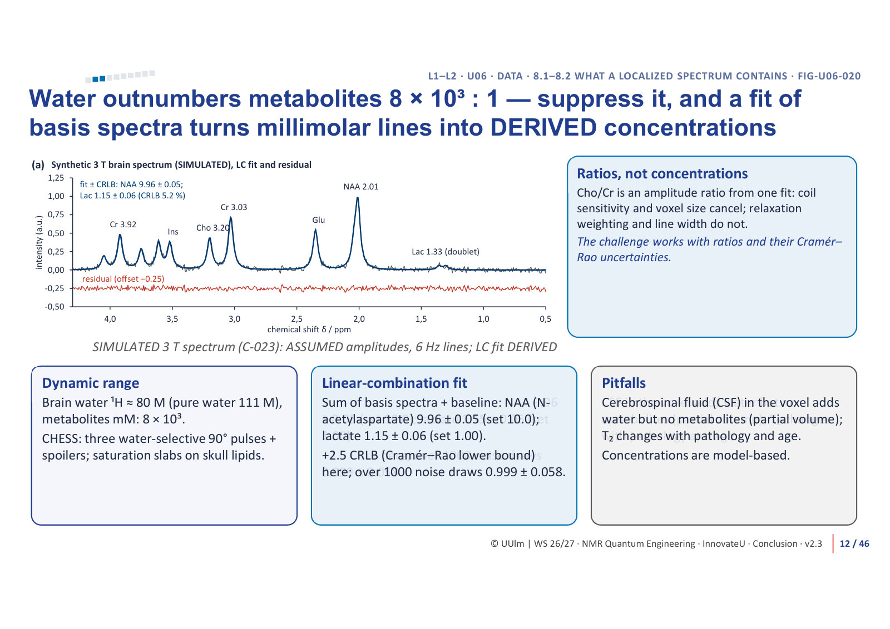

L1–L2 · U06 · 数据 · 8.1–8.2 局部波谱所含信息 · FIG-U06-020。

水中的质子数约为代谢物的 \(8\times10^3:1\)。抑制水信号后，可用基波谱拟合将毫摩尔量级的谱线转化为派生（DERIVED）浓度。

- **图 a。** 3 T 合成脑波谱（SIMULATED）、线性组合拟合及残差。纵轴是强度（a.u.），横轴为化学位移 δ / ppm。标出 Cr 3.92、Ins、Cho 3.20、Cr 3.03、Glu、NAA 2.01 和 Lac 1.33 ppm（双峰）。残差下移 −0.25。振幅为假定值（ASSUMED），线宽 6 Hz，拟合为派生结果（C-023）。
- **拟合值 ± CRLB。** NAA 9.96 ± 0.05，设定真值 10.0。乳酸 1.15 ± 0.06（CRLB 5.2%），设定真值 1.00。本次乳酸拟合高出约 2.5 个 CRLB。1,000 次噪声抽样得到 0.999 ± 0.058。模型为基波谱之和加基线。
- **动态范围。** 脑水中的 ¹H 约 80 M（纯水 111 M），代谢物为 mM 量级。CHESS 采用三个水选择性 90° 脉冲和扰相梯度。在颅骨脂质处另施加层面饱和。
- **挑战用比值。** Cho/Cr 是同一次拟合中的振幅比。线圈灵敏度和体素大小的公共因子相消，弛豫加权和线宽影响仍在。挑战赛使用这些比值及其 Cramér–Rao 不确定度。
- **解读限制。** 体素内脑脊液（CSF）会增加水信号，形成部分容积效应。病理和年龄可改变 \(T_2\)。浓度依赖模型。

## 第 13 页

[对照英文原件第 13 页](../../NMR_QE_InnovateU_Conclusion_v2.3_2026-11-20.pdf#page=13)

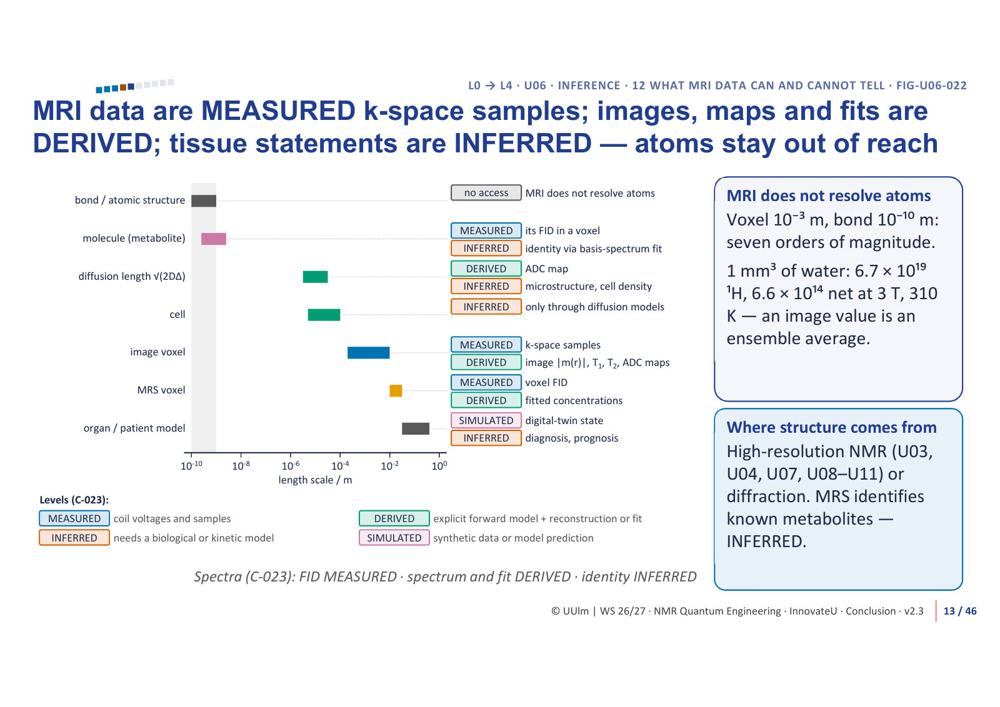

L0 → L4 · U06 · INFERENCE · 12 WHAT MRI DATA CAN AND CANNOT TELL · FIG-U06-022

### MRI 数据是通过测量 k 空间样本获得的；图像、图谱和拟合结果则是通过计算得出来的；组织的状态则是通过推断得出的——原子则始终无法被直接观测到。

键/原子结构无法访问

磁共振成像无法分辨原子结构

磁共振成像无法分辨原子。体素为 10⁻³米，键长为 10⁻¹⁰米：相差七个数量级。

测得的分子（代谢物）

该体素中的 FID 值

INFERRED

通过基础谱拟合法进行身份识别

扩散长度 = √((2DΔ)) 推导得出

ADC 映射图

1 mm³ 水含 6.7 × 10¹⁹ 个 ¹H。在 3 T、310 K 时，净极化对应 6.6 × 10¹⁴ 个 ¹H。图像数值是系综平均的结果。

INFERRED

微观结构，细胞密度

单元格推断

只有通过扩散模型

测量得到的体素图像

k 空间样本

DERIVED

图像 |m(r)|, T1, T2, ADC 映射图

MRS 测量得到的体素

体素 FID

DERIVED

拟合浓度

器官/患者模型模拟

孪生体状态

结构来源于高分辨率核磁共振（U03、U04、U07、U08–U11）或衍射技术。MRS 能够识别已知的代谢物——这是通过推断得出的结果。

INFERRED

诊断，预后

10⁻¹⁰

10⁻⁸

10⁻⁶

10⁻⁴

10⁻²

10⁰

长度尺度 / 米

等级 (C-023):

MEASURED

线圈电压和采样值

DERIVED

显式前向模型 + 重建或拟合

INFERRED

需要生物或动力学模型

SIMULATED

合成数据或模型预测

光谱数据 (C-023)：已测量频谱及拟合曲线，已推断出其性质。

13 / 46 © UUlm | WS 26/27 · NMR Quantum Engineering · InnovateU · Conclusion · v2.3

## 第 14 页

[对照英文原件第 14 页](../../NMR_QE_InnovateU_Conclusion_v2.3_2026-11-20.pdf#page=14)

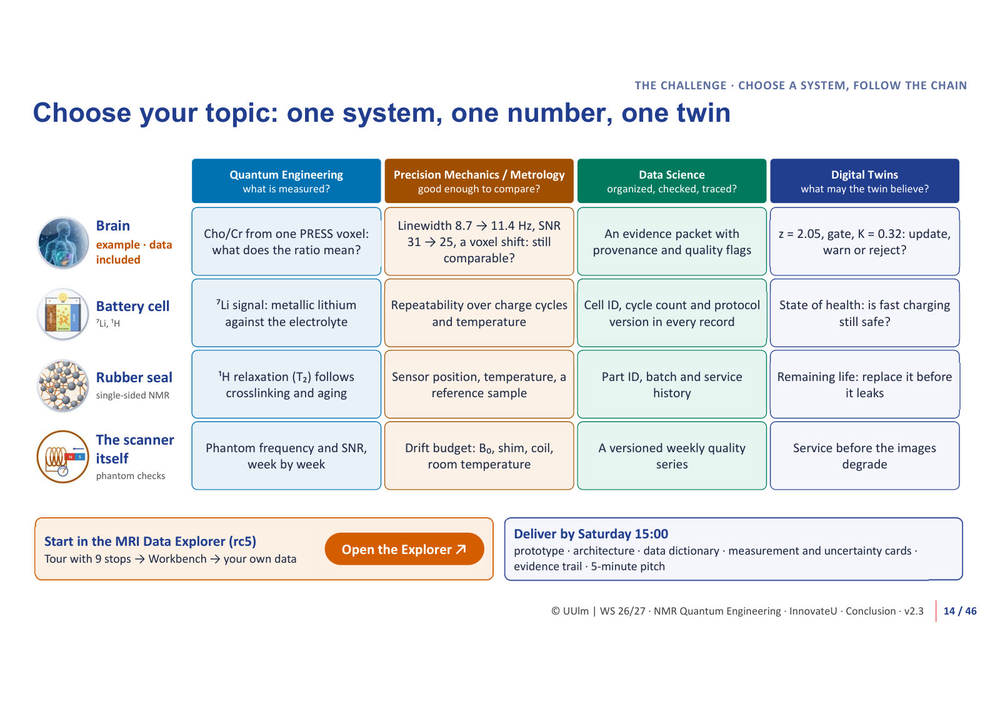

THE CHALLENGE · CHOOSE A SYSTEM, FOLLOW THE CHAIN

### 选择你的主题：一个系统，一个数字，一个孪生体

量子工程

精密机械／计量学

数据科学是否进行了整理、检查、追踪？

孪生体可能认为什么？

衡量的是什么？

足够好到可以进行比较吗？

脑科学示例·数据包含

线宽 8.7 → 11.4 赫兹, 信噪比

来自一个 PRESS 体素中的 Cho/Cr：

包含溯源和品质标志的证据包

z = 2.05, 质量门控, K = 0.32: 更新

31 → 25，一个体素尺寸：能否进行比较？

这个比率是什么意思呢？

需要警告还是拒绝？

电池单元

⁷ 锂信号：金属锂

充电周期内的重复性

细胞 ID、循环次数和实验方案

健康状态：正在快速充电

与电解质相对

以及温度

每条记录都包含版本信息

仍然安全吗？

⁷锂，¹氢

橡胶密封件

¹H 松弛过程（T₂）如下

传感器位置，温度

部件编号、批次和服务类型

剩余寿命：请在剩余寿命尽之前进行更换。

交联和老化

参考样本

历史记录

它泄露了信息

单面核磁共振

扫描仪本身

体模频率和信噪比

漂移预算：B₀, 匀场, 线圈

每周更新的质量版本

图像加载前的服务

每周

室温

系列

退化

幻觉检查

在周六下午 15:00 前交付原型 · 架构 · 数据字典 · 测量和不确定性卡片 · 证据链 · 5 分钟的演示

在 MRI 数据浏览器(rc5)之旅中开始旅程，共有 9 个站点→工作台→您自己的数据 打开浏览器 ↗

14 / 46 © UUlm | WS 26/27 · NMR Quantum Engineering · InnovateU · Conclusion · v2.3

## 第 15 页

[对照英文原件第 15 页](../../NMR_QE_InnovateU_Conclusion_v2.3_2026-11-20.pdf#page=15)

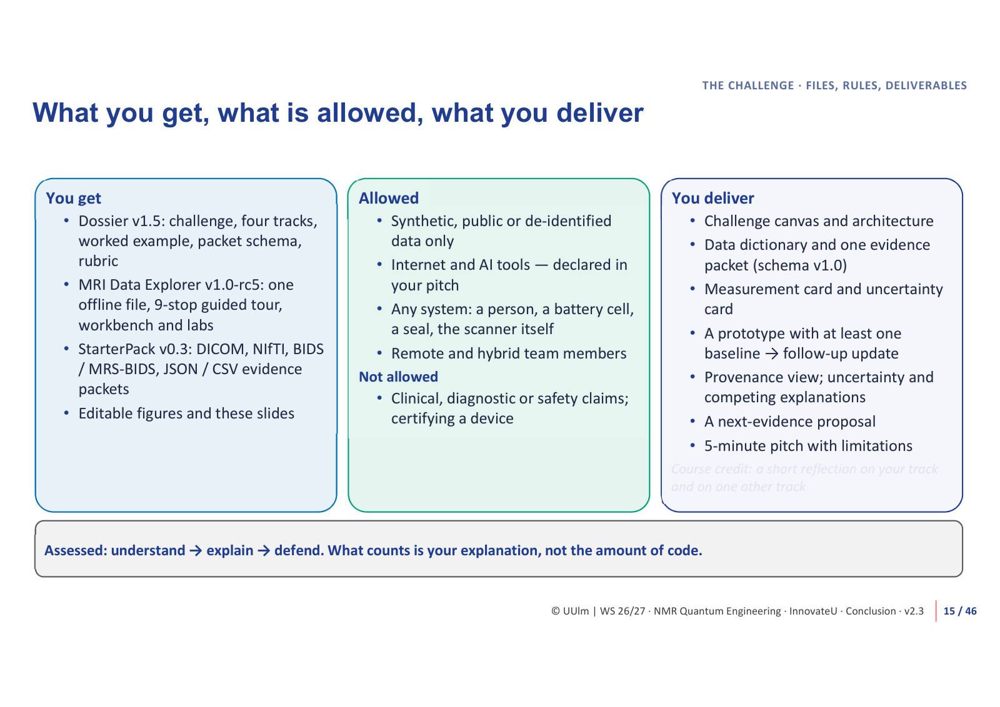

THE CHALLENGE · FILES, RULES, DELIVERABLES

### 你所获得的，被允许的东西，你交付的内容

您可以获得

允许

您已经交付了物品。

- 挑战手册 v1.5: 挑战赛, 四道题目, 示例案例, 数据包结构图, 评分标准
- 仅包含合成数据、公开数据或已去标识化处理的数据
- 挑战赛画布与架构
- 数据字典及一个证据包（规范 v1.0）
- 互联网与人工智能工具——在您的演讲中有所提及。
- MRI 数据浏览器 v1.0-rc5：一个离线文件，9 个步骤的引导式浏览，工作台和实验室功能
- 测量卡与不确定度卡
- 任何系统：一个人、一个电池单元、一个密封件，以及扫描仪本身
- 至少有一个基线的原型 → 带有随访更新的原型
- StarterPack v0.3：支持 DICOM、NIfTI 格式，同时能够处理 BIDS/MRS-BIDS、JSON/CSV 格式的证据包。
- 远程和混合团队成员不允许参与。
- 溯源视图；不确定性和相互矛盾的解释
- 临床、诊断或安全性声明；设备认证
- 可编辑的图表以及这些幻灯片
- 下一个证据提案
- 限时 5 分钟的演讲，但有一些限制条件

评估标准：理解 → 解释 → 辩护。重要的是你的解释能力，而不是所编写的代码量。

15 / 46 © UUlm | WS 26/27 · NMR Quantum Engineering · InnovateU · Conclusion · v2.3

### 图内文字与标签

- 课程学分
- 以及关于…

## 第 16 页

[对照英文原件第 16 页](../../NMR_QE_InnovateU_Conclusion_v2.3_2026-11-20.pdf#page=16)

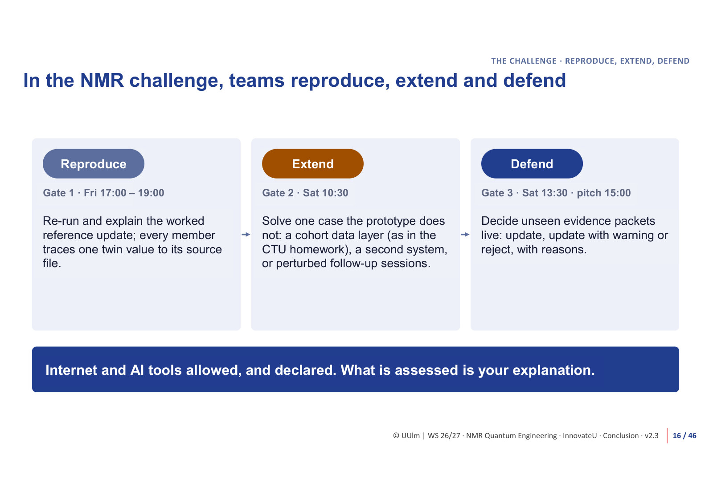

THE CHALLENGE · REPRODUCE, EXTEND, DEFEND

### 在 NMR 挑战赛中，团队负责复制、扩展和捍卫成果

复制

延伸

防御

质量门控 1 · 周五 17:00 – 19:00

第 2 次检查 · 周六 10:30

第 3 次检查 · 周六 13:30 · 15:00 项目陈述

重新运行并解释已完成的参考更新过程；每个成员都会将其中一个孪生体值追溯到其源文件。

解决一个原型无法处理的问题：一个队列数据层（如 CTU 作业中所描述的），第二个系统，或者随访会话的干扰情况。

决定处理这些未见过的证据包：进行更新；带有警告的更新；或者拒绝处理，并给出拒绝的理由。

互联网和人工智能工具被允许使用，并且得到了认可。现在需要评估的是你的解释能力。

16 / 46 © UUlm | WS 26/27 · NMR Quantum Engineering · InnovateU · Conclusion · v2.3

## 第 17 页

[对照英文原件第 17 页](../../NMR_QE_InnovateU_Conclusion_v2.3_2026-11-20.pdf#page=17)

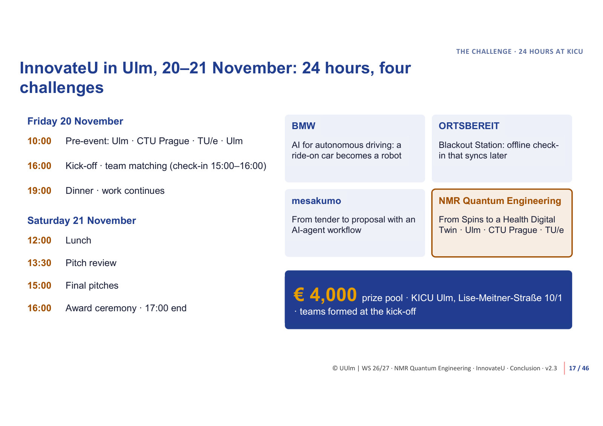

THE CHALLENGE · 24 HOURS AT KICU

### 11 月 20 日至 21 日，在乌尔姆的 InnovateU 活动：24 小时，四个挑战

11 月 20 日，星期五

BMW

ORTSBEREIT

10:00

预赛：乌尔姆 · 布拉格反恐部队 · 埃因霍温大学 · 乌尔姆

自动驾驶中的人工智能：载人的汽车变成了机器人

黑屏站：离线登记，随后进行同步操作

16:00

开球 · 队伍匹配（签到时间：15:00–16:00）

19:00

晚餐过后，工作仍在继续

mesakumo

NMR 量子工程

11 月 21 日，星期六

通过 AI 代理工作流程，从提案书到最终报价。

从旋转技术到健康数字孪生·乌尔姆·CTU 布拉格·埃科大学

12:00

午餐

13:30

评分评论

15:00

最后的投球

4,000 欧元的奖金池 · KICU 乌尔姆，Lise-Meitner-Straße 10/1 · 团队在启动仪式上组建而成

16:00

颁奖典礼 · 17:00 结束

17 / 46 © UUlm | WS 26/27 · NMR Quantum Engineering · InnovateU · Conclusion · v2.3

[返回中文总入口](index.html)
