# NMR 量子工程与数字孪生｜开场讲义 v2.3

[返回中文总入口](index.html) · [英文 PDF](../../NMR_QE_InnovateU_Intro_v2.3_2026-11-20.pdf) · [Markdown 源](qe-intro.md)

原件：`NMR_QE_InnovateU_Intro_v2.3_2026-11-20.pdf`，共 16 页。

按 PDF 文件页码对照。页脚的讲义总页数沿用课程原始编号。每页保留原图。

## 页码索引

[1](#第-1-页) · [2](#第-2-页) · [3](#第-3-页) · [4](#第-4-页) · [5](#第-5-页) · [6](#第-6-页) · [7](#第-7-页) · [8](#第-8-页) · [9](#第-9-页) · [10](#第-10-页)

[11](#第-11-页) · [12](#第-12-页) · [13](#第-13-页) · [14](#第-14-页) · [15](#第-15-页) · [16](#第-16-页)

## 第 1 页

[对照英文原件第 1 页](../../NMR_QE_InnovateU_Intro_v2.3_2026-11-20.pdf#page=1)

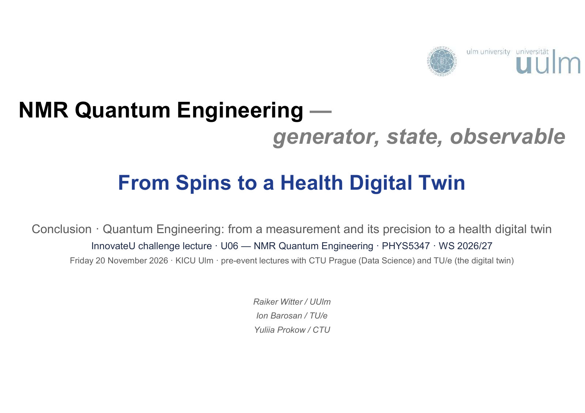

NMR 量子工程 —

生成器、状态、可观测量

从旋转技术到健康数字孪生

结论 · 量子工程：从测量及其精度到健康数字孪生

InnovateU 挑战赛讲座·U06 — 量子工程·PHYS5347·WS 2026/27

2026 年 11 月 20 日星期五 · KICU 乌尔姆 · 与 CTU 布拉格（数据科学）和 TU/e（数字孪生）共同举办的预会议程

Raiker Witter / 乌尔姆

Ion Barosan / 埃因霍温科技大学

Yuliia Prokop / 中央技术大学

### 图内文字与标签

- uim 大学 Universität
- uulm

## 第 2 页

[对照英文原件第 2 页](../../NMR_QE_InnovateU_Intro_v2.3_2026-11-20.pdf#page=2)

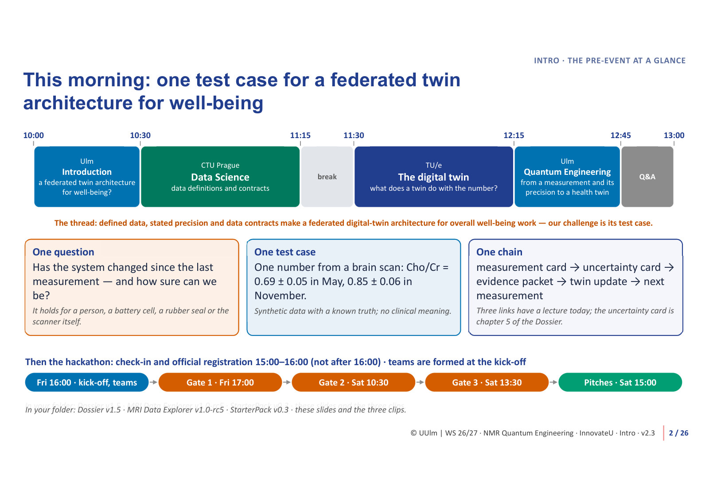

INTRO · THE PRE-EVENT AT A GLANCE

### 今天早上：一个关于孪生体架构的测试案例，旨在提升福祉

10:00

10:30

11:15

11:30

12:15

12:45

13:00

Ulm 介绍：一种联合孪生体架构

乌尔姆量子工程：从测量到应用

CTU 布拉格数据科学数据定义和合同

TU/e 数字孪生体，孪生体在数字方面的作用是什么？

中断

Q&A

为了福祉吗？

与健康孪生体相关的精确度

定义的数据、规定的精度和数据契约构成了一个用于提升整体福祉的联合数字孪生架构——我们的挑战在于对其进行测试。

有一个问题：自上次测量以来，系统是否发生了变化？我们能够确定到什么程度呢？

一个测试案例：从脑部扫描数据中得到的数值为：5 月时 Cho/Cr = 0.69 ± 0.05，11 月时为 0.85 ± 0.06。

一条测量卡 → 不确定度卡 → 证据包 → 孪生体更新 → 下一次测量

它适用于人、电池单元、橡胶密封件，甚至是扫描仪本身。

合成数据具有已知的真实性；没有临床意义。

今天有三场讲座；不确定度卡的内容是挑战手册的第 5 章。

然后就是马拉松比赛：签到和正式配准时间为 15:00 至 16:00（16:00 之后不受理）·团队将在启动会上组建

周五 16:00 · 比赛开始，各队伍登场

第 1 次检查 · 周五 17:00

第 2 次检查 · 周六 10:30

第 3 次检查 · 周六 13:30

音调 · 星期六 15:00

在你的文件夹中：挑战手册 v1.5 · 磁共振数据浏览器 v1.0-rc5 · 入门包 v0.3 · 这些幻灯片和三个视频片段。

2 / 26 © UUlm | WS 26/27 · NMR Quantum Engineering · InnovateU · Intro · v2.3

## 第 3 页

[对照英文原件第 3 页](../../NMR_QE_InnovateU_Intro_v2.3_2026-11-20.pdf#page=3)

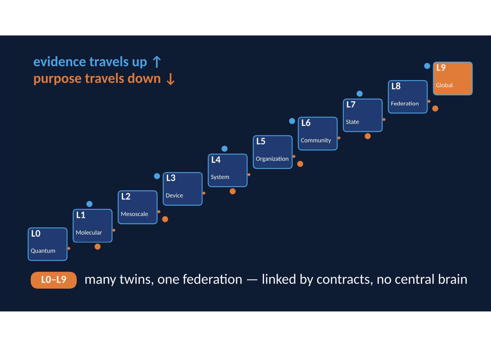

3 / 26 © UUlm | WS 26/27 · NMR Quantum Engineering · InnovateU · Intro · v2.3

### 图内文字与标签

- 证据向上传递 1
- 目的沿着 J 线前进。
- 全球
- 联合会
- 状态
- 社区
- 组织
- 系统
- 设备
- 中尺度
- LO
- 分子
- 量子
- LO-L9
- 许多双胞胎，一个由合同联系起来的联邦——没有中央大脑

## 第 4 页

[对照英文原件第 4 页](../../NMR_QE_InnovateU_Intro_v2.3_2026-11-20.pdf#page=4)

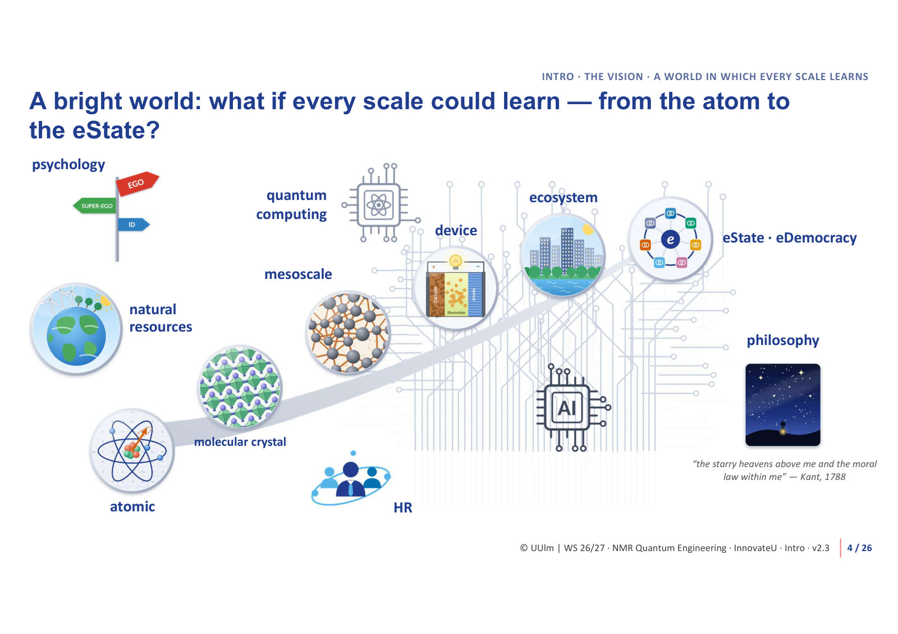

INTRO · THE VISION · A WORLD IN WHICH EVERY SCALE LEARNS

### 一个明亮的世界：如果每一个尺度都能学习——从原子到电子状态呢？

心理学

量子计算

生态系统

设备

eState · e 民主

中尺度

自然资源

哲学

分子晶体

“我头顶上的星空，以及道德准则”

“内心的法则” —— 康德，1788 年

原子

HR

4 / 26 © UUlm | WS 26/27 · NMR Quantum Engineering · InnovateU · Intro · v2.3

### 图内文字与标签

- EGO
- SUPER-EGO

## 第 5 页

[对照英文原件第 5 页](../../NMR_QE_InnovateU_Intro_v2.3_2026-11-20.pdf#page=5)

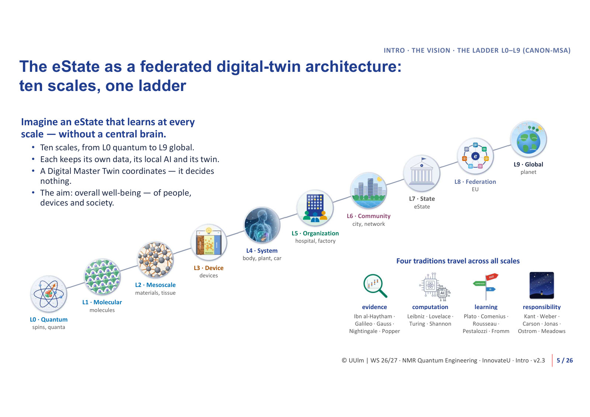

INTRO · THE VISION · THE LADDER L0–L9 (CANON-MSA)

### eState 作为一种联邦化数字孪生架构：十个维度，一个层级结构

想象一个能够在各个层面进行学习的电子状态机——无需依赖中央处理器。

- 从 L0 量子尺度到 L9 全球尺度，共有十个等级。
- 每个系统都保留着自己的数据、本地人工智能以及孪生体。

L9 · 全球

- 数字孪生体坐标——它并不起决定作用。

行星

L8 · 联合会

EU

- 目标：提升个人、设备以及整个社会的福祉。

L7 · 状态

eState

L6 · 社区

城市，网络

L5 · 组织

医院、工厂

L4 · 系统主体、工厂、车辆

四种传统跨越所有领域流传下来

L3 · 设备

设备

L2 · 中尺度材料，组织

L1 · 分子

伊本·海赛姆的证据 ·

计算 莱布尼茨 · 洛弗莱斯 ·

学习 柏拉图 · 科梅尼乌斯 ·

责任

分子

康德 · 韦伯 · 卡森 · 乔纳斯 · 奥斯特罗姆 · 梅多斯

L0 · 量子

伽利略 · 高斯 · 奈廷格尔 · 波普尔

图灵·香农

卢梭 · 佩斯塔洛齐 · 弗罗姆

旋转，量子

5 / 26 © UUlm | WS 26/27 · NMR Quantum Engineering · InnovateU · Intro · v2.3

## 第 6 页

[对照英文原件第 6 页](../../NMR_QE_InnovateU_Intro_v2.3_2026-11-20.pdf#page=6)

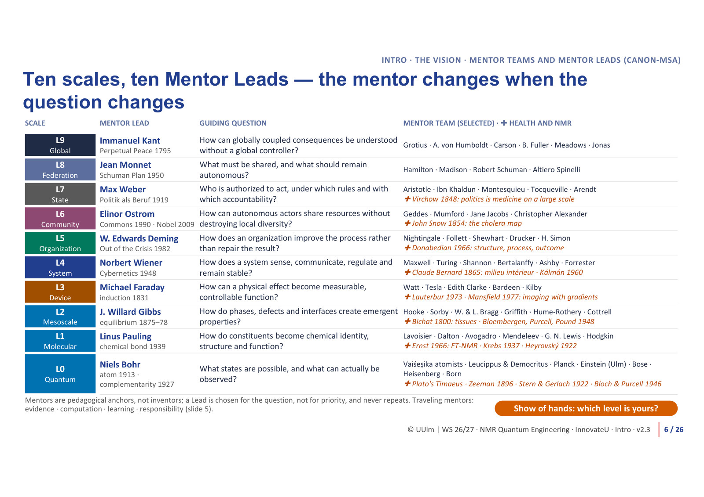

INTRO · THE VISION · MENTOR TEAMS AND MENTOR LEADS (CANON-MSA)

### 十个标准，十个指导者——随着问题的变化，指导者也会随之改变。

SCALE

MENTOR LEAD

GUIDING QUESTION

MENTOR TEAM (SELECTED) · ✚HEALTH AND NMR

L9 全球

伊曼努尔·康德 《永久的和平》 1795 年

如果没有一个全局性的控制器，我们如何理解全球范围内的耦合效应呢？Grotius · A. von Humboldt · Carson · B. Fuller · Meadows · Jonas

L8 联合会

让·莫内舒曼计划 1950 年

哪些内容需要共享？哪些内容应该保持独立？汉密尔顿·麦迪逊·罗伯特·舒曼·阿尔蒂耶罗·斯皮内利

L7 状态

马克斯·韦伯《政治作为职业》1919 年

谁有权根据哪些规则行事，并承担何种责任？

亚里士多德 · 伊本·赫勒敦 · 孟德斯鸠 · 托克维尔 · 阿伦特 ✚维尔肖 1848：政治就像是一门大规模的医学实践

L6 社区

埃莉诺·奥斯特罗姆·康姆斯，1990 年；诺贝尔，2009 年

如何让自主主体共享资源，同时不破坏当地的多样性呢？

盖德斯 · 芒福德 · 简·雅各布斯 · 克里斯托弗·亚历山大 ✚约翰·斯诺 1854 年：霍乱地图

L5 组织

W. Edwards Deming，《走出危机》，1982 年

一个组织应该如何改进流程，而不是仅仅修复结果呢？

尼廷杰尔·福莱特·谢沃特·德鲁克·西蒙 ✚多纳贝迪安 1966 年：结构、过程、结果

系统是如何感知、沟通、调节并保持稳定的呢？

L4 系统

诺伯特·维纳 控制论 1948 年

麦克斯韦 · 图林 · 香农 · 贝塔朗菲 · 阿什比 · 福雷斯特尔 ✚克劳德·伯纳德 1865 年：内部环境 · 卡尔曼 1960 年

L3 设备

迈克尔·法拉第 感应 1831

如何使物理效应变得可测量且可控？

瓦特 · 特斯拉 · 埃迪丝·克拉克 · 巴丁 · 基尔比 ✚劳特伯，1973 年 · 曼斯菲尔德，1977 年：利用梯度进行成像

L2 中尺度

J. Willard Gibbs 平衡理论 1875–78 年

相位、缺陷和界面是如何产生新的性质的呢？

胡克·索比·布拉格·格里菲斯·休姆-罗瑟里·科特雷尔 ✚比沙 1800 年：组织学 · 布洛姆贝格、珀塞尔、庞德 1948 年

L1 分子

林纳斯·鲍林 化学键 1939 年

元素是如何成为具有特定化学身份、结构及功能的化合物的呢？

拉瓦锡 · 道尔顿 · 阿伏伽德罗 · 门德列夫 · G·N·刘易斯 · 霍奇金 ✚恩斯特 1966：傅里叶变换核磁共振波谱法 · 克雷布斯 1937 · 赫罗夫斯基 1922

尼尔斯·玻尔，原子理论，1913 年 · 互补性概念，1927 年

瓦伊舍西卡原子论者 · 莱乌基普斯与德谟克利特 · 普朗克 · 爱因斯坦（乌尔姆） · 玻色 · 海森堡 · 玻恩 ✚柏拉图《蒂迈俄斯篇》 · 泽曼 1896 年 · 斯特恩与格拉赫 1922 年 · 布洛赫与珀塞尔 1946 年

L0 量子

可能有哪些状态存在？实际上又能观察到什么呢？

导师是教学上的引导者，而非发明家；担任导师的人是根据其能力被挑选出来的，而不是因为优先权而入选的，而且他们的角色不会重复。优秀的导师：具备证据意识、计算能力、学习态度以及责任感（幻灯片 5）。

举手：你处于哪个级别？

6 / 26 © UUlm | WS 26/27 · NMR Quantum Engineering · InnovateU · Intro · v2.3

## 第 7 页

[对照英文原件第 7 页](../../NMR_QE_InnovateU_Intro_v2.3_2026-11-20.pdf#page=7)

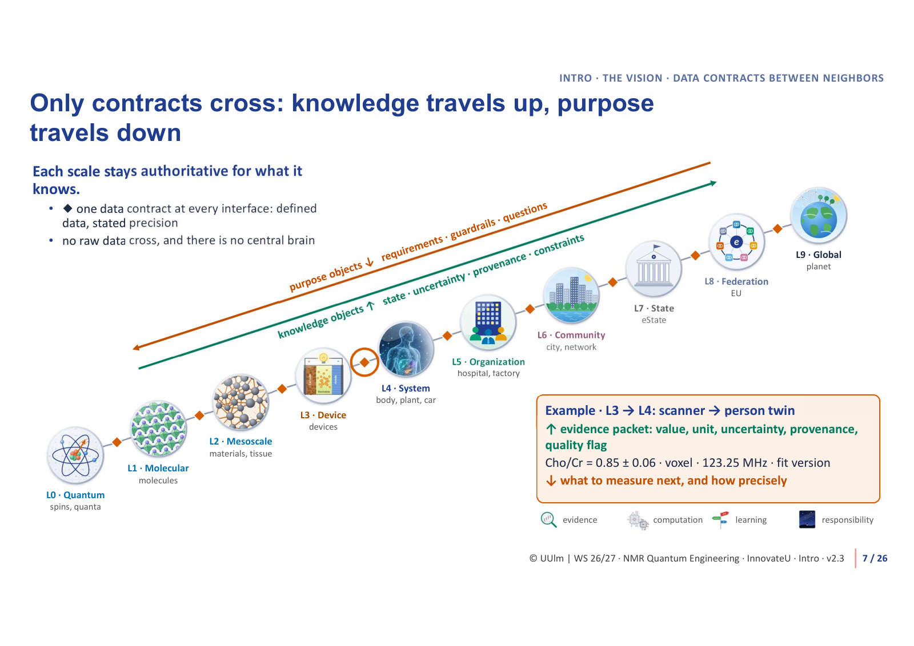

INTRO · THE VISION · DATA CONTRACTS BETWEEN NEIGHBORS

### 只有合同会交叉：知识向上流动，目的向下传递

每个标准在它所涵盖的领域内都保持着权威性。

- ◆每个接口都有一个数据契约：定义的数据，指定的精度
- 没有原始数据的交叉，也没有中央处理器

L9 · 全球

行星

L8 · 联合会

EU

L7 · 状态

eState

L6 · 社区

城市，网络

L5 · 组织

医院、工厂

L4 · 系统主体、工厂、车辆

示例 · L3 → L4: 扫描仪 → 孪生体 ↑ 证据包：数值、单位、不确定性、溯源、质量标志 Cho/Cr = 0.85 ± 0.06 · 体素 · 123.25 MHz · 适配版本 ↓ 接下来要测量什么，以及需要多精确

L3 · 设备

设备

L2 · 中尺度材料，组织

L1 · 分子

分子

L0 · 量子

旋转，量子

证据

计算

学习

责任

7 / 26 © UUlm | WS 26/27 · NMR Quantum Engineering · InnovateU · Intro · v2.3

### 图内文字与标签

- 目的、对象、要求 • 约束条件 • 问题
- 知识对象 1 状态 • 不确定性 • 溯源 • 约束条件

## 第 8 页

[对照英文原件第 8 页](../../NMR_QE_InnovateU_Intro_v2.3_2026-11-20.pdf#page=8)

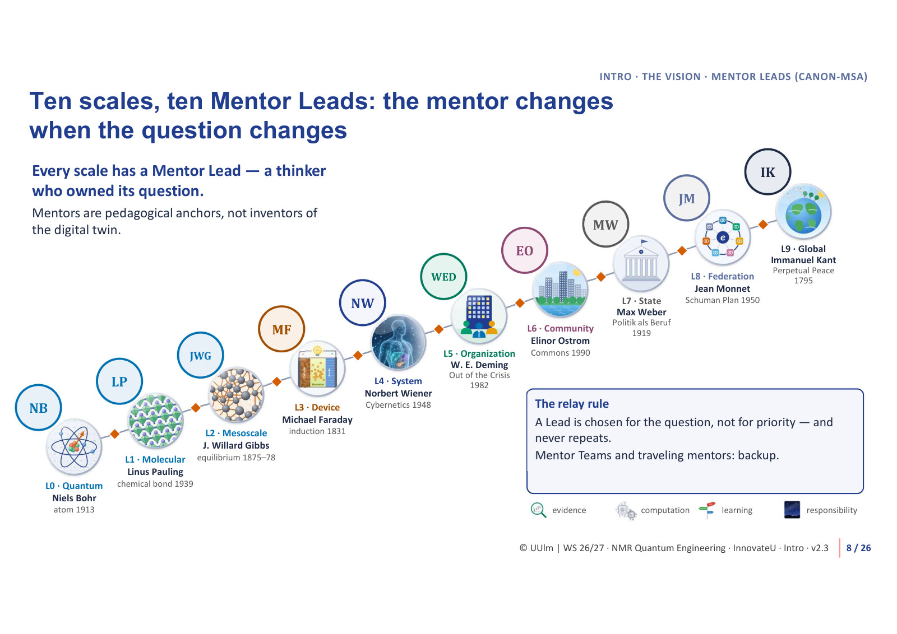

INTRO · THE VISION · MENTOR LEADS (CANON-MSA)

### 十种尺度，十种导师引领：当问题发生变化时，导师也会随之改变。

每个规模都有一个指导者——一位能够理解其问题的思想家。

IK

JM

导师是教学上的引导者，而非数字孪生的创造者。

MW

EO

L9 · 全球伊曼努尔·康德

《永久的和平》

L8 · 联合会

WED

1795

让·莫内舒曼计划 1950 年

NW

L7 · 状态 马克斯·韦伯 政治作为一种职业

MF

L6 · 社区

1919

埃莉诺·奥斯特罗姆·康姆斯 1990 年

JWG

L5 · 组织

W. E. 戴明 走出危机

LP

L4 · 诺伯特·维纳系统

1982

此问题选择的传递规则为 A Lead，而非优先级规则——且不会重复使用同一规则。指导团队和巡回指导老师：请提供备用方案。

NB

L3 · 迈克尔·法拉第装置

控制论 1948

诱导 1831

L2 · 中尺度 J. 威拉德·吉布斯 平衡 1875–78

L1 · 分子

林纳斯·鲍林 化学键 1939 年

L0 · 量子

尼尔斯·玻尔

原子 1913

证据

计算

学习

责任

8 / 26 © UUlm | WS 26/27 · NMR Quantum Engineering · InnovateU · Intro · v2.3

## 第 9 页

[对照英文原件第 9 页](../../NMR_QE_InnovateU_Intro_v2.3_2026-11-20.pdf#page=9)

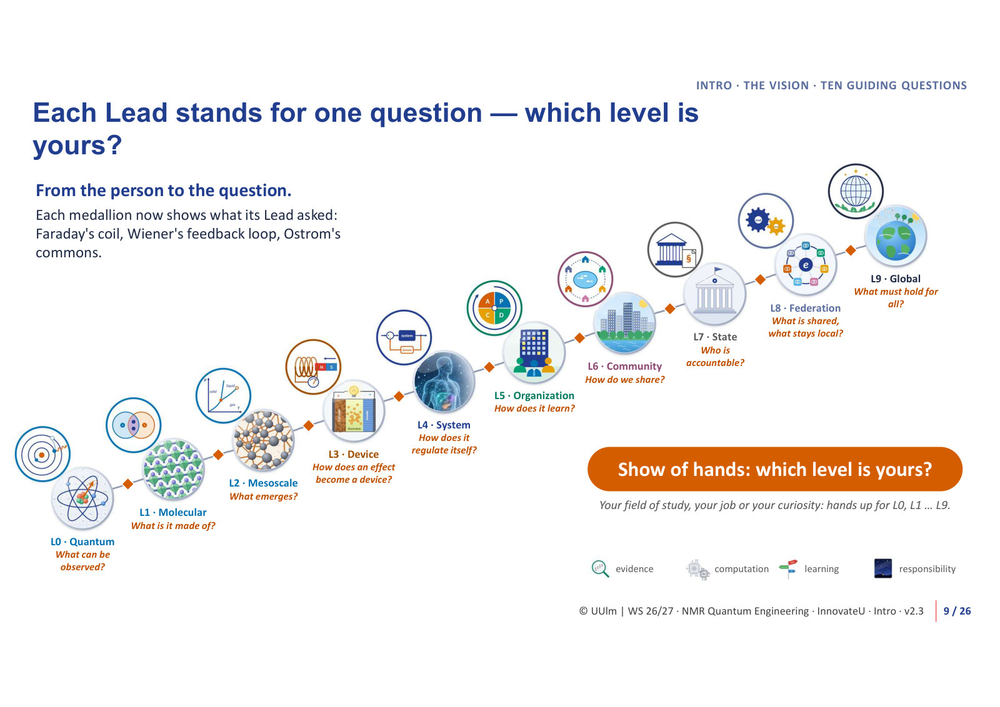

INTRO · THE VISION · TEN GUIDING QUESTIONS

### 每个标签代表一个问题——你处于哪个阶段呢？

从人到问题。

现在，每一个奖章都象征着其领导者所要求的：法拉第线圈、维纳的反馈回路、奥斯特罗姆的共享资源。

L9 · 全球范围所需的条件

L8 · 联合会

全部？

什么是共享的？什么是本地保留的？

L7 · 状态

谁应该负责？

L6 · 社区 我们如何分享？

L5 · 组织方式 它们是如何学习的？

L4 · 系统

它是如何自我调节的？

L3 · 设备 效果如何？

举手：你处于哪个级别？

变成一种设备？

L2 · 中尺度 会出现什么？

无论你的研究领域、职业还是兴趣爱好，都请举手表示支持 L0、L1……L9。

L1 · 分子 它由什么组成？

L0 · 量子

可以做什么

观测到的？

证据

计算

学习

责任

9 / 26 © UUlm | WS 26/27 · NMR Quantum Engineering · InnovateU · Intro · v2.3

## 第 10 页

[对照英文原件第 10 页](../../NMR_QE_InnovateU_Intro_v2.3_2026-11-20.pdf#page=10)

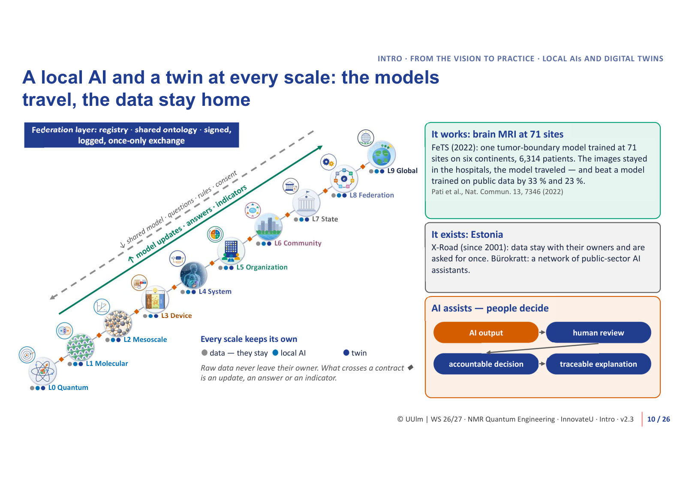

引言 · 从愿景到实践 · 本地 AI 与数字孪生

### 局部人工智能与每个尺度上的孪生体：模型可以移动，数据则留在原地。

联邦层：注册中心 · 共享本体 · 签名处理，

效果显著：在 71 个地点进行了脑部 MRI 扫描。FeTS（2022 年）的研究表明，在六大洲的 71 个地点训练出的肿瘤边界模型，对 6,314 名患者的数据进行了处理。这些图像被保存在医院内，而模型则被运输到其他地方使用。该模型的性能比那些基于公共数据训练的模型要高出 33%和 23%。参见 Pati 等人发表的论文：《Nat. Commun.》第 13 卷，第 7346 页（2022 年）。

仅记录一次的交易交换

L9 全球

L8 联合会

L7 状态

存在以下服务：爱沙尼亚的 X-道路（自 2001 年起运行），该服务下数据保留在所有者手中，且仅需要查询一次。Bürokratt：一个由公共部门人工智能助手组成的网络。

L6 社区

L5 组织

L4 系统

人工智能辅助——由人类做出决策

L3 设备

AI 输出

人工审核

每个规模都有其自己的特点。

L2 中尺度

数据——它们保持不变

局部 AI

孪生体

L1 分子

负责任的决策

可追踪的解释

原始数据永远不会离开其所有者。合同所涉及的，要么是更新，要么是答案，要么是一个指示。

L0 量子

10 / 26 © UUlm | WS 26/27 · NMR Quantum Engineering · InnovateU · Intro · v2.3

### 图内文字与标签

- & 共享模型 • 问题 • 规则：同意_
- 1 模型更新 • 答案 • 指标

## 第 11 页

[对照英文原件第 11 页](../../NMR_QE_InnovateU_Intro_v2.3_2026-11-20.pdf#page=11)

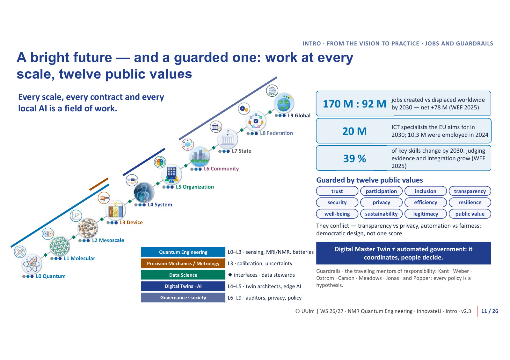

INTRO · FROM THE VISION TO PRACTICE · JOBS AND GUARDRAILS

### 光明的未来——同时也需要谨慎：在每一个层面上工作，秉持十二项公共价值观。

每一种规模、每一种合同，以及每一种本地人工智能，都是需要工作的领域。

170 M : 92 M

到 2030 年，全球新增的就业机会与失业人数之间的差额将达到+7800 万（世界经济论坛 2025 年预测）

L9 全球

20 M

欧盟计划在 2030 年达到的 ICT 专家数量；2024 年时，有 1030 万人从事相关职业。

L8 联合会

L7 状态

到 2030 年，关键技能中有 39%会发生变化：证据评估与整合能力将得到提升（世界经济论坛 2025 报告）

L6 社区

由十二个公共值进行保护

L5 组织

信任

参与程度

包含

透明度

安全性

隐私

效率

弹性

L4 系统

福祉

可持续性

合法性

公开价值

L3 设备

它们之间存在冲突——透明性与隐私性、自动化与公平性之间的矛盾。我们需要的是民主化的设计，而不是单一的标准。

L2 中尺度

数字孪生体 ≠ 自动化政府：它

量子工程

L0–L3 · 传感、磁共振/核磁共振、电池

L1 分子

在协调方面，由人们来决定。

精密机械／计量学

L3 · 校准，不确定性

护栏 · 负责任的旅行导师：康德 · 韦伯 · 奥斯特罗姆 · 卡森 · 梅多斯 · 乔纳斯 · 以及波普尔：每一项政策都是一种假设。

L0 量子

数据科学

◆接口·数据管理员

数字孪生·人工智能

L4–L5 · 孪生体建筑师，边缘 AI

治理 · 社会

L6–L9 · 审计员，隐私政策，章程

11 / 26 © UUlm | WS 26/27 · NMR Quantum Engineering · InnovateU · Intro · v2.3

## 第 12 页

[对照英文原件第 12 页](../../NMR_QE_InnovateU_Intro_v2.3_2026-11-20.pdf#page=12)

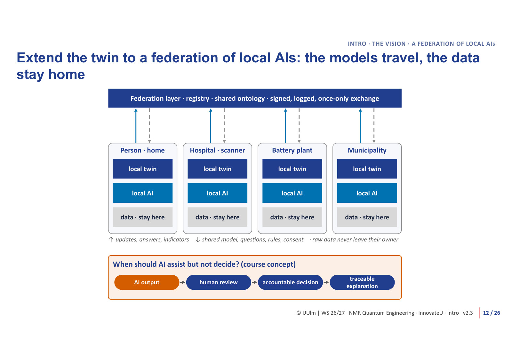

简介 · 愿景 · 一个由本地 AI 组成的联盟

### 将孪生体扩展为一个由本地 AI 组成的联邦：模型可以移动，数据则留在本地。

联邦层 · 注册中心 · 共享本体 · 签名确认、仅一次交换

人物 · 主页

医院 · 扫描仪

电池工厂

市镇

局部孪生体

局部孪生体

局部孪生体

局部孪生体

局部 AI

局部 AI

局部 AI

局部 AI

数据 · 保留在此

数据 · 保留在此

数据 · 保留在此

数据 · 保留在此

↑ 更新、答案、指标      ↓ 共享模型、问题、规则、同意      · 原始数据永远不会离开其所有者

何时让人工智能提供辅助服务，而不进行决策？（课程概念）

可问责的决策，可追溯的解释

AI 输出

人工审核

12 / 26 © UUlm | WS 26/27 · NMR Quantum Engineering · InnovateU · Intro · v2.3

## 第 13 页

[对照英文原件第 13 页](../../NMR_QE_InnovateU_Intro_v2.3_2026-11-20.pdf#page=13)

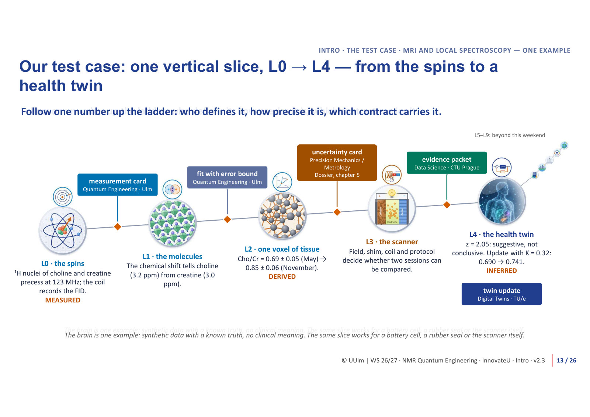

INTRO · THE TEST CASE · MRI AND LOCAL SPECTROSCOPY — ONE EXAMPLE

### 我们的测试案例：一个垂直切片，L0 → L4 —— 从自旋到健康的孪生体

沿着一个数字上升：由谁来定义它，它的精确度如何，哪个合同负责执行它。

L5–L9：直到这个周末之后

不确定度卡 精密机械 /

证据包 数据科学 · 布拉格 CTU

计量学挑战手册，第 5 章

带有误差界限的量子工程 · 乌尔姆

测量卡 量子工程 · 乌尔姆

L4 · 健康孪生体 z = 2.05：有提示性，但尚不能确定。更新后的数据：K = 0.32

L3 · 扫描仪场强、匀场、线圈和协议决定了两个会话是否能够进行

L2 · 一个体素的组织 Cho/Cr = 0.69 ± 0.05（5 月）

L1 · 分子 化学位移描述了胆碱的特性

0.690 → 0.741. INFERRED

L0 · 胆碱和肌酸的¹H 核自旋

0.85 ± 0.06（11 月）。计算结果

进行比较。

3.2 ppm 来自肌酸（3.0）

在 123 MHz 的频率下运行；线圈

ppm）。

记录了 FID 值。

孪生体更新 数字孪生 · 埃因霍夫大学

MEASURED

大脑就是一个例子：合成数据具有已知的真实性，但并无临床意义。同样的模型数据可以用于电池单元、橡胶密封件，甚至是扫描仪本身的分析。

13 / 26 © UUlm | WS 26/27 · NMR Quantum Engineering · InnovateU · Intro · v2.3

## 第 14 页

[对照英文原件第 14 页](../../NMR_QE_InnovateU_Intro_v2.3_2026-11-20.pdf#page=14)

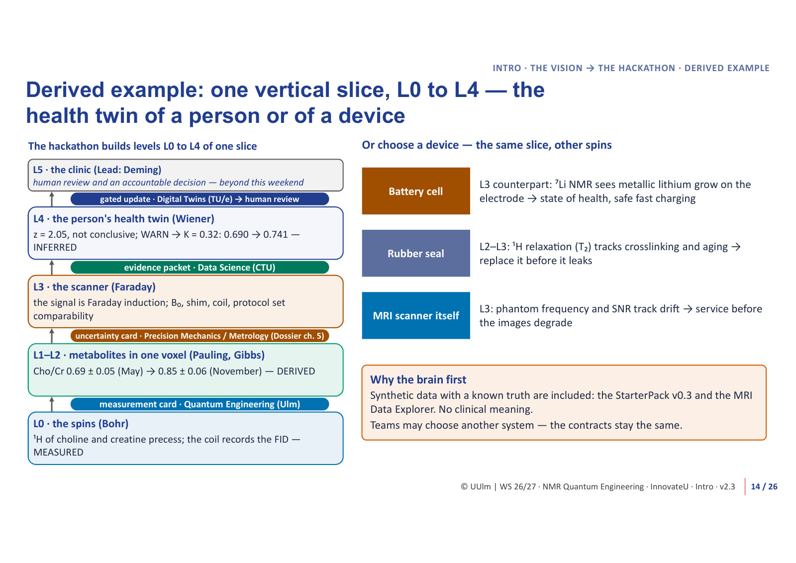

INTRO · THE VISION → THE HACKATHON · DERIVED EXAMPLE

### 衍生示例：一个垂直切片，L0 到 L4——代表一个人或设备的健康孪生体

或者选择一种设备——相同的切片，但不同的旋转方式。

这个编程马拉松活动负责构建一个切片中的 L0 到 L4 级别。

L5·诊所（负责人：Deming）通过人工审核做出负责任的决定——将持续到本周末之后。

电池单元 L3 版本：⁷Li 核磁共振扫描显示电极上出现了金属锂物质 → 电池处于健康状态，能够安全快速充电

限流更新 · 数字孪生（TU/e）→人工审核

L4 · 该人的健康孪生体（维纳模型） z = 2.05，尚不能确定；WARN → K = 0.32: 0.690 → 0.741 — 推断结果

橡胶密封件 L2–L3：¹H 松弛状态（T₂）反映了交联和老化情况→在泄漏之前更换密封件

证据包 · 数据科学(CTU)

L3 · 扫描仪（法拉第）产生的信号属于法拉第感应；B₀、匀场、线圈、协议设置的可比性

MRI 扫描仪本身，L3 部位：体模的频率和信噪比方向，在图像质量下降之前进行维护

不确定度卡 · 精密机械/计量学（挑战手册第 5 章）

L1-L2 · 一个体素中的代谢物（保林，吉布斯）Cho/Cr 从 0.69 ± 0.05（5 月）增加到 0.85 ± 0.06（11 月）——推导得出

为什么大脑首先会包含具有已知真实性的合成数据：StarterPack v0.3 和 MRI 数据浏览器。这些数据没有临床意义。团队可以选择其他系统——不过合同内容保持不变。

测量卡 · 量子工程（乌尔姆）

L0 · 胆碱和肌酸的自旋（玻尔定域）¹H；线圈记录了 FID——测量值

14 / 26 © UUlm | WS 26/27 · NMR Quantum Engineering · InnovateU · Intro · v2.3

## 第 15 页

[对照英文原件第 15 页](../../NMR_QE_InnovateU_Intro_v2.3_2026-11-20.pdf#page=15)

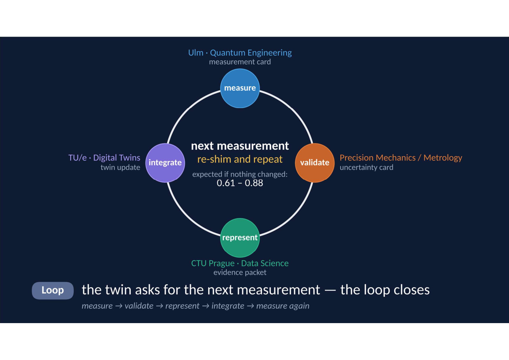

15 / 26 © UUlm | WS 26/27 · NMR Quantum Engineering · InnovateU · Intro · v2.3

### 图内文字与标签

- 乌尔姆 • 量子工程
- 测量卡
- 测量
- 下一次测量
- 精密机械／计量学
- TU/e • 数字孪生
- 重新匀场并重复操作
- 孪生体更新
- 积分
- 验证
- 不确定度卡
- 如果没有任何变化，则预期会如此：
- 代表
- CTU 布拉格 • 数据科学
- 证据包
- 循环
- 孪生体请求下一次测量——循环结束
- 测量 → 验证 → 表示 → 整合 → 再次测量

## 第 16 页

[对照英文原件第 16 页](../../NMR_QE_InnovateU_Intro_v2.3_2026-11-20.pdf#page=16)

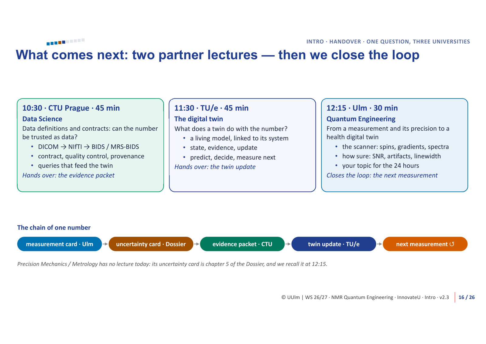

INTRO · HANDOVER · ONE QUESTION, THREE UNIVERSITIES

### 接下来将进行两场合作伙伴讲座——之后我们将结束本次讨论。

10:30 · 布拉格 CTU · 45 分钟 数据科学 数据定义和合同：这个数字能否作为数据被信任？

11:30 · 埃因霍温大学 · 45 分钟 数字孪生体 孪生体如何处理这个数字？

12:15 · 乌尔姆 · 30 分钟 量子工程 从测量及其精度到健康数字孪生

- 一个与系统相连接的活生生的模型
- DICOM → NIfTI → BIDS / MRS-BIDS
- 扫描仪：旋转、梯度处理、光谱分析
- 状态、证据、更新
- 合同、质量控制、溯源
- 预测、决策、衡量下一步行动——传递孪生体更新信息
- 确定性：信噪比、伪影、线宽
- 输入孪生体的查询：证据包
- 您选择的 24 小时主题正在关闭循环：下一次测量。

一个数字链

测量卡 · 乌尔姆

不确定度卡 · 挑战手册

证据包 · 反恐单位

孪生体更新 · TU/e

下一次测量

精密机械/计量学今天的讲座没有安排：其不确定度卡是挑战手册的第五章，我们将在 12:15 回顾这一内容。

16 / 26 © UUlm | WS 26/27 · NMR Quantum Engineering · InnovateU · Intro · v2.3

[返回中文总入口](index.html)
