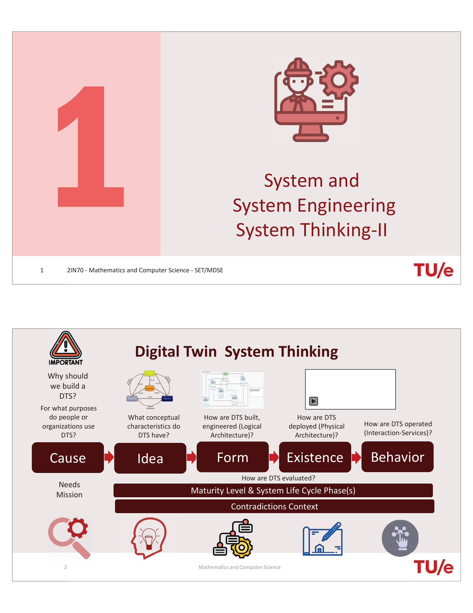
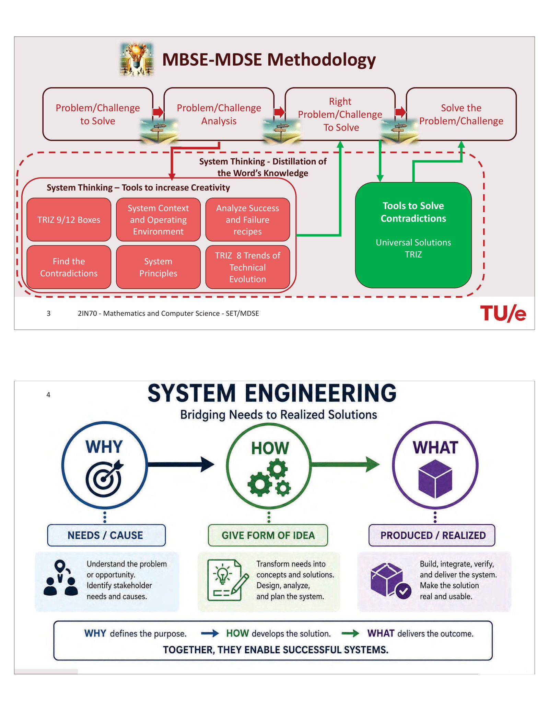
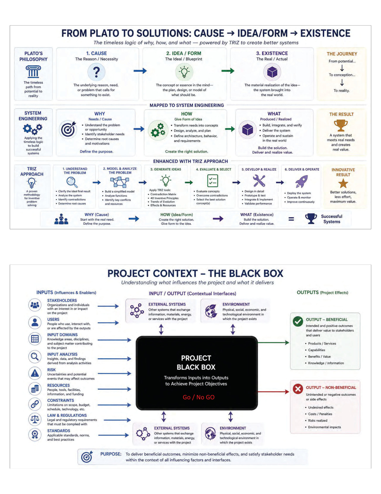
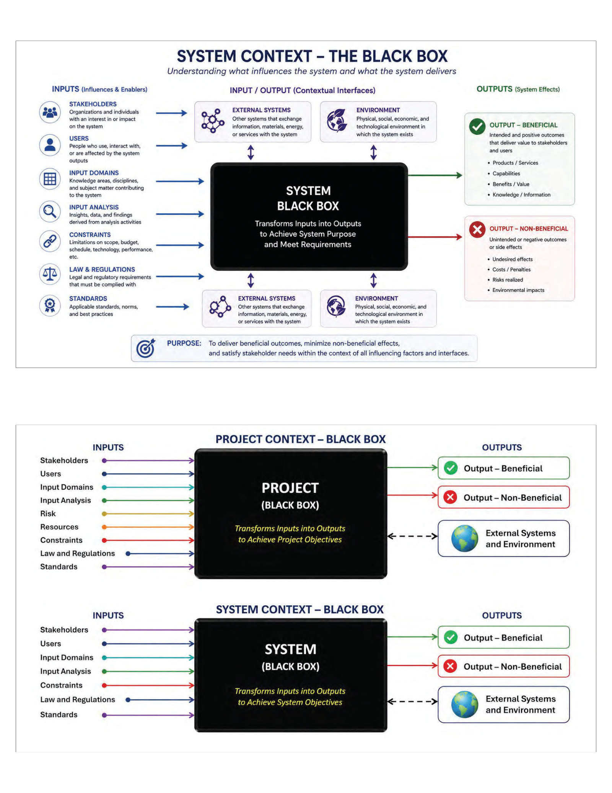
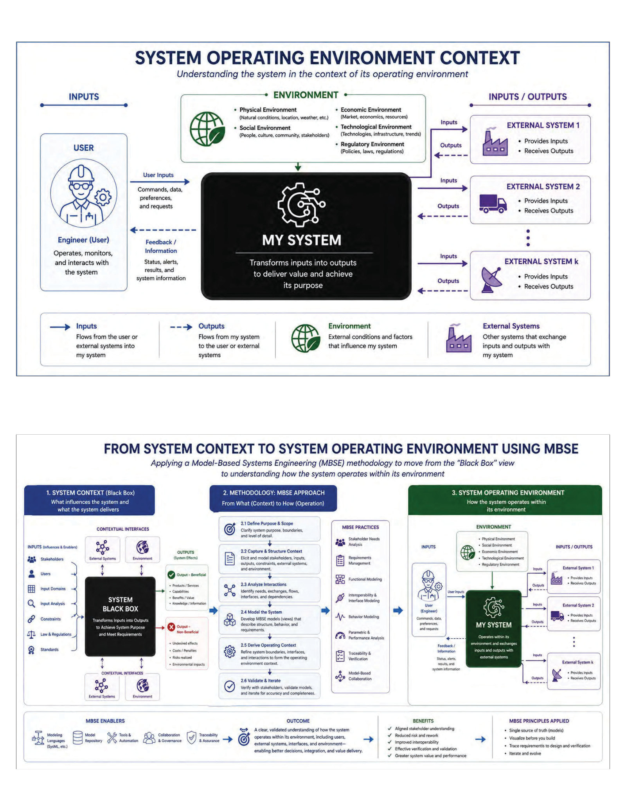

# 数字孪生系统思维

[返回中文总入口](index.html) · [英文 PDF](../../SystemThinking_FINAL.pdf) · [Markdown 源](system-thinking.md) · [项目方更新压缩包](../../update%20files.zip)

原件：`SystemThinking_FINAL.pdf`，共 5 页。

PDF 每页放置两张幻灯片，共 10 张。按 PDF 页码排版并在原图中保留幻灯片编号。

## 页码索引

[1](#第-1-页) · [2](#第-2-页) · [3](#第-3-页) · [4](#第-4-页) · [5](#第-5-页)

## 第 1 页

[对照英文原件第 1 页](../../SystemThinking_FINAL.pdf#page=1)

### 系统与系统工程：数字孪生系统思维

TU/e 课程 2IN70，数学与计算机科学，SET/MDSE。《系统思维 II》。

数字孪生系统思维按原因、构想、形式、存在和行为来理解 DTS。

| 阶段 | 要回答的问题 |
| --- | --- |
| 原因 | 为什么要建 DTS？个人或组织为了什么而使用 DTS？明确需要和使命。 |
| 构想 | DTS 具备什么概念特征？ |
| 形式 | 怎样构建和设计 DTS？这里关注逻辑架构。 |
| 存在 | 怎样部署 DTS？这里关注物理架构。 |
| 行为 | 怎样运行 DTS？这里关注交互与服务。 |

如何评价 DTS？考虑成熟度和所处的系统生命周期阶段，同时看清情境中的矛盾。

## 第 2 页

[对照英文原件第 2 页](../../SystemThinking_FINAL.pdf#page=2)

### MBSE–MDSE 方法与系统工程

待解决的问题或挑战 → 分析问题或挑战 → 找到正确的问题或挑战 → 解决问题或挑战。

系统思维提炼已有知识，并用工具提升创造力。

| 工具与分析 | 作用 |
| --- | --- |
| TRIZ 九窗格／十二窗格 | 找出矛盾 |
| 系统情境和运行环境 | 明确系统原理 |
| 分析成败案例和经验 | 用 TRIZ 的八种技术演化趋势分析 |
| 解决矛盾的工具 | 使用 TRIZ 通用解法 |

系统工程衔接需求与实现的解决方案。

- **为何。需求／原因。** 识别利益相关方的需求和原因。理解问题或机会。明确目的。
- **如何。为构想赋形。** 将需求转换为概念及解决方案。设计、分析和规划系统。
- **交付什么。生产／实现。** 构建、集成、验证并交付系统。让方案真实可用。

三项活动共同支持系统的成功交付。

## 第 3 页

[对照英文原件第 3 页](../../SystemThinking_FINAL.pdf#page=3)

### 从柏拉图到解决方案，以及项目黑箱

借用柏拉图的逻辑，从潜在需要出发，经过概念，走向现实。结合 TRIZ 可以创造更好的系统。

| 问题 | 哲学阶段 | 对应的系统工程活动 |
| --- | --- | --- |
| 为何 | **原因**。理由、必要性，或要求某物出现的根本需求和问题。 | 理解问题或机会，确定根因，识别利益相关方及其需求和动机，明确目的。 |
| 如何 | **构想／形式**。头脑中的概念或本质，即理想蓝图、计划、设计或模型。 | 把需求转为概念，定义架构、行为和需求，开展设计、分析和规划，形成合适的方案。 |
| 交付什么 | **存在**。构想的物质实现，即在真实世界建成的系统。 | 构建、集成并验证，交付系统，在真实环境中运行并维持它，实现价值。 |

TRIZ 增强方法：

1. **理解。** 明确理想最终结果，分析系统，识别矛盾，确定根因。
2. **建模与分析问题。** 建立简化模型，分析功能，找出关键冲突和资源。
3. **生成构想。** 用 40 条发明原理、矛盾矩阵、效应与资源、演化趋势解决矛盾。
4. **评价与选择。** 评价概念，选出最佳方案。
5. **开发与实现。** 详细设计、制作原型并测试、集成和实施、验证性能。
6. **交付与运行。** 部署系统、运行与监控、持续改善。

从真实需求出发，明确目的，形成并构建合适的方案，最终交付并实现价值。目标是用更少投入获得更好的方案和更大价值。

### 项目情境：黑箱

| 类别 | 中文图释 |
| --- | --- |
| 输入、影响因素和使能因素 | 利益相关方对项目有利益关系或影响。用户使用项目输出、与其交互或受其影响。输入学科提供知识。输入分析提供洞察、数据和发现。风险是影响结果的不确定性和潜在事件。资源包括人员、工具、设施、信息和经费。约束涵盖范围、预算、工期、技术等。法律法规必须遵守。还需考虑适用的标准、规范和良好实践。 |
| 情境接口 | 外部系统与项目交换信息、材料、能量或服务。项目存在于物理、社会、经济和技术环境中。接口可双向交换。 |
| 项目黑箱 | 将输入转成输出以实现项目目标。设有继续／停止（Go／No Go）决策。 |
| 有益输出 | 有意产生、对利益相关方和用户有益的结果：产品或服务、能力、收益或价值、知识或信息。 |
| 不利输出 | 非预期、负面结果或副作用：不希望出现的效应、成本或处罚、实际发生的风险、环境影响。 |

目标是在考虑所有影响因素和接口的情况下交付有益结果，尽量减少不利影响，满足利益相关方需求。

## 第 4 页

[对照英文原件第 4 页](../../SystemThinking_FINAL.pdf#page=4)

### 系统情境：黑箱

图上半部分分析哪些因素影响系统，以及系统交付什么。图下半部分对照项目黑箱和系统黑箱。

- **输入和影响因素。** 利益相关方，用户，提供知识的领域和学科，分析产生的洞察、数据和发现，范围、预算、工期、技术和性能等约束，法律法规和适用标准。用户可能使用系统、与其交互或受其影响。
- **输入／输出接口。** 外部系统交换信息、材料、能量和服务。系统位于物理、社会、经济和技术环境中。
- **系统黑箱。** 将输入转换为输出，达到系统目的并满足要求。
- **有益输出。** 对利益相关方和用户有价值的产品或服务、能力、收益或价值、知识或信息。
- **不利输出。** 意外结果、负面结果或副作用，包括不希望的影响、成本或处罚、实际发生的风险、环境影响。

对照图中，项目黑箱另列风险和资源，面向项目目标。系统黑箱面向系统目标。两者与外部系统和环境交换输入、输出，都需在各种影响因素与接口的约束下满足利益相关方需求，最大化有益结果并减少不利影响。

## 第 5 页

[对照英文原件第 5 页](../../SystemThinking_FINAL.pdf#page=5)

### 系统的运行环境与 MBSE 推导

### 系统运行环境情境
- **环境。** 影响系统的外部条件，包括物理（自然条件、位置、天气）、社会（人、文化、社群、利益相关方）、经济（市场、经济条件、资源）、技术（技术、基础设施、趋势）和监管（政策、法律、法规）。
- **工程师／用户。** 操作、监控系统并与系统交互，输入命令、数据、偏好和请求，收到状态、告警、结果和系统信息。
- **我的系统。** 将输入转化为输出，实现目的并交付价值。
- **外部系统 1、2、…、k。** 与本系统交换输入和输出。输入由用户或外部系统流入本系统，输出从本系统流向用户或外部系统。

### 使用基于模型的系统工程（MBSE），从系统情境到运行环境
1. **系统情境（黑箱）。** 确定影响系统的因素、系统交付内容、输入及情境接口。
2. **MBSE 方法。** 明确系统的目的、范围和详细程度。采集并组织利益相关方、输入、输出、约束及外部系统和环境。分析需要、交换关系、接口和依赖。建立说明结构、行为和要求的模型。细化边界和交互，形成运行环境情境。与利益相关方验证并反复修订，确保准确、完整。
3. **系统运行环境。** 说明系统如何在环境中运行，以及如何与外部系统交换输入与输出。

MBSE 使能工具包括模型及 SysML 等表示。采用单一事实来源，建造前先可视化，持续迭代，并把需求追溯到设计和验证。明确且经过验证的运行情境涵盖外部系统和接口。这样可对齐利益相关方理解，降低风险和返工，提高互操作性，支持有效的验证与确认，改善系统价值和性能。

[返回中文总入口](index.html)
