# 乌尔姆 2026 黑客松｜数字孪生系统概念

[返回中文总入口](index.html) · [英文 PDF](../../Hackathon_ULM_2026_NO_VIDEO_1.pdf) · [Markdown 源](ulm-hackathon.md)

原件：`Hackathon_ULM_2026_NO_VIDEO_1.pdf`，共 50 页。

每页保留讲义原图。图中文字按原图位置整理。演示画面的细小产品标记或截图内代码可查原图。

## 页码索引

[1](#第-1-页) · [2](#第-2-页) · [3](#第-3-页) · [4](#第-4-页) · [5](#第-5-页) · [6](#第-6-页) · [7](#第-7-页) · [8](#第-8-页) · [9](#第-9-页) · [10](#第-10-页)

[11](#第-11-页) · [12](#第-12-页) · [13](#第-13-页) · [14](#第-14-页) · [15](#第-15-页) · [16](#第-16-页) · [17](#第-17-页) · [18](#第-18-页) · [19](#第-19-页) · [20](#第-20-页)

[21](#第-21-页) · [22](#第-22-页) · [23](#第-23-页) · [24](#第-24-页) · [25](#第-25-页) · [26](#第-26-页) · [27](#第-27-页) · [28](#第-28-页) · [29](#第-29-页) · [30](#第-30-页)

[31](#第-31-页) · [32](#第-32-页) · [33](#第-33-页) · [34](#第-34-页) · [35](#第-35-页) · [36](#第-36-页) · [37](#第-37-页) · [38](#第-38-页) · [39](#第-39-页) · [40](#第-40-页)

[41](#第-41-页) · [42](#第-42-页) · [43](#第-43-页) · [44](#第-44-页) · [45](#第-45-页) · [46](#第-46-页) · [47](#第-47-页) · [48](#第-48-页) · [49](#第-49-页) · [50](#第-50-页)

## 第 1 页

[对照英文原件第 1 页](../../Hackathon_ULM_2026_NO_VIDEO_1.pdf#page=1)

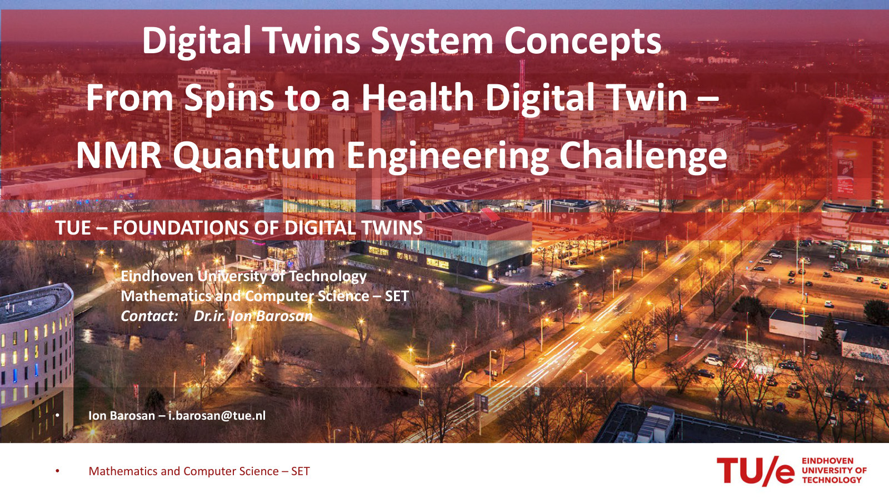

### 从自旋到健康数字孪生的数字孪生系统概念——量子工程挑战赛

TUE – FOUNDATIONS OF DIGITAL TWINS

埃因霍温理工大学 数学与计算机科学系 – SET 联系人：Dr.ir. Ion Barosan

Ion Barosan – i.barosan@tue.nl

数学与计算机科学 – 集合论

### 图内文字与标签

- TECHNOLOGY

## 第 2 页

[对照英文原件第 2 页](../../Hackathon_ULM_2026_NO_VIDEO_1.pdf#page=2)

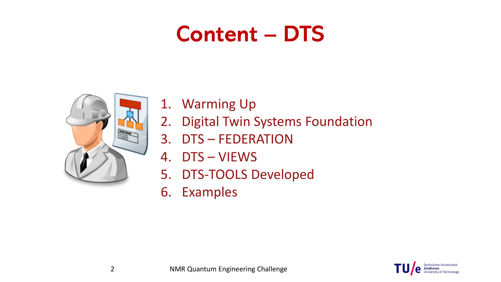

### 内容 – DTS

1. 预热 2. 数字孪生系统基础 3. DTS – 联合会 4. DTS – 视图 5. DTS-TOOLS 开发版 6. 示例

NMR 量子工程挑战赛

### 图内文字与标签

- 技术大学

## 第 3 页

[对照英文原件第 3 页](../../Hackathon_ULM_2026_NO_VIDEO_1.pdf#page=3)

### 数字孪生系统（DTS）

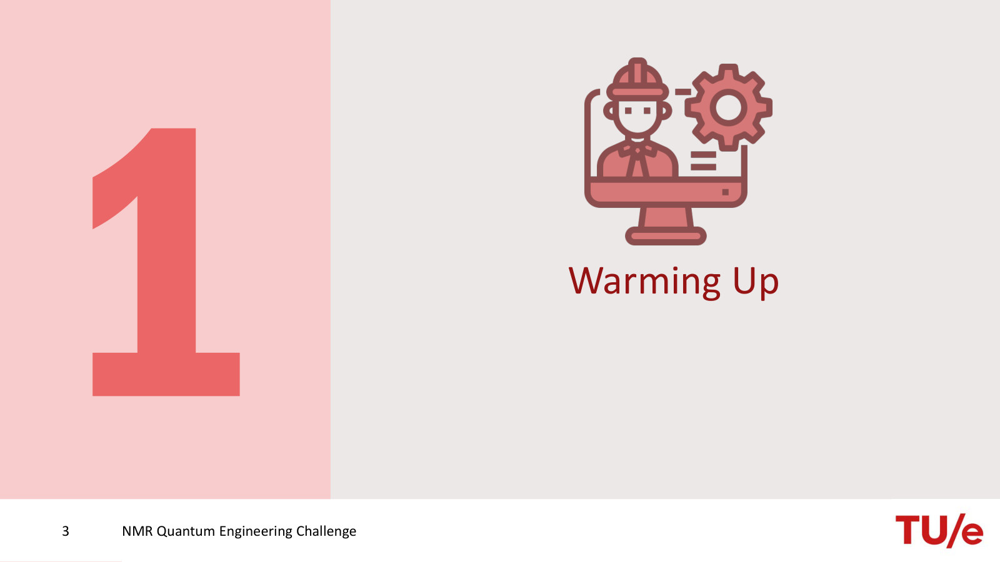

热身运动

NMR 量子工程挑战赛

## 第 4 页

[对照英文原件第 4 页](../../Hackathon_ULM_2026_NO_VIDEO_1.pdf#page=4)

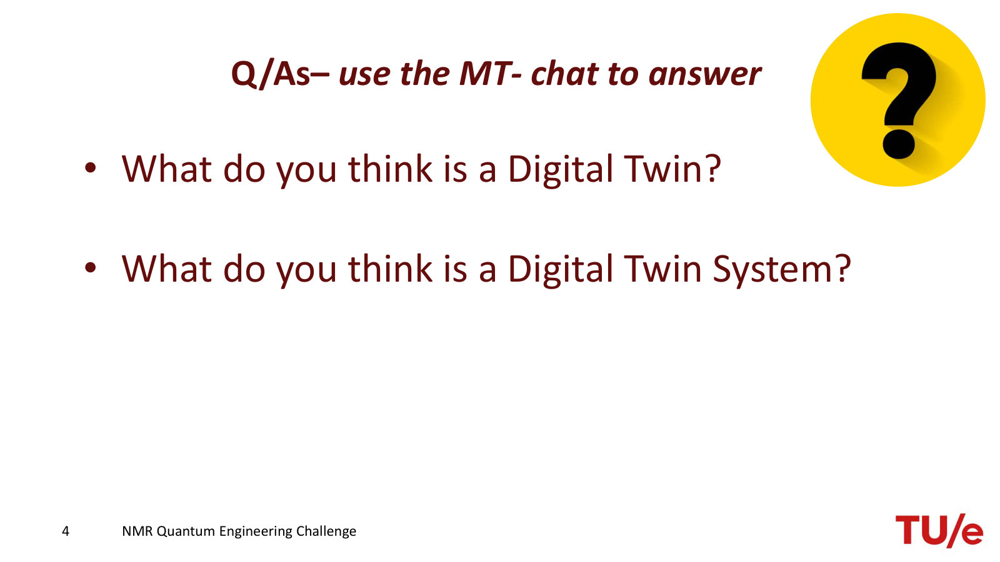

### Q/As – 请使用 MT 聊天工具进行回答

- 您认为什么是数字孪生？
- 您认为什么是数字孪生系统？

NMR 量子工程挑战赛

## 第 5 页

[对照英文原件第 5 页](../../Hackathon_ULM_2026_NO_VIDEO_1.pdf#page=5)

### Bejan、Gaudí 与 TRIZ

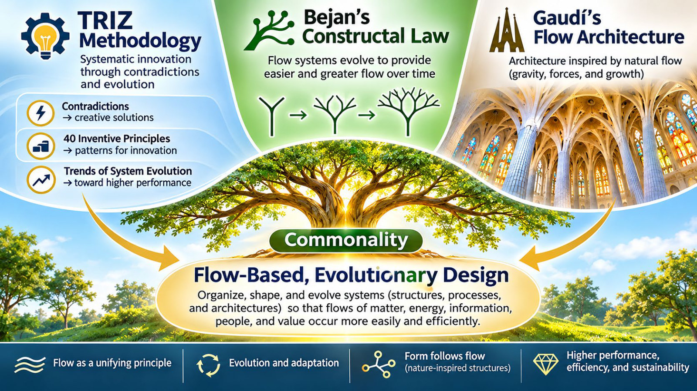

| 思想或方法 | 核心内容 |
| --- | --- |
| Bejan 的构形定律 | 流动系统会随时间演化，使流动更容易、流量更大。 |
| Gaudí 的流动建筑 | 从重力、受力和生长等自然流动过程获得建筑灵感。 |
| TRIZ 方法论 | 通过分析矛盾和演化实现系统创新。矛盾引出创造性解法，40 条发明原理提供创新模式，系统演化趋势指向更高性能。 |

共同点是以流动和演化为基础设计。组织和调整结构、过程与架构，使物质、能量、信息、人员和价值更容易、更高效地流动。形式顺应流动，系统随之演化和适应，提高性能、效率和可持续性。

## 第 6 页

[对照英文原件第 6 页](../../Hackathon_ULM_2026_NO_VIDEO_1.pdf#page=6)

### 高等教育中的智识、智能、直觉与抽象

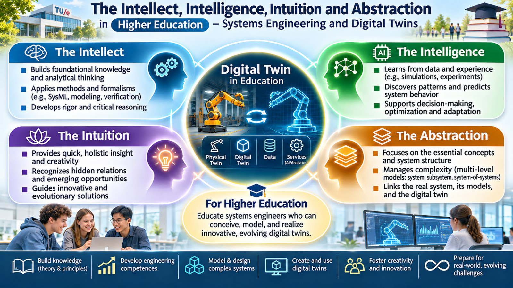

TU/e · 系统工程与数字孪生。

| 能力 | 在系统工程教育中的作用 |
| --- | --- |
| 智识 | 积累基础知识，训练分析思维。应用 SysML、建模和验证等方法，培养严谨和批判性推理。 |
| 智能 | 从仿真和实验等数据与经验中学习，发现模式，预测系统行为，支持决策、优化与适应。 |
| 直觉 | 快速形成整体洞察并激发创造力，识别隐藏关系和新机会，引导创新及演化解法。 |
| 抽象 | 聚焦基本概念与系统结构，用系统、子系统和系统之系统等多层模型管理复杂性，连接真实系统、模型和数字孪生。 |

教育中的数字孪生包含物理孪生、数字孪生、数据和服务（AI／分析）。目标是培养能构思、建模和实现创新、可演化孪生的工程师。教育路径包括积累知识、发展工程能力、为复杂系统建模与设计、创建和使用数字孪生、激发创新，以应对不断变化的现实挑战。

## 第 7 页

[对照英文原件第 7 页](../../Hackathon_ULM_2026_NO_VIDEO_1.pdf#page=7)

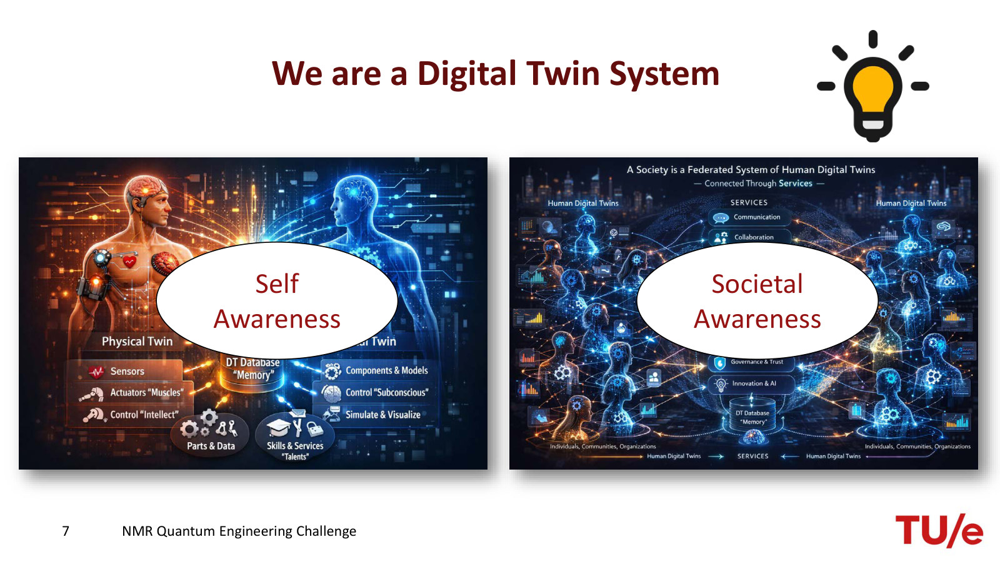

### 我们是一个数字孪生系统

自我意识

社会意识

NMR 量子工程挑战赛

### 图内文字与标签

- 社会是一种由人类数字孪生组成的联合体系。
- 通过服务连接
- 人类数字孪生体
- SERVICES
- 通信
- 协作
- 孪生体
- 1 孪生体
- DT 数据库
- 治理与信任
- 传感器
- “Memory®”
- 组件与模型
- Q-创新与人工智能
- 执行器 “Muscles®”
- 控制“潜意识®”
- 控制“智力”
- 模拟与可视化
- 内存
- 零件与数据
- 技能与服务
- 个人、社区、组织
- 人才”
- → 人类数字孪生体

## 第 8 页

[对照英文原件第 8 页](../../Hackathon_ULM_2026_NO_VIDEO_1.pdf#page=8)

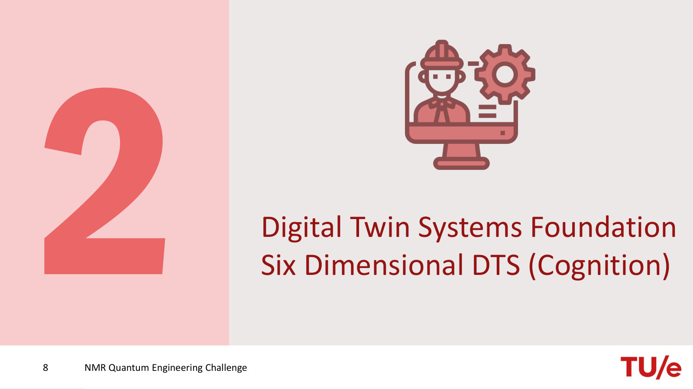

数字孪生系统基础六维 DTS（认知）

NMR 量子工程挑战赛

## 第 9 页

[对照英文原件第 9 页](../../Hackathon_ULM_2026_NO_VIDEO_1.pdf#page=9)

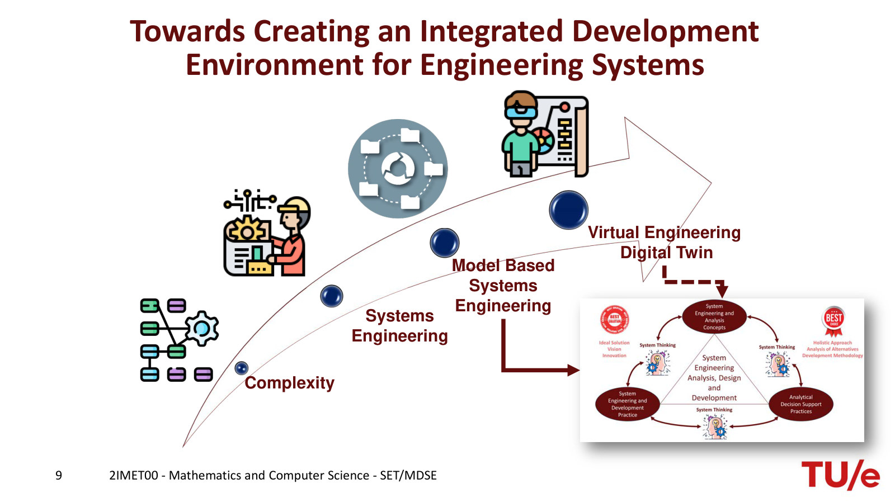

### 迈向一体化的开发

### 工程系统环境

虚拟工程

数字孪生

基于模型的

系统工程

系统工程

复杂性

2IMET00 - 数学与计算机科学 - SET/MDSE

### 图内文字与标签

- 工程与
- 系统
- 分析
- 概念
- rAna vsis 或 a termetivee
- 工程学
- 分析，设计
- 以及
- 分析性
- 开发
- 决策支持
- 实践
- 练习

## 第 10 页

[对照英文原件第 10 页](../../Hackathon_ULM_2026_NO_VIDEO_1.pdf#page=10)

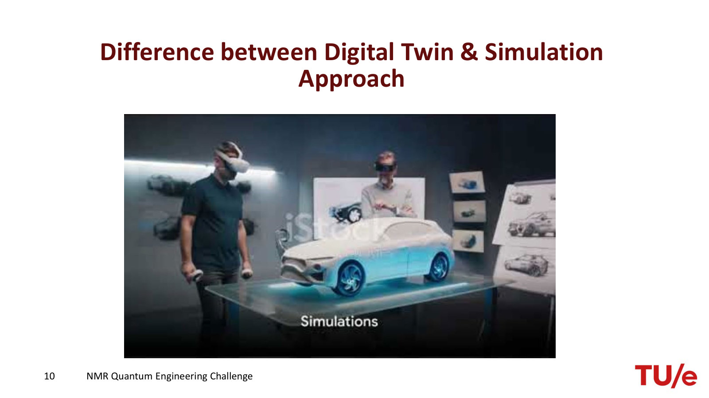

### 数字孪生与模拟的区别

### 接近方式

NMR 量子工程挑战赛

### 图内文字与标签

- 模拟

## 第 11 页

[对照英文原件第 11 页](../../Hackathon_ULM_2026_NO_VIDEO_1.pdf#page=11)

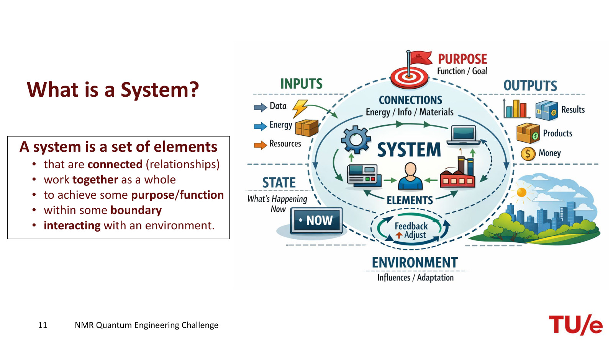

### 什么是系统？

系统是由一系列元素组成的集合。

- 那些相互关联的关系
- 作为一个整体协同工作
- 为了实现某种目的/功能
- 在一定的范围内
- 与环境进行互动。

NMR 量子工程挑战赛

### 图内文字与标签

- PURPOSE
- 功能/目标
- INPUTS
- OUTPUTS
- CONNECTIONS
- › 数据
- 能量 / 信息 / 材料
- 结果
- 能量
- 产品
- 资源
- SYSTEM
- 金钱
- STATE
- 正在发生的事情
- ELEMENTS
- 现在
- NOW
- 反馈
- + 调整
- ENVIRONMENT
- 影响/适应

## 第 12 页

[对照英文原件第 12 页](../../Hackathon_ULM_2026_NO_VIDEO_1.pdf#page=12)

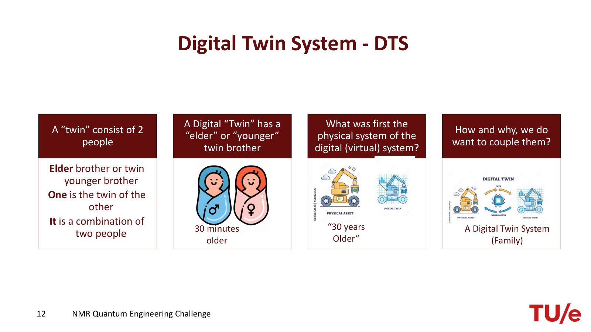

### 数字孪生系统 - DTS

一个数字孪生体拥有

数字（虚拟）系统的第一个物理系统是什么？

一个“孪生体”由 2 个部分组成

我们究竟如何以及为何要将它们结合在一起呢？

“年长”或“年轻”

人

孪生兄弟

孪生兄弟或孪生体

弟弟一是一位孪生体

其他 这是一个组合词

“30 年”

增加 30 分钟

数字孪生系统

两个人

较旧版本

（家族）

NMR 量子工程挑战赛

### 图内文字与标签

- DIGITAL TWIN
- 多贝股票 | #$81126127
- PHYSICAL ASSET

## 第 13 页

[对照英文原件第 13 页](../../Hackathon_ULM_2026_NO_VIDEO_1.pdf#page=13)

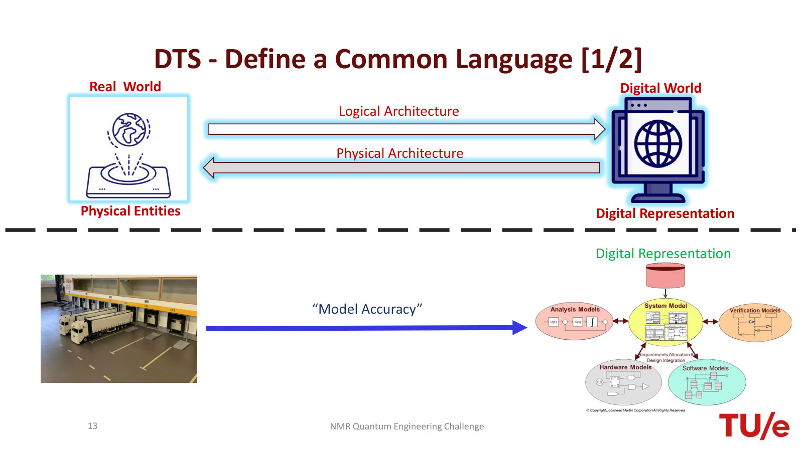

### DTS - 定义一种通用语言 [1/2]

### 真实世界

### 数字世界

逻辑架构

物理架构

物理实体

数字表示方式

数字表示方式

“模型精度”

NMR 量子工程挑战赛

### 图内文字与标签

- 系统模型
- 分析模型
- 验证模型
- 分配要求
- 硬件模型
- 软件模型
- © 洛克希德·马丁公司版权所有，保留一切权利。

## 第 14 页

[对照英文原件第 14 页](../../Hackathon_ULM_2026_NO_VIDEO_1.pdf#page=14)

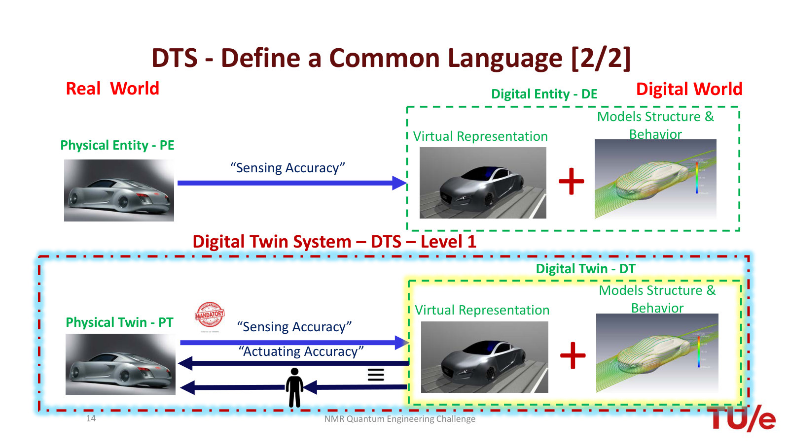

### DTS - 定义一种通用语言 [2/2]

### 数字世界 现实世界

### 数字实体 - 德语

模型结构&

行为 +

虚拟表示物理实体 - PE

“感知精度”

数字孪生系统 – DTS – 一级

数字孪生 - DT

模型结构&

行为 +

虚拟代表物理孪生体 - PT

“感知精度”

“执行精度”

NMR 量子工程挑战赛

## 第 15 页

[对照英文原件第 15 页](../../Hackathon_ULM_2026_NO_VIDEO_1.pdf#page=15)

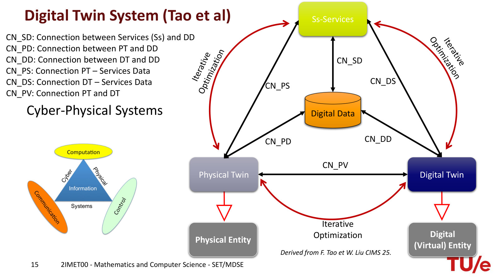

### 数字孪生系统（Tao 等人）

### Ss-服务

### `CN_SD`：服务与 DD 之间的连接 `CN_PD`：PT 与 DD 之间的连接 `CN_DD`：DT 与 DD 之间的连接 `CN_PS`：PT 与服务数据的连接 `CN_DS`：DT 与服务数据的连接 `CN_PV`：PT 与 DT 之间的连接

### `CN_SD`

`CN_DS` `CN_PS`

网络物理系统

数字数据

`CN_PD` `CN_DD`

`CN_PV`

孪生体

数字孪生

迭代优化

物理实体 数字（虚拟）实体

由 F. Tao 和 W. Liu 在 CIMS 25 中衍生得出。

2IMET00 - 数学与计算机科学 - SET/MDSE

### 图内文字与标签

- 优化
- 迭代法
- 计算
- 网络
- 物理
- 通信
- 信息
- 控制
- 系统

## 第 16 页

[对照英文原件第 16 页](../../Hackathon_ULM_2026_NO_VIDEO_1.pdf#page=16)

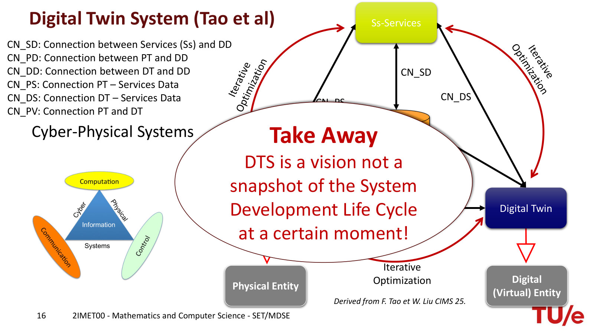

### 数字孪生系统（Tao 等人）

### Ss-服务

### `CN_SD`：服务与 DD 之间的连接 `CN_PD`：PT 与 DD 之间的连接 `CN_DD`：DT 与 DD 之间的连接 `CN_PS`：PT 与服务数据的连接 `CN_DS`：DT 与服务数据的连接 `CN_PV`：PT 与 DT 之间的连接

### `CN_SD`

`CN_DS` `CN_PS`

Take Away DTS 是一个系统开发生命周期的愿景，而非简单的快照。

网络物理系统

数字数据

`CN_PD` `CN_DD`

`CN_PV`

孪生体

数字孪生

在某一时刻！

迭代优化

物理实体 数字（虚拟）实体

由 F. Tao 和 W. Liu 在 CIMS 25 中衍生得出。

2IMET00 - 数学与计算机科学 - SET/MDSE

### 图内文字与标签

- 优化
- 迭代法
- 计算
- 网络
- 物理
- 通信
- 信息
- 控制
- 系统

## 第 17 页

[对照英文原件第 17 页](../../Hackathon_ULM_2026_NO_VIDEO_1.pdf#page=17)

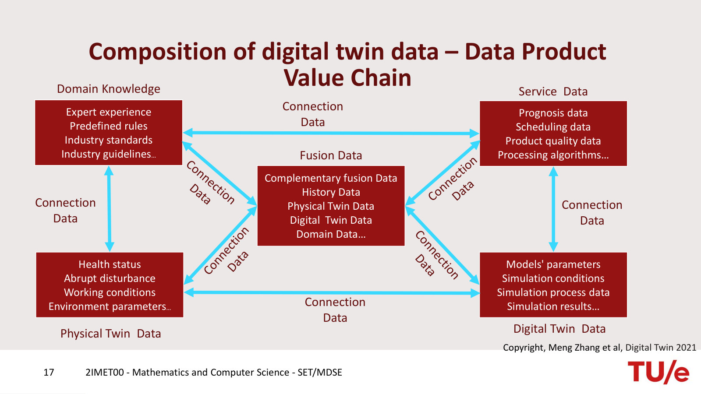

### 数字孪生数据构成 – 数据产品

### 价值链

### 领域知识

### 服务数据

连接

专家经验

预后数据 调度数据 产品质量数据 处理算法……

数据

预定义规则 行业标准 行业指南……

融合数据

互补融合数据

历史数据 物理孪生体数据

连接

连接

数据

数据

数字孪生数据

域数据…

健康状况 突然的干扰 工作条件 环境参数…

模型参数 模拟条件 模拟过程数据

连接

仿真结果……

数据

数字孪生数据

物理孪生体数据

版权所有，张 Meng 等，数字孪生 2021

2IMET00 - 数学与计算机科学 - SET/MDSE

### 图内文字与标签

- 连接
- 数据

## 第 18 页

[对照英文原件第 18 页](../../Hackathon_ULM_2026_NO_VIDEO_1.pdf#page=18)

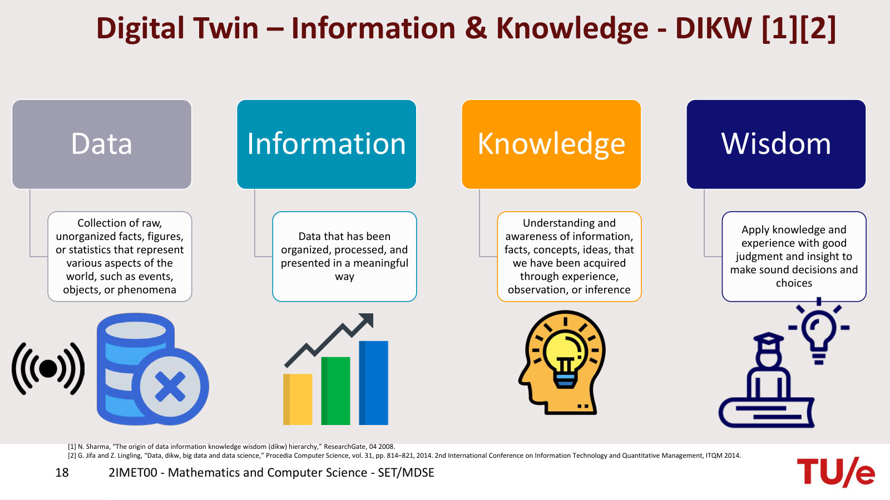

### 数字孪生 – 信息与知识 - DIKW [1][2]

数据

信息

知识

智慧

收集那些原始且未整理的事实、数据或统计信息。

对信息、事实、概念、思想的理解和认知

运用知识和经验，结合良好的判断力与洞察力，做出明智的决策。

已经经过整理、处理并以有意义的方式呈现的数据。

世界的各个方面，比如事件、物体或现象

我们已被收购

方式

通过经验、观察或推理

选择

[1] N. Sharma, “数据信息知识智慧（dikw）层次的起源”, ResearchGate, 2008 年 4 月 4 日. [2] G. Jifa 和 Z. Lingling, “数据、dikw、大数据与数据科学”, Procedia 计算机科学, 第 31 卷, 页 814–821, 2014 年. 第二届信息技术与定量管理国际会议, ITQM 2014.

2IMET00 - 数学与计算机科学 - SET/MDSE

## 第 19 页

[对照英文原件第 19 页](../../Hackathon_ULM_2026_NO_VIDEO_1.pdf#page=19)

### 新一类数字孪生与服务驱动的商业模式

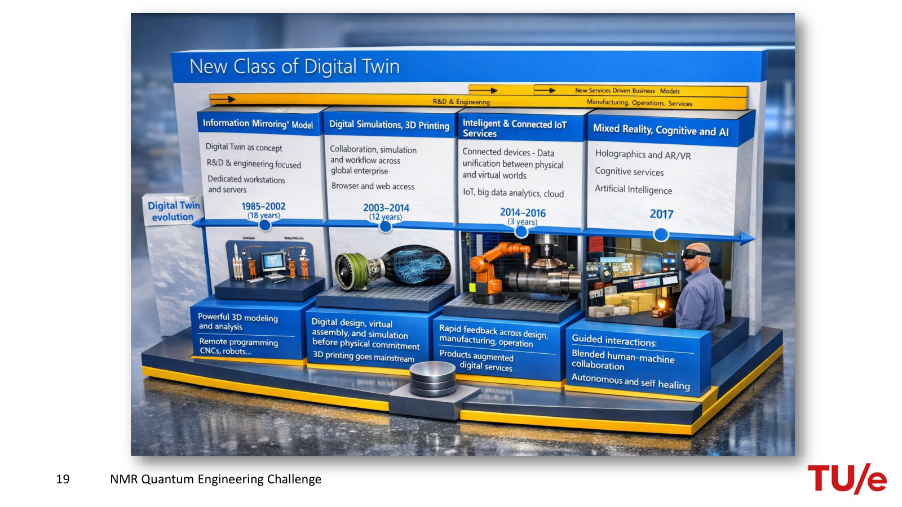

图从研发和工程延伸到制造、运营及服务。底部以 18 年、12 年和 3 年表示图示各阶段的时间尺度。

- **信息镜像模型。** 数字孪生概念侧重研发及工程。使用专用工作站和服务器，具备强大的三维建模与分析能力，可远程编程 CNC、机器人等设备。
- **数字仿真与 3D 打印。** 在跨地区企业内共享协作、仿真和工作流，支持浏览器访问。可在实物投产前完成数字设计、虚拟装配和仿真，3D 打印逐渐普及。
- **智能互联的 IoT。** 互联设备统一物理世界与虚拟世界的数据。结合 IoT、大数据分析和云，在设计、制造及运营间快速反馈，支持人机混合协作。
- **混合现实、认知服务和 AI。** 应用全息技术与 AR／VR、认知服务和人工智能，为人机交互提供指导。产品可通过数字服务增强，系统可实现自治和自修复。

## 第 20 页

[对照英文原件第 20 页](../../Hackathon_ULM_2026_NO_VIDEO_1.pdf#page=20)

### 数字孪生系统思维

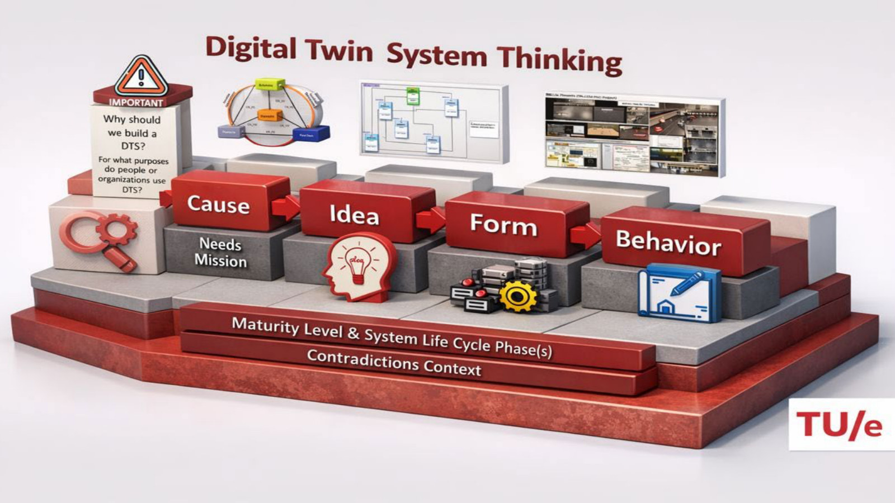

围绕原因、构想、形式、存在与行为组织 DTS。先问为何构建以及组织或个人为何使用。明确需求和使命，再问 DTS 的概念特征、如何按逻辑架构设计、如何按物理架构部署，以及如何通过交互与服务运行。评估时看成熟度与所处的生命周期阶段，并把矛盾放回相应情境。也可对照系统思维讲义第 1 页。

## 第 21 页

[对照英文原件第 21 页](../../Hackathon_ULM_2026_NO_VIDEO_1.pdf#page=21)

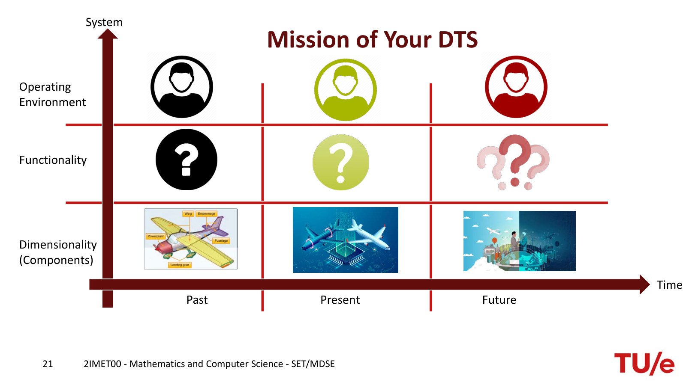

### 系统

### 您的 DTS 任务

### 运行环境

功能特性

维度（组件）

时间

未来 现在 过去

2IMET00 - 数学与计算机科学 - SET/MDSE

## 第 22 页

[对照英文原件第 22 页](../../Hackathon_ULM_2026_NO_VIDEO_1.pdf#page=22)

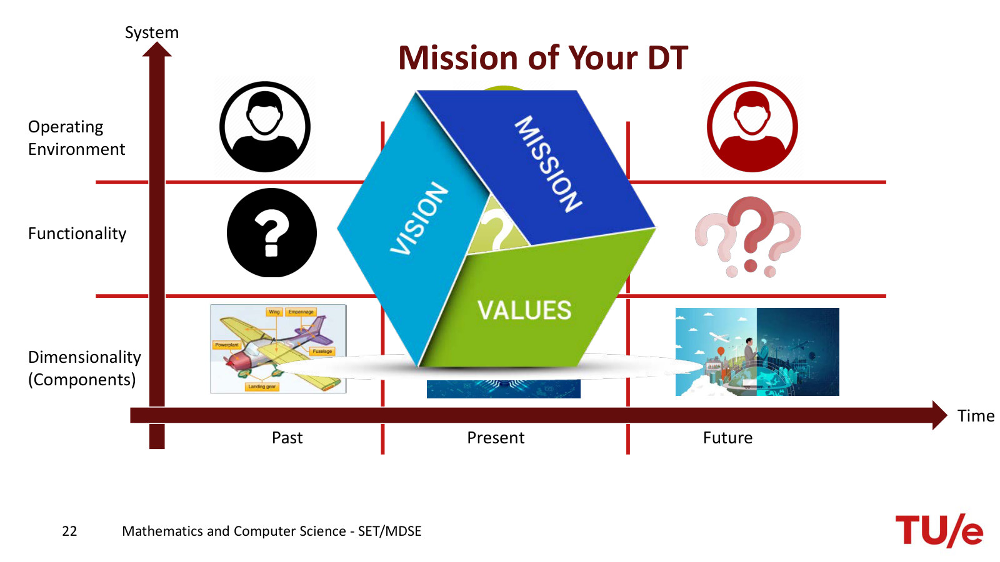

### 系统

### 您的 DT 任务使命

### 运行环境

功能特性

维度（组件）

时间

未来 现在 过去

数学与计算机科学 - SET/MDSE

### 图内文字与标签

- MISSION
- VISION
- VALUES

## 第 23 页

[对照英文原件第 23 页](../../Hackathon_ULM_2026_NO_VIDEO_1.pdf#page=23)

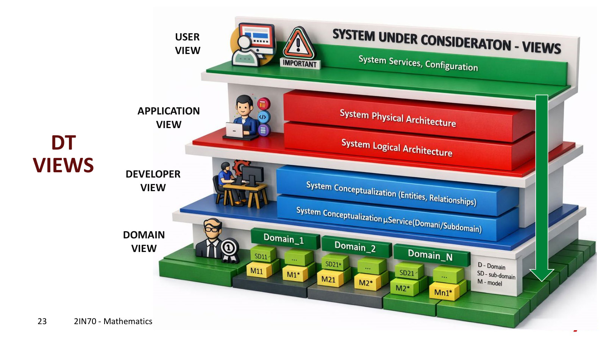

### USER VIEW

APPLICATION

VIEW

DT VIEWS

DEVELOPER

VIEW

DOMAIN

VIEW

2IN70 - 数学与计算机科学 - SET/MDSE

### 图内文字与标签

- SYSTEM UNDER CONSIDERATON - VIEWS
- 系统服务，配置
- IMPORTANT
- 系统物理架构
- 系统逻辑架构
- 系统概念化（实体、关系）
- 系统概念化 u 服务（Domani/子域）
- `Domain_1`
- `Domain_2`
- SD11
- `Domain_N`
- SD21*
- D - 域
- SD21
- SD - 子域
- M - 模型
- Mn1*

## 第 24 页

[对照英文原件第 24 页](../../Hackathon_ULM_2026_NO_VIDEO_1.pdf#page=24)

### 数字孪生系统组成

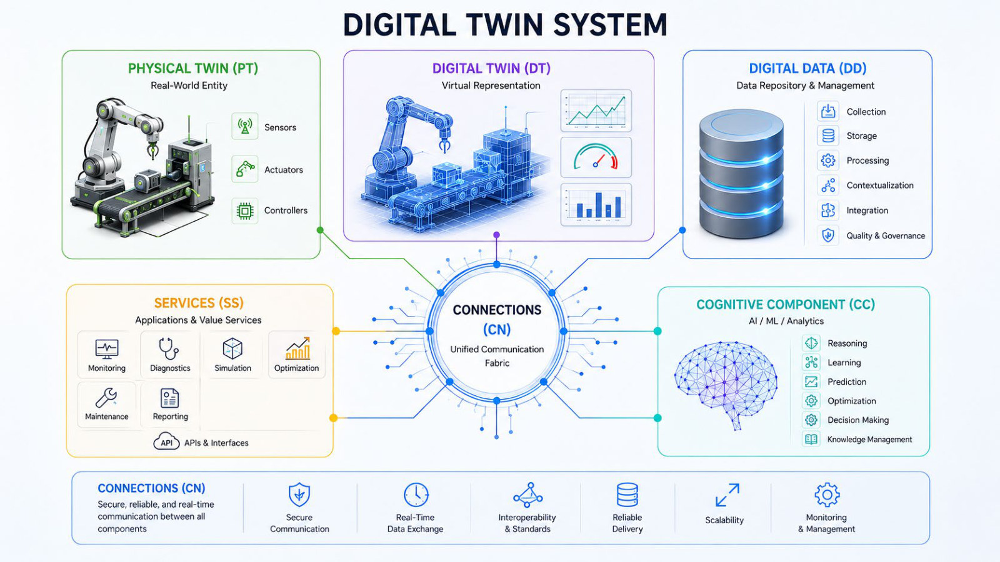

| 组件 | 图中职责 |
| --- | --- |
| 物理孪生（PT） | 真实世界实体。传感器、执行器、控制器。 |
| 数字孪生（DT） | 物理孪生的虚拟表示。监控、仿真、预测和优化。 |
| 数字数据（DD） | 数据库与数据管理。采集、存储、处理、补充情境、整合、质量和治理。 |
| 服务（SS） | 应用与价值服务。监控、诊断、仿真、优化、维护和报告。 |
| 认知组件（CC） | AI／ML／分析。推理、学习、预测、决策和知识管理。 |
| 连接（CN） | 统一通信结构。保障各组件间的数据交换、实时交付、标准与互操作、监控和管理，以及安全、可靠性和可扩展性。 |

## 第 25 页

[对照英文原件第 25 页](../../Hackathon_ULM_2026_NO_VIDEO_1.pdf#page=25)

### 连接物理世界与数字智能

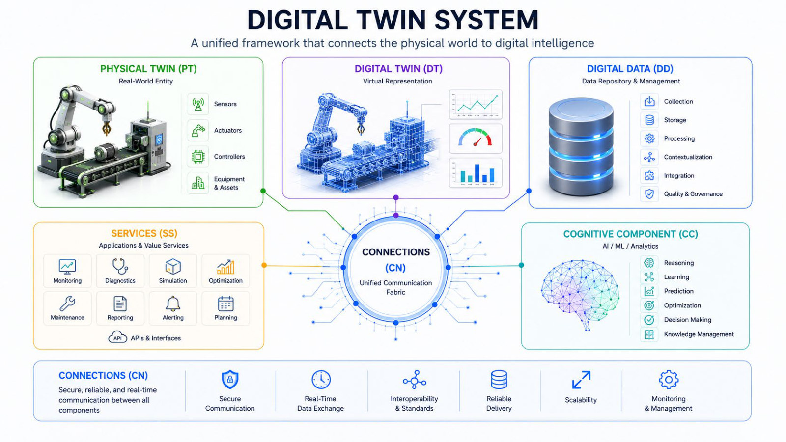

各组件通过连接（CN）实现安全、可靠的实时通信。

- **PT**：真实系统的传感器、执行器、控制器、设备和资产。
- **DT**：提供监控、仿真、预测和优化的虚拟表示。
- **DD**：数据采集、存储、处理、情境化、整合、质量与治理。
- **SS**：提供监控、诊断、优化、维护和报告等应用与价值服务。
- **CC**：用 AI、机器学习和分析支持推理、学习、规划、告警、决策和知识管理。图中还列出 API 与接口。
- **CN**：提供安全可靠的数据交换、实时交付、标准互操作、可扩展性、监控与管理。

## 第 26 页

[对照英文原件第 26 页](../../Hackathon_ULM_2026_NO_VIDEO_1.pdf#page=26)

### 物理孪生（PT）

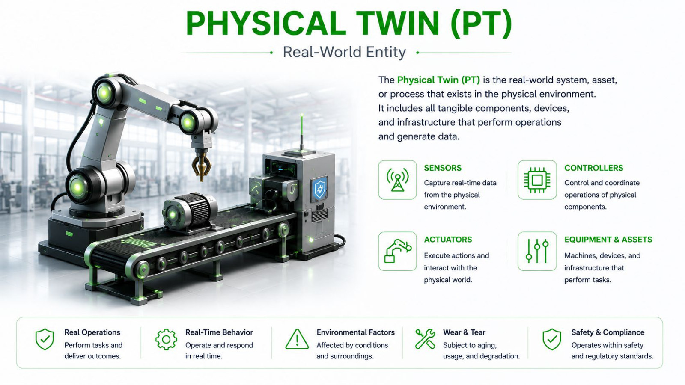

物理孪生是物理环境中的真实系统、资产或过程，包括执行任务和产生数据的有形组件、设备与基础设施。

| 组成 | 作用 |
| --- | --- |
| 传感器 | 捕获物理环境的实时数据。 |
| 控制器 | 控制及协调物理组件的操作。 |
| 执行器 | 执行动作并与物理世界交互。 |
| 设备与资产 | 执行任务的机器、设备、基础设施。 |

物理系统实际执行任务、实时运行并响应环境，受使用、老化和损耗影响，同时遵守安全与监管标准。

## 第 27 页

[对照英文原件第 27 页](../../Hackathon_ULM_2026_NO_VIDEO_1.pdf#page=27)

### 数字孪生（DT）

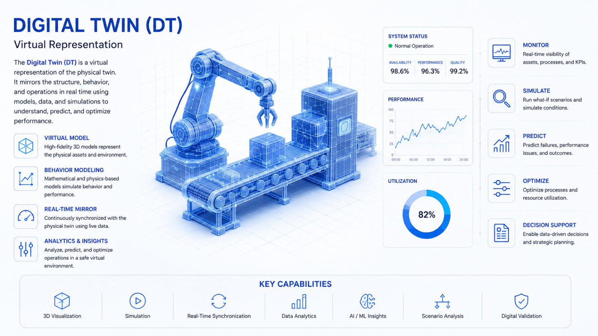

数字孪生是物理孪生的虚拟表示。用模型、数据和仿真实时反映结构、行为与运行，以理解、预测和优化性能。

- **虚拟模型。** 高保真 3D 模型表示资产和环境。数学及物理模型模拟行为和性能。
- **实时映射。** 使用实时数据持续同步物理孪生。可显示正常运行、可用率、性能和利用率等状态。
- **监控。** 实时查看资产、流程和 KPI。
- **仿真。** 运行假设情景和模拟工况。
- **预测和优化。** 预测故障、性能问题和结果，优化流程与资源使用。
- **决策支持。** 在安全的虚拟环境中分析、预测和优化运行，支持数据驱动决策与战略规划。

关键能力包括 3D 可视化、数据分析、AI／ML 洞察、情景分析和数字验证。

## 第 28 页

[对照英文原件第 28 页](../../Hackathon_ULM_2026_NO_VIDEO_1.pdf#page=28)

### 数字数据（DD）

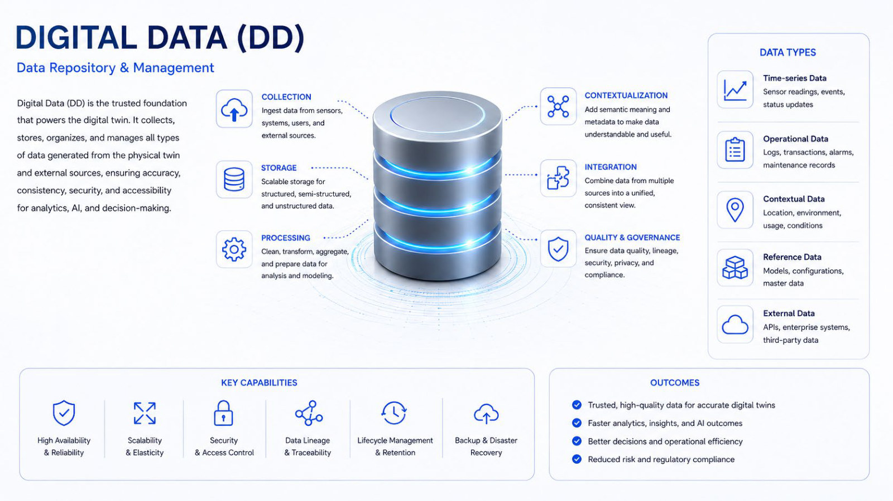

数字数据是孪生运行的可信基础。它收集、存储、组织和管理物理孪生与外部来源的数据，确保准确、一致、安全、可访问，支持分析、AI 和决策。

| 处理环节 | 功能 |
| --- | --- |
| 采集 | 接入传感器、系统、用户和外部来源的数据。 |
| 存储 | 为结构化、半结构化和非结构化数据提供可扩展存储。 |
| 处理 | 清洗、转换、聚合，为分析与建模准备数据。 |
| 情境化 | 增加语义和元数据，方便理解与使用。 |
| 整合 | 将多种数据源合并，形成一致的视图。 |
| 质量与治理 | 保证质量、沿袭、安全、隐私和合规。 |

数据类型包括时序（传感器读数、事件、状态）、运行（日志、交易、告警、维护）、情境（位置、环境、使用和条件）、参考（模型、配置、主数据）及外部数据（API、企业系统和第三方）。所需能力包括高可用性、可靠性、弹性扩展、安全与访问控制、沿袭和追溯、生命周期与留存、备份与灾难恢复。预期收益为可信的高质量数据、更快的分析和 AI 洞察、更好的决策与效率、更低风险以及合规。

## 第 29 页

[对照英文原件第 29 页](../../Hackathon_ULM_2026_NO_VIDEO_1.pdf#page=29)

### 服务（SS）

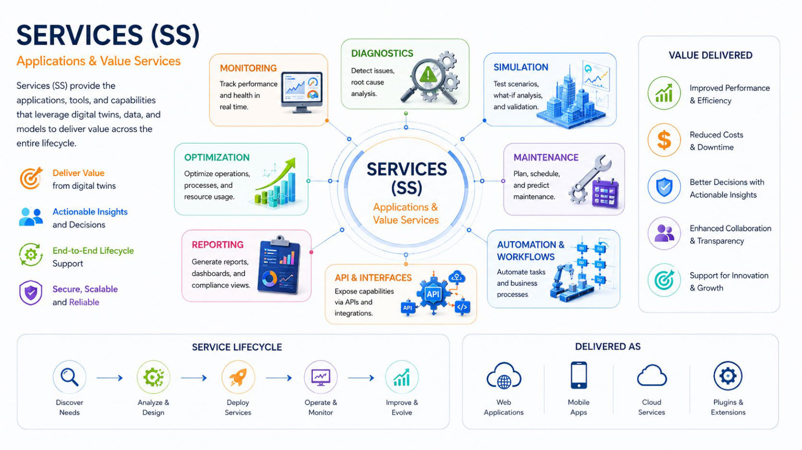

服务是使用数字孪生、数据与模型的应用、工具和能力，在整个生命周期交付价值。

| 服务 | 用途 |
| --- | --- |
| 监控与诊断 | 实时跟踪性能和健康状态，发现问题并分析根因。 |
| 仿真 | 测试情景，做假设分析和验证。 |
| 优化与维护 | 优化运营、流程和资源使用，安排、调度和预测维护。 |
| 报告 | 生成报告、仪表盘和合规视图。 |
| 自动化与工作流 | 自动执行任务和业务流程。 |
| API 与接口 | 通过 API 和集成开放能力，支持安全、可扩展且可靠的交付。 |

服务生命周期从发现需求开始，经过分析设计、部署、运行监控、改善演化。可交付为 Web、移动应用、云服务、插件和扩展。价值包括性能和效率、成本和停机时间、可执行洞察与决策、协作和透明度、创新和增长。

## 第 30 页

[对照英文原件第 30 页](../../Hackathon_ULM_2026_NO_VIDEO_1.pdf#page=30)

### 认知组件（CC）

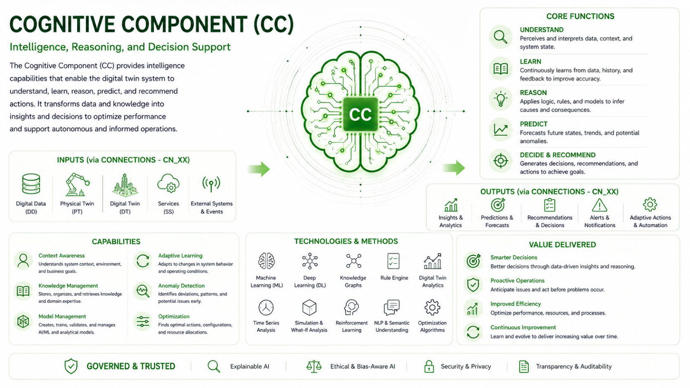

认知组件为数字孪生提供智能、推理与决策支持。它将数据和知识转换为见解及决策，优化性能，支持自主且知情的操作。

- **核心功能。** 感知并解读数据、上下文与状态。依据数据、历史和反馈持续学习。用逻辑、规则和模型推断原因与后果。预测未来状态、趋势和异常。生成实现目标所需的决策、建议和行动。
- **输入（经 CN_XX）。** 数字数据（DD）、物理孪生（PT）、数字孪生（DT）、服务（SS）、外部系统和事件。
- **输出（经 CN_XX）。** 洞察与分析、预测与预报、建议与决策、告警与通知、自适应行动及自动化。
- **能力。** 情境感知、自适应学习、知识管理、异常检测、模型管理和资源优化。
- **技术。** 机器学习、深度学习、知识图谱、规则引擎、数字孪生分析、时序分析、仿真和假设分析、强化学习、自然语言与语义理解、优化算法。
- **价值。** 改善决策，提前发现并处理问题，提高效率，持续学习和演化。横向要求为关注伦理和偏差、保障安全与隐私、透明且可审计。

## 第 31 页

[对照英文原件第 31 页](../../Hackathon_ULM_2026_NO_VIDEO_1.pdf#page=31)

### 连接（CN）

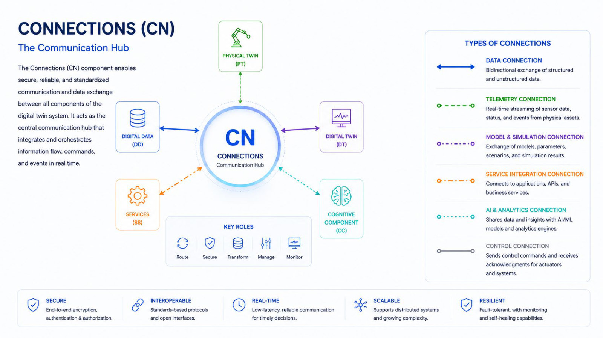

连接是通信枢纽，在物理孪生、数字数据、数字孪生、服务和认知组件之间安全、可靠、标准化地交换数据。它实时集成并编排信息、命令和事件。主要职责为路由、保护、转换、管理和监控。

| 连接类型 | 传递内容 |
| --- | --- |
| 数据 | 双向交换结构化与非结构化数据。 |
| 遥测 | 实时流式传输传感器数据、状态和事件。 |
| 模型与仿真 | 交换模型、参数、情景与仿真结果。 |
| 服务集成 | 连接应用、API 与业务服务。 |
| AI 与分析 | 向 AI／ML 模型及分析引擎共享数据与洞察。 |
| 控制 | 发送控制命令，接收执行器和系统确认。 |

图中要求端到端加密、标准协议、低延迟可靠通信、可扩展分布式支持，以及容错、监控与自修复。

## 第 32 页

[对照英文原件第 32 页](../../Hackathon_ULM_2026_NO_VIDEO_1.pdf#page=32)

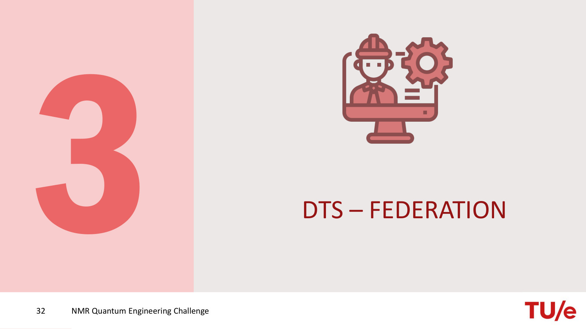

DTS – FEDERATION

NMR 量子工程挑战赛

## 第 33 页

[对照英文原件第 33 页](../../Hackathon_ULM_2026_NO_VIDEO_1.pdf#page=33)

### 服务层数字孪生与联邦互操作

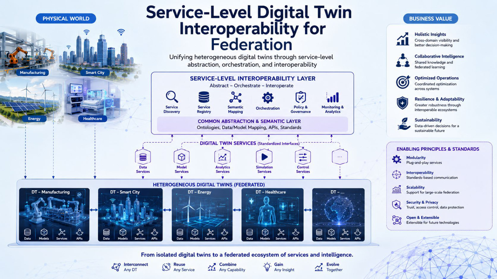

图中物理世界示例包括制造、智慧城市、能源和医疗。通过服务级抽象、编排与互操作，把这些异构数字孪生及其数据、模型、API 联合起来。

- **服务级互操作层。** 服务发现与注册、语义映射、编排、策略和治理、监控及分析。
- **共有抽象和语义层。** 本体、数据与模型映射、API、标准。
- **标准化服务接口。** 数据、模型、分析、仿真、控制和其他服务。
- **原则。** 模块化、即插即用、基于标准的互操作、联邦规模扩展、安全和隐私、开放与可扩展。
- **业务价值。** 跨领域洞察与决策、协同智能与联邦学习、跨系统协调优化、更强韧性与适应性，以及支持可持续发展的决策。

图底强调孪生、服务、能力和洞察的复用、组合、获取与联合演进。

## 第 34 页

[对照英文原件第 34 页](../../Hackathon_ULM_2026_NO_VIDEO_1.pdf#page=34)

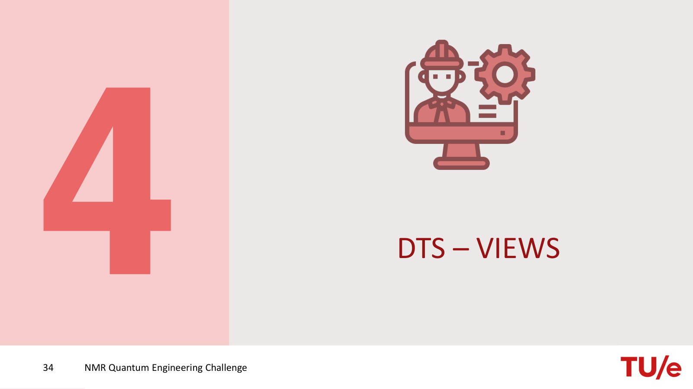

DTS – VIEWS

NMR 量子工程挑战赛

## 第 35 页

[对照英文原件第 35 页](../../Hackathon_ULM_2026_NO_VIDEO_1.pdf#page=35)

### 数字孪生系统的多视图：共同框架

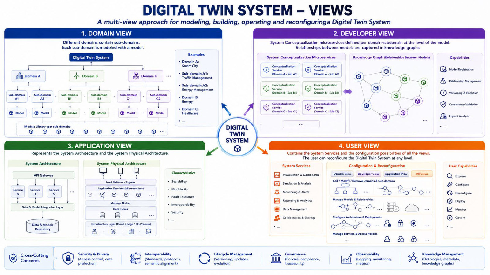

1. **领域视图。** 用按子领域组织的模型库描述对象。例如智慧城市含交通管理和能源管理，另有能源域、医疗域。
2. **开发者视图。** 每个领域和子领域在模型层有独立的系统概念化微服务，并用知识图谱记录模型间关系。能力包括注册、关系管理、版本与演化、一致性验证和影响分析。
3. **应用视图。** 以 API 网关、负载均衡／入口、应用微服务、消息代理、数据和模型集成层、存储库及云／边缘／本地基础设施呈现系统架构与物理架构。关注扩展性、模块化、容错、互操作和安全。
4. **用户视图。** 利用可视化仪表盘、仿真和分析、监控告警、报告、数据管理、协作和共享，探索、配置、重新配置、部署、监控和治理。可增删领域和子领域，管理模型及关系、服务、访问策略与部署。

共同事项包括生命周期（版本、更新和演化）、治理（政策、合规与追溯）、可观测性（日志、监控和度量）与知识管理（本体、元数据、知识图谱）。

## 第 36 页

[对照英文原件第 36 页](../../Hackathon_ULM_2026_NO_VIDEO_1.pdf#page=36)

### 数字孪生系统的多视图：从领域到使用

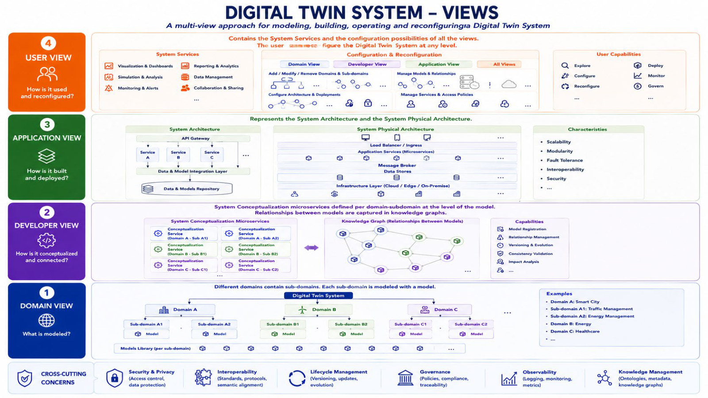

沿图从下往上阅读。领域视图回答对什么建模，开发者视图回答如何概念化和连接，应用视图回答如何构建和部署，用户视图回答如何使用及重新配置。

用户可在各层级配置系统服务、领域、模型关系、监控和分析、部署、服务与访问策略。应用层含 API 网关、负载均衡、微服务、消息代理、数据和模型、云／边缘／本地基础设施，支持扩展、模块化、容错、互操作和安全。开发层按领域和子领域组织概念化微服务与模型库，用知识图谱管理关联、影响和演化。领域层示例为智慧城市、交通管理、能源管理、能源、医疗。

跨层关注数据保护、语义对齐、生命周期、治理与可追溯性、可观测性、知识管理。

## 第 37 页

[对照英文原件第 37 页](../../Hackathon_ULM_2026_NO_VIDEO_1.pdf#page=37)

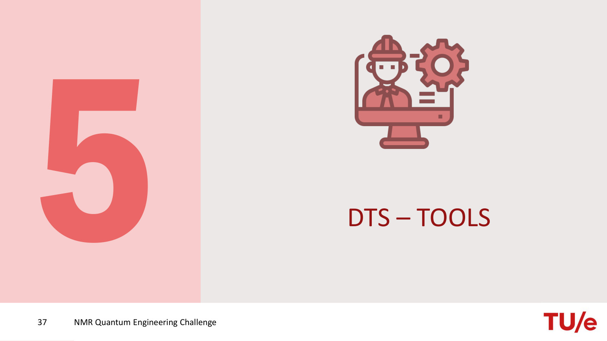

DTS – TOOLS

NMR 量子工程挑战赛

## 第 38 页

[对照英文原件第 38 页](../../Hackathon_ULM_2026_NO_VIDEO_1.pdf#page=38)

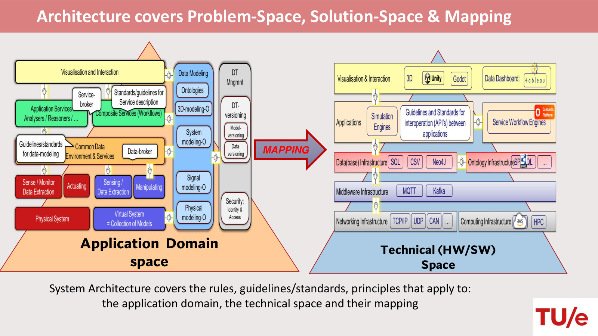

### 架构涵盖了问题空间、解决方案空间以及映射机制。

MAPPING

空间应用领域

技术方面（硬件/软件）

空间

系统架构涵盖了适用于以下领域的规则、指南/标准、原则：

应用领域、技术范围及其对应关系

### 图内文字与标签

- 可视化与交互设计
- DT
- 数据建模
- Ka 统一
- Godot
- 数据仪表盘：
- 管理
- Tableau
- 本体论
- 服务-
- 标准/指南
- 服务描述
- 经纪人
- 3D 建模 - オ
- DT-
- 应用服务
- 复合服务（工作流）
- 指南与标准
- 分析器 / 推理器 /...
- 版本控制
- 仿真
- 平台
- 应用程序
- 引擎
- 不同应用程序之间的互操作（API）
- 服务工作流引擎
- 系统
- 模型-
- 指南/标准
- 建模-O
- 通用数据
- 数据-
- 用于数据建模
- 环境与服务
- 数据代理程序
- 数据（基础）基础设施 SQL
- CSV
- Neo4J
- 本体基础设施 SP DL
- 信号
- 感知/监测
- 执行
- 感知/
- 操纵
- 数据提取
- 中间件基础设施
- MQTT
- Kafka
- 安全性：
- 物理
- 身份与
- 虚拟系统
- 访问
- 网络基础设施 TCPIP UDP CAN
- 物理系统
- = 模型集合
- 计算基础设施

## 第 39 页

[对照英文原件第 39 页](../../Hackathon_ULM_2026_NO_VIDEO_1.pdf#page=39)

### 应用空间架构

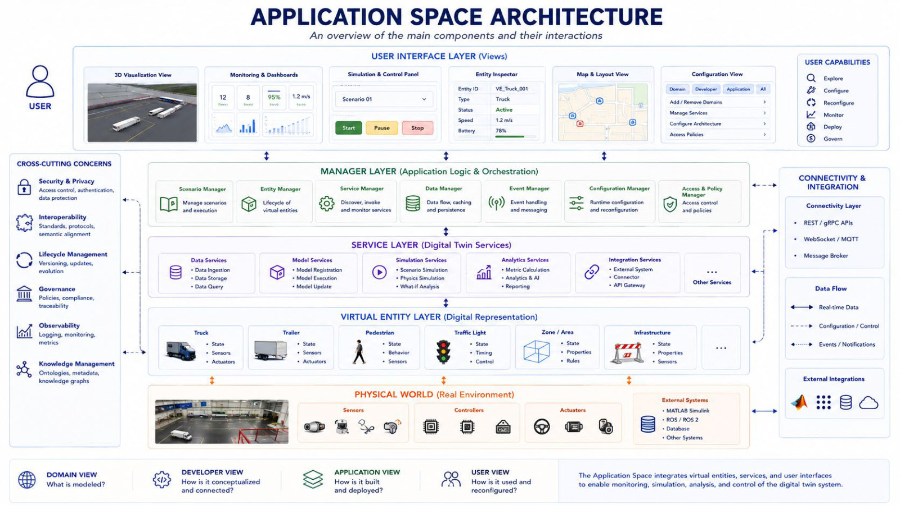

| 层 | 图示内容 |
| --- | --- |
| 用户界面 | 3D 视图、监控与仪表盘、仿真与控制面板、实体检查器、地图布局、配置。卡车示例为 VE_Truck_001，面板显示情景、状态、速度和电池，可暂停或停止。用户能探索、监控、增删领域、管理服务、配置架构、部署和治理访问策略。 |
| 管理器 | 应用逻辑与编排。情景管理执行，实体管理生命周期，服务管理与监视，数据管理流、缓存和持久化，事件管理消息，配置管理运行时变更，访问与策略管理控制权限。 |
| 数字孪生服务 | 数据摄取、存储和查询，模型注册、执行和更新，情景及物理仿真、实时数据、指标计算、分析和 AI、外部连接器、API 网关、消息代理及其他服务。 |
| 虚拟实体 | 用数字实体表示交通灯、区域和基础设施。 |
| 物理世界 | 真实环境，以及 MATLAB Simulink、ROS／ROS 2、数据库和其他系统等外部集成。 |

连接和集成可采用 REST／gRPC API、WebSocket／MQTT。图例区分数据流、配置／控制、事件／通知和外部集成。共同事项包括认证、权限和数据保护，标准与语义互操作，版本与演化，治理与可追溯性，日志、监控和度量，本体、元数据和知识图谱。领域、应用和用户三个视图分别回答建模与连接、构建与部署、使用与重新配置。应用空间集成虚拟实体、服务及界面，支持监控、仿真、分析和控制。

## 第 40 页

[对照英文原件第 40 页](../../Hackathon_ULM_2026_NO_VIDEO_1.pdf#page=40)

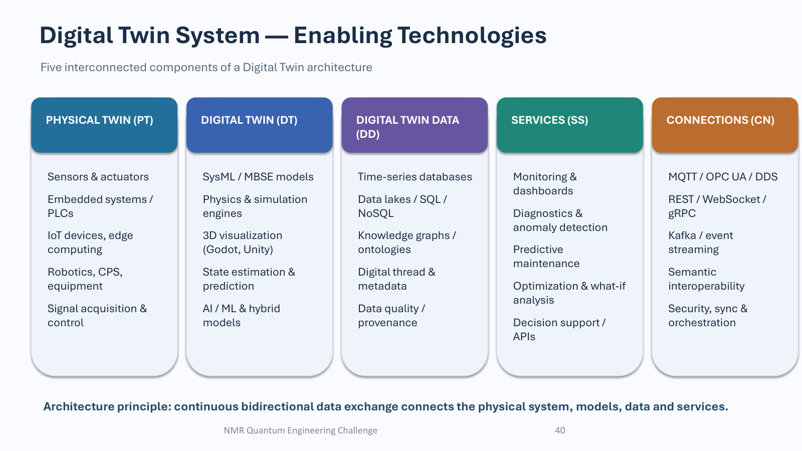

### 数字孪生系统 — 使能技术

数字孪生的五个相互关联的组成部分

PHYSICAL TWIN (PT)

DIGITAL TWIN (DT)

DIGITAL TWIN DATA (DD)

SERVICES (SS)

CONNECTIONS (CN)

传感器与执行器

SysML / 基于模型的环境模型

时间序列数据库

监控与仪表板

MQTT / OPC UA / DDS

嵌入式系统/PLC

物理与模拟引擎

数据湖 / SQL / NoSQL

REST / WebSocket / gRPC

诊断与异常检测

物联网设备，边缘计算

3D 可视化（Godot，Unity）

知识图谱/本体论

Kafka / 事件流处理

预测性维护

机器人技术、控制系统、设备

状态估计与预测

数字线程与元数据

语义互操作性

优化与假设分析

信号采集与控制

人工智能/机器学习及混合模型

数据质量/溯源

安全、同步与编排

决策支持/应用程序接口

架构原则：持续的双向数据交换将物理系统、模型、数据和服务连接在一起。

NMR 量子工程挑战赛

## 第 41 页

[对照英文原件第 41 页](../../Hackathon_ULM_2026_NO_VIDEO_1.pdf#page=41)

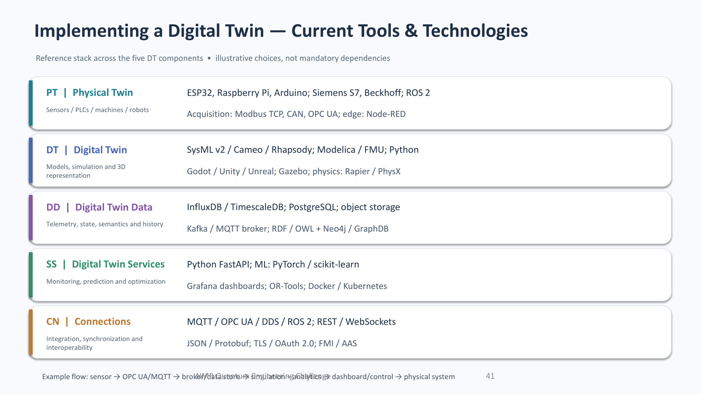

### 实施数字孪生——当前工具与技术

五个 DT 组件之间的引用堆栈 • 示例性选择，并非强制性依赖关系

孪生体

ESP32、Raspberry Pi、Arduino；西门子 S7、Beckhoff；ROS 2

传感器 / 可编程逻辑控制器 / 机器 / 机器人

采集：Modbus TCP、CAN、OPC UA；边缘计算：Node-RED

DT  |  数字孪生

SysML v2 / Cameo / Rhapsody；Modelica / FMU；Python

模型、仿真和三维展示

Godot / Unity / Unreal；Gazebo；物理引擎：Rapier / PhysX

DD  |  数字孪生数据

InfluxDB / TimescaleDB；PostgreSQL；对象存储

遥测、状态、语义和历史记录

Kafka / MQTT 代理；RDF / OWL + Neo4j / GraphDB

SS  |  数字孪生服务

Python FastAPI；机器学习：PyTorch / scikit-learn

监测、预测与优化

Grafana 仪表板；OR-Tools；Docker / Kubernetes

CN  | 连接数

MQTT / OPC UA / DDS / ROS 2；REST / WebSockets

集成、同步与互操作性

JSON / Protobuf；TLS / OAuth 2.0；FMI / AAS

示例流程：传感器 → OPC UA/MQTT → 代理/数据存储 → 模拟 + 分析 → 仪表板/控制 → 物理系统 NMR 量子工程挑战赛

## 第 42 页

[对照英文原件第 42 页](../../Hackathon_ULM_2026_NO_VIDEO_1.pdf#page=42)

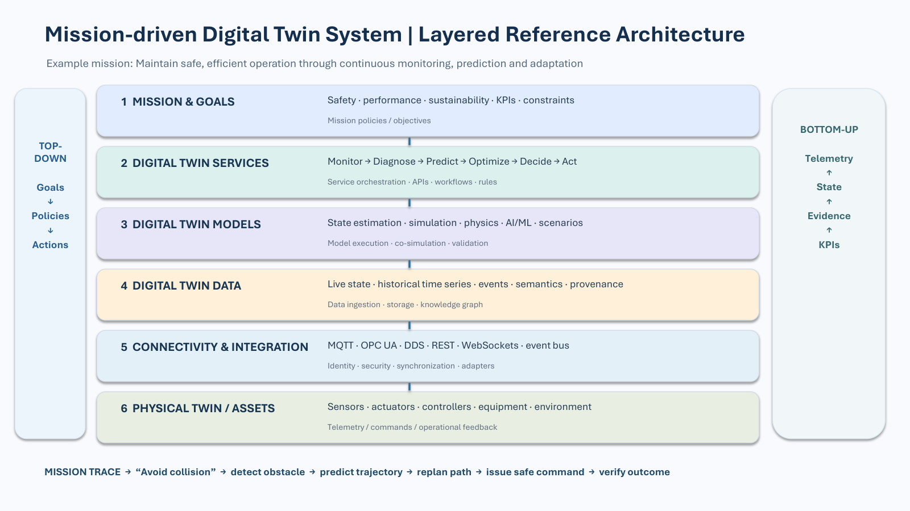

### 任务驱动的数字孪生系统 | 分层参考架构

示例任务：通过持续监控、预测和适应，确保操作的安全性与效率。

1 MISSION & GOALS

安全性 · 性能 · 可持续性 · 关键绩效指标 · 限制因素

任务政策/目标

BOTTOM-UP

TOP- DOWN

遥测

2 DIGITAL TWIN SERVICES

监控 → 诊断 → 预测 → 优化 → 决策 → 行动

↑ 州

服务编排 · 应用程序接口 · 工作流程 · 规则

目标

↓ 政策声明

↑ 证据

3 DIGITAL TWIN MODELS

状态估计 · 模拟 · 物理 · 人工智能/机器学习 · 场景

↓ 操作

↑ 关键绩效指标

模型执行 · 联合仿真 · 验证

活动状态 · 历史时间序列 · 事件 · 语义 · 溯源

4 DIGITAL TWIN DATA

数据摄取・存储・知识图谱

5 CONNECTIVITY & INTEGRATION

MQTT · OPC UA · DDS · REST · WebSockets · 事件总线

身份识别 · 安全 · 同步 · 适配器

6 PHYSICAL TWIN / ASSETS

传感器 · 执行器 · 控制器 · 设备 · 环境

遥测/命令/操作反馈

任务追踪 → “避免碰撞” → 检测障碍物 → 预测轨迹 → 重新规划路径 → 发出安全指令 → 验证结果

## 第 43 页

[对照英文原件第 43 页](../../Hackathon_ULM_2026_NO_VIDEO_1.pdf#page=43)

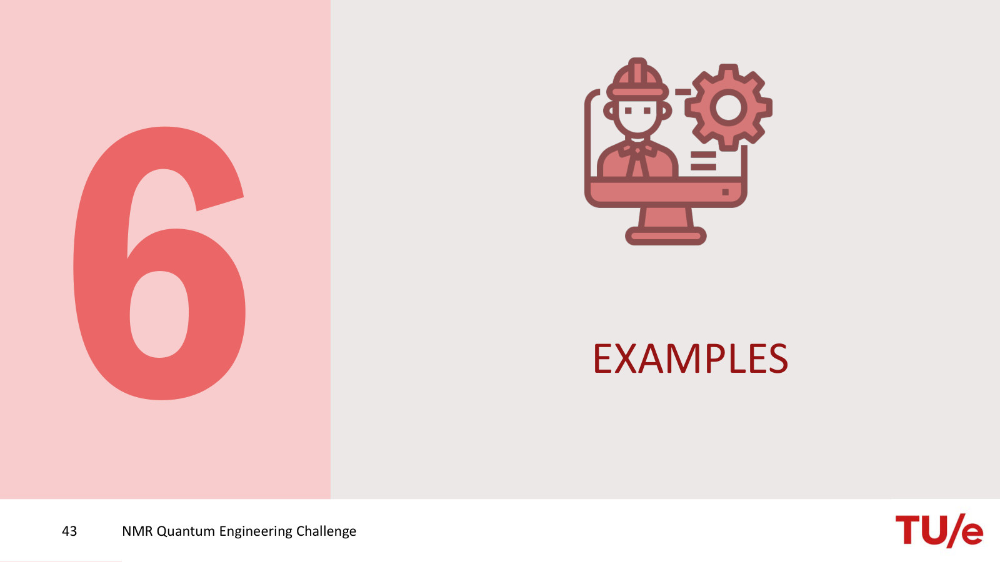

EXAMPLES

NMR 量子工程挑战赛

## 第 44 页

[对照英文原件第 44 页](../../Hackathon_ULM_2026_NO_VIDEO_1.pdf#page=44)

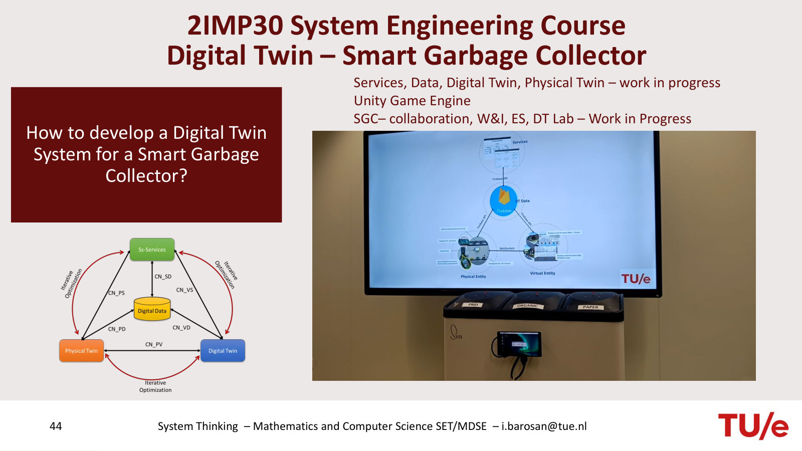

### 2IMP30 系统工程课程 数字孪生 – 智能垃圾收集器

### 服务、数据、数字孪生体、物理孪生体——正在开发中 Unity 游戏引擎 SGC——协作，W&I，ES，DT 实验室——正在开发中 如何开发数字孪生体

智能垃圾管理系统

Collector？

系统思维 – 数学与计算机科学 SET/MDSE – i.barosan@tue.nl

### 图内文字与标签

- Ss-服务
- 优化
- 迭代法
- 虚拟实体
- `CN_SD`
- 物理实体
- `CN_VS`
- `CN_PS`
- 数字数据
- `CN_PD`
- `CN_VD`
- `CN_PV`
- 孪生体
- 数字孪生

## 第 45 页

[对照英文原件第 45 页](../../Hackathon_ULM_2026_NO_VIDEO_1.pdf#page=45)

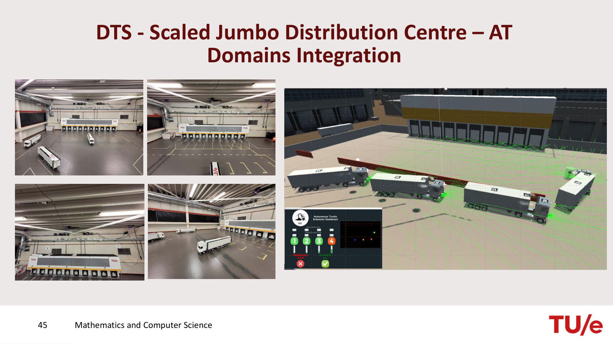

### DTS - 扩展型巨型分发中心 – 澳大利亚塔斯马尼亚

### 域集成

数学与计算机科学

## 第 46 页

[对照英文原件第 46 页](../../Hackathon_ULM_2026_NO_VIDEO_1.pdf#page=46)

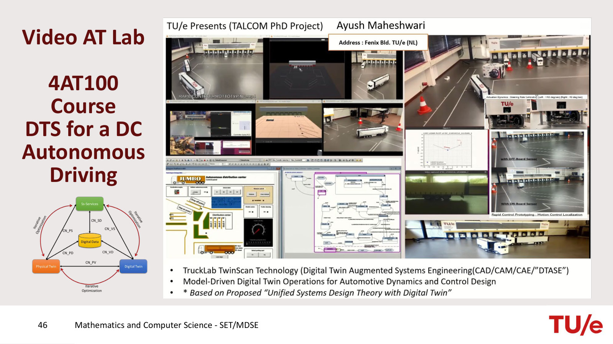

### 视频 AT 实验室

### 4AT100 直流自主系统的课程 DTS

驱动

数学与计算机科学 - SET/MDSE

### 图内文字与标签

- 图尔库理工大学展示项目（TALCOM 博士研究计划）
- Ayush Maheshwari
- 地址：Fenix 大厦，图灵大学/埃因霍温（荷兰）
- CN SD
- `CN_PS`
- `CN_VS`
- 数字数据
- `CN_PD`
- `CN_PV`
- 数字孪生
- TruckLab 孪生体技术（数字孪生增强系统工程(CAD/CAM/CAE/"DTASE")）
- 汽车动力学与控制设计的模型驱动数字孪生操作
- 优化
- 基于拟议的“带有数字孪生的统一系统设计理论”

## 第 47 页

[对照英文原件第 47 页](../../Hackathon_ULM_2026_NO_VIDEO_1.pdf#page=47)

### TU/e 与 Avular 演示画面

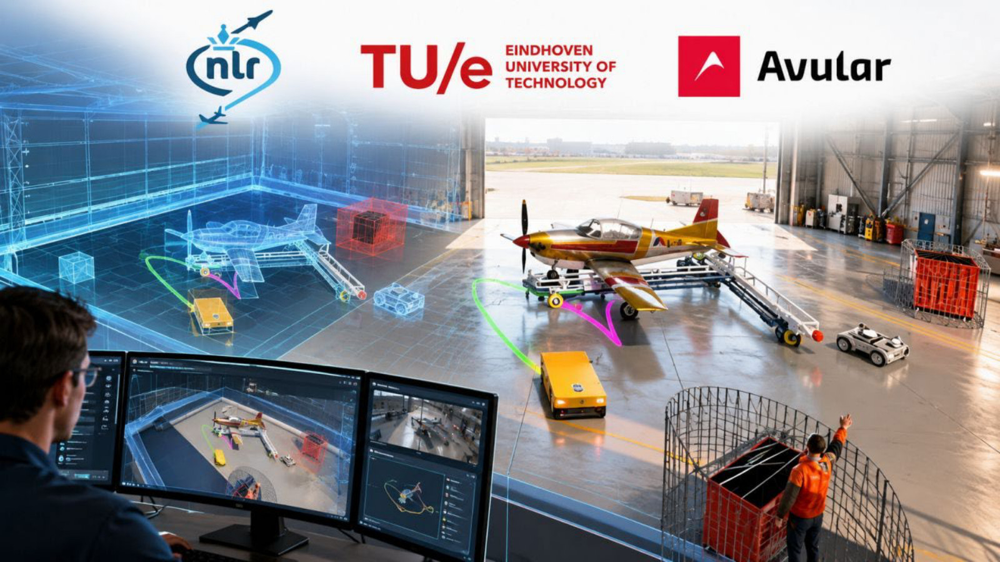

### 图内文字与标签

- 阿维拉尔
- UNIVERSITY OF
- TECHNOLOGY

## 第 48 页

[对照英文原件第 48 页](../../Hackathon_ULM_2026_NO_VIDEO_1.pdf#page=48)

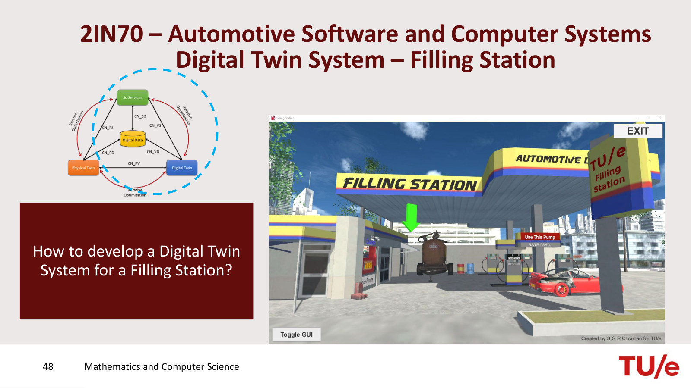

### 2IN70 – 汽车软件和计算机系统的数字孪生系统 – 加油站

如何开发数字孪生

充填站系统？

数学与计算机科学

### 图内文字与标签

- _PS
- EXIT
- `CN_VD`
- AUTOMOTIE LJU/€
- `CN_PD`
- `CN_PV`
- 填充
- 数字孪生
- FILLING STATION
- 车站
- 使用此泵
- 切换图形用户界面
- 由 S.G.R.Chouhan 为埃因霍温大学创建

## 第 49 页

[对照英文原件第 49 页](../../Hackathon_ULM_2026_NO_VIDEO_1.pdf#page=49)

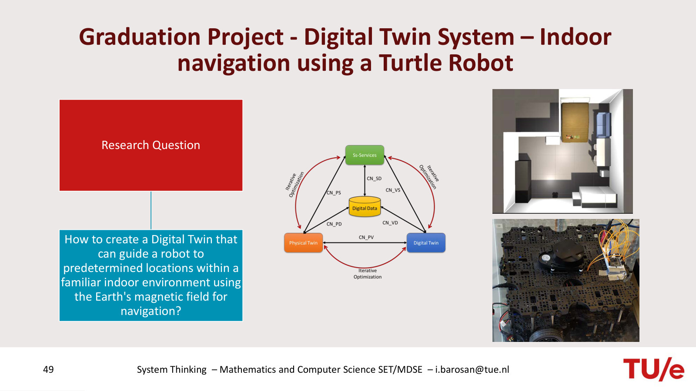

### 毕业项目 - 数字孪生系统 – 室内

### 使用海龟机器人进行导航

研究问题

如何创建数字孪生

能够使用户的机器人在熟悉的室内环境中前往预定位置

地球的磁场

导航？

系统思维 – 数学与计算机科学 SET/MDSE – i.barosan@tue.nl

### 图内文字与标签

- Ss-服务
- 优化
- 迭代法
- CN SD
- `CN_PS`
- `CN_VS`
- 数字数据
- `CN_PD`
- `CN_VD`
- `CN_PV`
- 孪生体
- 数字孪生

## 第 50 页

[对照英文原件第 50 页](../../Hackathon_ULM_2026_NO_VIDEO_1.pdf#page=50)

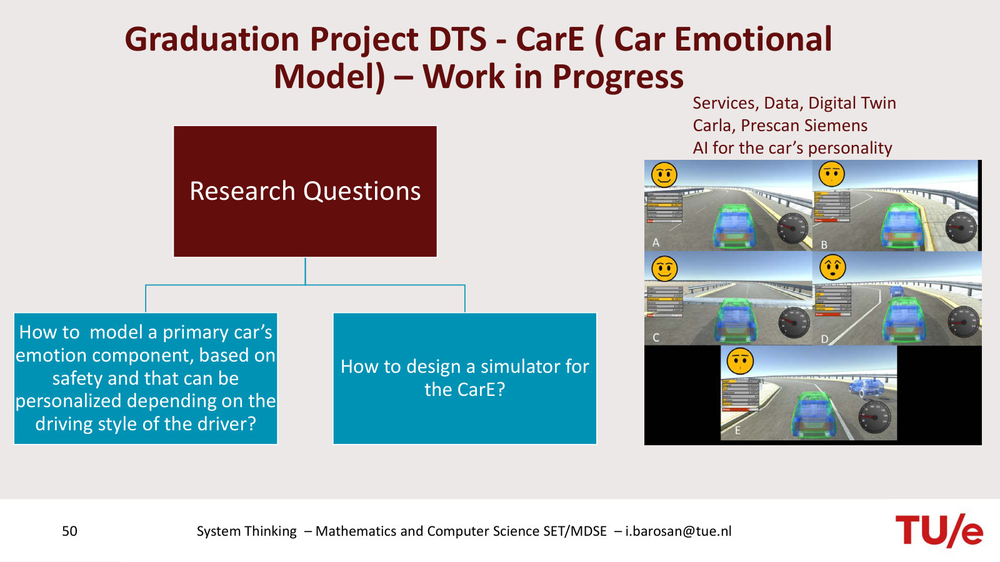

### 毕业项目 DTS - 汽车情感

### 模型）– 正在制作中

### 服务、数据、数字孪生汽车卡拉，预扫描西门子的人工智能技术，用于塑造汽车的个性。

研究问题

如何根据模型来模拟主车辆的情感成分

如何设计一个模拟器

安全性方面可以根据需要进行个性化设置。

CarE?

驾驶员的驾驶风格是什么？

系统思维 – 数学与计算机科学 SET/MDSE – i.barosan@tue.nl

[返回中文总入口](index.html)
